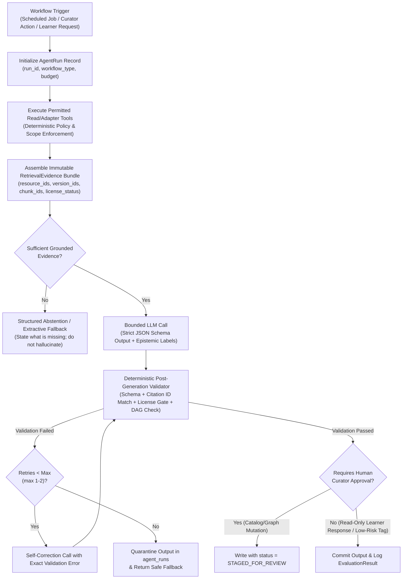

# Agent Workflows and Governance — AI Research & Learning System

**Document ID:** `ARCH-AGENT-004`  
**Status:** Proposed for Architectural Review  
**Last Updated:** 2026-10-27  
**Related ADRs:** [`0003-agent-execution-boundaries.md`](./decisions/0003-agent-execution-boundaries.md), [`0007-local-first-rag-chroma-and-multi-provider-architecture.md`](./decisions/0007-local-first-rag-chroma-and-multi-provider-architecture.md)

---

## 1. Orchestration Philosophy: Bounded Workflows Over Autonomous Services

The AI Research & Learning System defines five logical agent roles:

1. **Discovery Agent (`WF-01-DISCOVERY`)**
2. **Knowledge Curation Agent (`WF-02-CURATION`)**
3. **Research Analysis & Tutoring Agent (`WF-03-ANALYSIS`)**
4. **Learning-Path Generation Agent (`WF-04-LEARNING-PATH`)**
5. **Evaluation & Progress Assessment Agent (`WF-05-EVALUATION`)**

In the initial architecture, these roles are implemented as **deterministic, schema-validated, bounded state-machine workflows** inside `ingestion-worker` (for offline batch roles 1, 2, and batch 3/4) and `core-api` (for synchronous learner-facing roles 3, 4, and 5)—**not** as independent, continuously running autonomous microservices or open-ended multi-agent chat loops.

### 1.1 Why Bounded Workflows Are Required

- **Provenance & Epistemic Safety:** Open-ended agent loops frequently lose track of which tool output supports which sentence. Bounded workflows enforce a strict `Retrieve -> Validate Evidence -> Generate Structured Output -> Verify Citations -> Gate/Persist` pipeline.
- **Cost & Latency Predictability:** Every workflow has a hard upper bound on LLM calls (`max_llm_calls <= 3`), token budget (`max_input_tokens`, `max_output_tokens`), and wall-clock timeout.
- **Security Boundary:** Agents have **no arbitrary shell, filesystem, or unrestricted HTTP access**. Each workflow receives a fixed allow-list of read-only or schema-validated internal tools.

---

## 2. Epistemic Taxonomy & Claim Grounding Rules

Every agent workflow that emits explanations, concept notes, or research comparisons must classify every substantive statement using the system's canonical four-part epistemic taxonomy:

| Epistemic Class (`epistemic_status`) | Definition | Required Source Evidence | UI & API Rendering Rule |
| :--- | :--- | :--- | :--- |
| `ESTABLISHED_EVIDENCE` | Settled mathematical theorem, formal definition, or widely replicated empirical result (e.g., chain rule, universal approximation theorem, Boltzmann distribution properties). | At least one citation to a foundational paper (`SRC-HINTON`, `SRC-BENGIO`, `SRC-ARXIV`), textbook/course (`CSC2535`, `3B1B`), or verified `SRC-WIKIPEDIA` mathematical definition. | Rendered as core curriculum fact with inline citation link `[1]`. |
| `AUTHOR_OPINION` | Normative, philosophical, policy, governance, or speculative forecast stated by a named researcher (e.g., Bengio's speeches on AGI national security risks or Hinton's interviews on existential risk). | Direct citation to the specific blog essay, speech, or interview resource (`resource_id` + `canonical_url`), naming the speaker/author explicitly in prose (*"Yoshua Bengio argues in [2] that..."*). | Rendered with an **"Author Perspective"** badge; never presented as settled consensus. |
| `PRELIMINARY_RESEARCH` | Unrefereed preprint (`SRC-ARXIV`), recent workshop proposal, or active research hypothesis (e.g., Forward-Forward algorithm vs. backpropagation scaling, or recent GFlowNet bounds). | Direct citation to the preprint/paper (`arxiv_id`, `published_at`, `version_id`). | Rendered with a **"Preliminary / Active Research"** badge noting publication date and preprint status. |
| `GENERATED_INTERPRETATION` | Pedagogical analogy, worked small numerical example, prerequisite bridge, or synthesized comparison created by the AI workflow to aid comprehension. | Must link to the underlying `Concept` or `Resource` IDs being explained and explicitly set `is_ai_generated_paraphrase = true`. | Rendered inside a visually distinct **"AI Study Note / Synthesis"** container so the learner never mistakes it for a primary quote. |

---

## 3. End-to-End Agent Governance Pipeline

---

## 4. Detailed Specification of the Five Logical Agent Workflows

### 4.1 Role 1: Discovery Workflow (`WF-01-DISCOVERY`)

Prioritizes and classifies newly discovered candidate links (`discovered_links`) and API search results so the source inventory expands safely without unguided crawling.

| Attribute | Specification |
| :--- | :--- |
| **Execution Runtime** | Batch inside `ingestion-worker` (Cloud Run Job). |
| **Inputs** | `source_id`, unreviewed `discovered_links` records (`from_manifest_id`, `link_url`, `link_text`, `target_scope`), or bounded `SRC-ARXIV` / `SRC-WIKIPEDIA` query descriptors; current `seed_urls` manifest snapshot. |
| **Outputs** | Ranked `DiscoveryProposal` records containing `candidate_url`, `inferred_resource_type`, `recommended_priority` (`P1`, `P2`, `P3`, `SKIP`), `target_adapter` (`SRC-HINTON`, `SRC-BENGIO`, `SRC-3B1B`, `SRC-ARXIV`, `SRC-WIKIPEDIA`, or `EXTERNAL_RECORD_ONLY`), and rationale. |
| **Permitted Tools** | `read_source_manifest`, `list_discovered_links`, `check_url_scope_and_canonicalize` (pure function), `lookup_existing_resource_by_url_or_id`. **No live HTTP fetching of unapproved domains.** |
| **Source Evidence** | Anchor text (`link_text`), parent resource metadata (`from_manifest_id`), URL path structure, and extracted identifiers (`arxiv_id`, `doi`). |
| **Validation** | 1. Output must match `DiscoveryProposalSchema`. 2. Any URL failing `is_approved_site_url()` for HTML adapters is automatically forced to `EXTERNAL_RECORD_ONLY` or handed off to `SRC-ARXIV` / `SRC-WIKIPEDIA` regardless of LLM suggestion. |
| **Retry Behaviour** | Max `1` retry on JSON schema parse error; deterministic rule-based classification fallback if LLM call fails. |
| **Human Approval** | **Mandatory (`REQUIRED`)** before promoting any new HTML seed URL into active `--fetch` scope or expanding `APPROVED_HOST_PATHS`. High-confidence `arxiv_id` handoffs referenced directly on Hinton/Bengio first-party pages may be auto-queued for metadata-only `SRC-ARXIV` lookup. |
| **Failure Handling** | Leave candidate link in `decision = "candidate-not-fetched"`, log error in `agent_runs`, and continue batch. |

---

### 4.2 Role 2: Knowledge Curation Workflow (`WF-02-CURATION`)

Transforms verified `NormalizedResourceEnvelope` records into concept tags, prerequisite relationships (`Concept`, `ConceptRelation`), and pedagogical summaries.

| Attribute | Specification |
| :--- | :--- |
| **Execution Runtime** | Batch inside `ingestion-worker` triggered when a new `ResourceVersion` is created. |
| **Inputs** | `Resource` and `ResourceVersion` metadata (`title`, `authors`, `published_at`, `abstract_or_description`, `source_topic_tags`), permitted `knowledge_chunks`, and existing `concepts` taxonomy list. |
| **Outputs** | `CurationPatch`: proposed `ai_enrichment.generated_summary`, `difficulty_level`, mapped `concept_ids`, candidate new `Concept` definitions, and candidate `ConceptRelation` edges (`PREREQUISITE_OF`, `GENERALIZES`, `APPLIED_IN`). |
| **Permitted Tools** | `get_resource_version`, `search_existing_concepts`, `validate_concept_dag_acyclic` (graph cycle detector), `embed_text`. |
| **Source Evidence** | Resource title, source-provided topic headings (e.g., Hinton's `bytopics.html` sections, 3Blue1Brown topic series, arXiv subject classes, Wikipedia categories), and permitted abstract/text chunks. |
| **Validation** | 1. `generated_summary` must be `< 600` characters and explicitly marked `epistemic_status = "GENERATED_INTERPRETATION"`. 2. Adding proposed `PREREQUISITE_OF` edges must pass `validate_concept_dag_acyclic()` with zero cycles. 3. Every referenced `concept_id` must exist in `concepts` or in the same batch's `new_concepts` list. 4. Original `source_metadata` fields cannot be mutated. |
| **Retry Behaviour** | Max `2` retries: if a cycle is detected in proposed `PREREQUISITE_OF` edges, feed the exact cycle path back to the model once to remove the offending edge; otherwise drop the cyclic edge deterministically. |
| **Human Approval** | **Tiered:** - Mapping an existing `Resource` to existing `concept_ids` with confidence `>= 0.85`: auto-published with audit trail. - Creating new canonical `Concept` nodes, modifying core definitions, or altering `PREREQUISITE_OF` backbone edges: **staged for Curator approval (`STAGED_FOR_REVIEW`)**. |
| **Failure Handling** | Resource remains searchable via its primary `source_metadata` (`title`, `authors`, `source_topic_tags`); `ai_enrichment.status` is set to `"PENDING_RETRY"`. |

---

### 4.3 Role 3: Research Analysis & Source-Grounded Tutoring Workflow (`WF-03-ANALYSIS`)

Powers both offline multi-paper/author synthesis (`Claim` extraction and research comparison tables) and interactive learner Q&A in `core-api`.

| Attribute | Specification |
| :--- | :--- |
| **Execution Runtime** | Synchronous request-scoped workflow in `core-api` (for learner Q&A) or batch job in `ingestion-worker` (for precomputed topic comparisons). |
| **Inputs** | Learner question or comparison topic, optional scope filters (`source_ids`, `concept_ids`, `resource_ids`, `max_difficulty`), and learner's current mastery profile. |
| **Outputs** | `GroundedAnalysisResponse`: structured sections containing `claims[]` (each with `claim_text`, `epistemic_status`, `citation_ids[]`), `math_prerequisite_links[]` (pointing to `SRC-3B1B` / `SRC-WIKIPEDIA`), `primary_research_links[]` (`SRC-HINTON`, `SRC-BENGIO`, `SRC-ARXIV`), and `unresolved_questions_or_limitations[]`. |
| **Permitted Tools** | `hybrid_retrieve_chunks` (Firestore `find_nearest` + keyword/metadata filters), `get_resource_metadata`, `get_concept_prerequisites`, `get_transcript_segments`. **No open web search or unindexed external calls.** |
| **Source Evidence** | Immutable `RetrievalEvidence` bundle containing top-$K$ (`K <= 12`) permitted chunks/abstracts and resource metadata records retrieved from Firestore. |
| **Validation** | **Strict Deterministic Citation & Rights Gate:** 1. Every `citation_id` / `resource_id` in the generated output must be a member of the input `RetrievalEvidence` bundle. 2. Any claim referencing a blog opinion/speech (`resource_type` in `BLOG_ARTICLE`, `SPEECH`, `INTERVIEW`) must carry `epistemic_status = "AUTHOR_OPINION"`. 3. Any claim citing an unrefereed preprint without peer-reviewed venue metadata must carry `epistemic_status = "PRELIMINARY_RESEARCH"` or `"AUTHOR_OPINION"`. 4. Verbatim quotes (`quoted_span`) are blocked whenever `permits_verbatim_excerpts == false` or `legal_uncertainty_status == "UNVERIFIED_REQUIRES_HUMAN_REVIEW"` (no automatic character-length fair-use exemption); for those sources, citations must use metadata, structural/timestamp locators, and outbound `canonical_url` links only. When `permits_verbatim_excerpts == true` (verified open license or explicit permission), any `quoted_span` must match the source chunk verbatim and stay within configured UI display bounds. |
| **Retry Behaviour** | Max `1` repair retry if the deterministic citation validator finds an unanchored claim or missing `epistemic_status`. |
| **Human Approval** | Interactive learner Q&A responses are returned immediately once deterministic validation passes (logged to `agent_runs` for sampling audit). Precomputed canonical Research Comparison pages require Curator sign-off before being pinned to concept pages. |
| **Failure Handling** | If retrieval returns zero relevant evidence or validation fails after `1` retry, the workflow **must not guess**. It returns a **Structured Extractive Fallback**: displaying the closest matching cataloged resource titles, authors, canonical URLs, and abstracts with a clear notice: *"Insufficient verified source text in the local inventory to synthesize a full answer; consult these primary links directly."* |

---

### 4.4 Role 4: Learning-Path Generation Workflow (`WF-04-LEARNING-PATH`)

Constructs personalized or canonical step-by-step study sequences that bridge a learner from mathematical prerequisites (`SRC-3B1B`, `SRC-WIKIPEDIA`) to primary AI research (`SRC-HINTON`, `SRC-BENGIO`, `SRC-ARXIV`).

| Attribute | Specification |
| :--- | :--- |
| **Execution Runtime** | On-demand in `core-api` (personalized path) or batch in `ingestion-worker` (canonical curriculum templates). |
| **Inputs** | `target_concept_ids` (e.g., `["cpt_boltzmann_machine", "cpt_gflownet"]`), learner's current `users/{uid}/progress` mastery map, and available time budget. |
| **Outputs** | `LearningPath` document ordering modules topologically from foundational math concepts to advanced research papers, selecting specific verified `resource_ids`, timestamped `segment_ids`, `exercise_ids`, and optional `notebook_id` per module. |
| **Permitted Tools** | `compute_prerequisite_subgraph` (deterministic topological sort over `concepts` and `concept_relations`), `list_resources_for_concepts`, `get_learner_mastery`. |
| **Source Evidence** | Validated `Concept` DAG edges and verified `Resource` catalog records. |
| **Validation** | 1. **Topological Order Invariant:** If Concept A is a `PREREQUISITE_OF` Concept B (and the learner has not mastered A), Module A must appear strictly before Module B. 2. **Resource Existence Check:** Every `resource_id`, `segment_id`, `exercise_id`, and `notebook_id` in the path must exist and have `lifecycle_state == "ACTIVE"`. 3. **Foundation-to-Research Progression:** Every advanced module (`difficulty_tier >= 3`) must either follow or link to at least one foundational math/intuition resource (`SRC-3B1B` or `SRC-WIKIPEDIA`). |
| **Retry Behaviour** | Deterministic graph topological sort is computed in Python/TypeScript first; the LLM only selects pedagogical ordering among same-tier resources and writes module bridge notes. Max `1` retry on schema failure. |
| **Human Approval** | Canonical global learning paths (`learning_paths/*`) require Curator approval before publication. Learner-specific adaptive schedules (`users/{uid}/active_paths/*`) are generated automatically from approved concepts and resources. |
| **Failure Handling** | Fall back to the deterministic topological traversal of the concept graph with default highest-priority (`P1`) resources attached to each node. |

---

### 4.5 Role 5: Evaluation & Progress Assessment Workflow (`WF-05-EVALUATION`)

Performs two duties: (A) grading learner responses to conceptual/mathematical exercises and updating `users/{uid}/progress`, and (B) auditing agent outputs (`agent_runs`) for citation faithfulness and epistemic accuracy.

| Attribute | Specification |
| :--- | :--- |
| **Execution Runtime** | Synchronous in `core-api` (for learner exercise grading) and scheduled batch in `ingestion-worker` (for offline grounding audits). |
| **Inputs** | **Mode A (Learner Assessment):** `exercise_id`, canonical rubric & source citations, learner submission. **Mode B (System Grounding Audit):** `agent_run_id`, `RetrievalEvidence` bundle, generated output. |
| **Outputs** | **Mode A:** `AssessmentAttempt` (`score_0_to_1`, `criterion_breakdown[]`, `misconception_feedback`, `recommended_review_resource_ids[]`, updated `mastery_state`). **Mode B:** `EvaluationResult` (`citation_precision`, `citation_recall`, `epistemic_label_accuracy`, `flagged_hallucinations[]`). |
| **Permitted Tools** | `get_exercise_and_rubric`, `get_resource_chunks_by_id`, `update_learner_progress` (scoped strictly to authenticated `uid`), `write_evaluation_result`. |
| **Source Evidence** | Exercise rubric anchored to verified `Concept` definitions and `Citation` records (Mode A); exact `RetrievalEvidence` snapshot of the target `agent_run_id` (Mode B). |
| **Validation** | 1. Score must equal the weighted sum of rubric criteria (`0.0 <= score <= 1.0`). 2. Remedial resource pointers (`recommended_review_resource_ids`) must be valid active resources tied to the tested `concept_id`. 3. Learner mastery updates use a deterministic Bayesian/EMA update rule over validated scores rather than arbitrary LLM-chosen mastery states. |
| **Retry Behaviour** | Max `1` retry on schema validation failure. |
| **Human Approval** | New exercise items and rubrics require Curator approval before activation. Individual learner grading runs automatically; learners can flag any grade for curator review (`dispute_status = "FLAGGED"`). In Mode B, any `agent_run` scoring `< 0.90` on `citation_precision` automatically alerts curators and unpins any cached synthesis. |
| **Failure Handling** | Do not penalize learner mastery score on workflow/model timeout; save submission as `PENDING_GRADING` and allow immediate retry. |

---

## 5. Summary Governance Matrix

| Workflow ID | Role Name | Can Access External Network? | Can Mutate Public Knowledge Graph Directly? | Max LLM Calls / Run | Mandatory Human Approval Gate |
| :--- | :--- | :--- | :--- | :--- | :--- |
| `WF-01-DISCOVERY` | Discovery | **No** (analyzes already-extracted link table) | **No** (stages `DiscoveryProposal`) | `1` per batch | Approving new HTML seed URLs or host scopes |
| `WF-02-CURATION` | Knowledge Curation | **No** | **Staged** (`STAGED_FOR_REVIEW` for new concepts/DAG backbone) | `2` per resource | Publishing new `Concept` nodes or core DAG edges |
| `WF-03-ANALYSIS` | Research Analysis & Tutor | **No** (reads indexed Firestore `knowledge_chunks` only) | **No** (logs `agent_runs`; canonical comparisons staged) | `1` (+`1` repair) | Pinning canonical multi-author comparison articles |
| `WF-04-LEARNING-PATH` | Learning-Path Generation | **No** | **Staged** for global paths; user-scoped for personal paths | `1` (+`1` repair) | Publishing global curriculum templates |
| `WF-05-EVALUATION` | Evaluation & Assessment | **No** | **No** (updates `users/{uid}/progress` & `evaluation_results`) | `1` | Publishing new assessment rubrics; reviewing flagged runs |
