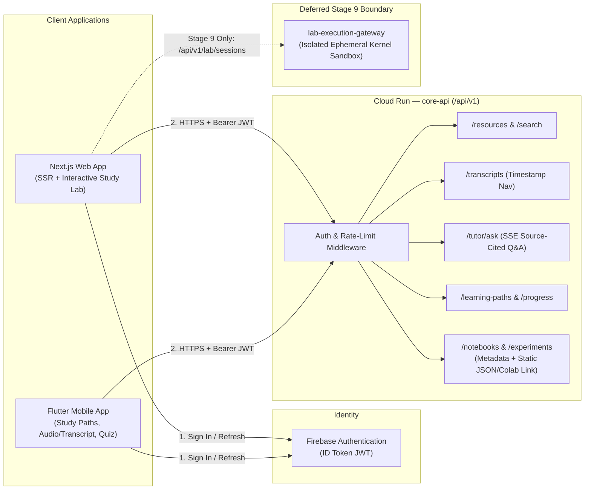
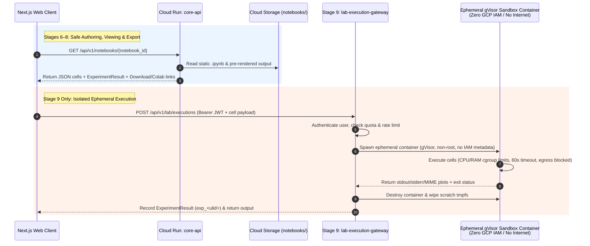

# Deliverable E — Web, Mobile, and Notebook Interfaces

| Metadata | Value |
| :--- | :--- |
| **Document ID** | `ARCH-CLIENT-005` |
| **Version** | `1.1.0` |
| **Last Updated** | `2026-10-22` |
| **Status** | `Proposed (For Architectural Review)` |
| **Companion Docs** | [`system-overview.md`](./system-overview.md), [`data-model.md`](./data-model.md), [`agent-workflows.md`](./agent-workflows.md), [`0004-notebook-isolation.md`](./decisions/0004-notebook-isolation.md) |

---

## 1. Shared Client Architecture & API Boundary Principles

The **Next.js Web Client** (target deployment on Firebase App Hosting after cloud provisioning) and the **Flutter Mobile Client** (iOS/Android) consume a single, versioned REST and Server-Sent Events (SSE) API exposed by the **Core API Service** (`core-api` on Cloud Run) under the `/api/v1` base path.

### 1.1 Architectural Invariants
1. **Single Backend Contract**: Neither client embeds business logic for concept prerequisite validation, citation verification, or AI model prompting. All write mutations and retrieval-augmented responses pass through `/api/v1/*`.
2. **Visual Separation of Provenance**: Both clients receive structured payloads that strictly separate original source metadata/quotes from AI-generated explanations (`epistemic_status` badge + inline citation anchors `[cit_...]`). Verbatim quotes (`quoted_span`) are displayed only when the source record has verified license/permission (`permits_verbatim_excerpts == true`); otherwise, the client renders bibliographic metadata, page/timestamp locators, an outbound link to `canonical_url`, and clearly labeled AI synthesis.
3. **Strict Separation of Notebook Authoring/Viewing and Code Execution (Client-Side `Pyodide` Also Deferred)**:
   - **Authoring, Cataloging, and Static Rendering (Stages 6–8)**: Handled by `core-api`. Notebooks (`.ipynb`) are parsed as JSON via `nbformat`, validated for schema and provenance links, stored in Cloud Storage (`notebooks/{notebook_id}/v{N}/notebook.ipynb`), and rendered as **static read-only cells with downloadable `.ipynb` artifacts** (and optional external Colab links). Client-side WebAssembly (`Pyodide` / `JupyterLite`) execution is **deferred** so Stages 6–8 remain focused on static notebooks and downloadable artifacts.
   - **Interactive & Arbitrary Code Execution (Stage 9 Only)**: Never runs inside `core-api` or the client process during Stages 6–8. Interactive code execution belongs exclusively to the **Stage 9 isolated lab milestone** (`lab-execution-gateway` with ephemeral sandboxed containers, resource quotas, and network egress blocks; see [Section 8](#8-separation-of-notebook-authoring-vs-isolated-execution-stage-9) and [`0004-notebook-isolation.md`](./decisions/0004-notebook-isolation.md)).



---

## 2. Authentication and User Progress

### 2.1 Authentication Flow & Endpoint Access Policy
Both Next.js (using Firebase Web SDK + HTTP-only session cookies for Server Components) and Flutter (using `firebase_auth` plugin) authenticate users via Firebase Authentication once cloud infrastructure is provisioned.
- **Public Catalog vs. Protected Endpoints vs. AI Tutor Quotas**:
  1. **Read-Only Public Catalog Access**: Read-only catalog endpoints (`GET /api/v1/resources`, `GET /api/v1/resources/{resource_id}`, `GET /api/v1/learning-paths`, `GET /api/v1/learning-paths/{path_id}`, `GET /api/v1/notebooks`, `GET /api/v1/notebooks/{notebook_id}`) may be accessed without authentication **only if and when the catalog is deliberately published** (`catalog_visibility == 'published'`). Unpublished or draft items always require authentication.
  2. **User-Specific Progress & Protected Endpoints**: All learner progress (`GET/PUT /api/v1/me/progress*`, `POST /api/v1/me/progress/sync`), personalized learning path generation (`POST /api/v1/learning-paths/generate`), assessment submission (`POST /api/v1/assessments/{assessment_id}/submit`), and curation endpoints require an authenticated user (`Authorization: Bearer <Firebase-ID-Token-JWT>`).
  3. **AI Tutor & Compute-Bearing Endpoints**: `POST /api/v1/tutor/ask` and `POST /api/v1/search` **always require an identified principal, abuse controls (Firebase App Check + IP/UID rate limiting), and strict token/request quotas**. Firebase Anonymous Auth may be enabled in `DEV` (or controlled preview testing after infrastructure exists) for low-friction evaluation, but anonymous principals are still bound to a verified UID and subject to stricter per-UID/per-IP quotas and project-wide daily spend circuit breakers—Anonymous Auth **must never** eliminate cost controls.
- **Header Contract**: Every authenticated request to `core-api` MUST include:
  ```http
  Authorization: Bearer <Firebase-ID-Token-JWT>
  X-Firebase-AppCheck: <App-Check-Token>
  X-Client-Platform: web | flutter-ios | flutter-android
  X-Client-Version: 1.0.0
  ```
- **Role Enforcement**: `core-api` verifies the token signature, expiration (`exp`), and `aud` claim via the Firebase Admin SDK and extracts `uid`, sign-in provider (`anonymous` vs. verified account), and custom `role` (`learner` | `curator` | `admin`).

### 2.2 Learner Progress Endpoints

| Method & Path | Role | Description |
| :--- | :--- | :--- |
| `GET /api/v1/me/progress` | `learner`+ | Fetches the authenticated learner's concept mastery states, active learning paths, and recent bookmarks. |
| `PUT /api/v1/me/progress/concepts/{concept_id}` | `learner`+ | Updates bookmark status, personal study notes, or last-visited timestamp for a concept. (Mastery transitions to `mastered` require passing an assessment via `POST /api/v1/assessments/{assessment_id}/submit`.) |
| `POST /api/v1/me/progress/sync` | `learner`+ | Batch synchronization endpoint for Flutter mobile offline-to-online progress queue (idempotent via client-generated `event_id` and `client_timestamp`). |

#### Example: `GET /api/v1/me/progress` Response (`200 OK`)
```json
{
  "user_id": "uid_learner_9921",
  "active_path_ids": ["path_backprop_foundations_v1"],
  "summary": {
    "concepts_mastered": 4,
    "concepts_in_progress": 2,
    "total_study_minutes": 310
  },
  "concept_states": {
    "cpt_chain_rule": {
      "status": "mastered",
      "mastery_score": 0.92,
      "last_assessed_at": "2026-10-20T14:22:00Z",
      "bookmarked_resource_ids": ["res_4b9e2c11f08a3319"]
    },
    "cpt_backpropagation": {
      "status": "in_progress",
      "mastery_score": 0.65,
      "last_assessed_at": "2026-10-21T16:05:12Z",
      "bookmarked_resource_ids": ["res_8f31a90e4c2b7104", "res_4b9e2c11f08a3319"]
    }
  }
}
```

---

## 3. Resource Search and Filtering

### 3.1 Endpoints

| Method & Path | Auth | Description |
| :--- | :--- | :--- |
| `GET /api/v1/resources` | Public (if deliberately published) / `learner`+ | Paginated catalog listing with structured filters by `source_id`, `resource_type`, `concept_id`, `difficulty_level`, and `publication_year`. |
| `GET /api/v1/resources/{resource_id}` | Public (if deliberately published) / `learner`+ | Detailed resource record including active `ResourceVersion`, license/attribution banner requirements, linked concepts, and provenance summary. |
| `POST /api/v1/search` | Identified Principal (`learner`+ with quota & abuse controls) | Hybrid semantic + metadata search over `knowledge_chunks` and `resources`, returning ranked results with provenance links and license-aware snippet handling. |

### 3.2 Filter & Search Query Contract (`POST /api/v1/search`)

#### Request Payload
```json
{
  "query": "How does backpropagation compute partial derivatives across hidden layers?",
  "filters": {
    "source_ids": ["SRC-HINTON", "SRC-3B1B", "SRC-ARXIV", "SRC-WIKIPEDIA"],
    "resource_types": ["paper", "video_lesson", "encyclopedia_article"],
    "concept_ids": ["cpt_backpropagation", "cpt_chain_rule"],
    "difficulty_levels": ["foundational", "intermediate"]
  },
  "top_k": 10,
  "include_transcript_segments": true
}
```

#### Response Payload (`200 OK`)
Note how `permits_verbatim_excerpts` governs whether a verbatim `quoted_span` is returned: for `SRC-HINTON` and `SRC-3B1B` (`permits_verbatim_excerpts: false`), `quoted_span` is `null` and the client renders bibliographic metadata, page/timestamp locators, an outbound link to `canonical_url`, and an AI-generated summary; for openly licensed resources such as `SRC-WIKIPEDIA` (`CC-BY-SA-4.0`, `permits_verbatim_excerpts: true`), a bounded quote with attribution is permitted.

```json
{
  "query_id": "qry_01J9Z8X2A0B1C2D3E4F5G6H7",
  "results": [
    {
      "chunk_id": "chk_ver_20261021_9c4e11a2_0001",
      "score": 0.894,
      "resource": {
        "resource_id": "res_8f31a90e4c2b7104",
        "source_id": "SRC-HINTON",
        "title": "Learning representations by back-propagating errors",
        "canonical_url": "https://www.cs.toronto.edu/~hinton/absps/naturebp.pdf",
        "resource_type": "paper",
        "permits_verbatim_excerpts": false,
        "legal_uncertainty_status": "UNVERIFIED_REQUIRES_HUMAN_REVIEW",
        "attribution_text": "Rumelhart, Hinton, & Williams (1986). Linked via Geoffrey Hinton's Toronto Publications."
      },
      "quoted_span": null,
      "ai_summary": "Explains how error derivatives are propagated backward from output units to hidden layers to learn internal representations.",
      "locator": {
        "type": "page",
        "page_start": 533,
        "page_end": 534
      }
    },
    {
      "chunk_id": "chk_ver_20261021_3b1b77c0_0004",
      "score": 0.871,
      "resource": {
        "resource_id": "res_4b9e2c11f08a3319",
        "source_id": "SRC-3B1B",
        "title": "What is backpropagation really doing?",
        "canonical_url": "https://www.3blue1brown.com/lessons/backpropagation",
        "resource_type": "video_lesson",
        "permits_verbatim_excerpts": false,
        "legal_uncertainty_status": "UNVERIFIED_REQUIRES_HUMAN_REVIEW",
        "attribution_text": "Grant Sanderson (3Blue1Brown). All Rights Reserved."
      },
      "quoted_span": null,
      "ai_summary": "Visualizes how weight adjustments in a layer are weighted by upstream activations and downstream error sensitivities.",
      "locator": {
        "type": "timestamp",
        "transcript_id": "tr_res_4b9e2c11f08a3319_en_v1",
        "segment_id": "seg_tr_res_4b9e2c11f08a3319_en_v1_0042",
        "start_ms": 238000,
        "end_ms": 254500,
        "deep_link_url": "https://www.youtube.com/watch?v=Ilg3gGewQ5U&t=238s"
      }
    }
  ]
}
```

---

## 4. Source-Cited Question Answering (AI Tutor)

The AI Tutor endpoint (`POST /api/v1/tutor/ask`) provides source-grounded answers with mandatory citations and explicit epistemic classification (`WF-03-ANALYSIS` / `WF-05-EVALUATION`). It requires an **identified principal, abuse controls (App Check + rate limiting), and token quotas**, and supports both standard JSON responses and Server-Sent Events (`Accept: text/event-stream`) for low-latency token streaming on Web and Flutter.

### 4.1 Request Contract (`POST /api/v1/tutor/ask`)
```json
{
  "question": "Why did Hinton and colleagues argue that perceptrons were insufficient and hidden representations were needed?",
  "scope": {
    "concept_ids": ["cpt_backpropagation", "cpt_multilayer_perceptron"],
    "allowed_source_ids": ["SRC-HINTON", "SRC-BENGIO", "SRC-3B1B", "SRC-ARXIV", "SRC-WIKIPEDIA"]
  },
  "response_mode": "pedagogical_explanation"
}
```

### 4.2 Response Contract (`200 OK`)
Every claim in `claims[]` carries an explicit `epistemic_status` and at least one verified `citation_id` resolved in `citations[]`. The client UI renders original source references in a visually distinct "Source Evidence Card" (displaying a verbatim `quoted_span` **only** when `permits_verbatim_excerpts == true`, and otherwise displaying bibliographic metadata, exact page/timestamp locators, and an outbound link to `canonical_url`) and displays epistemic badges (`ESTABLISHED_EVIDENCE`, `AUTHOR_OPINION`, `PRELIMINARY_RESEARCH`, `GENERATED_INTERPRETATION`) beside each synthesized block.

```json
{
  "agent_run_id": "run_wf03_20261021T161000Z_4d2a91",
  "answer_markdown": "Single-layer perceptrons cannot learn tasks where the input-output mapping requires intermediate internal representations that are not linearly separable in the raw input space [cit_01J9Z901]. Rumelhart, Hinton, and Williams demonstrated that error backpropagation enables hidden units to construct task-specific internal representations automatically [cit_01J9Z901]. Pedagogically, you can view each hidden layer as re-representing the input features so later layers can separate classes linearly [cit_01J9Z902, cit_01J9Z903].",
  "claims": [
    {
      "claim_id": "clm_01J9Z8Z9A1",
      "statement": "Error backpropagation enables hidden units in multilayer networks to learn internal representations not explicitly coded in the input.",
      "epistemic_status": "ESTABLISHED_EVIDENCE",
      "citation_ids": ["cit_01J9Z901"]
    },
    {
      "claim_id": "clm_01J9Z8Z9B2",
      "statement": "Viewing hidden layers as progressive coordinate transformations provides an intuitive geometric bridge from linear algebra to multilayer networks.",
      "epistemic_status": "GENERATED_INTERPRETATION",
      "citation_ids": ["cit_01J9Z902", "cit_01J9Z903"]
    }
  ],
  "citations": [
    {
      "citation_id": "cit_01J9Z901",
      "resource_id": "res_8f31a90e4c2b7104",
      "version_id": "ver_20261021_9c4e11a2",
      "source_id": "SRC-HINTON",
      "title": "Learning representations by back-propagating errors",
      "canonical_url": "https://www.cs.toronto.edu/~hinton/absps/naturebp.pdf",
      "license_spdx": "NOASSERTION",
      "permits_verbatim_excerpts": false,
      "locator": { "type": "page", "page_start": 533 },
      "quoted_span": null
    },
    {
      "citation_id": "cit_01J9Z902",
      "resource_id": "res_4b9e2c11f08a3319",
      "version_id": "ver_20261021_3b1b77c0",
      "source_id": "SRC-3B1B",
      "title": "What is backpropagation really doing?",
      "canonical_url": "https://www.3blue1brown.com/lessons/backpropagation",
      "license_spdx": "NOASSERTION",
      "permits_verbatim_excerpts": false,
      "locator": { "type": "timestamp", "start_ms": 238000, "end_ms": 254500 },
      "quoted_span": null
    },
    {
      "citation_id": "cit_01J9Z903",
      "resource_id": "res_wiki_backprop_1248991022",
      "version_id": "ver_20261021_6f10d2a9",
      "source_id": "SRC-WIKIPEDIA",
      "title": "Backpropagation",
      "canonical_url": "https://en.wikipedia.org/w/index.php?title=Backpropagation&oldid=1248991022",
      "license_spdx": "CC-BY-SA-4.0",
      "permits_verbatim_excerpts": true,
      "locator": { "type": "section", "section_heading": "Matrix multiplication" },
      "quoted_span": "Backpropagation computes the gradient in weight space of a feedforward neural network, with respect to a loss function."
    }
  ],
  "disclaimer": "AI-generated synthesis grounded in cited primary and educational sources. Inspect Source Evidence Cards for source links, locators, and licensed excerpts."
}
```

---

## 5. Learning Paths and Assessments

### 5.1 Endpoints

| Method & Path | Role | Description |
| :--- | :--- | :--- |
| `GET /api/v1/learning-paths` | Public / `learner`+ | Lists published, prerequisite-verified learning paths (`status == 'published'`). |
| `GET /api/v1/learning-paths/{path_id}` | Public / `learner`+ | Returns the ordered module sequence, concept DAG edges (`REQUIRES`, `MOTIVATES`), primary readings, and attached static notebooks. |
| `POST /api/v1/learning-paths/generate` | `learner`+ | Invokes `WF-04-LEARNING-PATH` to assemble a personalized study sequence from the learner's current mastery state to a target concept (`target_concept_id`). |
| `GET /api/v1/concepts/{concept_id}/exercises` | `learner`+ | Retrieves exercises and formative assessments grounded in the concept's canonical sources. |
| `POST /api/v1/assessments/{assessment_id}/submit` | `learner`+ | Submits a learner's answer (`WF-05-EVALUATION`), returning rubric scores, misconception diagnostics, source remediation links, and updated concept mastery. |

---

## 6. Transcript Search and Timestamp Navigation

When a resource has an authorized transcript (`Resource.transcript_status == 'available'`), both Web and Flutter clients allow learners to search inside transcripts and jump directly to the exact video/audio timestamp.

### 6.1 Endpoints

| Method & Path | Role | Description |
| :--- | :--- | :--- |
| `GET /api/v1/resources/{resource_id}/transcript` | `learner`+ | Returns transcript metadata (`transcript_id`, `language`, `acquisition_method`, `license_spdx`) and paginated timestamped segments (`segments[]`). |
| `GET /api/v1/transcripts/search` | `learner`+ | Searches across `transcript_segments` with query string `q`, optional `resource_id` or `concept_id` filter, returning matching segments with `start_ms`, `end_ms`, and `deep_link_url`. |

### 6.2 Timestamp Navigation Contract
Each `TranscriptSegment` returned by `/api/v1/resources/{resource_id}/transcript` includes timestamp bounds and deep links, and returns verbatim `text` **only** when `permits_verbatim_excerpts == true` (otherwise `text` is `null` and `topic_summary` + timestamp deep links are returned):
```json
{
  "segment_id": "seg_tr_res_4b9e2c11f08a3319_en_v1_0042",
  "sequence_index": 42,
  "start_ms": 238000,
  "end_ms": 254500,
  "speaker_label": "Grant Sanderson",
  "permits_verbatim_excerpts": false,
  "text": null,
  "topic_summary": "Weight nudge magnitude and sensitivity to upstream activation.",
  "concept_ids": ["cpt_backpropagation", "cpt_gradient_descent"],
  "navigation": {
    "canonical_lesson_url": "https://www.3blue1brown.com/lessons/backpropagation",
    "media_deep_link_url": "https://www.youtube.com/watch?v=Ilg3gGewQ5U&t=238s",
    "start_seconds": 238
  }
}
```
- **Web Client Behavior**: Clicking a transcript segment seeks the embedded official player (when embedding is permitted by the source's terms) or opens `media_deep_link_url` at `t=238s`, while highlighting active `concept_ids` in the sidebar.
- **Flutter Mobile Client Behavior**: Displays a synchronized scrolling timestamp/topic drawer with tap-to-seek (`start_ms`) and one-tap concept bookmarking.

---

## 7. Notebook Attachment and Experiment History

### 7.1 Endpoints (Stages 6–8: Authoring, Attachment & Read-Only History)

| Method & Path | Role | Description |
| :--- | :--- | :--- |
| `GET /api/v1/notebooks` | Public (if deliberately published) / `learner`+ | Lists verified `NotebookArtifact` records filterable by `concept_id`, `learning_path_id`, or `resource_id`. |
| `GET /api/v1/notebooks/{notebook_id}` | Public (if deliberately published) / `learner`+ | Returns notebook metadata, provenance links (`derived_from_resource_ids`), pre-rendered static HTML/JSON cells, downloadable `.ipynb` artifact URL, and optional external launch URL. |
| `POST /api/v1/notebooks` | `curator` / `admin` | Registers or updates a curated `.ipynb` artifact. `core-api` validates the JSON structure using `nbformat`, strips unverified execution credentials, computes `sha256_checksum`, and uploads to Cloud Storage (`notebooks/{notebook_id}/v{N}/notebook.ipynb`). |
| `GET /api/v1/notebooks/{notebook_id}/experiments` | `learner`+ | Lists recorded `ExperimentResult` runs (`exp_<ulid>`) associated with a notebook, including seed, hyperparameters, metrics, and immutable log/plot URIs. |

#### Example: `GET /api/v1/notebooks/nb_backprop_scalar_lab_v1` Response (`200 OK`)
*(Note: `gs://<unprovisioned-notebooks-bucket>/...` is a target URI template; no Cloud Storage buckets have been created yet.)*
```json
{
  "notebook_id": "nb_backprop_scalar_lab_v1",
  "version": 1,
  "title": "Lab 01: Scalar Automatic Differentiation & Backpropagation from Scratch",
  "concept_ids": ["cpt_chain_rule", "cpt_backpropagation"],
  "derived_from_resource_ids": ["res_8f31a90e4c2b7104", "res_4b9e2c11f08a3319"],
  "storage_uri": "gs://<unprovisioned-notebooks-bucket>/notebooks/nb_backprop_scalar_lab_v1/v1/notebook.ipynb",
  "sha256_checksum": "e3b0c44298fc1c149afbf4c8996fb92427ae41e4649b934ca495991b7852b855",
  "runtime_profile": {
    "python_version": "3.11",
    "packages": ["numpy==1.26.4", "matplotlib==3.8.4"],
    "requires_gpu": false
  },
  "execution_policy": {
    "in_process_api_execution": "FORBIDDEN",
    "client_side_pyodide_execution": "DEFERRED",
    "available_modes": ["static_preview", "download_ipynb"]
  },
  "latest_verified_experiment": {
    "experiment_id": "exp_01J9Z950A1B2C3D4E5F6G7H8",
    "status": "succeeded",
    "random_seed": 42,
    "metrics": { "xor_train_loss": 0.0012, "grad_check_max_rel_error": 1.4e-7 },
    "completed_at": "2026-10-21T12:00:00Z"
  }
}
```

---

## 8. Separation of Notebook Authoring vs. Isolated Execution (Stage 9)

> [!CAUTION]
> **Critical Security Boundary**: Running arbitrary Python or shell code submitted from a `.ipynb` file inside `core-api` (or any shared API container with service account access to Firestore, Cloud Storage, or secret environment variables) is a critical Remote Code Execution (RCE) and data-exfiltration vulnerability. **Arbitrary notebook code MUST NEVER execute inside `core-api`.**



### 8.1 Stage 9 Isolated Execution Controls (Detailed in [`0004-notebook-isolation.md`](./decisions/0004-notebook-isolation.md))
When interactive cloud execution is introduced in Stage 9:
1. **Dedicated Service Boundary**: Handled by a separate service (`lab-execution-gateway`) isolated from `core-api`.
2. **Ephemeral gVisor Sandbox**: Each execution runs in a single-tenant, short-lived container under Cloud Run Gen2 / gVisor syscall interception with a dedicated `nobody` user and read-only root filesystem (`tmpfs` scratch only).
3. **Zero Cloud Credentials**: The sandbox container has **no GCP service account token** (GCE metadata server access `169.254.169.254` is blocked) and **no access to Firestore or API secrets**.
4. **Controlled Network Egress**: Default-deny VPC firewall blocks all outbound internet access from the sandbox container; required scientific packages (`numpy`, `scipy`, `torch` CPU, `matplotlib`) are pre-baked into the immutable container image.
5. **Hard Resource Limits & Timeouts**: Maximum `1 vCPU`, `2 GiB RAM`, `60 seconds` per cell execution, `15 minutes` maximum session lifetime, and `10 MiB` maximum output artifact size.

---

## 9. API Versioning and Standardized Error Handling

### 9.1 Versioning Strategy
- **URI Path Versioning**: All endpoints are prefixed with `/api/v1`.
- **Non-Breaking Evolution**: Adding optional fields to responses or new endpoints under `/api/v1` is non-breaking.
- **Breaking Changes**: Any incompatible schema change requires introducing `/api/v2` and maintaining `/api/v1` with a `Sunset` and `Deprecation` HTTP header for at least 90 days so deployed Flutter mobile binaries can upgrade gracefully.

### 9.2 Error Format (RFC 9457 Problem Details for HTTP APIs)
All `4xx` and `5xx` responses from `core-api` return `application/problem+json` conforming to **RFC 9457** with a machine-readable `error_code` and `trace_id`:

```json
{
  "type": "https://api.airesearchlearning.local/errors/unverified-citation",
  "title": "Source Grounding Verification Failed",
  "status": 422,
  "detail": "The generated explanation could not be verified against an active ResourceVersion in the canonical catalog.",
  "instance": "/api/v1/tutor/ask",
  "error_code": "ERR_GROUNDING_UNVERIFIED_CITATION",
  "trace_id": "00-4bf92f3577b34da6a3ce929d0e0e4736-00f067aa0ba902b7-01",
  "retryable": true
}
```

### 9.3 Canonical Error Codes

| HTTP Status | `error_code` | Meaning & Client Handling |
| :--- | :--- | :--- |
| `400 Bad Request` | `ERR_VALIDATION_FAILED` | Malformed request query/body; inspect `invalid_params[]`. Do not retry without fixing payload. |
| `401 Unauthorized` | `ERR_AUTH_TOKEN_INVALID` | Missing or expired Firebase ID Token; refresh token via Firebase Auth SDK and retry once. |
| `403 Forbidden` | `ERR_POLICY_REDISTRIBUTION_RESTRICTED` | Requested full-text/media redistribution is blocked by source license policy (`redistribution_allowed == false`); client must link to `canonical_url`. |
| `404 Not Found` | `ERR_RESOURCE_NOT_FOUND` | Requested `resource_id`, `concept_id`, or `notebook_id` does not exist or is archived. |
| `409 Conflict` | `ERR_PREREQUISITE_CYCLE_DETECTED` | Proposed concept DAG edge would create a cycle in `concept_relations`. |
| `422 Unprocessable Entity` | `ERR_GROUNDING_UNVERIFIED_CITATION` | Agent output failed citation verification gate (`G-01`/`G-02`). |
| `429 Too Many Requests` | `ERR_RATE_LIMIT_EXCEEDED` | Per-user or per-IP quota exceeded; obey `Retry-After` response header. |
| `503 Service Unavailable` | `ERR_UPSTREAM_MODEL_UNAVAILABLE` | AI model provider temporarily unavailable; client falls back to deterministic hybrid search (`/api/v1/search`). |

---

## 10. Official References Consulted

| Topic | Official Documentation URL | Date Checked |
| :--- | :--- | :--- |
| **RFC 9457 — Problem Details for HTTP APIs** | https://www.rfc-editor.org/rfc/rfc9457.html | `2026-10-21` |
| **Next.js App Router & Server Actions / Route Handlers** | https://nextjs.org/docs/app | `2026-10-21` |
| **Flutter Networking & HTTP Best Practices** | https://docs.flutter.dev/data-and-backend/networking | `2026-10-21` |
| **Firebase Auth ID Token Verification** | https://firebase.google.com/docs/auth/admin/verify-id-tokens | `2026-10-21` |
| **Jupyter Notebook Format (`nbformat`) & Security** | https://nbformat.readthedocs.io/en/latest/ / https://jupyter-notebook.readthedocs.io/en/stable/security.html | `2026-10-21` |
| **Cloud Run Execution Environment (Gen2 / gVisor)** | https://cloud.google.com/run/docs/about-execution-environments | `2026-10-21` |
| **YouTube IFrame Player API (Timestamp Navigation)** | https://developers.google.com/youtube/iframe_api_reference | `2026-10-21` |
