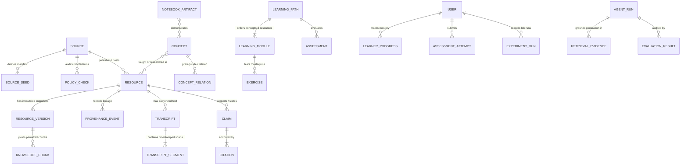

# Canonical Data Model — AI Research & Learning System

**Document ID:** `ARCH-DATA-002`  
**Status:** Proposed for Architectural Review  
**Last Updated:** 2026-10-21  
**Related ADR:** `docs/architecture/decisions/0002-knowledge-data-model.md`

---

## 1. Design Principles & Storage Partitioning

The canonical data model bridges the existing local SQLite collector schema (`collect.py`: `source_urls`, `documents`, `discovered_links`, `site_policies`, `crawl_runs`, `fetch_events`) into a cloud-ready architecture backed by **Cloud Firestore** (structured metadata, concept graph, chunk embeddings, and user state) and **Google Cloud Storage** (immutable compliance snapshots, permitted raw content, and notebook files).

### 1.1 Core Data Invariants

1. **Provenance Immutability:** Every resource, transcript segment, extracted claim, and AI-generated explanation must trace back to a specific `source_id`, `resource_id`, `version_id`, and `provenance_event_id`.
2. **Strict Separation of Source vs. Generated Content:** Fields populated directly from primary sources (`source_metadata`, `verbatim_quote`, `transcript_text`) are never overwritten by AI-generated fields (`generated_summary`, `pedagogical_notes`, `claim_interpretation`). Every AI-generated field carries a `generation_provenance` block (`agent_run_id`, `model_id`, `prompt_version`, `verified_status`).
3. **Rights-Gated Persistence:** A resource's `storage_policy.text_storage_status` defaults to `"metadata-only"`. Full text, chunks, or transcripts may only be persisted when `license_info.permits_full_text_storage == true` (e.g., CC BY, CC BY-SA, MIT, or explicit written authorization).
4. **Deterministic Identifiers for Deduplication:** Primary knowledge entities use deterministic IDs or enforced unique keys so repeated ingestion runs are idempotent.

---

## 2. Entity-Relationship Overview



---

## 3. Entity Catalog: Identifiers, Ownership, Lifecycle & Storage Mapping

| Entity | Firestore Collection Path | Deterministic ID Format | Owner Writer | Lifecycle & Mutability | Cloud Storage Offload (`gs://...`) |
| :--- | :--- | :--- | :--- | :--- | :--- |
| **Source** | `sources/{source_id}` | `SRC-<SLUG>` (e.g., `SRC-HINTON`) | `ingestion-worker` / Admin | Long-lived; updated on policy/config change | Policy snapshots in `audit/{source_id}/...` |
| **Source Seed / Manifest** | `sources/{source_id}/seeds/{manifest_id}` | `<PREFIX>-URL-<NNN>` (e.g., `HI-URL-001`) | `ingestion-worker` | Synced from seed manifest or approved discovery | None |
| **Resource** | `resources/{resource_id}` | `res_<sha256_16(canonical_key)>` | `ingestion-worker` | Head pointer to latest verified version; soft-deleted only | Permitted snapshots in `artifacts/{source_id}/{resource_id}/` |
| **Resource Version** | `resources/{resource_id}/versions/{version_id}` | `ver_<yyyymmdd>_<metadata_hash8>` | `ingestion-worker` | **Immutable** once written | Raw permitted HTML/XML/JSON in GCS |
| **Provenance Event** | `provenance_events/{event_id}` | `prov_<ulid>` | `ingestion-worker` / `core-api` | **Append-only immutable audit log** | Raw HTTP headers / robots text in `audit/` |
| **Transcript** | `transcripts/{transcript_id}` | `tr_<resource_id>_<lang>_v<N>` | `ingestion-worker` | Versioned when captions are corrected | Full `.vtt`/`.json` transcript in `artifacts/` |
| **Transcript Segment** | `transcripts/{transcript_id}/segments/{segment_id}` | `seg_<transcript_id>_<seq_0000>` | `ingestion-worker` | Immutable per transcript version | None (kept `< 2 KB` per segment in Firestore) |
| **Knowledge Chunk** | `knowledge_chunks/{chunk_id}` | `chk_<version_id>_<seq_0000>` | `ingestion-worker` | Replaced when a new `version_id` is promoted | None (contains `embedding` vector `<= 2048` dims) |
| **Concept** | `concepts/{concept_id}` | `cpt_<slug>` (e.g., `cpt_backpropagation`) | Curation workflow + Curator | Versioned (`schema_version`, `status`) | Optional diagram assets in `artifacts/concepts/` |
| **Concept Relation** | `concept_relations/{relation_id}` | `rel_<from_id>__<type>__<to_id>` | Curation workflow + Curator | Validated as DAG for `PREREQUISITE_OF` | None |
| **Claim & Citation** | `claims/{claim_id}` | `clm_<ulid>` (embeds `citations[]`) | Analysis workflow + Curator | Immutable per `agent_run_id` or curator edit | None |
| **Learning Path** | `learning_paths/{path_id}` | `path_<slug>_v<N>` | Learning-path workflow + Curator | Published versions are immutable | None |
| **Exercise & Assessment** | `exercises/{exercise_id}` | `ex_<concept_id>_<seq>` | Evaluation workflow + Curator | Versioned; rubric kept server-side | None |
| **Learner Progress** | `users/{uid}/progress/{item_id}` | `{concept_id}` or `{resource_id}` | `core-api` (authenticated `uid`) | Mutable per learner; deletable on account erasure | None |
| **Agent Run** | `agent_runs/{run_id}` | `run_<workflow>_<timestamp>_<hash6>` | `ingestion-worker` / `core-api` | **Immutable** after completion | Large prompt/response traces in `audit/agent_runs/` |
| **Retrieval Evidence** | `agent_runs/{run_id}/evidence/{evidence_id}` | `ev_<run_id>_<seq>` | `core-api` / `ingestion-worker` | **Immutable** audit record of retrieved chunks | None |
| **Evaluation Result** | `evaluation_results/{eval_id}` | `eval_<run_id>_<metric_suite>` | Evaluation workflow | **Immutable** quality & grounding score record | Full evaluation report in `audit/evals/` |
| **Notebook Artifact** | `notebooks/{notebook_id}` | `nb_<slug>_v<N>` | Curator / Authoring API | Metadata in Firestore; `.ipynb` in Cloud Storage | `notebooks/{notebook_id}/template.ipynb` |
| **Experiment Result** | `users/{uid}/experiments/{experiment_id}` | `exp_<ulid>` | Lab Gateway / `core-api` | Immutable execution record per run | Execution logs/plots in `experiments/{uid}/{exp_id}/` |

---

## 4. Detailed Schema Definitions & Representative JSON Examples

### 4.1 Sources and Source Connectors (`sources/{source_id}`)

Represents an authoritative external provider and its technical/legal ingestion rules.

```json
{
  "source_id": "SRC-HINTON",
  "display_name": "Geoffrey Hinton Official Website (University of Toronto)",
  "source_category": "RESEARCHER_FIRST_PARTY",
  "adapter_type": "HTML_CONSERVATIVE_COLLECTOR",
  "origin": "https://www.cs.toronto.edu",
  "approved_host_paths": ["/~hinton"],
  "policy": {
    "robots_url": "https://www.cs.toronto.edu/robots.txt",
    "last_robots_status": "ok",
    "last_robots_http_status": 200,
    "crawl_delay_seconds": 1.0,
    "min_enforced_delay_seconds": 1.0,
    "max_requests_per_run": 25,
    "last_policy_check_at": "2026-10-20T00:48:38Z",
    "policy_snapshot_gcs_uri": "gs://ai-research-audit-dev/policies/SRC-HINTON/2026-10-20T004838Z-robots.txt"
  },
  "default_rights": {
    "copyright_holder": "Geoffrey Hinton / respective publishers",
    "default_license_status": "ALL_RIGHTS_RESERVED_METADATA_ONLY",
    "permits_metadata_indexing": true,
    "permits_full_text_storage": false,
    "permits_media_rehosting": false,
    "attribution_template": "Geoffrey Hinton, University of Toronto ({canonical_url})"
  },
  "status": "ACTIVE",
  "created_at": "2026-10-20T00:48:38Z",
  "updated_at": "2026-10-21T15:00:00Z"
}
```

### 4.2 Canonical Resources & Versions (`resources/{resource_id}` & `versions/{version_id}`)

Unifies papers, articles, 3Blue1Brown educational lessons, videos, lectures, interviews, and talks under a single polymorphic metadata envelope while keeping source-specific attributes in `source_specific`.

```json
{
  "resource_id": "res_8f31c9a04e2b7d11",
  "source_id": "SRC-BENGIO",
  "manifest_id": "YB-URL-012",
  "canonical_url": "https://yoshuabengio.org/en/blog/generative-flow-networks",
  "external_identifiers": {
    "arxiv_id": "2106.04399",
    "doi": null,
    "wikidata_qid": null,
    "youtube_video_id": null
  },
  "resource_type": "BLOG_RESEARCH_EXPLANATION",
  "media_modality": "TEXT_HTML",
  "title": "Generative Flow Networks",
  "authors": ["Yoshua Bengio"],
  "published_at": "2022-05-14T00:00:00Z",
  "source_metadata": {
    "abstract_or_description": "An introduction to GFlowNets as a probabilistic framework for amortizing sampling proportional to a reward function.",
    "source_topic_tags": ["GFlowNets", "Reinforcement Learning", "Probabilistic Modeling"],
    "language": "en"
  },
  "ai_enrichment": {
    "generated_summary": "AI-generated pedagogical overview: This article introduces GFlowNets, bridging reinforcement learning and variational inference for structured object generation.",
    "difficulty_level": "ADVANCED_RESEARCH",
    "concept_ids": ["cpt_markov_decision_process", "cpt_energy_based_model", "cpt_gflownet"],
    "generation_provenance": {
      "agent_run_id": "run_curation_20261021T151000Z_a1b2c3",
      "model_id": "gemini-2.5-flash",
      "prompt_version": "curation-v1.0",
      "human_review_status": "APPROVED"
    }
  },
  "license_info": {
    "license_status": "FIRST_PARTY_COPYRIGHT_METADATA_ONLY",
    "license_spdx": null,
    "permits_full_text_storage": false,
    "permits_verbatim_excerpts": false,
    "permits_transcript_storage": false,
    "rights_notes": "Blog text copyright Yoshua Bengio; retain metadata and outbound arXiv links only unless explicit reuse permission is recorded."
  },
  "storage_policy": {
    "text_storage_status": "metadata-only",
    "raw_artifact_gcs_uri": null
  },
  "current_version_id": "ver_20261020_9c4e1a2b",
  "metadata_hash": "9c4e1a2b77f80912e3d4c5b6a7890123456789abcdef0123456789abcdef0123",
  "lifecycle_state": "ACTIVE",
  "first_discovered_at": "2026-10-20T00:48:38Z",
  "last_verified_at": "2026-10-20T00:48:38Z"
}
```

### 4.3 Transcripts and Timestamped Segments (`transcripts/{transcript_id}` & `segments/{segment_id}`)

Stores only transcripts whose acquisition method and license are explicitly authorized (e.g., CC-licensed captions, official open transcripts, or first-party lesson markdown from 3Blue1Brown where permitted).

```json
{
  "transcript_id": "tr_res_3b1b_backprop_en_v1",
  "resource_id": "res_3b1b_backprop_0001",
  "source_id": "SRC-3B1B",
  "language": "en",
  "acquisition_method": "OFFICIAL_CAPTION_TRACK_OR_PUBLIC_LESSON_SOURCE",
  "authorization_basis": "Official 3Blue1Brown lesson caption metadata / linked educational text; full video remains hosted at canonical source.",
  "permits_snippet_display": true,
  "max_snippet_chars": 400,
  "duration_seconds": 812,
  "segment_count": 48,
  "full_transcript_gcs_uri": null,
  "created_at": "2026-10-21T15:00:00Z"
}
```

Representative segment document (`transcripts/tr_res_3b1b_backprop_en_v1/segments/seg_tr_res_3b1b_backprop_en_v1_0012`):

```json
{
  "segment_id": "seg_tr_res_3b1b_backprop_en_v1_0012",
  "transcript_id": "tr_res_3b1b_backprop_en_v1",
  "resource_id": "res_3b1b_backprop_0001",
  "sequence_index": 12,
  "start_ms": 184000,
  "end_ms": 201500,
  "deep_link_url": "https://www.3blue1brown.com/lessons/backpropagation#t=184",
  "speaker": "Grant Sanderson",
  "segment_summary": "Explains how the chain rule decomposes the sensitivity of the cost function with respect to weights in earlier layers.",
  "verbatim_excerpt": null,
  "concept_ids": ["cpt_chain_rule", "cpt_backpropagation", "cpt_gradient_descent"],
  "chunk_id": "chk_ver_20261021_3b1b0012_0012"
}
```

### 4.4 Concepts and Prerequisite Relationships (`concepts/{concept_id}` & `concept_relations/{relation_id}`)

Forms a Directed Acyclic Graph (DAG) for `PREREQUISITE_OF` edges while supporting associative edges (`GENERALIZES`, `CONTRASTS_WITH`, `APPLIED_IN`).

```json
{
  "concept_id": "cpt_backpropagation",
  "slug": "backpropagation",
  "title": "Backpropagation and Reverse-Mode Automatic Differentiation",
  "domain_layer": "DEEP_LEARNING_FOUNDATIONS",
  "difficulty_tier": 2,
  "canonical_definition": {
    "text": "An efficient algorithm for computing gradients of a scalar loss function with respect to neural network parameters by applying the chain rule backward from outputs to inputs.",
    "primary_citations": ["cit_01JATM9K2P8X4R", "cit_01JATM9K8Z1Q2W"],
    "epistemic_status": "ESTABLISHED_EVIDENCE"
  },
  "prerequisite_concept_ids": ["cpt_chain_rule", "cpt_matrix_multiplication", "cpt_gradient_descent"],
  "foundational_resource_ids": ["res_3b1b_backprop_0001", "res_wiki_backprop_0001"],
  "primary_research_resource_ids": ["res_hinton_1986_backprop"],
  "status": "PUBLISHED",
  "updated_at": "2026-10-21T15:00:00Z"
}
```

### 4.5 Claims, Citations, and Knowledge Chunks (`claims/{claim_id}` & `knowledge_chunks/{chunk_id}`)

Every significant statement surfaced in research comparisons or concept synthesis is modeled as a structured `Claim` with explicit epistemic classification and verifiable `Citation` anchors.

```json
{
  "claim_id": "clm_01JATN1B4C9D2E3F4G5H",
  "subject_concept_ids": ["cpt_ai_safety_guardrails", "cpt_scientist_ai"],
  "claim_text": "Yoshua Bengio argues that frontier AI systems should be designed as non-agentic 'Scientist AI' predictors with formal probability bounds on harm rather than autonomous goal-seeking agents.",
  "epistemic_status": "AUTHOR_OPINION",
  "is_ai_generated_paraphrase": true,
  "stated_by_authors": ["Yoshua Bengio"],
  "citations": [
    {
      "citation_id": "cit_01JATN1B9X8Y7Z",
      "resource_id": "res_yb_cautious_scientist_ai",
      "version_id": "ver_20261020_44a1b8c2",
      "canonical_url": "https://yoshuabengio.org/en/blog/towards-cautious-scientist-ai-convergent-safety-bounds",
      "locator": {
        "type": "URL_AND_METADATA",
        "section_heading": "Towards a Cautious Scientist AI",
        "start_ms": null,
        "end_ms": null
      },
      "evidence_type": "FIRST_PARTY_BLOG_ESSAY"
    }
  ],
  "generation_provenance": {
    "agent_run_id": "run_analysis_20261021T152000Z_f9e8d7",
    "model_id": "gemini-2.5-pro",
    "verification_status": "VERIFIED_AGAINST_SOURCE_METADATA"
  }
}
```

Representative `knowledge_chunks/{chunk_id}` document for Firestore vector retrieval:

```json
{
  "chunk_id": "chk_ver_20261021_arxiv210604399_0001",
  "resource_id": "res_arxiv_2106_04399",
  "version_id": "ver_20261021_a88b99c0",
  "source_id": "SRC-ARXIV",
  "chunk_origin_type": "PERMITTED_ABSTRACT",
  "license_status": "ARXIV_NON_EXCLUSIVE_DISTRIBUTE_METADATA_ABSTRACT",
  "concept_ids": ["cpt_gflownet", "cpt_markov_decision_process"],
  "text": "Flow networks allow learning a stochastic policy that generates composite objects with probability proportional to a given reward...",
  "locator": {
    "section": "Abstract",
    "page": 1,
    "start_ms": null
  },
  "embedding_model": "text-embedding-004",
  "embedding_dimension": 768,
  "embedding": [0.0142, -0.0318, 0.0091, "... (768 float values total)"]
}
```

### 4.6 Learning Paths, Exercises, Assessments, and Learner Progress

```json
{
  "path_id": "path_foundations_to_backprop_v1",
  "title": "From Chain Rule to Backpropagation in Deep Networks",
  "target_persona": "Math-to-AI Learner",
  "modules": [
    {
      "module_index": 1,
      "concept_id": "cpt_linear_transformation",
      "primary_resource_ids": ["res_3b1b_linear_algebra_0003", "res_wiki_linear_map"],
      "exercise_ids": ["ex_cpt_linear_transformation_01"]
    },
    {
      "module_index": 2,
      "concept_id": "cpt_chain_rule",
      "primary_resource_ids": ["res_3b1b_calculus_0004", "res_wiki_chain_rule"],
      "exercise_ids": ["ex_cpt_chain_rule_01"]
    },
    {
      "module_index": 3,
      "concept_id": "cpt_backpropagation",
      "primary_resource_ids": ["res_3b1b_backprop_0001", "res_hinton_1986_backprop"],
      "exercise_ids": ["ex_cpt_backpropagation_01"],
      "notebook_id": "nb_micrograd_backprop_v1"
    }
  ],
  "assessment_id": "asmt_path_foundations_to_backprop_v1_final",
  "status": "PUBLISHED"
}
```

Learner progress document (`users/{uid}/progress/{concept_id}`):

```json
{
  "uid": "usr_firebase_uid_998877",
  "item_type": "CONCEPT",
  "item_id": "cpt_backpropagation",
  "mastery_state": "PROFICIENT",
  "mastery_score": 0.88,
  "completed_resource_ids": ["res_3b1b_backprop_0001"],
  "completed_exercise_ids": ["ex_cpt_backpropagation_01"],
  "last_reviewed_at": "2026-10-21T15:30:00Z",
  "next_review_due_at": "2026-10-28T15:30:00Z"
}
```

### 4.7 Agent Runs, Retrieval Evidence, and Evaluation Results (`agent_runs/{run_id}`)

```json
{
  "run_id": "run_tutor_20261021T153500Z_99aabb",
  "workflow_type": "SOURCE_GROUNDED_TUTOR_QA",
  "triggered_by": "uid:usr_firebase_uid_998877",
  "started_at": "2026-10-21T15:35:00Z",
  "finished_at": "2026-10-21T15:35:02Z",
  "status": "COMPLETED",
  "model_provider": "google-genai",
  "model_id": "gemini-2.5-flash",
  "prompt_template_version": "tutor-qa-v1.2",
  "token_usage": {
    "input_tokens": 1420,
    "output_tokens": 385
  },
  "retrieval_evidence_summary": {
    "query_text": "How do Hinton's Boltzmann machines relate to energy functions?",
    "retrieved_chunk_ids": [
      "chk_ver_20261020_hinton_bm_0001",
      "chk_ver_20261020_wiki_bm_0002"
    ],
    "citation_validation_passed": true
  },
  "evaluation_result_id": "eval_run_tutor_20261021T153500Z_99aabb_grounding"
}
```

### 4.8 Notebook Artifacts and Experiment Results (`notebooks/{notebook_id}`)

```json
{
  "notebook_id": "nb_micrograd_backprop_v1",
  "title": "Scalar Autograd and Two-Layer Neural Network from Scratch",
  "concept_ids": ["cpt_chain_rule", "cpt_backpropagation"],
  "source_citations": ["cit_01JATM9K2P8X4R"],
  "license_spdx": "MIT",
  "template_gcs_uri": "gs://ai-research-notebooks-prod/nb_micrograd_backprop_v1/template.ipynb",
  "template_sha256": "e3b0c44298fc1c149afbf4c8996fb92427ae41e4649b934ca495991b7852b855",
  "runtime_requirements": {
    "python_version": "3.12",
    "allowed_packages": ["numpy>=2.0", "matplotlib>=3.9"],
    "requires_gpu": false,
    "network_egress_policy": "DENY_ALL"
  },
  "execution_mode_supported": ["LOCAL_DOWNLOAD", "STAGE_9_SANDBOX_DISABLED"]
}
```

---

## 5. Firestore vs. Cloud Storage Partitioning Summary

| Data Artifact | Stored in Cloud Firestore? | Stored in Cloud Storage (GCS)? | Rationale |
| :--- | :--- | :--- | :--- |
| Source registry, seed URLs, & policy summary | **Yes** (`sources`, `seeds`) | **Yes** (raw `robots.txt` & sitemap XML in `audit/`) | Fast runtime policy lookup in Firestore; immutable legal/compliance evidence in GCS. |
| Canonical resource metadata & version descriptors | **Yes** (`resources`, `versions`) | Optional (raw API XML/JSON or CC-licensed HTML in `artifacts/`) | Keeps Firestore documents well below 1 MiB (`~2–10 KB` each) for low-latency filtering. |
| Unlicensed full-text HTML, PDFs, slides, videos | **No** | **No** | Strictly prohibited by project reuse policy; only canonical URLs and metadata are stored. |
| Authorized transcripts & segment timestamps | **Yes** (segment metadata & short permitted snippets in `transcripts/*/segments`) | **Yes** (complete `.vtt`/`.json` caption file if redistribution/storage is licensed) | Enables timestamp range and concept queries in Firestore without loading multi-megabyte files. |
| Permitted text chunks + vector embeddings | **Yes** (`knowledge_chunks` with `768`-dim vector) | **No** | Firestore native `find_nearest` requires vector fields inside Firestore documents. |
| Concept prerequisite graph (`concepts`, `concept_relations`) | **Yes** | **No** | Small document footprint (`< 5 KB`/concept); queried by ID and cached as an in-memory DAG by `core-api`. |
| Notebook `.ipynb` files & execution output plots | Metadata only (`notebooks`, `experiments`) | **Yes** (`notebooks/` and `experiments/` buckets) | `.ipynb` JSON with embedded plots easily exceeds 1 MiB and is served via signed URLs. |

---

## 6. Indexing, Deduplication, Versioning, Deletion, and Source Updates

### 6.1 Firestore Composite & Vector Indexes (`firestore.indexes.json`)

1. **`resources` Composite Indexes:**
   - `(source_id ASC, lifecycle_state ASC, published_at DESC)` — Source-filtered chronological catalog.
   - `(ai_enrichment.concept_ids ARRAY_CONTAINS, lifecycle_state ASC, published_at DESC)` — Resources teaching or researching a concept.
   - `(external_identifiers.arxiv_id ASC)` — Cross-source deduplication against arXiv preprints.
2. **`knowledge_chunks` Vector Index:**
   - Composite vector index on `(source_id ASC, embedding VECTOR<768, FLAT>)` and `(concept_ids ARRAY_CONTAINS, embedding VECTOR<768, FLAT>)` supporting `COSINE` distance queries via `find_nearest`.
3. **`transcript_segments` Composite Index:**
   - `(resource_id ASC, start_ms ASC)` — Ordered timeline playback navigation.

### 6.2 Deduplication Strategy

1. **Same-Source URL Normalization:** Uses `canonicalize_url()` (lowercased scheme/host, default port stripped, fragment removed, query preserved, same-host `<link rel="canonical">` honored) to compute deterministic `resource_id = "res_" + sha256(f"{source_id}:{canonical_url}")[:16]`.
2. **Cross-Source Work Deduplication (`work_cluster_id`):** When Geoffrey Hinton's publications page (`SRC-HINTON`) or Yoshua Bengio's site (`SRC-BENGIO`) links to a paper that also exists on `SRC-ARXIV` (matched by normalized `arxiv_id`, `doi`, or normalized `title + year + first_author`), both `Resource` records are preserved to maintain source provenance, and both share a common `work_cluster_id` (`wrk_<sha256_12>`) pointing to the canonical primary record.

### 6.3 Versioning and Source Updates

1. On each ingestion check, the collector computes `metadata_hash` (SHA-256 of canonicalized metadata fields) and, for open-access resources, `content_hash`.
2. If neither hash has changed since `current_version_id`, only `last_verified_at` and a lightweight `provenance_events` heartbeat are updated—no new `ResourceVersion` or re-embedding is triggered.
3. If `metadata_hash` or `content_hash` changes:
   - A new immutable `resources/{resource_id}/versions/{new_version_id}` document is created.
   - New `knowledge_chunks` are generated for `{new_version_id}`; once committed, `current_version_id` on `resources/{resource_id}` is atomically updated in a Firestore transaction and superseded chunks are marked `is_current = false` (and pruned after 30 days).

### 6.4 Deletion, Takedown, and Right-to-Erasure

1. **Source Policy Revocation or Takedown:** If a source changes `robots.txt` to `Disallow` or an author requests removal, `resources/{resource_id}.lifecycle_state` is set to `"WITHDRAWN_BY_POLICY"`, all associated `knowledge_chunks` and `transcript_segments` are purged immediately, and GCS snapshots in `artifacts/` are deleted while preserving a redacted compliance tombstone in `provenance_events`.
2. **Learner Account Deletion:** Deleting a user in Firebase Authentication triggers a cleanup routine that deletes `users/{uid}` and all subcollections (`progress`, `assessment_attempts`, `experiments`) plus `gs://<env>-ai-research-experiments/{uid}/*` within 24 hours.

---

## 7. Database Sufficiency Assessment & Migration Triggers

### 7.1 Why Cloud Firestore Is Sufficient for Release 1

- **Corpus Scale:** Initial sources (`SRC-HINTON`, `SRC-BENGIO`, `SRC-3B1B`, curated `SRC-ARXIV` papers, and `SRC-WIKIPEDIA` math/AI articles) comprise roughly `1,000–5,000` resources, `< 5,000` concepts, and `15,000–50,000` permitted chunks/segments.
- **Query Patterns:** Key-value lookups by `resource_id`/`concept_id`, array-contains filtering by `concept_ids`, user-scoped subcollection reads (`users/{uid}/progress`), and pre-filtered kNN vector search (`find_nearest` up to 2,048 dimensions) map natively to Firestore without requiring multi-table SQL joins.
- **Cost & Operations:** Firestore scales to zero when idle, requires no VPC NAT or connection pooling proxies on Cloud Run, and enforces fine-grained security rules.

### 7.2 Quantitative, Evidence-Based Triggers for Additional Databases

No additional database engine may be provisioned unless at least one of the following measurable triggers is reached and documented in a superseding ADR:

| Candidate Service | Trigger Condition (Measurable Evidence Required) | Migration Seam in Current Design |
| :--- | :--- | :--- |
| **Dedicated Vector Search** (Vertex AI Vector Search or Qdrant) | 1. Active `knowledge_chunks` count exceeds **100,000 vectors**, OR<br/>2. Firestore `find_nearest` p95 latency exceeds **250 ms** over a 7-day window, OR<br/>3. Hybrid retrieval requires ANN index tuning (HNSW/ScaNN recall vs. latency) unavailable in Firestore flat vector indexes. | `RetrievalRepository` interface abstracts chunk search; `chunk_id` and `resource_id` remain canonical keys. |
| **PostgreSQL** (Cloud SQL or AlloyDB with `pgvector`) | 1. Analytical or curriculum-reporting queries require **3+ relational joins** or complex aggregations that cannot be precomputed at write time, OR<br/>2. Firestore document read/write billing exceeds **$150/month** due to high-frequency scan workloads. | Canonical JSON schemas map 1:1 to normalized relational tables (`sources`, `resources`, `resource_versions`, `concepts`, `concept_relations`, `claims`). |
| **Dedicated Graph Database** (Spanner Graph or Neo4j) | 1. Concept graph exceeds **50,000 nodes** or **250,000 edges**, AND<br/>2. Dynamic multi-hop pathfinding queries (`> 4` hops) exceed **50 ms** p95 when using the in-memory cached adjacency list in `core-api`. | `ConceptGraphService` loads nodes/edges via a repository interface independent of Firestore storage internals. |
