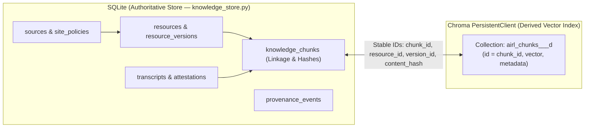

# ADR 0007 — Local-First RAG Pipeline, SQLite + Chroma Storage Split, Interchangeable Model Providers, and Learning Workflow Boundaries

| Metadata | Value |
| :--- | :--- |
| **ADR ID** | `ADR-0007` |
| **Date** | `2026-10-27` |
| **Status** | `Proposed (Implemented in Local Proof — Task 029)` |
| **Related Docs** | [`system-overview.md`](../system-overview.md), [`data-model.md`](../data-model.md), [`agent-workflows.md`](../agent-workflows.md), [`source-adapter-contract.md`](../source-adapter-contract.md), [`implementation-roadmap.md`](../implementation-roadmap.md), [`0002-knowledge-data-model.md`](0002-knowledge-data-model.md), [`0003-agent-execution-boundaries.md`](0003-agent-execution-boundaries.md), [`0006-transcript-acquisition-and-storage.md`](0006-transcript-acquisition-and-storage.md) |

---

## 1. Context and Problem Statement

Through Tasks 001–028, `ai-research-learning` established:
1. A canonical local SQLite knowledge store ([`../../../knowledge_store.py`](../../../knowledge_store.py), schema `v8`) managing `sources`, `site_policies`, `resources`, `resource_versions`, `provenance_events`, `discovered_link_candidates`, `discovered_link_reviews`, and policy-gated `transcripts` (`transcript_authorization_attestations`, `transcript_versions`, `transcript_segments`, `transcript_syntheses`).
2. Polite, rate-limited source adapters ([`../../../src/ai_research_learning/sources/`](../../../src/ai_research_learning/sources/)) for Geoffrey Hinton (`SRC-HINTON`), Yoshua Bengio (`SRC-BENGIO`), 3Blue1Brown (`SRC-3B1B`), arXiv (`SRC-ARXIV`), and English Wikipedia (`SRC-WIKIPEDIA`).
3. A read-only local HTTP Research Library API ([`../../../src/ai_research_learning/api.py`](../../../src/ai_research_learning/api.py)) supporting metadata inspection and deterministic SQL `LIKE` lexical search (`search_mode = "metadata_lexical"`).

However, existing architecture documents ([`../system-overview.md`](../system-overview.md), [`../data-model.md`](../data-model.md), [`../agent-workflows.md`](../agent-workflows.md)) described semantic vector retrieval and AI tutoring only in terms of a future, unprovisioned Google Cloud / Firestore (`find_nearest`) / Vertex AI deployment. Concrete architectural and implementation gaps prevented the local-first AI research and learning workflow:

1. **No local chunking or persistent vector index:** No mechanism existed to chunk permitted resource text, generate embeddings, persist vectors locally in Chroma while preserving authoritative SQLite linkage, or handle re-indexing, updates, and takedowns without duplicates.
2. **No interchangeable model/embedding provider abstraction:** The codebase lacked a provider interface separating `EmbeddingProvider` from `GenerationProvider` across OpenAI (GPT), Anthropic (Claude), Google Gemini, and local/deterministic providers.
3. **No source-grounded RAG flow:** No retrieval-to-generation pipeline existed to retrieve relevant chunks with provenance, enforce evidence sufficiency thresholds, validate citations, keep generated explanations separate from original source text, and provide a deterministic retrieval-only fallback when API credentials are unconfigured.
4. **Unspecified learning memory separation and candidate source expansion:** The architecture needed explicit state separation for follow-up learning conversations vs. persisted learner notes/mastery, and a policy evaluation for `https://www.deeplearning.ai/the-batch` (`SRC-THE-BATCH`) as a candidate source.

---

## 2. Decisions

### 2.1 Knowledge and Storage: Authoritative SQLite + Local Persistent Chroma (`A`)

We adopt a **hybrid local storage architecture** where SQLite remains the single source of truth and Chroma serves strictly as a derived, rebuildable semantic vector index:

1. **SQLite Authoritative Role:**
   - SQLite owns all resource identity (`resource_id`), immutable version history (`version_id`), source licensing (`sources`, `permits_full_text_storage`, `permitted_storage_scope`), transcript attestations (`transcript_authorization_attestations`), provenance logs (`provenance_events`), curation states, and chunk linkage records (`knowledge_chunks`).
   - Source documents and metadata are **never** stored solely as vectors in Chroma.
2. **Chroma Local Persistent Vector Store Evaluation (`chromadb.PersistentClient`):**
   - Chroma's embedded `PersistentClient(path=...)` persists HNSW vector indices and metadata locally on disk (default `data/runtime/chroma/`) with zero external server or cloud dependency.
   - Collections are partitioned by embedding space (`airl_chunks_<provider>_<model>_d<dim>`) so switching embedding models or dimensions never mixes incompatible vector spaces in a single index.
   - Chroma's default ONNX model download is disabled by passing precomputed embeddings directly from the configured `EmbeddingProvider` (`collection.upsert(ids=..., embeddings=..., documents=..., metadatas=...)`).
3. **Stable Bidirectional Linkage (`knowledge_chunks` <-> Chroma):**
   - Each chunk has a deterministic primary key:
     `chunk_id = "chk_" + sha256(f"{resource_id}|{version_id}|{content_origin}|{chunk_index}")[:16]`.
   - SQLite `knowledge_chunks` stores: `chunk_id` (PK), `resource_id` (FK -> `resources.resource_id`), `version_id` (FK -> `resource_versions.version_id`), `source_id` (FK -> `sources.source_id`), `transcript_id` (nullable FK -> `transcripts.transcript_id`), `transcript_version_id` (nullable FK -> `transcript_versions.transcript_version_id`), `content_origin` (`RESOURCE_FULL_TEXT`, `RESOURCE_ABSTRACT_METADATA`, `AUTHORIZED_TRANSCRIPT`), `epistemic_layer` (`PRIMARY_SOURCE_TEXT`, `AUTHORIZED_ABSTRACT_OR_DESCRIPTION`, `APPROVED_LESSON_MATERIAL`), `chunk_index`, `char_start`, `char_end`, `chunk_text`, `content_hash` (`SHA-256` of normalized `chunk_text`), `embedding_provider`, `embedding_model`, `embedding_dimensions`, `vector_collection`, `vector_id` (`== chunk_id`), `lifecycle_state` (`ACTIVE`, `SUPERSEDED`, `TOMBSTONED`), `indexed_at`, and `updated_at`.
   - Every Chroma vector record uses `id = chunk_id` and stores `resource_id`, `version_id`, `source_id`, `canonical_url`, `content_hash`, `epistemic_layer`, and `chunk_index` in Chroma metadata.
4. **Duplicate Detection, Re-Indexing, Updates, and Deletions:**
   - **Idempotent Re-Indexing & Duplicate Detection:** Re-indexing an unchanged `(resource_id, version_id)` computes the exact same deterministic `chunk_id` and `content_hash`. Existing `ACTIVE` chunks with matching `(chunk_id, content_hash, embedding_provider, embedding_model, embedding_dimensions)` are updated idempotently via `collection.upsert()` and `INSERT OR REPLACE` / `ON CONFLICT(chunk_id) DO UPDATE`, creating zero duplicate SQLite rows and zero duplicate Chroma vectors.
   - **Version Updates & Trailing Chunk Cleanup:** When a resource advances to a new `version_id` (or when updated text produces fewer chunks), any previously `ACTIVE` chunks for that `resource_id` not present in the new chunk set are marked `SUPERSEDED` in SQLite `knowledge_chunks` and removed from Chroma via `collection.delete(ids=stale_chunk_ids)`.
   - **Deletions & Rights Revocation Cascade:** When a resource or transcript is tombstoned, withdrawn, or loses storage authorization, `remove_resource_chunks(resource_id)` deletes all associated vectors from Chroma and marks the SQLite `knowledge_chunks` rows `TOMBSTONED`. Furthermore, **every retrieval query joins Chroma candidate IDs against authoritative SQLite `resources`, `transcripts`, and `knowledge_chunks` rows at read time**, immediately filtering out any non-`ACTIVE` or unauthorized record even before background vector cleanup runs.
5. **Strict Epistemic Separation (Source Material vs. Generated Summaries vs. Approved Lessons):**
   - **Source Material (`PRIMARY_SOURCE_TEXT` / `AUTHORIZED_ABSTRACT_OR_DESCRIPTION`):** Immutable original or rule-normalized text from permitted resources (`resources` / `resource_versions` / `transcript_segments`). Indexed in the primary source RAG collection.
   - **Generated Summaries & Explanations (`GENERATED_INTERPRETATION`):** Model-generated syntheses (`transcript_syntheses`, RAG answers). Stored with model/prompt lineage and `cited_chunk_ids`; **never** indexed back into the primary source vector collection to prevent hallucination feedback loops.
   - **Approved Lessons (`APPROVED_LESSON_MATERIAL`):** Structured curriculum artifacts that have passed human or deterministic grounding verification, stored with explicit links to underlying source `chunk_id`s.

---

### 2.2 Traceable Ingestion and Processing Pipeline (`B`)

The end-to-end local pipeline follows seven explicit, auditable stages:

`Approved source → collect → normalize → chunk → embed → index → retrieve`

1. **Approved Source & Policy Gate:** Sources must be registered in `sources` with `status = 'ACTIVE'` and verified `site_policies` (`robots.txt`, crawl delay, identified User-Agent). Candidate sources (`status = 'CANDIDATE_PENDING_REVIEW'`) are blocked from collection and indexing.
2. **Collect:** Polite source adapters (`ArxivAtomAdapter`, `WikipediaRestAdapter`, `ConservativeHtmlMetadataAdapter`) or authorized local transcript importers (`import_local_transcript`) record `resources`, `resource_versions`, and `provenance_events`.
3. **Rights & Storage Eligibility Gate (Pre-Chunking):**
   Before any document is normalized or chunked for vector indexing, the indexer verifies SQLite rights attributes:
   - **Full-Text Permitted (`permits_full_text_storage = 1`):** Full article/document text may be chunked (`content_origin = 'RESOURCE_FULL_TEXT'`, `epistemic_layer = 'PRIMARY_SOURCE_TEXT'`), e.g., English Wikipedia (`CC_BY_SA_4_0`) or explicitly permissive open-access papers (`CC-BY-4.0`, `CC0-1.0`).
   - **Abstract & Metadata Permitted (`permitted_storage_scope = 'ARXIV_METADATA_AND_ABSTRACT_PERMITTED'` or `permits_metadata_indexing = 1` with an open abstract):** Only the canonical title and permitted abstract/description are chunked (`content_origin = 'RESOURCE_ABSTRACT_METADATA'`, `epistemic_layer = 'AUTHORIZED_ABSTRACT_OR_DESCRIPTION'`).
   - **Authorized Transcript (`transcripts.permits_transcript_storage = 1` with `VERIFIED`, non-expired attestation):** Normalized transcript segments are chunked with timestamp locators (`content_origin = 'AUTHORIZED_TRANSCRIPT'`).
   - **Restricted / Metadata-Only (`ALL_RIGHTS_RESERVED_METADATA_ONLY` without permitted text/abstract):** Blocked from body chunking and vector indexing (`PolicyBlockedIndexingError`).
4. **Normalize & Chunk:** Deterministic Unicode NFC + whitespace normalization followed by paragraph/sentence-aware sliding-window chunking (`chunk_size_chars`, `chunk_overlap_chars`) preserving exact character offsets (`char_start`, `char_end`) and `content_hash`.
5. **Embed:** The configured `EmbeddingProvider` transforms chunk text into float vectors of fixed `dimensions`.
6. **Index:** Vectors and provenance metadata are upserted into the local persistent Chroma collection and linked in SQLite `knowledge_chunks` inside a tracked provenance operation (`KNOWLEDGE_CHUNK_INDEXED`).
7. **Retrieve:** Semantic query vectors retrieve top-$k$ candidate chunks from Chroma, which are re-verified against SQLite `knowledge_chunks` and `resources` before returning ranked `RetrievedChunk` records.

---

### 2.3 Source-Grounded RAG and Insufficient-Evidence Handling (`C`)

The local RAG service (`RAGPipeline.answer_question`) executes a five-step grounded workflow:

1. **Question Acceptance & Query Validation:** Validates non-empty `question`, `top_k` ($1 \le k \le 20$), and `min_similarity_score` threshold.
2. **Authoritative Semantic Retrieval:**
   - Generates query embedding via `EmbeddingProvider.embed_query(question)`.
   - Queries the persistent Chroma collection (`airl_chunks_*`) and joins results with SQLite `knowledge_chunks`, `resources`, and `sources`.
   - Applies both a semantic similarity threshold (`similarity_score >= min_similarity_score`) and a lexical/topical anchor check so unrelated queries on small local collections do not pass irrelevant chunks as "evidence".
3. **Insufficient-Evidence Abstention Gate:**
   - If zero chunks pass the retrieval and relevance gate, the pipeline **immediately abstains** (`status = "insufficient_evidence"`, `sufficient_evidence = False`, `generated_answer = None`), returning an explicit message that the local indexed corpus does not contain sufficient source evidence to answer the question. It never fabricates citations or falls back to ungrounded model pretraining knowledge.
4. **Grounded Generation or Deterministic Retrieval-Only Fallback:**
   - **When `GenerationProvider` is configured with credentials:** Constructs a structured prompt containing only the retrieved chunks and their `[chunk_id]` provenance headers, instructing the model to answer solely from the provided context and cite `[chunk_id]` inline.
   - **When credentials are unavailable (`retrieval_only` fallback):** Returns `status = "retrieval_only_fallback"`, `sufficient_evidence = True`, `generated_answer = None`, and the full list of `retrieved_chunks` and `citations` so the caller receives verified source excerpts and provenance without inventing a live model call.
5. **Citation Verification & Output Separation:**
   - Extracts cited `[chunk_id]` references from the model response and verifies that every cited ID belongs to the retrieved chunk set (stripping/flagging any hallucinated ID).
   - Returns a `RAGResponse` object where `retrieved_chunks` (`epistemic_layer = PRIMARY_SOURCE_TEXT` / `AUTHORIZED_ABSTRACT_OR_DESCRIPTION`) and `generated_answer` (`epistemic_status = GENERATED_INTERPRETATION`) are structurally distinct fields.

---

### 2.4 Interchangeable Model and Embedding Provider Interface (`D`)

Embedding and generation capabilities are decoupled into two minimal Python protocols in [`../../../src/ai_research_learning/rag.py`](../../../src/ai_research_learning/rag.py):

- **`EmbeddingProvider` Protocol:**
  - Properties: `provider_name: str`, `model_name: str`, `dimensions: int`
  - Methods: `embed_texts(texts: Sequence[str]) -> list[list[float]]`, `embed_query(query: str) -> list[float]`
- **`GenerationProvider` Protocol:**
  - Properties: `provider_name: str`, `model_name: str`
  - Methods: `is_configured() -> bool`, `generate_grounded_answer(prompt_input: RAGPromptInput) -> GeneratedAnswerPayload`

#### Supported Provider Matrix & Explicit Configuration (`ProviderConfig.from_env`)

| Provider Family | Role | Provider Key | Default Model & Dimensions | Environment Variable(s) Expected by `ProviderConfig.from_env` | Authentication & Notes |
| :--- | :--- | :--- | :--- | :--- | :--- |
| **Local Deterministic** | Embedding (Offline Proof / Default) | `local_deterministic` | `token-hash-bow-v1` (`128` dims) | `AI_LEARNING_EMBEDDING_PROVIDER=local_deterministic` `AI_LEARNING_EMBEDDING_MODEL=token-hash-bow-v1` `AI_LEARNING_EMBEDDING_DIMENSIONS=128` | Deterministic L2-normalized token/stem/concept hash embeddings; zero network I/O or API cost. |
| **Retrieval-Only Fallback** | Generation Fallback (Default) | `retrieval_only` | `none` | `AI_LEARNING_GENERATION_PROVIDER=retrieval_only` `AI_LEARNING_GENERATION_MODEL=none` | Explicit default when no LLM API key is configured; returns retrieved source chunks and citations without calling an external LLM. |
| **OpenAI API** | Embedding & Generation | `openai` | Embed: `text-embedding-3-small` (default `128` dims via `AI_LEARNING_EMBEDDING_DIMENSIONS`) Gen: `gpt-4o-mini` | `OPENAI_API_KEY` (Optional: `AI_LEARNING_EMBEDDING_PROVIDER=openai`, `AI_LEARNING_EMBEDDING_MODEL`, `AI_LEARNING_EMBEDDING_DIMENSIONS`, `AI_LEARNING_GENERATION_PROVIDER=openai`, `AI_LEARNING_GENERATION_MODEL`) | Authenticates via `Authorization: Bearer <OPENAI_API_KEY>`. |
| **Anthropic API** | Generation | `anthropic` | Gen: `claude-3-5-haiku-latest` | `ANTHROPIC_API_KEY` (Optional: `AI_LEARNING_GENERATION_PROVIDER=anthropic`, `AI_LEARNING_GENERATION_MODEL`) | Authenticates via `x-api-key` header. Pair `AI_LEARNING_GENERATION_PROVIDER=anthropic` with `AI_LEARNING_EMBEDDING_PROVIDER=local_deterministic`, `openai`, or `gemini`. |
| **Google Gemini Developer API** | Embedding & Generation | `gemini` | Embed: `text-embedding-004` (default `128` dims via `AI_LEARNING_EMBEDDING_DIMENSIONS`) Gen: `gemini-2.5-flash` | `GEMINI_API_KEY` (Optional: `AI_LEARNING_EMBEDDING_PROVIDER=gemini`, `AI_LEARNING_EMBEDDING_MODEL`, `AI_LEARNING_EMBEDDING_DIMENSIONS`, `AI_LEARNING_GENERATION_PROVIDER=gemini`, `AI_LEARNING_GENERATION_MODEL`) | Uses the Gemini Developer API (`generativelanguage.googleapis.com/v1beta`) with `x-goog-api-key: <GEMINI_API_KEY>`. Requires only `GEMINI_API_KEY` (does not use `GOOGLE_API_KEY`, a Google Cloud project ID, or Vertex AI credentials). |

- **Collection Configuration:** `AI_LEARNING_CHROMA_COLLECTION` sets the Chroma collection name (default: `ai_research_knowledge_chunks_v1`).

**Security & Credential Rules:**
- API keys are read solely from environment variables (`OPENAI_API_KEY`, `ANTHROPIC_API_KEY`, `GEMINI_API_KEY`) via `ProviderConfig.from_env()`, never hardcoded in source files, never written to SQLite or Chroma metadata, and redacted from `ProviderConfig.to_safe_dict()` and `repr(config)` (which expose only boolean `has_*_api_key` flags).
- No live paid API request is ever made during automated tests or default CLI dry runs without explicit configuration and opt-in.

---

### 2.5 Bounded Agentic Learning Workflows (`E`)

Future learning features are partitioned into four bounded workflow roles, each starting as a **deterministic Python pipeline with at most a single bounded `GenerationProvider` call** (no autonomous multi-agent conversation loops or heavyweight orchestration frameworks):

1. **Research Curator (`WF-CURATOR`):**
   - **Input:** Newly collected `resources`, `resource_versions`, and `knowledge_chunks`.
   - **Responsibility:** Proposes topic tags, concept mappings, prerequisite relationships, and candidate lesson groupings backed by explicit `resource_id` and `chunk_id` evidence.
   - **Boundary:** Writes only `PENDING_REVIEW` candidate proposals; never auto-approves sources, alters licensing fields, or triggers network fetches.
2. **Lesson Designer (`WF-LESSON-DESIGNER`):**
   - **Input:** Approved source chunks (`permits_full_text_storage = 1` or authorized abstracts/transcripts) and curated concept definitions.
   - **Responsibility:** Synthesizes structured lesson outlines, explanations, worked examples, and check-for-understanding exercises where every section cites its supporting `chunk_id`s.
   - **Boundary:** Output is marked `GENERATED_INTERPRETATION` (`review_status = 'PENDING_REVIEW'`) until deterministic citation verification and curator review promote it to `APPROVED_LESSON_MATERIAL`.
3. **Learning Tutor (`WF-LEARNING-TUTOR`):**
   - **Input:** Learner question or follow-up doubt, active lesson context, current session turn buffer, and retrieved `knowledge_chunks` from `RAGPipeline`.
   - **Responsibility:** Answers questions grounded strictly in retrieved lesson and primary-source chunks, quotes verbatim only when `permits_verbatim_excerpts = 1`, and explicitly states when retrieved evidence is insufficient.
   - **Boundary:** Read-only access to the knowledge store and vector index; cannot modify canonical resources or lessons.
4. **Learning Planner (`WF-LEARNING-PLANNER`):**
   - **Input:** Concept prerequisite DAG, approved lessons, and `learner_progress_records` (demonstrated mastery evidence).
   - **Responsibility:** Computes topological learning paths and recommends next lessons or remedial review modules based on prerequisite completion and quiz/exercise performance.
   - **Boundary:** Deterministic graph traversal first; optional single LLM call only for human-readable study plan rationale.

---

### 2.6 Learning Conversations and Memory Separation (`F`)

To support a learner asking follow-up questions about a lesson and exploring doubts over time without polluting the canonical knowledge base, state is separated into four distinct domains:

| Memory Domain | Persistence Scope | Storage Location | Lifecycle & Promotion Rules |
| :--- | :--- | :--- | :--- |
| **1. Current Conversation Context** | Ephemeral / Session-scoped (`session_id`) | In-memory session state or local `learning_conversation_turns` table | Tracks recent user questions, resolved coreferences, and cited `chunk_id`s within an active doubt-exploration thread. **Never** auto-promoted to permanent knowledge or indexed in Chroma. |
| **2. Persisted Learning Notes & Learner Preferences** | Explicit user-approved persistence | SQLite `learner_notes` & `learner_preferences` | Created **only** when the learner explicitly saves a note, bookmarks an explanation, or updates a study preference (e.g., math depth, notation style). Retains `source_session_id`, `cited_chunk_ids`, and `created_at` provenance. |
| **3. Learning Progress & Mastery Evidence** | Auditable learner state | SQLite `learner_progress_records` | Records lesson completion, exercise/quiz attempts, confidence scores, and concept mastery states (`NOT_STARTED`, `IN_PROGRESS`, `PRACTICED`, `MASTERED`). Updated only by deterministic assessment events. |
| **4. Retrieved Source Knowledge** | Authoritative corpus | SQLite (`resources`, `resource_versions`, `transcripts`, `knowledge_chunks`) + Chroma (`airl_chunks_*`) | Immutable/versioned research papers, encyclopedic articles, and authorized transcripts governed by source licensing. Strictly read-only during tutoring conversations. |

---

### 2.7 Candidate Source Expansion: `https://www.deeplearning.ai/the-batch` (`G`)

We evaluate `https://www.deeplearning.ai/the-batch` (`SRC-THE-BATCH`, DeepLearning.AI *The Batch* Newsletter & AI Research News) alongside the five existing canonical sources (`SRC-HINTON`, `SRC-BENGIO`, `SRC-3B1B`, `SRC-ARXIV`, `SRC-WIKIPEDIA`), keeping **technical feasibility** strictly separate from **source policy approval**:

1. **Technical & Policy Inspection (`2026-10-27`):**
   - **Robots Exclusion Policy (`https://www.deeplearning.ai/robots.txt`, HTTP `200`):**
     - `User-Agent: *` -> `Allow: /`
     - Search and user-assisted agents (`OAI-SearchBot`, `ChatGPT-User`, `Claude-SearchBot`, `Claude-User`, `PerplexityBot`, `Google-Extended`, `Applebot`) -> `Allow: /`
     - Bulk AI training/scraping crawlers (`GPTBot`, `ClaudeBot`, `CCBot`, `Bytespider`, `meta-externalagent`, `Applebot-Extended`) -> `Disallow: /`
     - Declares `Sitemap: https://www.deeplearning.ai/sitemap.xml` and `Host: https://www.deeplearning.ai`.
   - **Available Interfaces & Content Licensing:**
     - Issue and article pages under `https://www.deeplearning.ai/the-batch/` publish structured HTML `<meta>` (`og:title`, `og:description`, `article:published_time`) and JSON-LD metadata, plus sitemap discovery.
     - No public open-licensed REST API or Creative Commons (`CC-BY` / `CC0`) license is declared; content is proprietary (`© DeepLearning.AI`, All Rights Reserved).
2. **Separation of Technical Feasibility vs. Source Approval:**
   - **Technical Feasibility (`FEASIBLE_METADATA_ONLY`):** Polite HTML metadata extraction (`title`, `canonical_url`, `published_at`, short `abstract_or_description` metadata, `sitemap.xml` inspection) under `/the-batch/` is technically compatible with `ConservativeHtmlMetadataAdapter` (`min_enforced_delay_seconds = 1.0`, `max_requests_per_run = 5`).
   - **Policy & Rights Determination (`CANDIDATE_PENDING_REVIEW` — Default Closed):**
     - Because `robots.txt` explicitly disallows bulk AI corpus crawlers (`GPTBot`, `ClaudeBot`, `CCBot`) and the site is `ALL_RIGHTS_RESERVED`, **full-text storage, full-article RAG chunking/embedding, and verbatim excerpt redistribution are prohibited (`permits_full_text_storage = 0`, `permits_verbatim_excerpts = 0`, `permits_media_rehosting = 0`, `default_license_status = 'ALL_RIGHTS_RESERVED_METADATA_ONLY'`)**.
     - `SRC-THE-BATCH` is defined as an explicit **candidate source** (`status = 'CANDIDATE_PENDING_REVIEW'`, `legal_uncertainty_status = 'UNVERIFIED_REQUIRES_HUMAN_REVIEW'`). Live collection and RAG indexing remain disabled until explicit human policy review and source approval occur.

---

## 3. Consequences

### Positive
- **Local-First Verification:** The complete `Approved source → collect → normalize → chunk → embed → index → retrieve → grounded RAG` pipeline runs locally on the Raspberry Pi using SQLite + persistent Chroma with zero cloud dependencies.
- **Zero Duplicate Vectors & Strict Takedown Hygiene:** Deterministic `chunk_id`s, `content_hash` comparison, stale-version pruning, and read-time SQLite joins guarantee idempotent re-indexing and immediate takedown enforcement.
- **Provider Independence:** Switching between `local_deterministic`, `openai`, `anthropic`, and `gemini` requires only environment variable changes (`AI_LEARNING_EMBEDDING_PROVIDER`, `AI_LEARNING_EMBEDDING_MODEL`, `AI_LEARNING_EMBEDDING_DIMENSIONS`, `AI_LEARNING_GENERATION_PROVIDER`, `AI_LEARNING_GENERATION_MODEL`, `AI_LEARNING_CHROMA_COLLECTION`, and provider API keys `OPENAI_API_KEY`, `ANTHROPIC_API_KEY`, `GEMINI_API_KEY`).
