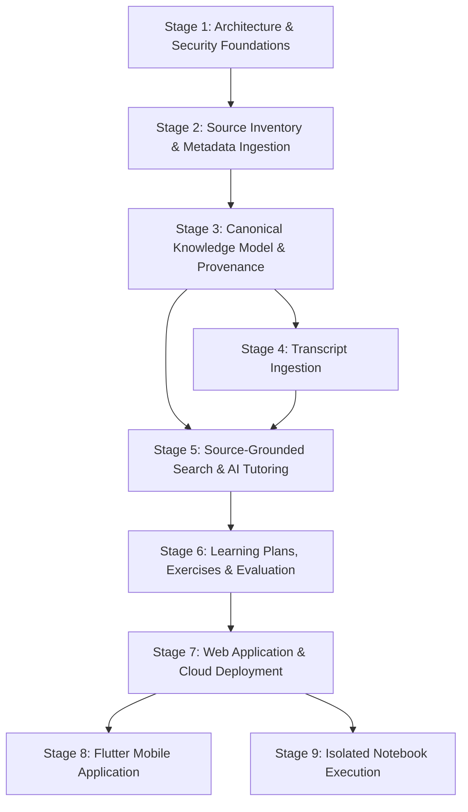

# Deliverable F — Staged Implementation Roadmap & Cloud Operations Plan

| Metadata | Value |
| :--- | :--- |
| **Document ID** | `ARCH-ROADMAP-006` |
| **Version** | `1.0.0` |
| **Last Updated** | `2026-10-21` |
| **Status** | `Proposed (For Architectural Review)` |
| **Companion Docs** | [`system-overview.md`](./system-overview.md), [`0001-cloud-architecture.md`](./decisions/0001-cloud-architecture.md), [`0002-knowledge-data-model.md`](./decisions/0002-knowledge-data-model.md), [`0003-agent-execution-boundaries.md`](./decisions/0003-agent-execution-boundaries.md), [`0004-notebook-isolation.md`](./decisions/0004-notebook-isolation.md) |

---

## 1. Staged Implementation Sequence Overview

The implementation of the AI Research & Learning System is organized into **nine sequential stages**. No stage may advance to production without passing its measurable completion checks and automated CI gates.

---

## 2. Detailed Stage Definitions (Stages 1–9)

### Stage 1 — Architecture and Security Foundations
- **Dependencies**: None (Baseline repository and CI established in Task 001).
- **Scope**:
  - Finalize and approve architectural design package (`ARCH-SYS-001` through `ARCH-ROADMAP-006` and ADRs `0001`–`0004`).
  - Define environment configuration templates (`${GCP_PROJECT_ID_DEV}`, `${GCP_PROJECT_ID_PROD}`), Firestore security rules (`firestore.rules`), Storage security rules (`storage.rules`), and least-privilege IAM service account matrices as code (without hardcoding project IDs).
  - Establish GitHub Actions workflows for linting, type checking, unit testing, and security rule validation against the local Firebase Emulator Suite.
- **Acceptance Criteria**:
  - Architecture PR reviewed and approved by the system architect.
  - Firestore and Cloud Storage security rules reject all unauthenticated client writes and reject learner writes to canonical catalog collections (`sources`, `resources`, `concepts`, `claims`, `citations`) in emulator tests.
- **Key Risks & Mitigations**:
  - *Risk*: Accidental credential leakage or hardcoded project identifiers. *Mitigation*: Enforce secret scanning and parameterized environment variables (`${GCP_PROJECT_ID}`) in CI.
- **Measurable Completion Checks**:
  - `100%` of Firestore security rule unit tests pass in offline emulator mode; zero hardcoded cloud project IDs or secrets in repository.

---

### Stage 2 — Source Inventory and Metadata Ingestion
- **Dependencies**: Stage 1.
- **Scope**:
  - Implement the `SourceAdapter` interface ([`source-adapter-contract.md`](./source-adapter-contract.md)) for the five initial sources (`SRC-HINTON`, `SRC-BENGIO`, `SRC-3B1B`, `SRC-ARXIV`, `SRC-WIKIPEDIA`).
  - Enforce RFC 9309 `robots.txt` validation, source-specific rate limiters (e.g., arXiv 3.0s spacing, single connection), conditional HTTP caching (`ETag` / `If-Modified-Since`), URL canonicalization, and `RightsAndLicensing` tagging.
  - Implement `WF-01-DISCOVERY` with fixture-based offline tests for CI and dry-run inventory validation.
- **Acceptance Criteria**:
  - All five adapters emit valid `CandidateResourceRecord` payloads passing Pydantic schema validation.
  - `redistribution_allowed` is set to `false` by default unless an explicit permissive license (`CC-BY-4.0`, `CC-BY-SA-4.0`, `CC0-1.0`) is verified.
- **Key Risks & Mitigations**:
  - *Risk*: Violating arXiv or Wikipedia API etiquette or crawling disallowed paths. *Mitigation*: Hardcoded token-bucket limiters, descriptive `User-Agent`, and mandatory `robots.txt` pre-check before any HTTP fetch.
- **Measurable Completion Checks**:
  - `100%` pass rate on offline adapter contract tests covering all 5 sources, duplicate URL normalization, HTTP `429`/`503` backoff, and robots/license enforcement.

---

### Stage 3 — Canonical Knowledge Model and Provenance
- **Dependencies**: Stage 2.
- **Scope**:
  - Implement Firestore repositories and Pydantic domain models for `Source`, `Resource`, `ResourceVersion`, `ProvenanceRecord`, `Concept`, `ConceptRelation`, `Claim`, and `Citation` ([`data-model.md`](./data-model.md)).
  - Implement `WF-02-CURATION` including SHA-256 content-hash deduplication, immutable `ResourceVersion` creation (`ver_<yyyymmdd>_<hash8>`), append-only `ProvenanceRecord` logging, and cycle-free `ConceptRelation` DAG validation.
- **Acceptance Criteria**:
  - Every `ResourceVersion` and `Concept` links to an immutable `ProvenanceRecord`.
  - Attempting to insert a prerequisite cycle (`A -> B -> A`) raises `ERR_PREREQUISITE_CYCLE_DETECTED`.
  - Soft-deletion (`status = 'retracted' | 'tombstoned'`) preserves citation history while removing chunks from active retrieval.
- **Key Risks & Mitigations**:
  - *Risk*: Orphaned citations when source documents update. *Mitigation*: Citations bind to immutable `version_id` (`ver_...`), never mutable pointers.
- **Measurable Completion Checks**:
  - `0` cycles in `concept_relations` graph; `100%` of curated resources have verifiable `ProvenanceRecord` entries and SHA-256 hashes in integration tests.

---

### Stage 4 — Transcript Ingestion
- **Dependencies**: Stage 3.
- **Scope**:
  - Implement authorized transcript acquisition workflows (`official_caption_api`, `first_party_webpage`, `curated_upload`) and schema normalization into `Transcript` (`tr_...`) and `TranscriptSegment` (`seg_...`) records with `start_ms` and `end_ms` locators.
  - Link transcript segments to `knowledge_chunks` and `concept_ids` while enforcing `redistribution_allowed` policies (e.g., snippet-only indexing + deep timestamp linking for `SRC-3B1B`).
- **Acceptance Criteria**:
  - Transcript segments accurately resolve to timestamped deep links (`start_ms`, `end_ms`).
  - Unauthorized audio/video downloading or covert scraping is blocked by policy gates (`G-03`).
- **Key Risks & Mitigations**:
  - *Risk*: Storing or redistributing full copyrighted transcripts without authorization. *Mitigation*: Policy gate verifies `acquisition_method` and `redistribution_allowed` before storage.
- **Measurable Completion Checks**:
  - `100%` of ingested `TranscriptSegment` records satisfy `0 <= start_ms < end_ms` and resolve to valid `ResourceVersion` and `ProvenanceRecord` IDs.

---

### Stage 5 — Source-Grounded Search and AI Tutoring
- **Dependencies**: Stages 3 and 4.
- **Scope**:
  - Implement the replaceable `ModelProvider` and `VectorIndex` abstractions (`768`-dimension embeddings in Firestore `knowledge_chunks` using `find_nearest`).
  - Implement hybrid search (`POST /api/v1/search`) and the source-grounded AI Tutor (`POST /api/v1/tutor/ask`) powered by `WF-03-ANALYSIS`.
  - Enforce deterministic citation verification (`G-01`), quote-span verification (`G-02`), and epistemic status tagging (`ESTABLISHED_EVIDENCE`, `AUTHOR_OPINION`, `PRELIMINARY_RESEARCH`, `GENERATED_INTERPRETATION`).
- **Acceptance Criteria**:
  - Every tutor response includes structured `claims[]` and `citations[]` pointing to active `ResourceVersion` locators.
  - Any claim with a fabricated citation ID or unverified quote is deterministically rejected (`ERR_GROUNDING_UNVERIFIED_CITATION`).
- **Key Risks & Mitigations**:
  - *Risk*: LLM hallucinating citations or conflating generated analogies with primary theorems. *Mitigation*: Post-generation deterministic verifier (`G-01`, `G-02`, `G-04`) rejects unverified claims before the response leaves `core-api`.
- **Measurable Completion Checks**:
  - `100%` citation resolution rate (`citation_precision == 1.0`) and `>= 0.90` groundedness score across the golden evaluation benchmark suite.

---

### Stage 6 — Learning Plans, Exercises, and Evaluation
- **Dependencies**: Stage 5.
- **Scope**:
  - Implement `WF-04-LEARNING-PATH` (topological prerequisite sorting from foundational mathematics to deep learning and research) and `WF-05-EVALUATION` (exercise grading, misconception diagnosis, and source-grounded remediation).
  - Implement `NotebookArtifact` (`nb_...`) and `ExperimentResult` (`exp_...`) metadata cataloging and static `.ipynb` validation (`nbformat`).
- **Acceptance Criteria**:
  - Generated learning paths satisfy topological ordering across all `REQUIRES` edges (`prerequisite_violation_count == 0`).
  - Learner assessment evaluations cite specific source passages for every remediation tip.
- **Key Risks & Mitigations**:
  - *Risk*: Prematurely advancing learners before prerequisites are mastered. *Mitigation*: Mastery state transitions require passing rubric-backed assessments in `WF-05-EVALUATION`.
- **Measurable Completion Checks**:
  - `0` topological ordering violations across test curricula; `100%` of assessment feedback items include valid remediation `citation_ids`.

---

### Stage 7 — Web Application and Cloud Deployment
- **Dependencies**: Stage 6.
- **Scope**:
  - Build the Next.js responsive web application (`Next.js App Router`) with Concept Graph Explorer, Resource & Transcript Reader (with timestamp synchronization), Source-Cited AI Tutor UI (showing distinct Source Evidence Cards and epistemic badges), and Static Notebook Viewer.
  - Configure containerized deployment of `core-api` (Cloud Run Service), `ingestion-worker` (Cloud Run Job), and Next.js frontend (Firebase App Hosting via `apphosting.yaml`) across isolated `DEV` and `PROD` environments using GitHub Actions and Workload Identity Federation (WIF).
- **Acceptance Criteria**:
  - End-to-end user journey works in `DEV` and `PROD` with Firebase Auth, rate limiting, structured logging, and budget alerts active.
  - Original source quotes and attribution banners are visually separated from AI-generated explanations on all screens.
- **Key Risks & Mitigations**:
  - *Risk*: Unexpected cloud or LLM API spend. *Mitigation*: Cloud Run `max-instances` caps, per-user token-bucket rate limits, and automated billing budget alerts at 50%/80%/100%.
- **Measurable Completion Checks**:
  - Web Core Web Vitals pass in Lighthouse audit; accessibility score `>= 90`; CI/CD deploys cleanly via WIF with zero long-lived service account keys.

---

### Stage 8 — Flutter Mobile Application
- **Dependencies**: Stage 7.
- **Scope**:
  - Build the iOS/Android Flutter client consuming `/api/v1/*` ([`client-and-lab.md`](./client-and-lab.md)).
  - Implement learning path progression, synchronized transcript reader with timestamp jump, source-cited AI tutor chat, flashcards/assessments, and offline progress queueing (`POST /api/v1/me/progress/sync`).
- **Acceptance Criteria**:
  - Feature parity on core study, transcript navigation, and assessment workflows with the web client.
  - Offline study progress and bookmarks synchronize idempotently upon reconnection.
- **Key Risks & Mitigations**:
  - *Risk*: API contract drift breaking deployed mobile binaries. *Mitigation*: Strict `/api/v1` contract tests and backwards-compatible schema evolution policy.
- **Measurable Completion Checks**:
  - `100%` of Flutter widget and integration tests pass in CI; zero API contract mismatches against the OpenAPI `/api/v1` specification.

---

### Stage 9 — Isolated Notebook Execution
- **Dependencies**: Stage 7 (can proceed in parallel with or after Stage 8).
- **Scope**:
  - Implement `lab-execution-gateway` and ephemeral gVisor-sandboxed execution containers ([`0004-notebook-isolation.md`](./decisions/0004-notebook-isolation.md)).
  - Enforce zero cloud IAM credentials inside kernels, blocked GCE metadata server access, default-deny outbound network egress, CPU/RAM cgroups (`1 vCPU`, `2 GiB RAM`), and `60s` per-cell execution timeouts.
  - Record reproducible `ExperimentResult` (`exp_<ulid>`) telemetry from sandbox runs.
- **Acceptance Criteria**:
  - Malicious test payloads attempting network egress, metadata server token theft (`169.254.169.254`), filesystem escape, or fork bombs are deterministically blocked and terminated within resource bounds.
- **Key Risks & Mitigations**:
  - *Risk*: Container escape or crypto-mining abuse. *Mitigation*: Strict authentication + verified-email gate, strict per-user daily execution quota, gVisor sandbox isolation, and zero outbound network access.
- **Measurable Completion Checks**:
  - `100%` of adversarial security red-team tests (metadata access, egress attempt, memory exhaustion, infinite loop) blocked and verified before enabling Stage 9 in `PROD`.

---

## 3. Cloud Environment, Identity, CI/CD, Monitoring, Quotas, and Cost Controls

### 3.1 DEV and PROD Cloud Project Separation
No cloud project IDs are hardcoded in source files. All deployment manifests parameterize the project via `${GCP_PROJECT_ID}`:
- **`DEV` Project (`${GCP_PROJECT_ID_DEV}`)**: Used for integration testing, staging previews on pull requests, and dry-run ingestion of small resource batches. Uses lower quotas and stricter instance caps (`max-instances = 2`).
- **`PROD` Project (`${GCP_PROJECT_ID_PROD}`)**: Used exclusively for serving verified canonical knowledge to learners. Deployed only from tagged releases or merges to `main` after CI verification and human approval gates.

### 3.2 Identity Boundaries & Least-Privilege IAM

| Identity / Principal | Target Environment | Permitted Roles / Permissions | Explicit Denials |
| :--- | :--- | :--- | :--- |
| `sa-github-deployer` (via Workload Identity Federation) | `DEV` / `PROD` | `roles/run.admin`, `roles/firebaseapphosting.admin`, `roles/artifactregistry.writer`, `roles/iam.serviceAccountUser` (scoped to runtime SAs) | No static JSON keys; branch-restricted to `main` for `PROD`. |
| `sa-core-api` | Cloud Run `core-api` | `roles/datastore.user` (Firestore), `roles/storage.objectViewer` (`artifacts/`, `notebooks/`), `roles/storage.objectCreator` (`experiments/`), `roles/aiplatform.user` | Cannot write to `audit/` bucket prefix; cannot invoke Cloud Run Admin APIs. |
| `sa-ingestion-worker` | Cloud Run Job `ingestion-worker` | `roles/datastore.user`, `roles/storage.objectCreator` (`audit/`, `artifacts/`), `roles/aiplatform.user` | No public ingress URL; triggered only by Cloud Scheduler or `admin` workflow. |
| `sa-lab-sandbox` (Stage 9) | Ephemeral Sandbox | **None** (`0` GCP IAM permissions; metadata server blocked) | No access to Firestore, GCS, Vertex AI, or internal VPC services. |

### 3.3 CI/CD Pipeline Architecture (GitHub Actions + Firebase App Hosting)
1. **Pull Request Gate (`.github/workflows/ci.yml`)**:
   - Runs offline Python unit tests (`python3 -m unittest discover -s tests -v`), bytecode compilation checks, schema contract tests, and security rule tests.
   - Zero live external scraping or cloud mutations during PR checks.
2. **Staging Deployment (`DEV`)**:
   - Authenticates to `${GCP_PROJECT_ID_DEV}` via OIDC Workload Identity Federation (`google-github-actions/auth`).
   - Builds and deploys `core-api` and `ingestion-worker` images, and triggers Firebase App Hosting preview rollout.
3. **Production Promotion (`PROD`)**:
   - Requires protected GitHub Environment approval (`production`), green staging smoke tests, and verified provenance audit checks before rolling out to `${GCP_PROJECT_ID_PROD}`.

### 3.4 Monitoring, Quotas, and Cost Controls

| Control Layer | Configuration (`DEV`) | Configuration (`PROD`) | Purpose |
| :--- | :--- | :--- | :--- |
| **Cloud Run Scaling** | `min-instances: 0`, `max-instances: 2` | `min-instances: 0`, `max-instances: 10` | Scale-to-zero idle cost; hard ceiling against traffic spikes. |
| **API Rate Limiting** | `30 req/min` (Search), `5 req/min` (Tutor) per UID | `60 req/min` (Search), `15 req/min` (Tutor) per UID | Prevents automated scraping and bounds LLM token spend. |
| **LLM Daily Token Quota** | `100,000` tokens/day project cap | `2,000,000` tokens/day project cap + per-UID cap | Hard circuit breaker (`503 ERR_UPSTREAM_MODEL_UNAVAILABLE`) if daily token budget is exhausted; falls back to deterministic search. |
| **Cloud Storage Lifecycle** | Delete temporary staging files after `7 days` | Transition `audit/` raw snapshots to Nearline after `30 days` and Coldline after `90 days` | Minimizes long-term storage cost while preserving provenance. |
| **Cloud Billing Budgets** | Alert thresholds at `50%`, `80%`, `100%` of monthly DEV budget | Alert thresholds at `50%`, `80%`, `100%` of monthly PROD budget | Pub/Sub notification + email alert to project administrators. |
| **Observability Alerts** | Log-based errors in Cloud Logging | P1 alert on `citation_verification_failures_total > 0` or `5xx > 2%` over 5 min | Immediate visibility into grounding regressions or service outages. |

---

## 4. Official References Consulted

| Topic | Official Documentation URL | Date Checked |
| :--- | :--- | :--- |
| **GitHub Actions Workload Identity Federation with GCP** | https://github.com/google-github-actions/auth | `2026-10-21` |
| **Cloud Run Max Instances & Cost Controls** | https://cloud.google.com/run/docs/configuring/max-instances | `2026-10-21` |
| **Firebase Emulator Suite for CI Testing** | https://firebase.google.com/docs/emulator-suite | `2026-10-21` |
| **Cloud Billing Budgets & Cost Alerting** | https://cloud.google.com/billing/docs/how-to/budgets | `2026-10-21` |
