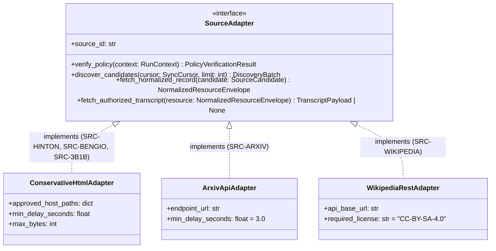
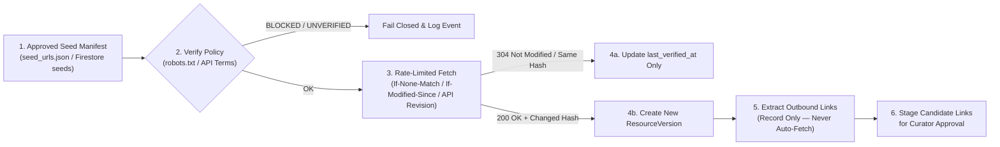

# Source Adapter Contract — AI Research & Learning System

**Document ID:** `ARCH-ADAPTER-003`  
**Status:** Proposed for Architectural Review  
**Last Updated:** 2026-10-25  
**Baseline Implementation Reference:** `collect.py` (`ConservativeCollector`), `src/ai_research_learning/sources/`  
**Related Decisions:** [ADR-0005 (`0005-arxiv-api-access-policy.md`)](decisions/0005-arxiv-api-access-policy.md), [ADR-0006 (`0006-transcript-acquisition-and-storage.md`)](decisions/0006-transcript-acquisition-and-storage.md)  
**Companion Docs:** [`transcript-ingestion.md`](./transcript-ingestion.md) (`ARCH-TRANSCRIPT-007`)

---

## 1. Purpose and Core Legal/Technical Principle

The **Source Adapter Contract** defines a uniform programmatic interface and compliance boundary for all knowledge connectors in the AI Research & Learning System:

1. **Geoffrey Hinton (`SRC-HINTON`)** — First-party academic website (`https://www.cs.toronto.edu/~hinton/`)
2. **Yoshua Bengio (`SRC-BENGIO`)** — First-party academic & blog website (`https://yoshuabengio.org/en`)
3. **3Blue1Brown (`SRC-3B1B`)** — Educational mathematics & AI website (`https://www.3blue1brown.com/`)
4. **arXiv (`SRC-ARXIV`)** — Open-access research archive API (`https://export.arxiv.org/api/query`)
5. **Wikipedia (`SRC-WIKIPEDIA`)** — Wikimedia REST & Action APIs (`https://en.wikipedia.org/w/rest.php/v1/`)

> [!IMPORTANT]
> **Public Visibility != Redistribution License (And No Automated "Fair Use" Assumption):**  
> 1. The fact that a web page, PDF paper, slide deck, video lecture, or transcript is publicly reachable on the internet—or permitted to be crawled by `robots.txt`—does **not** grant a license to copy, archive in full, or redistribute that content to users.
> 2. **No Automatic Character-Count Fair-Use Rule:** An arbitrary character threshold (such as a 300-character snippet limit) does **not** automatically make copying or displaying verbatim quotations lawful under copyright or fair-use/fair-dealing doctrines. Software cannot adjudicate context-dependent legal questions automatically.
> 3. Every adapter must evaluate **access policy** (`robots.txt` / API Terms of Use) and **content reuse rights** (copyright / SPDX license / explicit permission) as two independent gates. When reuse rights are unverified, ambiguous, or all-rights-reserved, the adapter must default to **not redistributing full text, verbatim excerpts, or media** (`METADATA_ONLY`) and record the legal uncertainty explicitly for human review.

---

## 2. Common Source Adapter Interface

All source connectors implement the `SourceAdapter` protocol in Python (`ingestion-worker`), ensuring uniform policy verification, rate limiting, deduplication, and provenance logging.



### 2.1 Python Protocol Definition

```python
from dataclasses import dataclass, field
from typing import Any, Literal, Protocol

PolicyStatus = Literal["OK", "BLOCKED", "UNVERIFIED"]
StorageScope = Literal["METADATA_ONLY", "METADATA_AND_ABSTRACT", "METADATA_AND_PERMITTED_TEXT"]

@dataclass(frozen=True)
class PolicyVerificationResult:
    source_id: str
    origin: str
    policy_endpoint_url: str
    status: PolicyStatus
    http_status: int | None
    effective_delay_seconds: float
    sitemap_urls: list[str]
    evidence_summary: str
    raw_snapshot_gcs_uri: str | None
    checked_at_utc: str

@dataclass(frozen=True)
class DiscoveredLinkCandidate:
    from_canonical_url: str
    target_canonical_url: str
    link_text: str | None
    rel: str | None
    target_scope: Literal["FIRST_PARTY_IN_SCOPE", "SAME_HOST_OUT_OF_SCOPE", "EXTERNAL_KNOWN_SOURCE", "EXTERNAL_UNMAPPED"]
    recommended_decision: Literal["CANDIDATE_NOT_FETCHED", "HANDOFF_TO_SOURCE_ADAPTER", "RECORD_ONLY_REVIEW"]

@dataclass(frozen=True)
class NormalizedResourceEnvelope:
    source_id: str
    resource_id: str
    manifest_id: str | None
    canonical_url: str
    fetched_url: str
    resource_type: str
    media_modality: Literal["TEXT_HTML", "API_ATOM_XML", "API_JSON", "VIDEO_LESSON", "PDF_REFERENCE_ONLY"]
    title: str
    authors: list[str]
    published_at: str | None
    updated_at_source: str | None
    abstract_or_description: str | None
    topic_tags: list[str]
    external_identifiers: dict[str, str | None]  # doi, arxiv_id, wikidata_qid, youtube_video_id
    source_specific: dict[str, Any]
    license_status: str
    license_spdx: str | None
    permitted_storage_scope: StorageScope
    permits_verbatim_excerpts: bool = False
    legal_uncertainty_status: Literal["VERIFIED_OPEN_LICENSE", "VERIFIED_TERMS_PERMITTED", "ALL_RIGHTS_RESERVED_METADATA_ONLY", "UNVERIFIED_REQUIRES_HUMAN_REVIEW"] = "UNVERIFIED_REQUIRES_HUMAN_REVIEW"
    attribution_text: str = ""
    permitted_body_chunks: list[dict[str, Any]] = field(default_factory=list)
    discovered_links: list[DiscoveredLinkCandidate] = field(default_factory=list)
    metadata_hash: str = ""
    content_hash: str | None = None
    fetched_at_utc: str = ""

class SourceAdapter(Protocol):
    source_id: str

    def verify_policy(self) -> PolicyVerificationResult:
        """Must run before any content fetch. If status != 'OK', caller must abort."""
        ...

    def discover_candidates(self, cursor: str | None, batch_limit: int) -> list[dict[str, Any]]:
        """Return bounded candidate URLs or API identifiers without fetching full items."""
        ...

    def fetch_normalized_record(self, candidate: dict[str, Any]) -> NormalizedResourceEnvelope:
        """Fetch a single resource respecting rate limits, byte caps, and license rules."""
        ...
```

---

## 3. Source-by-Source Specification Matrix

| Attribute | `SRC-HINTON` (Geoffrey Hinton) | `SRC-BENGIO` (Yoshua Bengio) | `SRC-3B1B` (3Blue1Brown) | `SRC-ARXIV` (arXiv API) | `SRC-WIKIPEDIA` (Wikipedia API) |
| :--- | :--- | :--- | :--- | :--- | :--- |
| **Canonical Host / Endpoint** | `www.cs.toronto.edu` | `yoshuabengio.org` | `www.3blue1brown.com` | `export.arxiv.org` | `en.wikipedia.org` |
| **Approved Path / Route Prefix** | `/~hinton` (and `/~hinton/*`) | `/en` (and `/en/*`) | `/`, `/lessons/*`, `/topics/*` | `/api/query` | `/w/rest.php/v1/page/*`, `/w/api.php` |
| **Seed ID Prefix** | `HI-URL-NNN` | `YB-URL-NNN` | `3B1B-URL-NNN` | `ARXIV-REC-NNN` | `WIKI-REC-NNN` |
| **Access Protocol** | Conservative HTML GET (`collect.py`) | Conservative HTML GET (`collect.py`) | Conservative HTML GET / Public Lesson Metadata | Atom 1.0 over HTTP GET | MediaWiki REST v1 / Action API JSON |
| **Minimum Request Interval** | `max(1.0s, robots Crawl-delay)` (`1.0s` observed) | `max(1.0s, robots Crawl-delay)` | `max(1.5s, robots Crawl-delay)` | **>= 3.0s** between requests; **only 1 connection at a time globally across all project machines** | `<= 5 req/s` (well below Wikimedia `200 req/s` ceiling) |
| **Max Batch Size per Run** | `15` HTML pages | `15` HTML pages | `15` HTML pages | `50` records per query (`max_results<=50`) | `25` pages per run |
| **Default Storage Scope** | `METADATA_ONLY` | `METADATA_ONLY` | `METADATA_ONLY` (links + lesson metadata) | `METADATA_AND_ABSTRACT` (full text only if license == CC BY / CC0) | `METADATA_AND_PERMITTED_TEXT` (CC BY-SA 4.0) |
| **Binary / PDF Download?** | **Prohibited** in adapter (record `.pdf`/`.pptx` URLs only) | **Prohibited** in adapter | **Prohibited** (no video/graphic binary download) | Disabled by default; PDF link recorded (`https://arxiv.org/pdf/{id}`) | Diagrams linked via Wikimedia Commons metadata |

---

## 4. Detailed Source Rules & Source-Specific Metadata

### 4.1 `SRC-HINTON` — Geoffrey Hinton Official Website

- **Canonical URL Rule:** Lowercase scheme (`https`) and host (`www.cs.toronto.edu`), path must equal `/~hinton` or begin with `/~hinton/`, strip URL fragments (`#...`), preserve meaningful query strings (e.g., `bio.html?stream=top`), ignore cross-host `<link rel="canonical">`.
- **Disallowed Same-Host Paths:** Any path outside `/~hinton` (e.g., `/~tijmen/csc321/`) is classified as `SAME_HOST_OUT_OF_SCOPE` and recorded with `decision = "RECORD_ONLY_REVIEW"`.
- **Source-Specific Metadata (`source_specific`):**
  - `publication_year_listed`: Year parsed from bibliography listing (`publications.html`, `papers.html`).
  - `hinton_topic_category`: Topic section heading from `bytopics.html` (`poe.html`, `speech.html`, `reviewpap.html`).
  - `course_code`: E.g., `"CSC2535"` or `"Coursera-NNML-2012"`.
  - `linked_slide_urls`: Array of `{format: "pdf" | "pptx", url: str}` recorded as metadata pointers without downloading binary files.

### 4.2 `SRC-BENGIO` — Yoshua Bengio Official Website

- **Canonical URL Rule:** Host `yoshuabengio.org`, path `/en` or `/en/*` (`/en/research`, `/en/blog`, `/en/publication/*`). Explicitly excludes `/wp-admin/*`, `/wp-login.php`, and non-English duplicate routes unless cross-referenced.
- **Source-Specific Metadata (`source_specific`):**
  - `post_category`: `"Blog"`, `"Speech"`, `"Research Commentary"`, `"Publication Detail"`.
  - `pagination_page`: Integer page index when discovered via `/en/blog?page=N`.
  - `referenced_arxiv_ids`: Extracted arXiv IDs (e.g., `arxiv:2606.29657`) handed off to `SRC-ARXIV` queue rather than scraped from external domains.
  - `external_media_pointers`: Outbound links to interviews, UN speeches, or reports (`internationalaisafetyreport.org`, `lawzero.org`) stored strictly as `EXTERNAL_UNMAPPED` citations.

### 4.3 `SRC-3B1B` — 3Blue1Brown Educational Website & Linked Resources

- **Canonical URL Rule:** Host `www.3blue1brown.com`, paths `/lessons/*` and `/topics/*` (e.g., `https://www.3blue1brown.com/lessons/backpropagation`, `https://www.3blue1brown.com/topics/linear-algebra`).
- **Licensing & Reuse Boundary:**
  - Videos, written lesson narratives, and proprietary "Pi creature" graphics are copyright **3Blue1Brown LLC** (All Rights Reserved). The adapter stores **metadata, topic hierarchies, prerequisite links, and canonical lesson URLs** (`METADATA_ONLY`).
  - Open-source animation code in linked GitHub repositories (`github.com/3b1b/manim`, `github.com/3b1b/videos`) is governed by its respective repository license (MIT for Manim).
- **Source-Specific Metadata (`source_specific`):**
  - `series_slug`: E.g., `"essence-of-linear-algebra"`, `"essence-of-calculus"`, `"neural-networks"`, `"differential-equations"`.
  - `lesson_number`: Sequence number within the series.
  - `youtube_video_id`: Canonical video ID for official player embedding / timestamp deep-linking (`https://www.youtube.com/watch?v={id}&t={sec}s`).
  - `interactive_elements_present`: Boolean indicating whether the web lesson contains interactive visualization widgets.

### 4.4 `SRC-ARXIV` — arXiv Official API

- **Endpoint & Query Construction:** Uses `https://export.arxiv.org/api/query?id_list=...` or bounded `search_query=au:Hinton_G+OR+au:Bengio_Y` with `start` and `max_results <= 50`.
- **Distinction from General HTML Crawling (`robots.txt` vs. API Terms of Use):**
  - General HTML crawling on `export.arxiv.org` and `arxiv.org` (`robots.txt` returns `User-agent: * / Disallow: /` on `export.arxiv.org`) remains **strictly blocked** under the fail-closed `robots.txt` policy (`RFC 9309`).
  - As documented in [ADR-0005 (`0005-arxiv-api-access-policy.md`)](decisions/0005-arxiv-api-access-policy.md), the explicit API-specific policy profile (`ARXIV_OFFICIAL_API_TOU`) applies **exclusively** to `https://export.arxiv.org/api/query`. HTML pages (`/abs/*`, `/html/*`), PDFs (`/pdf/*`), e-print source tarballs (`/e-print/*`), and any other paths on `export.arxiv.org` or `arxiv.org` are rejected before any network call.
- **Global Rate-Limit Boundary ([Official arXiv API Terms of Use](https://info.arxiv.org/help/api/tou.html)):**
  - **Minimum Request Interval:** At least **three seconds (`>= 3.0s`)** between consecutive HTTP requests.
  - **Single Active Connection:** Only **one connection (`max_concurrency = 1`)** making API requests at a time.
  - **Cross-Machine Scope:** These rate and concurrency limits apply **globally across all machines controlled by the project**, not merely within a single Python object or OS process.
- **Supported Runtime Execution Boundary:**
  - **Current Local Implementation (`LOCAL_SINGLE_WORKER_SERIALIZED`):** All `SRC-ARXIV` API requests must execute sequentially through one controlled adapter execution path. A process-wide re-entrant mutex and shared clock schedule inside `src/ai_research_learning/sources/arxiv_adapter.py` serialize any concurrent in-process calls (across threads or multiple `ArxivSourceAdapter` instances) so that at most one HTTP connection is in flight at a time and consecutive requests remain separated by `>= 3.0s`. Parallel arXiv requests and multiple independently scheduled arXiv workers are prohibited. Deploying multiple independent adapter instances across OS processes or machines is **strictly prohibited** until coordinated cross-machine rate limiting is implemented.
  - **Future Distributed Deployment Requirement:** Before `SRC-ARXIV` is enabled in any cloud or multi-worker environment, the deployment must enforce either: (a) **one dedicated serialized API worker** (`max_instances = 1`, `concurrency = 1`, non-overlapping scheduler triggers), or (b) a **shared global rate-limit coordinator** (single-lease distributed mutex + shared next-allowed-timestamp state) enforcing one `>= 3.0s`, single-connection schedule across all project-controlled workers.
- **Licensing & Reuse Boundary:**
  - Bibliographic metadata (title, authors, categories, DOI, publication date, version history) and **abstracts** are provided via the arXiv API and may be indexed and embedded (`METADATA_AND_ABSTRACT`).
  - Every entry's `<link title="license" href="..."/>` or arXiv license URI (`arxiv.org/licenses/nonexclusive-distrib/1.0/`, `creativecommons.org/licenses/by/4.0/`, `creativecommons.org/publicdomain/zero/1.0/`) is inspected. Full paper text extraction is **disabled by default** and only permitted in later milestones for papers bearing an explicit Creative Commons (`CC-BY-*` or `CC0`) license URI.
- **Source-Specific Metadata (`source_specific`):**
  - `arxiv_id_base`: E.g., `"2106.04399"`.
  - `arxiv_version`: E.g., `"v3"`.
  - `primary_category`: E.g., `"cs.LG"`, `"cs.AI"`, `"stat.ML"`.
  - `all_categories`: List of arXiv subject classifications.
  - `journal_ref` and `comment`: Author-supplied publication notes.

### 4.5 `SRC-WIKIPEDIA` — English Wikipedia (MediaWiki REST & Action APIs)

- **Endpoint & User-Agent Policy (checked 2026-10-21):**
  - Uses `https://en.wikipedia.org/w/rest.php/v1/page/{title}` and `/w/api.php` for section structure and revision IDs.
  - Sends mandatory descriptive `User-Agent` and `Api-User-Agent` headers: `AIResearchLearningBot/0.1 (https://github.com/maha-ai-developer/ai-research-learning; contact-configured-in-env)`.
- **Licensing & Attribution Requirements:**
  - Text content on English Wikipedia is licensed under **Creative Commons Attribution-ShareAlike 4.0 International (`CC-BY-SA-4.0`)** (with co-licensing under GFDL where applicable).
  - Permitted storage scope: `METADATA_AND_PERMITTED_TEXT` for curated mathematical and AI concept articles, provided every stored chunk and UI view retains:
    1. Canonical page URL (`https://en.wikipedia.org/wiki/{Title}`),
    2. Exact permanent revision URL (`https://en.wikipedia.org/w/index.php?title={Title}&oldid={revision_id}`),
    3. License badge (`CC BY-SA 4.0`) and notice that any derivative adaptation of Wikipedia text shares the `CC BY-SA 4.0` license.
- **Source-Specific Metadata (`source_specific`):**
  - `page_id`: MediaWiki numeric page ID.
  - `revision_id`: Exact `oldid` revision identifier.
  - `wikidata_qid`: Linked Wikidata entity (e.g., `"Q193524"` for Backpropagation).
  - `math_formula_count`: Count of `<math>` LaTeX expressions in the article for mathematical depth classification.

---

## 5. Incremental Discovery, Refresh, Rate Limits, and Failure Handling

### 5.1 Incremental Discovery & Refresh Cadence



1. **Conditional Requests:** HTML adapters send `If-None-Match` (`ETag`) and `If-Modified-Since` when previous response headers exist; `SRC-WIKIPEDIA` checks latest `revision_id` before fetching full page content; `SRC-ARXIV` queries `id_list` and compares `<updated>` timestamp and version suffix (`v1` -> `v2`).
2. **Refresh Cadence:**
   - Index/discovery pages (`HI-URL-001..005`, `YB-URL-001..004`, `3B1B` topic indexes): checked at most **once every 7 days**.
   - Individual publication/blog/lesson pages: checked at most **once every 30 days** or on explicit curator request.

### 5.2 Rate Limiting & Retry / Circuit-Breaker Policy

1. **Per-Origin Single-Connection Slot & Process-Wide arXiv Serialization:**
   - Each adapter acquires an exclusive per-origin connection slot (`max_concurrency = 1` per origin) across the entire HTTP request and body read lifecycle.
   - For `SRC-ARXIV`, the runtime additionally enforces a process-wide mutex and shared `>= 3.0s` inter-request schedule across all in-process `ArxivSourceAdapter` instances, and prohibits running multiple uncoordinated processes or machines against `export.arxiv.org` without a dedicated single-instance worker (`max_instances = 1`, `concurrency = 1`) or a shared global rate-limit coordinator.
2. **HTTP Error Handling & No-Retry-Storm Circuit Breaker:**
   - `429 Too Many Requests` or `503 Service Unavailable`:
     - For `SRC-ARXIV`, any `429` or `503` response **immediately fails closed without automatic retry** and latches the adapter's circuit breaker (`_halted_error`) so subsequent candidate items in the run fail fast with zero additional HTTP calls, preventing retry storms against `export.arxiv.org`.
     - For other sources where bounded retry is configured in future workers, pause the source adapter, honor `Retry-After` (minimum 60s backoff), and abort the remaining batch if a second `429`/`503` occurs. In the current local adapter implementation, all sources fail closed on `429`/`503` without retry loops.
   - `401` / `403` / `451`: Immediately mark the URL `blocked-by-policy-or-scope`, do **not** retry, latch the circuit breaker on `SRC-ARXIV` so subsequent calls do not hit the origin, and log a high-priority provenance alert.
   - `404` / `410`: Mark existing resource `SOURCE_URL_UNAVAILABLE`, preserve historical metadata record for citation integrity, and do not delete prior provenance logs.
   - Redirects (`301`, `302`, `303`, `307`, `308`): Maximum `3` hops (`MAX_REDIRECTS = 3`). Every hop is re-validated against `is_approved_site_url()` and `robots.txt` before following. Cross-host redirects from first-party HTML crawlers are **never** followed automatically.

---

## 6. External-Link Boundaries

When an adapter parses HTML from `SRC-HINTON`, `SRC-BENGIO`, or `SRC-3B1B`, it extracts `<a href="...">` anchors into `discovered_links` using four deterministic classifications:

1. `FIRST_PARTY_IN_SCOPE`: Same host and approved path prefix (e.g., `https://yoshuabengio.org/en/blog/new-post`). Recorded with `decision = "CANDIDATE_NOT_FETCHED"`. Requires curator promotion (or explicit manifest inclusion) before fetching in a subsequent run.
2. `SAME_HOST_OUT_OF_SCOPE`: Same host but outside approved path prefix (e.g., `https://www.cs.toronto.edu/~tijmen/csc321/` or `https://yoshuabengio.org/wp-admin/`). Recorded as `RECORD_ONLY_REVIEW`; never fetched.
3. `EXTERNAL_KNOWN_SOURCE`: Outbound link matching `arxiv.org/abs/*` or `en.wikipedia.org/wiki/*`. Recorded with `decision = "HANDOFF_TO_SOURCE_ADAPTER"` so the identifier (`arxiv_id` or Wikipedia title) can be queued for `SRC-ARXIV` or `SRC-WIKIPEDIA` via their official APIs rather than scraped via the HTML collector.
4. `EXTERNAL_UNMAPPED`: Any third-party publisher, news outlet, video platform, or organization (`ft.com`, `time.com`, `transformernews.ai`, `youtube.com`, `lawzero.org`). Stored strictly as a reference pointer (`RECORD_ONLY_REVIEW`); **never** fetched by the HTML collector.

---

## 7. Transcript Availability and Authorized Acquisition Methods

Lecture, talk, and interview transcripts are high-value learning assets (e.g., Hinton's lectures and interviews, Bengio's speeches and interviews, and 3Blue1Brown's visual math lessons), but they carry strict copyright and platform terms. The complete transcript ingestion architecture, data model, state machine, and source-by-source rules are specified in [`transcript-ingestion.md`](./transcript-ingestion.md) (`ARCH-TRANSCRIPT-007`) and [`decisions/0006-transcript-acquisition-and-storage.md`](./decisions/0006-transcript-acquisition-and-storage.md) (`ADR-0006`).

### 7.1 Permitted Acquisition Hierarchy

An adapter or transcript workflow may acquire transcript text **only** through one of the four mutually exclusive methods defined in `ADR-0006`:

1. **Method A — Official Transcript or Caption Published on Approved Source Page (`METHOD_A_OFFICIAL_SOURCE_PAGE`):**
   - Where a first-party page publishes written lesson text or open caption files under an explicit open license or documented permission, the pipeline records the license/terms and extracts timestamped concept anchors. Where full text is All Rights Reserved (`SRC-3B1B`, `SRC-HINTON`, `SRC-BENGIO` by default), the adapter indexes **section headings, mathematical concept tags, timestamp deep-links, and short AI-generated summaries** rather than storing or redistributing the verbatim lesson narrative (`permits_full_text_storage = false`, `permits_verbatim_excerpts = false`).
2. **Method B — Public Transcript URL or Official API Explicitly Permitted by Terms and Access Controls (`METHOD_B_PERMITTED_URL_OR_API`):**
   - Publicly hosted `.vtt`/`.srt`/`.txt`/TimedText files or official APIs where both technical access policy (`robots.txt` or official API Terms of Service) and reuse license (`CC-BY-4.0`, `CC-BY-SA-4.0`, `CC0-1.0`, or written permission) are verified. Viewing captions in a third-party video player (such as YouTube's web UI or IFrame player) does **not** grant API download permission (`captions.download` requires video-owner OAuth `youtube.force-ssl` / `youtubepartner`).
3. **Method C — Authorized User-Supplied Transcript or Approved ASR Output (`METHOD_C_AUTHORIZED_USER_SUPPLIED_ASR`):**
   - Offline curator-uploaded transcript files or approved speech-to-text (ASR) output accompanied by a mandatory `AuthorizationAttestation` verifying that the underlying audio/video is public domain, openly licensed (`CC BY`, `CC BY-SA`, `CC0`), or covered by written rights-holder permission.
4. **Method D — Metadata-Only Fallback (`METHOD_D_UNAVAILABLE`):**
   - When no authorized transcript source passes the policy and rights gates, the resource transitions to `UNAVAILABLE` (or `BLOCKED_BY_POLICY`) and retains metadata, outbound links, and optional curator-authored timestamp index points (`original_segment_text = null`, `normalized_segment_text = null`).

### 7.2 Strictly Prohibited Transcript Practices

- **No unauthorized third-party YouTube or video platform scraping:** Do not use unofficial scraper libraries (`youtube-transcript-api`, `youtube-dl`, `yt-dlp`, headless browsers, or undocumented internal timedtext endpoints) to download audio or closed captions from third-party video platforms.
- **No Whisper/ASR transcription of copyrighted streams without rights:** Do not download copyrighted video/audio files to run speech-to-text transcription unless the media itself carries a verified open license or explicit written permission from the copyright holder.
- **Discovery and Curation Never Grant Transcript Fetching Permission:** Recording a candidate link in `discovered_link_candidates` or approving it in `discovered_link_reviews` never triggers a transcript download and never bypasses the pre-acquisition policy gate.

---

## 8. Copyright, Quotations, Legal Uncertainty, and Removal Requests

### 8.1 Default Rule: No Redistribution Without Verified License or Permission

All source connectors default to:
- `permitted_storage_scope = "METADATA_ONLY"`
- `permits_full_text_storage = false`
- `permits_verbatim_excerpts = false`
- `permits_media_rehosting = false`

Full text, transcript segments, or verbatim excerpts may be persisted and displayed **only** when the adapter or a human curator verifies an explicit open license (such as `CC-BY-4.0`, `CC-BY-SA-4.0`, `CC0-1.0`, or `MIT`), explicit API redistribution terms (such as arXiv's metadata and abstract distribution policy), or documented written permission from the rights holder.

### 8.2 Handling Citations, Source Links, and Minimal Quotations

1. **Citations & Outbound Source Links (Always Required):**
   - Every resource and claim displays bibliographic attribution (`title`, `authors`, `published_at`, `source_id`, `attribution_text`), structural locators (section heading, equation/page number, or `start_ms`–`end_ms` timestamp), and a clickable canonical outbound URL (`canonical_url`) so learners read or watch the work on the rights-holder's site.
2. **Minimal Quotations vs. AI Paraphrase:**
   - **No Automatic "300-Character Fair Use" Assumption:** The system does **not** treat a fixed character count (e.g., 300 characters) as a blanket legal authorization to copy or display verbatim excerpts from all-rights-reserved works (`SRC-HINTON`, `SRC-BENGIO`, `SRC-3B1B`).
   - When `permits_verbatim_excerpts == false`, `Citation` records omit `quoted_span` (`quoted_span: null`) and rely on **bibliographic metadata + section/page/timestamp locator + outbound link + clearly labeled AI-generated summary/paraphrase** (`epistemic_status: GENERATED_INTERPRETATION` or attributed `AUTHOR_OPINION` paraphrase).
   - When `permits_verbatim_excerpts == true` (for openly licensed works such as `SRC-WIKIPEDIA` under `CC-BY-SA-4.0`, openly licensed `SRC-ARXIV` articles/abstracts, or explicitly authorized excerpts), technical snippet-length bounds (`max_excerpt_chars`) are enforced purely for UI conciseness and payload bounding—never as a substitute for license verification.

### 8.3 Explicit Recording of Legal Uncertainty

Automated parsers cannot resolve ambiguous copyright notices, conflicting page footers, third-party embedded media, or jurisdictional fair-use/fair-dealing questions. Whenever an adapter encounters:
- An unrecognized or missing license URI on a page where text extraction is requested,
- Co-authored or publisher-hosted papers linked from a researcher's site (`IEEE`, `ACM`, `Nature`, `MIT Press`), or
- Ambiguous terms of service regarding automated indexing or excerpting,

the adapter **must not guess**. It sets:
- `legal_uncertainty_status = "UNVERIFIED_REQUIRES_HUMAN_REVIEW"`
- `permitted_storage_scope = "METADATA_ONLY"`
- `permits_verbatim_excerpts = false`

and logs a review item for human governance rather than attempting automated legal adjudication.

### 8.4 Removal, Opt-Out, and Takedown Request Workflow

If a researcher, site administrator, publisher, or rights holder requests removal—or updates `robots.txt` / site terms to disallow indexing—the system executes a deterministic **Takedown & Tombstone Procedure**:

1. **Immediate Ingestion Halt:** Add the URL pattern or `source_id` to the active exclusion blocklist so no further requests are made.
2. **Purge Stored Content & Chunks:** Immediately delete any associated `knowledge_chunks`, `transcripts`, `transcript_segments`, cached agent syntheses, and Cloud Storage artifacts (`artifacts/`).
3. **Compliance Tombstone:** Transition `resources/{resource_id}.lifecycle_state` to `"WITHDRAWN_BY_POLICY"` (or `"TOMBSTONED_ON_TAKEDOWN"`), scrubbing descriptive text and metadata down to an internal hash/URL blocklist entry and an immutable `provenance_events` audit log so future discovery runs permanently skip the withdrawn resource.
