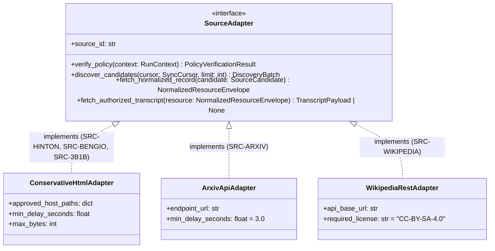
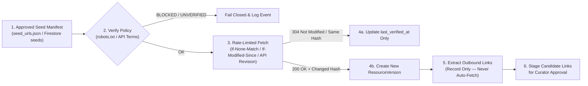

# Source Adapter Contract — AI Research & Learning System

**Document ID:** `ARCH-ADAPTER-003`  
**Status:** Proposed for Architectural Review  
**Last Updated:** 2026-10-21  
**Baseline Implementation Reference:** `collect.py` (`ConservativeCollector`)

---

## 1. Purpose and Core Legal/Technical Principle

The **Source Adapter Contract** defines a uniform programmatic interface and compliance boundary for all knowledge connectors in the AI Research & Learning System:

1. **Geoffrey Hinton (`SRC-HINTON`)** — First-party academic website (`https://www.cs.toronto.edu/~hinton/`)
2. **Yoshua Bengio (`SRC-BENGIO`)** — First-party academic & blog website (`https://yoshuabengio.org/en`)
3. **3Blue1Brown (`SRC-3B1B`)** — Educational mathematics & AI website (`https://www.3blue1brown.com/`)
4. **arXiv (`SRC-ARXIV`)** — Open-access research archive API (`https://export.arxiv.org/api/query`)
5. **Wikipedia (`SRC-WIKIPEDIA`)** — Wikimedia REST & Action APIs (`https://en.wikipedia.org/w/rest.php/v1/`)

> [!IMPORTANT]
> **Public Visibility != Redistribution License:**  
> The fact that a web page, PDF paper, slide deck, video lecture, or transcript is publicly reachable on the internet—or permitted to be crawled by `robots.txt`—does **not** grant a license to copy, archive in full, or redistribute that content to users. Every adapter must evaluate **access policy** (`robots.txt` / API Terms of Use) and **content reuse rights** (copyright / SPDX license) as two independent gates. When reuse rights are unverified or all-rights-reserved, the adapter must operate in **metadata-only** mode.

---

## 2. Common Source Adapter Interface

All source connectors implement the `SourceAdapter` protocol in Python (`ingestion-worker`), ensuring uniform policy verification, rate limiting, deduplication, and provenance logging.



### 2.1 Python Protocol Definition

```python
from dataclasses import dataclass, field
from typing import Any, Literal, Protocol

PolicyStatus = Literal["OK", "BLOCKED", "UNVERIFIED"]
StorageScope = Literal["METADATA_ONLY", "METADATA_AND_ABSTRACT", "METADATA_AND_PERMITTED_TEXT"]

@dataclass(frozen=True)
class PolicyVerificationResult:
    source_id: str
    origin: str
    policy_endpoint_url: str
    status: PolicyStatus
    http_status: int | None
    effective_delay_seconds: float
    sitemap_urls: list[str]
    evidence_summary: str
    raw_snapshot_gcs_uri: str | None
    checked_at_utc: str

@dataclass(frozen=True)
class DiscoveredLinkCandidate:
    from_canonical_url: str
    target_canonical_url: str
    link_text: str | None
    rel: str | None
    target_scope: Literal["FIRST_PARTY_IN_SCOPE", "SAME_HOST_OUT_OF_SCOPE", "EXTERNAL_KNOWN_SOURCE", "EXTERNAL_UNMAPPED"]
    recommended_decision: Literal["CANDIDATE_NOT_FETCHED", "HANDOFF_TO_SOURCE_ADAPTER", "RECORD_ONLY_REVIEW"]

@dataclass(frozen=True)
class NormalizedResourceEnvelope:
    source_id: str
    resource_id: str
    manifest_id: str | None
    canonical_url: str
    fetched_url: str
    resource_type: str
    media_modality: Literal["TEXT_HTML", "API_ATOM_XML", "API_JSON", "VIDEO_LESSON", "PDF_REFERENCE_ONLY"]
    title: str
    authors: list[str]
    published_at: str | None
    updated_at_source: str | None
    abstract_or_description: str | None
    topic_tags: list[str]
    external_identifiers: dict[str, str | None]  # doi, arxiv_id, wikidata_qid, youtube_video_id
    source_specific: dict[str, Any]
    license_status: str
    license_spdx: str | None
    permitted_storage_scope: StorageScope
    attribution_text: str
    permitted_body_chunks: list[dict[str, Any]] = field(default_factory=list)
    discovered_links: list[DiscoveredLinkCandidate] = field(default_factory=list)
    metadata_hash: str = ""
    content_hash: str | None = None
    fetched_at_utc: str = ""

class SourceAdapter(Protocol):
    source_id: str

    def verify_policy(self) -> PolicyVerificationResult:
        """Must run before any content fetch. If status != 'OK', caller must abort."""
        ...

    def discover_candidates(self, cursor: str | None, batch_limit: int) -> list[dict[str, Any]]:
        """Return bounded candidate URLs or API identifiers without fetching full items."""
        ...

    def fetch_normalized_record(self, candidate: dict[str, Any]) -> NormalizedResourceEnvelope:
        """Fetch a single resource respecting rate limits, byte caps, and license rules."""
        ...
```

---

## 3. Source-by-Source Specification Matrix

| Attribute | `SRC-HINTON` (Geoffrey Hinton) | `SRC-BENGIO` (Yoshua Bengio) | `SRC-3B1B` (3Blue1Brown) | `SRC-ARXIV` (arXiv API) | `SRC-WIKIPEDIA` (Wikipedia API) |
| :--- | :--- | :--- | :--- | :--- | :--- |
| **Canonical Host / Endpoint** | `www.cs.toronto.edu` | `yoshuabengio.org` | `www.3blue1brown.com` | `export.arxiv.org` | `en.wikipedia.org` |
| **Approved Path / Route Prefix** | `/~hinton` (and `/~hinton/*`) | `/en` (and `/en/*`) | `/`, `/lessons/*`, `/topics/*` | `/api/query` | `/w/rest.php/v1/page/*`, `/w/api.php` |
| **Seed ID Prefix** | `HI-URL-NNN` | `YB-URL-NNN` | `3B1B-URL-NNN` | `ARXIV-REC-NNN` | `WIKI-REC-NNN` |
| **Access Protocol** | Conservative HTML GET (`collect.py`) | Conservative HTML GET (`collect.py`) | Conservative HTML GET / Public Lesson Metadata | Atom 1.0 over HTTP GET | MediaWiki REST v1 / Action API JSON |
| **Minimum Request Interval** | `max(1.0s, robots Crawl-delay)` (`1.0s` observed) | `max(1.0s, robots Crawl-delay)` | `max(1.5s, robots Crawl-delay)` | **>= 3.0s** between requests (`1` connection max) | `<= 5 req/s` (well below Wikimedia `200 req/s` ceiling) |
| **Max Batch Size per Run** | `15` HTML pages | `15` HTML pages | `15` HTML pages | `50` records per query (`max_results<=50`) | `25` pages per run |
| **Default Storage Scope** | `METADATA_ONLY` | `METADATA_ONLY` | `METADATA_ONLY` (links + lesson metadata) | `METADATA_AND_ABSTRACT` (full text only if license == CC BY / CC0) | `METADATA_AND_PERMITTED_TEXT` (CC BY-SA 4.0) |
| **Binary / PDF Download?** | **Prohibited** in adapter (record `.pdf`/`.pptx` URLs only) | **Prohibited** in adapter | **Prohibited** (no video/graphic binary download) | Disabled by default; PDF link recorded (`https://arxiv.org/pdf/{id}`) | Diagrams linked via Wikimedia Commons metadata |

---

## 4. Detailed Source Rules & Source-Specific Metadata

### 4.1 `SRC-HINTON` — Geoffrey Hinton Official Website

- **Canonical URL Rule:** Lowercase scheme (`https`) and host (`www.cs.toronto.edu`), path must equal `/~hinton` or begin with `/~hinton/`, strip URL fragments (`#...`), preserve meaningful query strings (e.g., `bio.html?stream=top`), ignore cross-host `<link rel="canonical">`.
- **Disallowed Same-Host Paths:** Any path outside `/~hinton` (e.g., `/~tijmen/csc321/`) is classified as `SAME_HOST_OUT_OF_SCOPE` and recorded with `decision = "RECORD_ONLY_REVIEW"`.
- **Source-Specific Metadata (`source_specific`):**
  - `publication_year_listed`: Year parsed from bibliography listing (`publications.html`, `papers.html`).
  - `hinton_topic_category`: Topic section heading from `bytopics.html` (`poe.html`, `speech.html`, `reviewpap.html`).
  - `course_code`: E.g., `"CSC2535"` or `"Coursera-NNML-2012"`.
  - `linked_slide_urls`: Array of `{format: "pdf" | "pptx", url: str}` recorded as metadata pointers without downloading binary files.

### 4.2 `SRC-BENGIO` — Yoshua Bengio Official Website

- **Canonical URL Rule:** Host `yoshuabengio.org`, path `/en` or `/en/*` (`/en/research`, `/en/blog`, `/en/publication/*`). Explicitly excludes `/wp-admin/*`, `/wp-login.php`, and non-English duplicate routes unless cross-referenced.
- **Source-Specific Metadata (`source_specific`):**
  - `post_category`: `"Blog"`, `"Speech"`, `"Research Commentary"`, `"Publication Detail"`.
  - `pagination_page`: Integer page index when discovered via `/en/blog?page=N`.
  - `referenced_arxiv_ids`: Extracted arXiv IDs (e.g., `arxiv:2606.29657`) handed off to `SRC-ARXIV` queue rather than scraped from external domains.
  - `external_media_pointers`: Outbound links to interviews, UN speeches, or reports (`internationalaisafetyreport.org`, `lawzero.org`) stored strictly as `EXTERNAL_UNMAPPED` citations.

### 4.3 `SRC-3B1B` — 3Blue1Brown Educational Website & Linked Resources

- **Canonical URL Rule:** Host `www.3blue1brown.com`, paths `/lessons/*` and `/topics/*` (e.g., `https://www.3blue1brown.com/lessons/backpropagation`, `https://www.3blue1brown.com/topics/linear-algebra`).
- **Licensing & Reuse Boundary:**
  - Videos, written lesson narratives, and proprietary "Pi creature" graphics are copyright **3Blue1Brown LLC** (All Rights Reserved). The adapter stores **metadata, topic hierarchies, prerequisite links, and canonical lesson URLs** (`METADATA_ONLY`).
  - Open-source animation code in linked GitHub repositories (`github.com/3b1b/manim`, `github.com/3b1b/videos`) is governed by its respective repository license (MIT for Manim).
- **Source-Specific Metadata (`source_specific`):**
  - `series_slug`: E.g., `"essence-of-linear-algebra"`, `"essence-of-calculus"`, `"neural-networks"`, `"differential-equations"`.
  - `lesson_number`: Sequence number within the series.
  - `youtube_video_id`: Canonical video ID for official player embedding / timestamp deep-linking (`https://www.youtube.com/watch?v={id}&t={sec}s`).
  - `interactive_elements_present`: Boolean indicating whether the web lesson contains interactive visualization widgets.

### 4.4 `SRC-ARXIV` — arXiv Official API

- **Endpoint & Query Construction:** Uses `https://export.arxiv.org/api/query?id_list=...` or bounded `search_query=au:Hinton_G+OR+au:Bengio_Y` with `start` and `max_results <= 50`.
- **Rate Limits (Official arXiv API Terms of Use, checked 2026-10-21):**
  - Single concurrent connection (`max_concurrency = 1`).
  - Mandatory **minimum 3.0-second sleep** between consecutive HTTP requests.
- **Licensing & Reuse Boundary:**
  - Bibliographic metadata (title, authors, categories, DOI, publication date, version history) and **abstracts** are provided via the arXiv API and may be indexed and embedded (`METADATA_AND_ABSTRACT`).
  - Every entry's `<link title="license" href="..."/>` or arXiv license URI (`arxiv.org/licenses/nonexclusive-distrib/1.0/`, `creativecommons.org/licenses/by/4.0/`, `creativecommons.org/publicdomain/zero/1.0/`) is inspected. Full paper text extraction is **disabled by default** and only permitted in later milestones for papers bearing an explicit Creative Commons (`CC-BY-*` or `CC0`) license URI.
- **Source-Specific Metadata (`source_specific`):**
  - `arxiv_id_base`: E.g., `"2106.04399"`.
  - `arxiv_version`: E.g., `"v3"`.
  - `primary_category`: E.g., `"cs.LG"`, `"cs.AI"`, `"stat.ML"`.
  - `all_categories`: List of arXiv subject classifications.
  - `journal_ref` and `comment`: Author-supplied publication notes.

### 4.5 `SRC-WIKIPEDIA` — English Wikipedia (MediaWiki REST & Action APIs)

- **Endpoint & User-Agent Policy (checked 2026-10-21):**
  - Uses `https://en.wikipedia.org/w/rest.php/v1/page/{title}` and `/w/api.php` for section structure and revision IDs.
  - Sends mandatory descriptive `User-Agent` and `Api-User-Agent` headers: `AIResearchLearningBot/0.1 (https://github.com/maha-ai-developer/ai-research-learning; contact-configured-in-env)`.
- **Licensing & Attribution Requirements:**
  - Text content on English Wikipedia is licensed under **Creative Commons Attribution-ShareAlike 4.0 International (`CC-BY-SA-4.0`)** (with co-licensing under GFDL where applicable).
  - Permitted storage scope: `METADATA_AND_PERMITTED_TEXT` for curated mathematical and AI concept articles, provided every stored chunk and UI view retains:
    1. Canonical page URL (`https://en.wikipedia.org/wiki/{Title}`),
    2. Exact permanent revision URL (`https://en.wikipedia.org/w/index.php?title={Title}&oldid={revision_id}`),
    3. License badge (`CC BY-SA 4.0`) and notice that any derivative adaptation of Wikipedia text shares the `CC BY-SA 4.0` license.
- **Source-Specific Metadata (`source_specific`):**
  - `page_id`: MediaWiki numeric page ID.
  - `revision_id`: Exact `oldid` revision identifier.
  - `wikidata_qid`: Linked Wikidata entity (e.g., `"Q193524"` for Backpropagation).
  - `math_formula_count`: Count of `<math>` LaTeX expressions in the article for mathematical depth classification.

---

## 5. Incremental Discovery, Refresh, Rate Limits, and Failure Handling

### 5.1 Incremental Discovery & Refresh Cadence



1. **Conditional Requests:** HTML adapters send `If-None-Match` (`ETag`) and `If-Modified-Since` when previous response headers exist; `SRC-WIKIPEDIA` checks latest `revision_id` before fetching full page content; `SRC-ARXIV` queries `id_list` and compares `<updated>` timestamp and version suffix (`v1` -> `v2`).
2. **Refresh Cadence:**
   - Index/discovery pages (`HI-URL-001..005`, `YB-URL-001..004`, `3B1B` topic indexes): checked at most **once every 7 days**.
   - Individual publication/blog/lesson pages: checked at most **once every 30 days** or on explicit curator request.

### 5.2 Rate Limiting & Retry / Circuit-Breaker Policy

1. **Per-Origin Token Bucket:** Enforced in-process by `ingestion-worker` (which runs with `parallelism = 1` per source origin) so concurrent containers can never multiply request rates against a researcher's server.
2. **HTTP Error Handling:**
   - `429 Too Many Requests` or `503 Service Unavailable`: Immediately pause the source adapter, honor the `Retry-After` header (minimum 60s backoff, exponential up to 15 minutes, max 2 retries), and abort the remaining batch for that source if a second `429`/`503` occurs.
   - `401` / `403` / `451`: Immediately mark the URL `blocked-by-policy-or-scope`, do **not** retry, and log a high-priority provenance alert.
   - `404` / `410`: Mark existing resource `SOURCE_URL_UNAVAILABLE`, preserve historical metadata record for citation integrity, and do not delete prior provenance logs.
   - Redirects (`301`, `302`, `303`, `307`, `308`): Maximum `3` hops (`MAX_REDIRECTS = 3`). Every hop is re-validated against `is_approved_site_url()` and `robots.txt` before following. Cross-host redirects from first-party HTML crawlers are **never** followed automatically.

---

## 6. External-Link Boundaries

When an adapter parses HTML from `SRC-HINTON`, `SRC-BENGIO`, or `SRC-3B1B`, it extracts `<a href="...">` anchors into `discovered_links` using four deterministic classifications:

1. `FIRST_PARTY_IN_SCOPE`: Same host and approved path prefix (e.g., `https://yoshuabengio.org/en/blog/new-post`). Recorded with `decision = "CANDIDATE_NOT_FETCHED"`. Requires curator promotion (or explicit manifest inclusion) before fetching in a subsequent run.
2. `SAME_HOST_OUT_OF_SCOPE`: Same host but outside approved path prefix (e.g., `https://www.cs.toronto.edu/~tijmen/csc321/` or `https://yoshuabengio.org/wp-admin/`). Recorded as `RECORD_ONLY_REVIEW`; never fetched.
3. `EXTERNAL_KNOWN_SOURCE`: Outbound link matching `arxiv.org/abs/*` or `en.wikipedia.org/wiki/*`. Recorded with `decision = "HANDOFF_TO_SOURCE_ADAPTER"` so the identifier (`arxiv_id` or Wikipedia title) can be queued for `SRC-ARXIV` or `SRC-WIKIPEDIA` via their official APIs rather than scraped via the HTML collector.
4. `EXTERNAL_UNMAPPED`: Any third-party publisher, news outlet, video platform, or organization (`ft.com`, `time.com`, `transformernews.ai`, `youtube.com`, `lawzero.org`). Stored strictly as a reference pointer (`RECORD_ONLY_REVIEW`); **never** fetched by the HTML collector.

---

## 7. Transcript Availability and Authorized Acquisition Methods

Lecture, talk, and interview transcripts are high-value learning assets (e.g., Hinton's 2012 Coursera neural network lectures, Bengio's speeches and interviews, and 3Blue1Brown's visual math lessons), but they carry strict copyright and platform terms.

### 7.1 Permitted Acquisition Hierarchy

An adapter may ingest transcript text **only** through one of the following authorized methods:

1. **Method A — First-Party Open Lesson Text / Captions (`SRC-3B1B` / Open Repositories):**
   - Where a creator publishes written lesson text or open caption files under an explicit open license or public first-party educational page that permits indexing, the adapter records the license/terms and extracts timestamped concept anchors. Where full text is All Rights Reserved (default for 3Blue1Brown lesson narratives), the adapter indexes **section headings, mathematical concept tags, timestamp deep-links, and short AI-generated summaries** rather than duplicating the verbatim lesson article.
2. **Method B — Creative Commons Licensed Media / Official Open Transcripts:**
   - Videos or audio tracks published with an explicit Creative Commons license (`CC BY` or `CC BY-SA`) or official public-domain/open-access transcript text (e.g., official UN speech transcript release or CC-licensed academic talk).
3. **Method C — Curator-Uploaded / Rights-Cleared Transcript Files:**
   - Transcripts manually vetted and uploaded by a project curator with a documented `authorization_basis` and `license_status` in `transcripts/{transcript_id}`.

### 7.2 Strictly Prohibited Transcript Practices

- **No unauthorized third-party YouTube scraping:** Do not use unofficial scraper libraries (`youtube-dl`, `yt-dlp`, or unauthenticated transcript scrapers bypassing platform terms) to bulk-download audio or closed captions from third-party YouTube channels without permission or API compliance.
- **No Whisper/ASR transcription of copyrighted streams without rights:** Do not download copyrighted video/audio files to run speech-to-text transcription unless the media itself carries an open license or explicit permission from the copyright holder.
- **Timestamp Deep-Linking as the Default:** Whenever full transcript storage is not licensed, the system stores structured **Topic & Timestamp Index Points** (`start_ms`, `end_ms`, `concept_ids`, and an AI-generated one-sentence description of what is taught in that segment) so learners can click through directly to the exact timestamp on the official hosting platform.
