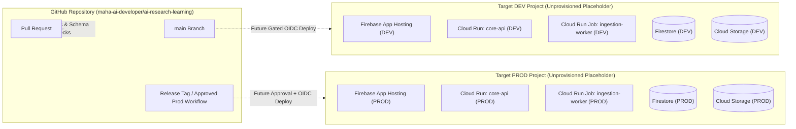
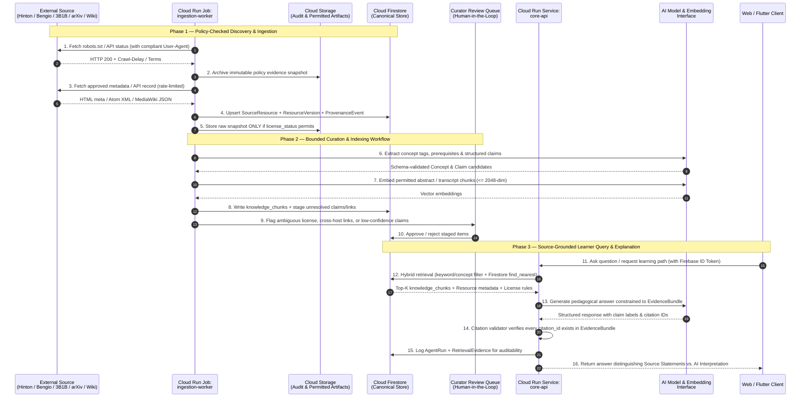

# System Overview — AI Research & Learning System

**Document ID:** `ARCH-SYS-001`  
**Status:** Proposed for Architectural Review  
**Last Updated:** 2026-10-22  
**Repository:** <https://github.com/maha-ai-developer/ai-research-learning>

> [!IMPORTANT]
> **Unprovisioned Cloud Infrastructure Status & Local-First Rollout:**
> - **No Firebase or Google Cloud projects have been created for this product.**
> - **Project IDs (`maha-airl-dev-01` and `maha-airl-prod-01` as candidate IDs only), cloud regions, billing accounts, enabled APIs, and runtime environments (`DEV` / `PROD`) are not yet established.** Availability, account access, and billing permissions must be verified before any project creation.
> - **This architecture package and Pull Requests #1 and #2 do not create projects, enable billing, enable cloud services, deploy resources, or commit environment credentials.**
> - **Local-First Milestone & `DEV`-First Rollout:** Initial adapter, schema, and security-rule development (Stages 1–6) uses the **Firebase Local Emulator Suite** and **local SQLite** (`data/research_inventory.sqlite`) with zero cloud dependency. Cloud provisioning and billing authorization are deferred to a separate approval gate, followed by a **`DEV`-first rollout** (`PROD` remains unprovisioned and unavailable until release readiness has been demonstrated in `DEV`). See [`../operations/cloud-provisioning-plan.md`](../operations/cloud-provisioning-plan.md) for the detailed pre-provisioning blueprint.
> - **Firebase App Hosting requires the Firebase Blaze (pay-as-you-go) billing plan** and may incur costs across multiple underlying services (Cloud Build, Cloud Run SSR in the primary region, Artifact Registry, Cloud CDN/bandwidth, and Secret Manager). Cloud Billing budgets (`$5/month DEV`, `$15/month PROD`) are **notification thresholds only, not maximum spending guarantees**, so service-specific caps (`maxInstances`), API quotas, and application-level circuit breakers must be configured before enabling Blaze.

---

## 1. Product Purpose and Boundaries

The **AI Research & Learning System** is a source-grounded, agentic learning environment designed to guide learners progressively from **mathematical foundations** (linear algebra, calculus, probability, information theory, optimization) to **modern AI engineering and primary research** (representation learning, deep neural networks, generative models, reinforcement learning, and AI safety).

Unlike generic chat interfaces that blend memorized training data with unverifiable claims, this system enforces strict **epistemic and provenance boundaries**:

1. **Source before synthesis:** Every lesson, concept explanation, research comparison, and tutor response anchors to cataloged source records with stable identifiers, canonical URLs, retrieval timestamps, and license states.
2. **Strict separation of original source material and AI-generated analysis:** Primary metadata, authorized verbatim quotes/transcripts, and author statements are stored and rendered distinctly from AI-generated pedagogical summaries, prerequisite bridges, and comparisons.
3. **Policy- and license-aware ingestion:** Public reachability on the web does **not** grant permission to scrape, store, or redistribute full text, PDFs, videos, or transcripts. Ingestion defaults to metadata-first and fails closed whenever `robots.txt`, API terms, or copyright/reuse rights are unverified or restrictive.
4. **Minimal coherent cloud footprint:** The initial cloud architecture uses managed serverless primitives on Google Cloud and Firebase—**Firebase App Hosting**, **Firebase Authentication**, **Cloud Firestore**, **Cloud Storage**, and **Cloud Run** (one API service and one scheduled/triggered worker job)—deferring dedicated vector databases, graph databases, and multi-tenant notebook clusters until explicit quantitative triggers are met.

### 1.1 Initial Knowledge Sources

| Source ID | Source Name | Primary Origin / Endpoint | Initial Ingestion Mode | Pedagogical Role |
| :--- | :--- | :--- | :--- | :--- |
| `SRC-HINTON` | Geoffrey Hinton's Official Website | `https://www.cs.toronto.edu/~hinton/` | Conservative HTML metadata & link catalog (`crawl-delay: 1s`) | Foundational neural networks, Boltzmann machines, capsules, backpropagation, Coursera lectures/slides metadata |
| `SRC-BENGIO` | Yoshua Bengio's Official Website | `https://yoshuabengio.org/en` | Conservative HTML metadata & link catalog (`min-delay: 1s`) | Representation learning, deep learning foundations, GFlowNets, Scientist AI, AI safety and governance commentary |
| `SRC-3B1B` | 3Blue1Brown Educational Website & Linked Resources | `https://www.3blue1brown.com/` | Metadata-first lesson catalog & structured topic links | Visual and intuitive mathematical foundations (Essence of Linear Algebra, Calculus, Probability, Neural Networks, Transformers) |
| `SRC-ARXIV` | arXiv Research Archive | `https://export.arxiv.org/api/query` | Official Atom/REST API (`>= 3s` interval) & OAI-PMH | Canonical preprint metadata, abstracts, version history, DOIs, and openly licensed papers |
| `SRC-WIKIPEDIA` | English Wikipedia | `https://en.wikipedia.org/w/rest.php/v1/` | Official MediaWiki REST & Action APIs (compliant `User-Agent`) | Definitions, mathematical notation, historical context, and concept prerequisite bridging under CC BY-SA 4.0 |

### 1.2 Principal Use Cases

1. **Guided Foundation-to-Research Progression:** A learner selects a target research topic (e.g., *Backpropagation*, *Restricted Boltzmann Machines*, *Attention & Transformers*, or *Generative Flow Networks*) and receives a structured prerequisite graph starting from 3Blue1Brown visual math lessons and Wikipedia mathematical definitions up to Hinton and Bengio primary papers and arXiv preprints.
2. **Source-Cataloged Resource Exploration:** Learners search and filter verified papers, talks, lectures, blog essays, and visual math lessons by researcher, concept, mathematical prerequisite, publication year, and resource type, with direct links to original sources.
3. **Source-Grounded AI Tutoring & Claim Inspection:** Learners ask conceptual or technical questions. The tutor retrieves verified metadata, abstracts, and permitted transcript/text chunks, labels each claim by epistemic category (`ESTABLISHED_EVIDENCE`, `AUTHOR_OPINION`, `PRELIMINARY_RESEARCH`, `GENERATED_INTERPRETATION`), and attaches clickable inline citations.
4. **Research Comparison & Timeline View:** Learners compare how different researchers or eras approach a problem (e.g., Hinton's energy-based models and forward-forward algorithm vs. Bengio's GFlowNets and deliberative safety bounds), clearly separating empirical results from author hypotheses.
5. **Interactive Transcript & Timestamp Navigation (Milestone 4+):** Learners search authorized lecture and interview transcripts and jump directly to timestamped video/audio segments on the original hosting platform.
6. **Sandboxed Notebook Exploration (Milestone 9):** Learners open curated Jupyter notebooks linked to concepts and papers. Authoring/viewing metadata is handled through the core API, while code execution is strictly isolated in a separate ephemeral execution boundary.

### 1.3 Explicit Non-Goals (Out of Scope for Initial Releases)

- **No bulk unthrottled crawling or full-web scraping:** Only approved domains, path prefixes, and official APIs are queried.
- **No unauthorized re-hosting of copyrighted media:** PDFs, slide decks, videos, and proprietary lesson graphics are linked at their canonical source URLs unless an explicit open license (e.g., CC BY, CC BY-SA, MIT) permits archival in Cloud Storage.
- **No arbitrary code execution inside the API service:** Neither the Cloud Run API service nor the Next.js server runtime may execute user-submitted Python/notebook code.
- **No autonomous, unconstrained multi-agent loops:** Agent workflows run as bounded, schema-validated state machines with strict token/step budgets and human review gates.

---

## 2. High-Level System Architecture

### 2.1 Minimal Coherent Architecture Diagram

```mermaid
flowchart TB
    subgraph Clients["Learner & Curator Clients"]
        Web["Next.js Web Client<br/>(Firebase App Hosting)"]
        Mobile["Flutter Mobile Client<br/>(iOS / Android)"]
        LocalLab["Local JupyterLab<br/>(Stage A Owner/Learner Local)"]
    end

    subgraph Identity["Identity & Edge Security"]
        FBAuth["Firebase Authentication<br/>(ID Tokens + Custom Claims)"]
        AppCheck["Firebase App Check<br/>(Attestation for Web/Mobile)"]
    end

    subgraph Compute["Google Cloud Run (Serverless Compute)"]
        API["Cloud Run Service: core-api<br/>(REST API, Retrieval, Tutor, Progress)"]
        Worker["Cloud Run Job: ingestion-worker<br/>(Scheduled Connectors, Curation & Indexing)"]
        Sandbox["Deferred Milestone 9: lab-execution-gateway<br/>(Isolated Ephemeral Kernel Runner)"]
    end

    subgraph Storage["Persistence & Artifact Storage"]
        Firestore[("Cloud Firestore<br/>(Metadata, Graph, Chunks, Vectors, Progress)")]
        GCS[("Cloud Storage Buckets<br/>(Raw Policy Logs, Permitted Artifacts, Notebooks)")]
    end

    subgraph AI["Replaceable AI & Retrieval Layer"]
        ModelAdapter["Model Provider Interface<br/>(Gemini via Vertex AI / Google GenAI SDK)"]
        Embedder["Embedding & Reranking Interface<br/>(<= 2048-dim Vectors)"]
    end

    subgraph External["Approved External Knowledge Sources"]
        Hinton["Geoffrey Hinton Site<br/>cs.toronto.edu/~hinton"]
        Bengio["Yoshua Bengio Site<br/>yoshuabengio.org/en"]
        ThreeB1B["3Blue1Brown<br/>3blue1brown.com"]
        Arxiv["arXiv API<br/>export.arxiv.org"]
        Wiki["Wikipedia REST API<br/>en.wikipedia.org"]
    end

    Web -->|HTTPS + Bearer JWT| API
    Mobile -->|HTTPS + Bearer JWT| API
    Web -.->|Sign-in| FBAuth
    Mobile -.->|Sign-in| FBAuth
    API -->|Verify JWT & Claims| FBAuth
    API -->| verify token | AppCheck

    API -->|Read/Write Entities & Vector Query| Firestore
    API -->|Signed Read URLs / Artifacts| GCS
    API -->|Prompt + Grounded Context| ModelAdapter
    API -->|Query Embedding| Embedder

    Worker -->|Policy Check + Bounded Fetch| Hinton
    Worker -->|Policy Check + Bounded Fetch| Bengio
    Worker -->|Policy Check + Bounded Fetch| ThreeB1B
    Worker -->|API Query| Arxiv
    Worker -->|REST API Query| Wiki

    Worker -->|Upsert Provenance, Docs, Concepts| Firestore
    Worker -->|Store Audit Logs & Permitted Snapshots| GCS
    Worker -->|Batch Embeddings & Curation Workflows| ModelAdapter
    Worker -->|Generate Chunk Vectors| Embedder

    API -.->|Milestone 9 Signed Session| Sandbox
    LocalLab -.->|Read Public Manifest / Export| API
```

---

## 3. Component Responsibilities and Justification

The architecture deliberately selects the smallest set of managed services that satisfy security, provenance, cross-platform delivery, and cost efficiency.

### 3.1 Clients: Next.js Web Application & Flutter Mobile Application

1. **Next.js Web Client (deployed on Firebase App Hosting — Provisional Option A or Cloud Run Fallback Option C):**
   - Provides responsive browser interfaces for concept graphs, reading lists, source-grounded Q&A, side-by-side research comparisons, transcript timestamp navigation, and notebook previewing.
   - Uses Server-Side Rendering (SSR) and Incremental Static Regeneration (ISR) for public catalog pages and SEO-friendly concept overviews, while authenticated learner state and dynamic operations are fetched directly from the shared Cloud Run `core-api`.
   - **Provisional Regional Topology & Request Path (Unfinalized):** As detailed in [`../operations/cloud-provisioning-plan.md`](../operations/cloud-provisioning-plan.md), **Option A** is the provisional recommendation: data and Python compute (`Firestore`, `Cloud Storage`, `Cloud Run` `core-api` and `ingestion-worker`, and `Artifact Registry`) in `asia-south1` (Mumbai) and Firebase App Hosting in `asia-southeast1` (Singapore, the nearest supported App Hosting region). Even when Cloud CDN is enabled on App Hosting, **uncached requests are routed to and executed by App Hosting's primary-region Cloud Run backend in `asia-southeast1`**. Therefore, dynamic web and Flutter operations (`POST /api/v1/search`, `POST /api/v1/tutor/ask`, `/api/v1/me/progress/*`) use a **direct client-to-Mumbai-API (`core-api` in `asia-south1`) request path**, avoiding unnecessary server-side proxies through `asia-southeast1`. **Option C** (hosting the Next.js container directly on Cloud Run in `asia-south1` without App Hosting) is preserved as a fallback if single-region co-location and simplicity outweigh App Hosting's convenience. No region has been finalized for provisioning.
2. **Flutter Mobile Client (iOS and Android):**
   - Shares the exact same backend REST API (`core-api` in `asia-south1` under Option A/C) and Firebase Authentication identity model as the web application.
   - Focuses on structured learning paths, mathematical intuition cards (linking 3Blue1Brown lessons), spaced-repetition concept reviews, audio/video lecture companions with synchronized transcripts, and offline caching of permitted metadata and study progress.
3. **Why both clients share a single backend API:**
   - Centralizing business logic, entitlement checks, provenance assembly, and AI workflows in the Cloud Run `core-api` prevents duplicating security rules, prompt templates, or citation-validation logic across TypeScript (Web) and Dart (Flutter), while eliminating cross-region proxy hops for dynamic browser and mobile requests.

### 3.2 Shared Backend API & Authentication Model

1. **Firebase Authentication:**
   - Handles user sign-in across Web and Flutter via Google Sign-In, Email/Password, and GitHub OAuth, issuing short-lived (1-hour) signed JWT ID tokens (`uid`, `email`, `email_verified`, and custom role claims such as `role: "learner" | "curator" | "admin"`).
   - **Access & Principal Policy:**
     - **Public Catalog Endpoints:** Read-only catalog access (`GET /api/v1/resources`, `GET /api/v1/learning-paths`) may be served unauthenticated **only** for catalog slices deliberately marked `PUBLISHED` for public browsing, protected by IP rate limits.
     - **User Progress & Protected Endpoints:** All learner progress (`users/{uid}/progress`, `/api/v1/me/*`), assessment submissions, and curation endpoints strictly require an authenticated principal.
     - **AI Tutor & Cost-Bearing Endpoints:** AI tutor endpoints (`POST /api/v1/tutor/ask`) and model-backed semantic queries require an **identified principal**, abuse controls (Firebase App Check attestation + per-principal and per-IP rate limits), and strict daily token/request quotas. Firebase Anonymous Auth may be enabled for low-friction testing after cloud infrastructure exists, but anonymous principals must remain bound to tighter per-UID and per-IP quotas and **must never bypass cost controls**.
   - **Why selected:** Native SDK support for Next.js and Flutter, zero-maintenance token rotation, and tight integration with Google Cloud IAM and Firestore.
2. **Backend API (`core-api` on Cloud Run):**
   - Stateless Python (FastAPI) or TypeScript/Node service running as a single container image on Cloud Run (once provisioned).
   - Validates Firebase ID tokens on every protected endpoint using the Firebase Admin SDK (`verify_id_token(check_revoked=True)`).
   - Enforces role-based access control (RBAC): learners access catalog, tutor, and their own `users/{uid}` progress; only `curator`/`admin` principals or internal OIDC service accounts can trigger ingestion or approve human-review queues.
   - All client reads of curated knowledge and writes of learner progress pass through `core-api` (or tightly scoped Firestore security rules for user-owned progress syncing), ensuring schema invariants and audit logging.

### 3.3 Persistence: Cloud Firestore & Cloud Storage

1. **Cloud Firestore:**
   - Stores structured operational and knowledge metadata: source registry (`sources`), canonical resources (`resources`), content versions (`resource_versions`), provenance logs (`provenance_events`), concept graph nodes and edges (`concepts`, `concept_relations`), transcript segment metadata (`transcripts`, `transcript_segments`), permitted text chunks with native vector embeddings (`knowledge_chunks`), learning paths (`learning_paths`), learner progress (`users/{uid}/progress`), and agent run records (`agent_runs`).
   - Uses Firestore native vector search (`find_nearest`, where **2,048 dimensions is Firestore's documented maximum ceiling, not a default dimension**) on `knowledge_chunks` combined with composite pre-filters (e.g., `source_id`, `concept_ids`, `embedding_space_version`, `license_class`).
   - **Why selected:** Serverless scale-to-zero cost profile, strong consistency on document reads/transactions, native vector search for initial RAG scale, and built-in offline synchronization support for Flutter and Web if needed.
2. **Cloud Storage (GCS):**
   - When provisioned in a future approval-gated milestone, stores immutable or large payloads that exceed Firestore's 1 MiB document limit or do not require field-level indexing (using environment-parameterized bucket names—no buckets exist today):
     - `gs://<unprovisioned-env-bucket>-audit/`: raw `robots.txt` snapshots, sitemap XML captures, and HTTP response headers for compliance evidence.
     - `gs://<unprovisioned-env-bucket>-artifacts/`: permitted open-access content snapshots (e.g., CC BY-SA Wikipedia revision JSON, arXiv CC BY papers/abstract XML, authorized full transcripts).
     - `gs://<unprovisioned-env-bucket>-notebooks/`: curated `.ipynb` templates and immutable experiment output bundles.
   - **Why selected:** Object versioning, lifecycle rules, low cost per GB, and signed URL delivery without routing heavy payloads through the API memory space.

### 3.4 Compute: Cloud Run Services vs. Cloud Run Jobs

1. **Cloud Run Service (`core-api`):**
   - Handles synchronous HTTP/JSON and Server-Sent Events (SSE) requests from the Next.js and Flutter clients.
   - Scales to zero (`minInstances: 0` in DEV, configurable in PROD) with bounded concurrency (`concurrency: 80`) and request timeouts (`<= 60s`).
2. **Cloud Run Job (`ingestion-worker`):**
   - Executes batch source discovery, `robots.txt` verification, conservative rate-limited metadata collection (`>= 1s` per origin for Hinton/Bengio/3Blue1Brown, `>= 3s` for arXiv), transcript processing, and offline agent curation workflows.
   - Triggered on a schedule via **Cloud Scheduler** or on-demand via authenticated admin invocation.
   - **Why separate Service and Job (from the same codebase/repository):** Crawlers and curation workflows require long wall-clock times (up to 15–60 minutes) and strict per-origin rate-limit serialization (`1 worker task`), whereas the user-facing API requires fast autoscaling and short request timeouts. Running both from a single monorepo container image avoids microservice sprawl while cleanly separating runtime lifecycles.

### 3.5 Deployment: GitHub Actions & Firebase App Hosting

1. **GitHub Actions CI/CD:**
   - Currently runs offline tests and syntax/policy checks on every push and pull request targeting `main` with minimal permissions (`contents: read`).
   - Once cloud environments are approved and provisioned in a later milestone, deployment workflows will use OIDC Workload Identity Federation (never long-lived service account JSON keys) to deploy `core-api`, `ingestion-worker`, Firestore indexes (`firestore.indexes.json`), and security rules (`firestore.rules`, `storage.rules`).
2. **Firebase App Hosting (Requires Blaze Plan — Provisioning Gated):**
   - Intended under provisional **Option A** (`asia-southeast1` primary region) to build and host the Next.js web application using `apphosting.yaml` (`runConfig` for CPU, memory, concurrency, and `minInstances`/`maxInstances`, plus Secret Manager bindings for runtime secrets), with **Option C** (direct Cloud Run deployment in `asia-south1`) retained as a single-region fallback (see [`../operations/cloud-provisioning-plan.md`](../operations/cloud-provisioning-plan.md)).
   - **Billing & Multi-Service Cost Prerequisite:** Firebase App Hosting requires upgrading a Firebase project to the **Blaze (pay-as-you-go) plan** and may incur charges across multiple underlying Google Cloud services (**Cloud Build**, **Cloud Run** in the App Hosting primary region for uncached SSR requests, **Artifact Registry**, **Cloud CDN / network egress**, and **Secret Manager**). Because Cloud Billing budgets are notification thresholds only (not hard spending caps) and no single control guarantees a strict total-bill ceiling, App Hosting **must not** be enabled until billing budgets, hard `maxInstances` caps, CDN cache policies, API quotas, and abuse rate limits are configured and approved.

### 3.6 Replaceable AI Model & Configurable Embedding Strategy

To prevent vendor lock-in, handle model deprecations safely, and support empirical model evaluation:

- All LLM and embedding calls are isolated behind two configurable protocol interfaces:
  - `LanguageModelProvider`: `generate_structured(prompt, schema, temperature, system_instruction) -> StructuredOutput` and `stream_grounded_answer(query, evidence_bundle) -> AsyncIterator[AnswerChunk]`.
  - `EmbeddingProvider`: `embed_documents(texts, task_type="RETRIEVAL_DOCUMENT") -> list[Vector]` and `embed_query(text, task_type="RETRIEVAL_QUERY") -> Vector`.
- **No Hardcoded or Deprecated Embedding Model:** Retired models (such as the shut-down `text-embedding-004`) must not be used. The embedding provider, model identifier, and output dimensionality are runtime-configurable parameters selected via an offline retrieval benchmark prior to Stage 5 indexing.
- **Dimensionality Policy:** Firestore's `2,048`-dimension limit is treated strictly as the **maximum platform ceiling**, not the default dimension. Candidate models (including Matryoshka/MRL-capable models supporting `256`, `512`, `768`, or `1,024` dimensions) will be benchmarked on math/AI retrieval recall@K, latency, and storage footprint to select the smallest effective dimension.
- **Mandatory Embedding Provenance Fields:** Every embedded chunk and query records:
  - `embedding_provider` (e.g., configurable provider slug),
  - `embedding_model_id` (active model identifier),
  - `embedding_model_version` (pinned version or checkpoint identifier),
  - `embedding_dimension` (integer $D \le 2048$), and
  - `embedding_space_version` (e.g., `emb_v1`, binding `{provider, model_id, model_version, dimension, normalization}`).
- **Re-Embedding & Index Migration:** Because vectors from different models or dimensions occupy incompatible vector spaces, changing the embedding model or dimension requires incrementing `embedding_space_version`, running a background re-embedding job in `ingestion-worker`, building the corresponding Firestore composite vector index, and atomically switching `core-api` queries to the new `embedding_space_version` before retiring old vectors (detailed in [`data-model.md`](./data-model.md)).

### 3.7 What Is Explicitly Deferred (Initial Scaling Hypotheses)

> [!NOTE]
> The collection counts and latency numbers below are **initial architectural hypotheses** intended to prevent premature infrastructure complexity in Release 1—not universal scaling facts. They must be validated empirically using real workload telemetry and retrieval benchmarks once the system is running.

| Deferred Component | Reason for Deferral | Initial Hypothesis Trigger to Validate via Measurement |
| :--- | :--- | :--- |
| **PostgreSQL (Cloud SQL / AlloyDB)** | Firestore handles document lookups, hierarchical progress, and composite filtering at near-zero idle cost. | Evaluate via measurement if multi-join analytical queries, complex transactional reporting, or measured Firestore read/write costs exceed budget thresholds defined in [`data-model.md`](./data-model.md). |
| **Dedicated Vector DB (Vertex AI Vector Search / Qdrant)** | Firestore native `find_nearest` supports up to 2,048 dimensions and flat kNN queries for the initial corpus with low operational overhead. | Hypothesis threshold: evaluate when active chunk count approaches `50,000–100,000` vectors or measured p95 `find_nearest` latency exceeds `250 ms` under realistic pre-filters. |
| **Dedicated Graph DB (Neo4j / Spanner Graph)** | The initial concept prerequisite graph is small (`< 5,000` nodes); adjacency lists in Firestore + in-memory DAG caching in `core-api` are simpler. | Hypothesis threshold: evaluate only if measured multi-hop graph traversals (`> 4` hops) cannot be served in `< 50 ms` from cached adjacency lists. |
| **Interactive Notebook Execution (Client-Side Pyodide & Remote Kernel Cluster)** | Both client-side WebAssembly (`Pyodide`) and remote multi-user kernel clusters add execution, package-compatibility, and security/support surface area. | **Defer both client-side Pyodide and server-side execution initially.** Start in Stages 6–8 with static rendered notebooks and downloadable `.ipynb` artifacts; introduce interactive execution only in the dedicated **Stage 9 Isolated Lab** milestone. |

---

## 4. Target DEV and PROD Environment Separation (Unprovisioned Blueprint)

> [!WARNING]
> **Target State Only — Not Yet Provisioned:** Neither the `DEV` nor the `PROD` Google Cloud / Firebase project exists today. No project IDs, regions, billing accounts, or service accounts have been created. The diagram and table below specify the target isolation boundary to be provisioned only after explicit architectural and billing approval.

DEV and PROD will be isolated at the **Google Cloud / Firebase Project boundary** to guarantee that development tests, schema migrations, or experimental prompts never pollute production provenance or learner data.

### 4.1 Target Environment Configuration Matrix (Pre-Provisioning Blueprint)

See [`../operations/cloud-provisioning-plan.md`](../operations/cloud-provisioning-plan.md) for the complete pre-provisioning blueprint, candidate project ID verification steps, regional topology analysis, and cost/quota safeguards.

| Dimension | Local-First Milestone (Active Now, Stages 1–6) | Target DEV Environment (Unprovisioned — Rollout First at Stage 7) | Target PROD Environment (Unprovisioned — Gated Until DEV Release Readiness) |
| :--- | :--- | :--- | :--- |
| **GCP / Firebase Project** | Local Firebase Emulator Suite + local SQLite (`data/research_inventory.sqlite`) | Candidate ID: `maha-airl-dev-01` (`${GCP_PROJECT_ID_DEV}`); not yet created, requires availability/access/billing check & approval gate | Candidate ID: `maha-airl-prod-01` (`${GCP_PROJECT_ID_PROD}`); remains unprovisioned/unavailable until release readiness is demonstrated in `DEV` |
| **Regional Topology (Unfinalized)** | Local only (`127.0.0.1`) | Provisional **Option A**: data/compute in `asia-south1`, App Hosting in `asia-southeast1` (direct client-to-`asia-south1` API path for dynamic calls); Fallback **Option C**: all in `asia-south1` | Same approved topology as `DEV` (provisional **Option A** or fallback **Option C**; not yet finalized) |
| **Billing & Cost Safeguards** | `$0` cloud spend (no billing account) | Spark initially if emulator-compatible; Blaze required before App Hosting/Cloud Run; `$5/mo` budget alert (**notification threshold only, not a hard cap**) + service quotas & circuit breakers | Blaze plan; `$15/mo` budget alert (**notification threshold only, not a hard cap**) + service quotas, `maxInstances`, & circuit breakers |
| **Service Accounts** | Local developer ADC / emulator | Target: `sa-cicd-deployer`, `sa-core-api`, `sa-ingestion-worker`, `sa-apphosting-web`, `sa-lab-sandbox` (Stage 9) | Target: `sa-cicd-deployer`, `sa-core-api`, `sa-ingestion-worker`, `sa-apphosting-web`, `sa-lab-sandbox` (Stage 9) |
| **Secrets Management** | `.env.local` (git-ignored) | Secret Manager (`DEV` project scope) | Secret Manager (`PROD` project scope, rotation enforced) |
| **Cloud Run `minInstances`** | N/A | `0` (scale to zero to minimize cost) | `0` initially; `1` for `core-api` only if justified by active daily learners > 100 |
| **Cloud Run `maxInstances`** | N/A | `2` (`core-api` and App Hosting `runConfig`) | `5`–`10` (`core-api`), `3` (App Hosting `runConfig`) |
| **Source Ingestion Scope** | Offline fixtures (`tests/`) or `--policy-only` / `--limit 10` | Small capped batches (`--limit 25`) | Approved scheduled runs with full provenance audit |
| **Firestore Backup / PITR** | Ephemeral / local SQLite | On-demand / scheduled export to `DEV` bucket (7-day retention; PITR disabled in `DEV` to save cost) | Point-in-Time Recovery (PITR, 7-day window) + scheduled GCS exports |

---

## 5. End-to-End Data Flow: From Source Discovery to Learner Explanation

---

## 6. Main Failure Modes and Observability Requirements

### 6.1 Failure Modes and Mitigations

| Failure Mode | Impact | Detection Mechanism | Mitigation & Fail-Safe Design |
| :--- | :--- | :--- | :--- |
| **1. Source `robots.txt` unavailable, modified to `Disallow`, or rate-limited (`HTTP 429`/`503`)** | Unauthorized crawl risk or IP block | `site_policies` check before every run; HTTP status monitoring in `fetch_events` | **Fail closed:** abort fetching for that origin immediately, honor `Retry-After`, log `blocked-by-policy-or-scope`, and alert curator. |
| **2. Source HTML layout changes (Hinton, Bengio, 3Blue1Brown)** | Missing titles, broken publication lists, or malformed dates | Schema validation failures and sudden drop in extracted fields or `metadata_hash` anomalies | Fall back to previous verified `ResourceVersion`; quarantine malformed parse output in `agent_runs` without overwriting valid records. |
| **3. Hallucinated or ungrounded AI explanation / fabricated citation** | Learner receives inaccurate mathematical or research claim attributed to Hinton/Bengio | Deterministic post-generation citation check (`citation_id` must match retrieved `EvidenceBundle` and span) | Reject or strip any sentence citing an unknown `resource_id`/`segment_id`; downgrade confidence or return raw source abstracts only ("extractive fallback"). |
| **4. Conflation of author opinion with settled scientific consensus** | Policy commentary (e.g., AI existential risk) presented as mathematical fact | Mandatory `epistemic_status` enum on every claim (`ESTABLISHED_EVIDENCE` vs. `AUTHOR_OPINION` vs. `PRELIMINARY_RESEARCH` vs. `GENERATED_INTERPRETATION`) | UI badges and system prompts explicitly separate peer-reviewed foundations from author essays and unrefereed preprints. |
| **5. Accidental ingestion of unlicensed full text or binary media** | Copyright / terms-of-use violation | Extension blocklist (`.pdf`, `.mp4`, `.pptx`), byte-size limit (`2 MB`), and `license_status` gate prior to GCS write | Default `text_storage_status = "metadata-only"`. Full text or transcript segments are written to `knowledge_chunks` only when `license_status` is verified open or explicitly authorized. |
| **6. Runaway cloud or LLM token cost** | Unexpected billing spike | Cloud Billing budget alerts, per-user rate limits in `core-api`, and per-run token budgets in `ingestion-worker` | Enforce `maxInstances` caps on Cloud Run, daily per-user query quotas in Firestore, response caching by `(concept_id,resource_version_hash)`, and hard token limits per workflow run. |

### 6.2 Observability and Telemetry Requirements

All services emit structured JSON logs to **Google Cloud Logging** and metrics to **Cloud Monitoring**:

1. **Mandatory Correlation Identifiers in Every Log Entry:**
   - `trace_id` (W3C Trace Context), `environment` (`dev` | `prod`), `component` (`core-api` | `ingestion-worker` | `web-client`), and where applicable `run_id`, `source_id`, `resource_id`, or hashed `uid`.
2. **Ingestion & Provenance Metrics:**
   - `ingestion.policy_check.status` (counter by `source_id` and `status`: `ok`, `blocked`, `unverified`).
   - `ingestion.fetch.latency_ms` and `ingestion.fetch.http_status` (by `source_id`).
   - `ingestion.records.changed_count`, `ingestion.records.skipped_count`, `ingestion.records.error_count`.
3. **Retrieval & AI Quality Metrics:**
   - `tutor.retrieval.empty_evidence_rate` (queries returning 0 chunks above similarity threshold).
   - `tutor.citation_validation.failure_count` (responses rejected due to invalid or missing citation anchors).
   - `llm.tokens.input_count`, `llm.tokens.output_count`, and `llm.latency_ms` (by `workflow_type` and `model_id`).
4. **Privacy and Security in Logs:**
   - Never log raw Firebase ID tokens, API keys, user email addresses, or unlicensed third-party full text in Cloud Logging.

---

## 7. Official References Consulted

All architecture choices in this document were verified against current official documentation (checked **2026-10-21**):

1. **Firebase App Hosting Documentation:** <https://firebase.google.com/docs/app-hosting> and `apphosting.yaml` configuration (<https://firebase.google.com/docs/app-hosting/configure>) — Checked 2026-10-21.
2. **Firebase Authentication Documentation:** <https://firebase.google.com/docs/auth> and ID Token verification (<https://firebase.google.com/docs/auth/admin/verify-id-tokens>) — Checked 2026-10-21.
3. **Cloud Firestore Documentation & Vector Search:** <https://firebase.google.com/docs/firestore> and Vector Search with `findNearest` up to 2,048 dimensions (<https://firebase.google.com/docs/firestore/vector-search>) — Checked 2026-10-21.
4. **Google Cloud Run Services & Jobs Documentation:** <https://cloud.google.com/run/docs> — Checked 2026-10-21.
5. **arXiv API User's Manual & Terms of Use:** <https://info.arxiv.org/help/api/index.html> and <https://info.arxiv.org/help/api/tou.html> (enforcing single connection and 3-second delay between calls) — Checked 2026-10-21.
6. **MediaWiki REST API & Wikimedia User-Agent Policy:** <https://www.mediawiki.org/wiki/API:REST_API> and <https://foundation.wikimedia.org/wiki/Policy:Wikimedia_Foundation_User-Agent_Policy> — Checked 2026-10-21.
7. **Jupyter Server Security & REST API Documentation:** <https://jupyter-server.readthedocs.io/en/latest/operators/security.html> and <https://jupyter-server.readthedocs.io/en/stable/developers/rest-api.html> — Checked 2026-10-21.
8. **Source Sites:** Geoffrey Hinton (<https://www.cs.toronto.edu/~hinton/>), Yoshua Bengio (<https://yoshuabengio.org/en>), and 3Blue1Brown (<https://www.3blue1brown.com/>) — Checked 2026-10-21.
