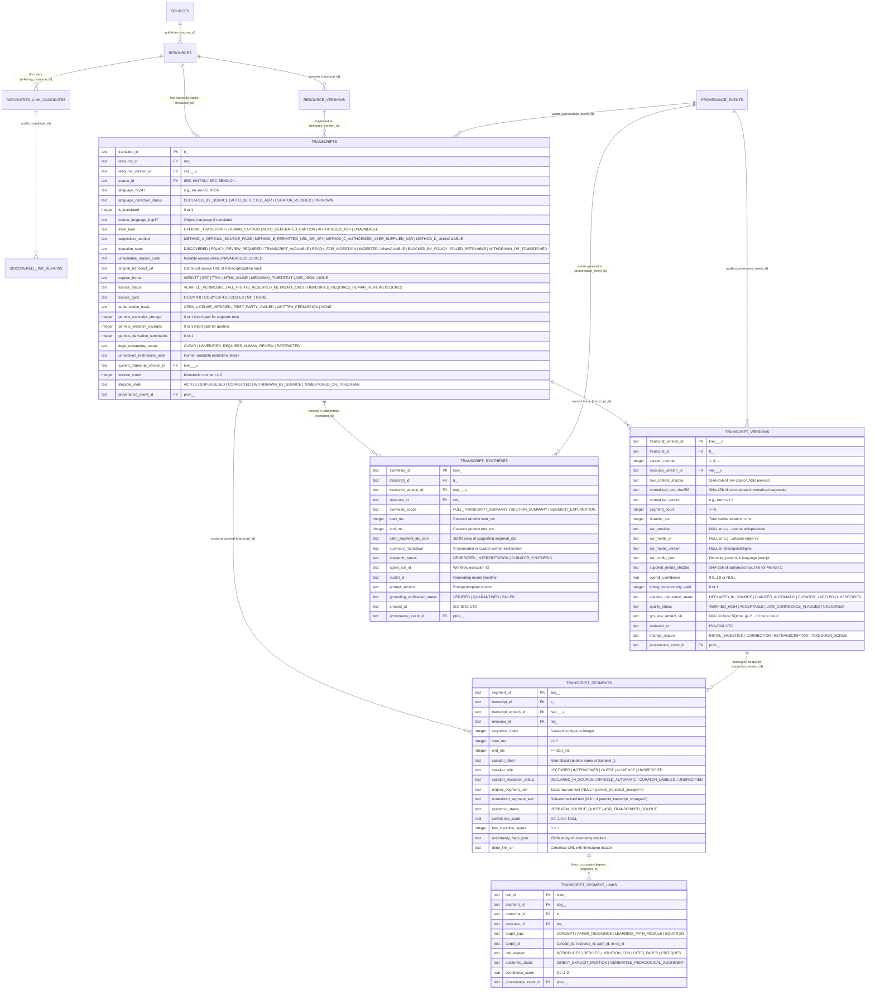
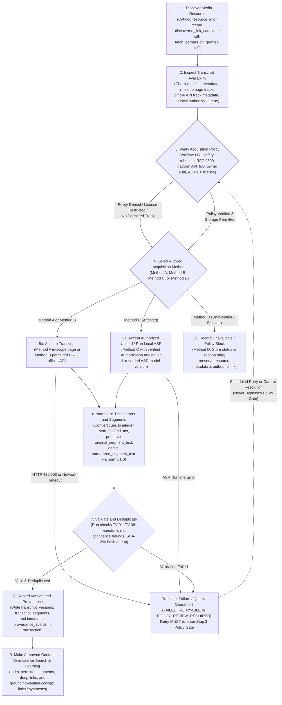

# Transcript Ingestion Architecture — AI Research & Learning System

**Document ID:** `ARCH-TRANSCRIPT-007`  
**Status:** Proposed for Architectural Review  
**Version:** `1.0.0`  
**Last Updated:** 2026-10-25  
**Related Decisions:** [`ADR-0006` (`decisions/0006-transcript-acquisition-and-storage.md`)](decisions/0006-transcript-acquisition-and-storage.md), [`ADR-0002` (`decisions/0002-knowledge-data-model.md`)](decisions/0002-knowledge-data-model.md), [`ADR-0003` (`decisions/0003-agent-execution-boundaries.md`)](decisions/0003-agent-execution-boundaries.md), [`ADR-0004` (`decisions/0004-notebook-isolation.md`)](decisions/0004-notebook-isolation.md), [`ADR-0005` (`decisions/0005-arxiv-api-access-policy.md`)](decisions/0005-arxiv-api-access-policy.md)  
**Companion Documents:** [`system-overview.md`](system-overview.md), [`data-model.md`](data-model.md), [`source-adapter-contract.md`](source-adapter-contract.md), [`agent-workflows.md`](agent-workflows.md), [`client-and-lab.md`](client-and-lab.md), [`implementation-roadmap.md`](implementation-roadmap.md), [`../operations/cloud-provisioning-plan.md`](../operations/cloud-provisioning-plan.md)

> [!IMPORTANT]
> **Architecture & Documentation Scope Boundary (Task 018):**
> - **Documentation and Architecture Only:** This specification defines the transcript acquisition policies, canonical data model extensions, state machine, source-specific rules, quality validation gates, and future implementation interfaces. It does **not** implement transcript downloading, audio extraction, automated speech recognition (ASR), vector embeddings, AI agents, or SQLite schema migrations (`LATEST_SCHEMA_VERSION` in [`../../knowledge_store.py`](../../knowledge_store.py) remains `5`).
> - **No Cloud Provisioning:** No Firebase or Google Cloud projects, billing accounts, APIs, Cloud Run jobs, Firestore databases, or Cloud Storage buckets are created or enabled by this task. Initial transcript persistence is designed for local SQLite (`data/research_inventory.sqlite`) on the Raspberry Pi.
> - **Unified Resource & Provenance Lineage:** Transcript ingestion reuses the existing canonical tables in [`../../knowledge_store.py`](../../knowledge_store.py) (`sources`, `resources`, `resource_versions`, `provenance_events`, `discovered_link_candidates`, and `discovered_link_reviews`) and [`../../curation.py`](../../curation.py). It does **not** introduce a parallel resource catalog.

---

## 1. Purpose, Architectural Context, and Integration with Existing Knowledge Store

Lectures, interviews, keynote talks, and visual mathematics lessons are primary pedagogical vehicles in modern AI research. For our target sources—Geoffrey Hinton (`SRC-HINTON`), Yoshua Bengio (`SRC-BENGIO`), 3Blue1Brown (`SRC-3B1B`), arXiv (`SRC-ARXIV`), and English Wikipedia (`SRC-WIKIPEDIA`)—crucial explanations often appear in spoken lectures or video lessons linked from first-party pages.

However, video and audio transcripts sit at the intersection of three distinct governance boundaries that must never be conflated:

1. **Discovery vs. Acquisition Permission:** Finding an outbound video or lecture link on an in-scope page (such as the `26` YouTube/`youtu.be` links among the `181` candidates persisted in `discovered_link_candidates` during the Task 012 pilot) records a citation candidate (`fetch_permission_granted = 0`). It **never** authorizes crawling the external video host or downloading its captions.
2. **Human UI Viewing vs. Programmatic API Download:** Being able to read an interactive transcript in a video platform's web browser UI or embed a player via an official iframe API does **not** mean programmatic caption downloading is permitted or technically available to third parties.
3. **Crawl Access (`robots.txt`) vs. Copyright & Platform Reuse Terms:** An `ALLOW` result under RFC 9309 (`robots.txt`) governs automated HTTP access to a URL; it is **not** a copyright license to store, index, or redistribute full transcript text or extract audio for speech-to-text processing.

### 1.1 Integration with Existing Entities in `knowledge_store.py`

Every transcript record attaches directly to the existing persistence hierarchy in [`../../knowledge_store.py`](../../knowledge_store.py):

- **`sources` (`source_id`)**: Identifies the registered source (`SRC-HINTON`, `SRC-BENGIO`, `SRC-3B1B`, `SRC-ARXIV`, `SRC-WIKIPEDIA`) and its baseline rate-limit and license posture.
- **`resources` (`resource_id = res_<sha256_16(source_id:canonical_url)>`)**: Represents the parent lecture, talk, lesson page, or media item. A transcript never exists as an orphan without a parent `resource_id`.
- **`resource_versions` (`version_id = ver_<yyyymmdd>_<hash8>_v<n>`)**: Captures the specific snapshot of the parent resource metadata at the time transcript availability was inspected.
- **`discovered_link_candidates` (`candidate_id = cand_<sha256_16>`) & `discovered_link_reviews` (`review_id = rev_<yyyymmdd>_<sha256_10>_r<n>`)**: Media links discovered on HTML pages remain in `discovered_link_candidates` with `fetch_permission_granted = 0`. Even when a curator records `ACCEPTED_FOR_REFERENCE` or `APPROVED_FOR_MANIFEST` via [`../../curation.py`](../../curation.py), `fetch_permission_granted` remains `0` until a source-specific policy gate independently verifies acquisition rights.
- **`provenance_events` (`event_id = prov_<yyyymmdd>_<sha256_12>`)**: Every transcript policy check, acquisition, normalization, validation failure, or takedown appends an immutable audit record referencing `source_id`, `resource_id`, and `run_id`.

---

## 2. Supported Transcript Acquisition Methods and Policy Boundaries

The architecture defines **four mutually exclusive transcript acquisition methods (`A`, `B`, `C`, `D`)**. Every media-bearing or lecture-bearing resource inspected by the pipeline must be classified into one of these four methods before any transcript content operation occurs.

> [!CAUTION]
> **Hard Prohibitions Across All Acquisition Methods:**
> 1. **No Undocumented Endpoints or Caption Scrapers:** The system must **never** use unofficial transcript scraping tools or undocumented internal endpoints (such as `youtube-transcript-api`, `yt-dlp --write-auto-sub`, `youtube-dl`, or direct scraping of undocumented `/api/timedtext` player endpoints).
> 2. **No Unlicensed Audio Extraction or Stream Ripping:** A public video or audio URL does **not** grant permission to download the media stream, strip its audio track, or run automated speech recognition (ASR) on it.
> 3. **No UI-to-API Permission Assumption:** The presence of a "Show transcript" button or CC toggle in a web video player UI is a human viewing feature governed by the platform's end-user terms; it does **not** grant programmatic scraping rights or override API owner-only restrictions.
> 4. **No `robots.txt` Substitute for Copyright/ToS:** A permissive `robots.txt` file never overrides copyright reservations (`ALL_RIGHTS_RESERVED`) or platform Terms of Service.

### 2.1 Method A — Transcript or Captions Published Directly on an Official Source Page (`METHOD_A_OFFICIAL_SOURCE_PAGE`)

| Dimension | Specification |
| :--- | :--- |
| **Method Code** | `METHOD_A_OFFICIAL_SOURCE_PAGE` |
| **Conditions for Use** | 1. The transcript text or caption track (`<track kind="captions\|subtitles" src="...">`, downloadable `.vtt`/`.srt`/`.txt`, or structured HTML transcript section) is published directly on an in-scope first-party URL matching `sources.allowed_url_prefixes`.<br/>2. The target URL passes [`validate_and_canonicalize_url`](../../knowledge_store.py#L140-L246) (HTTPS/HTTP only, no credentials, no private/loopback IP ranges).<br/>3. The host's `robots.txt` (`RFC 9309`) permits fetching the path under our descriptive `User-Agent`, and the adapter's per-origin rate limiter (`>= 5.0s` conservative floor for HTML sources) is respected. |
| **Required Permissions** | **Dual Gate (Technical Access + Copyright Reuse):**<br/>1. **Technical Crawl Permission:** `robots.txt` `ALLOW` on the exact transcript/page URL.<br/>2. **Content Storage & Redistribution Permission:** Explicit open license on the page (`CC-BY-4.0`, `CC-BY-SA-4.0`, `CC0-1.0`, `MIT`) or documented written permission from the rights holder (`permits_transcript_storage = 1`). |
| **Provenance Recorded** | `provenance_events` (`event_type = 'TRANSCRIPT_ACQUIRED'` or `'TRANSCRIPT_BLOCKED_BY_POLICY'`), recording `source_id`, `resource_id`, `resource_version_id`, `original_transcript_url`, HTTP status, `ETag`, `Last-Modified`, `raw_content_sha256`, `policy_profile_id`, and `license_spdx`. |
| **Failure Behaviour** | - If `robots.txt` disallows the path or returns `401`/`403`: fail closed immediately (`BLOCKED_BY_POLICY`).<br/>- If HTTP `429`/`503` occurs: trip the per-source circuit breaker, honor `Retry-After`, and transition to `FAILED_RETRYABLE` (no retry storms).<br/>- If the page is reachable by `robots.txt` but its copyright license is `ALL_RIGHTS_RESERVED` or `UNVERIFIED_REQUIRES_HUMAN_REVIEW`: **do not store full transcript text**; record `POLICY_REVIEW_REQUIRED` / `BLOCKED_BY_POLICY` (Method D fallback for text storage). |
| **Storage Eligibility** | - **If `permits_transcript_storage == 1`:** Full original transcript, normalized segments, and timestamps may be stored in SQLite (and later Cloud Storage).<br/>- **If `permits_transcript_storage == 0` (`ALL_RIGHTS_RESERVED` or `UNVERIFIED`):** Full transcript text may **not** be stored. Only resource metadata, section headings, and outbound deep-link locators are persisted (`METADATA_ONLY`). |

### 2.2 Method B — Caption or Transcript Files Available Through an Explicitly Permitted URL or Official API (`METHOD_B_PERMITTED_URL_OR_API`)

| Dimension | Specification |
| :--- | :--- |
| **Method Code** | `METHOD_B_PERMITTED_URL_OR_API` |
| **Conditions for Use** | 1. Captions or transcripts are exposed through an officially documented platform API (e.g., MediaWiki/Wikimedia Commons `TimedText` API, or YouTube Data API v3 `captions.list` + `captions.download` for videos where the caller holds authorized video-owner OAuth credentials) or a direct download URL accompanied by machine-readable open-license metadata.<br/>2. Requests use only documented API endpoints, required headers (`User-Agent` / `Api-User-Agent`), and official authentication scopes. |
| **Required Permissions** | **Three-Part Verification Gate:**<br/>1. **API Terms Compliance:** Full compliance with the platform's official API Terms of Service.<br/>2. **API Endpoint Authorization:** Valid API credentials/scopes required by the endpoint. Specifically, for YouTube Data API v3, `GET https://www.googleapis.com/youtube/v3/captions/{id}` (`captions.download`) requires OAuth 2.0 scope `https://www.googleapis.com/auth/youtube.force-ssl` or `youtubepartner` authorized by the **video owner** (`onBehalfOfContentOwner`). Calling `captions.download` on third-party videos returns `403 Forbidden`.<br/>3. **Underlying Content License:** Verified open license (`CC-BY`, `CC-BY-SA`, `CC0`, `MIT`) or explicit owner authorization permitting storage and indexing (`permits_transcript_storage = 1`). |
| **Provenance Recorded** | `provenance_events` (`event_type = 'TRANSCRIPT_ACQUIRED'`), recording API endpoint URL, `policy_profile_id`, platform `video_id` / `caption_track_id`, `track_kind` (`standard` vs. `asr`), revision ID (`oldid` / `etag`), `raw_content_sha256`, and verified `license_spdx`. |
| **Failure Behaviour** | - If the platform API requires owner OAuth not held by the project (the standard case for third-party YouTube videos) or returns `401`/`403`: transition deterministically to `UNAVAILABLE` (`unavailable_reason = 'PLATFORM_API_OWNER_ONLY_RESTRICTION'`). **Never** attempt to scrape the web player's caption track.<br/>- If an external caption repository (`github.com/...`) lacks an explicit license file permitting redistribution: halt at `POLICY_REVIEW_REQUIRED` (`legal_uncertainty_status = 'UNVERIFIED_REQUIRES_HUMAN_REVIEW'`). |
| **Storage Eligibility** | - **If API terms AND content license permit storage (`permits_transcript_storage == 1`):** Full caption file (`.vtt`/`.srt`/`.ttml`) and normalized timestamped segments may be stored with required attribution (e.g., `CC BY-SA 4.0` `oldid` link for Wikimedia TimedText).<br/>- **Otherwise:** No caption text is stored; only track availability metadata (`language_bcp47`, `track_kind`, `is_owner_authorized = 0`) and outbound player deep links are stored. |

### 2.3 Method C — Transcription of an Audio/Video File That the User Is Authorized to Supply and Process (`METHOD_C_AUTHORIZED_USER_SUPPLIED_ASR`)

| Dimension | Specification |
| :--- | :--- |
| **Method Code** | `METHOD_C_AUTHORIZED_USER_SUPPLIED_ASR` |
| **Conditions for Use** | 1. A curator or authorized user supplies a local audio/video file (or an already-prepared transcript file) linked to an existing `resource_id` and executes local/batch speech-to-text transcription (e.g., local Whisper / `faster-whisper` or approved cloud speech API).<br/>2. The system **never** downloads or rips media streams from unauthorized third-party video platforms to feed into Method C.<br/>3. Before any audio processing or text persistence begins, a mandatory **Authorization Attestation** record must be validated (`authorization_basis`, `license_spdx`, `supplied_media_sha256`, `attested_by`, `attested_at`, `evidence_reference`). |
| **Required Permissions** | Explicit verification that the user/project holds legal rights to process the media and store derivative transcripts under one of:<br/>- `OPEN_LICENSE_VERIFIED` (`CC-BY-4.0`, `CC-BY-SA-4.0`, `CC0-1.0`, `MIT`),<br/>- `FIRST_PARTY_OWNED_MEDIA` (project-authored educational recordings), or<br/>- `WRITTEN_RIGHTS_HOLDER_PERMISSION` (documented permission reference on file). |
| **Provenance Recorded** | `provenance_events` (`event_type = 'TRANSCRIPT_ASR_GENERATED'`), recording `supplied_media_sha256`, `media_duration_ms`, `authorization_basis`, `attested_by`, `asr_provider`, `asr_model_id`, `asr_model_version`, `asr_compute_env`, decoding parameters JSON, `raw_content_sha256`, and overall/per-segment confidence statistics. |
| **Failure Behaviour** | - If `authorization_basis` or `license_spdx` is missing, `ALL_RIGHTS_RESERVED`, or `UNVERIFIED`: reject immediately (`BLOCKED_BY_POLICY`) before running ASR.<br/>- If ASR processing fails due to corrupt media or runtime error: transition to `FAILED_RETRYABLE` and log `TRANSCRIPT_INGESTION_FAILED`.<br/>- If segment confidence is below minimum quality threshold (`< 0.50` mean confidence): quarantine transcript (`POLICY_REVIEW_REQUIRED`) so unintelligible hallucinations are not indexed for learner search. |
| **Storage Eligibility** | - **Permitted (`permits_transcript_storage == 1`)** when the attested license/permission covers derivative transcript creation and storage. Raw ASR output (`original_segment_text` with confidence scores) and normalized text (`normalized_segment_text`) are stored alongside full model lineage. |

### 2.4 Method D — Transcript Unavailable or Inaccessible Through Permitted Methods (`METHOD_D_UNAVAILABLE`)

| Dimension | Specification |
| :--- | :--- |
| **Method Code** | `METHOD_D_UNAVAILABLE` |
| **Conditions for Use** | Applied whenever a media resource:<br/>1. Has no published transcript or captions (`NO_CAPTIONS_PUBLISHED`),<br/>2. Hosts captions only in a third-party web UI where programmatic download requires video-owner authorization not held by the project (`PLATFORM_API_OWNER_ONLY_RESTRICTION`),<br/>3. Is governed by `ALL_RIGHTS_RESERVED` or unresolved licensing (`LICENSE_RESTRICTED_OR_UNVERIFIED`), or<br/>4. Is disallowed by `robots.txt` or site Terms of Service (`ROBOTS_OR_TERMS_DISALLOWED`). |
| **Required Permissions** | None — no transcript content is downloaded, extracted, or transcribed. |
| **Provenance Recorded** | `provenance_events` (`event_type = 'TRANSCRIPT_UNAVAILABLE_RECORDED'` or `'TRANSCRIPT_BLOCKED_BY_POLICY'`), recording `resource_id`, `ingestion_state` (`UNAVAILABLE`, `BLOCKED_BY_POLICY`, or `POLICY_REVIEW_REQUIRED`), `unavailable_reason_code`, and timestamp. |
| **Failure Behaviour** | Deterministic, non-error terminal state for the transcript pipeline. The system preserves the parent `resources` bibliographic record, curatorial notes, and outbound `canonical_url` so learners can navigate directly to the original video/lecture on the publisher's site. |
| **Storage Eligibility** | **Zero transcript text stored** (`permits_transcript_storage = 0`, `permits_verbatim_excerpts = 0`, `segment_count = 0`). Only the availability/policy status record in `transcripts` and the parent `resources` metadata are stored in SQLite. |

### 2.5 Why Viewing a Video Platform UI Transcript Does Not Grant Programmatic Download Permission

A frequent architectural anti-pattern in educational AI tools is assuming that because a human learner can click "Show transcript" on a public YouTube video, a backend worker may scrape that transcript programmatically. Our architecture enforces a strict separation:

1. **YouTube Web UI vs. YouTube Data API v3:**
   - The YouTube web client retrieves captions through internal player sessions governed by the YouTube Terms of Service, which prohibit automated scraping or downloading of content unless explicitly authorized by YouTube or the rights holder.
   - The official **YouTube Data API v3** provides two relevant methods:
     - [`captions.list`](https://developers.google.com/youtube/v3/docs/captions/list) (`GET https://www.googleapis.com/youtube/v3/captions?part=snippet&videoId={videoId}`): Returns metadata about available caption tracks (track ID, language, `trackKind` such as `standard` or `ASR`), but **not** the caption text.
     - [`captions.download`](https://developers.google.com/youtube/v3/docs/captions/download) (`GET https://www.googleapis.com/youtube/v3/captions/{id}`): Downloads the actual caption track, but **requires OAuth 2.0 scope `https://www.googleapis.com/auth/youtube.force-ssl` or `https://www.googleapis.com/auth/youtubepartner` from the video owner** (or a content partner acting `onBehalfOfContentOwner`). Any attempt to download captions for a third-party video returns HTTP `403 Forbidden`.
2. **YouTube IFrame Player API (`developers.google.com/youtube/iframe_api_reference`):**
   - Allows embedding a public video (when the video owner has enabled embedding) and navigating playback time via `player.seekTo(seconds, allowSeekAhead)` or `?start=<seconds>`.
   - Does **not** expose an API to extract caption text from the embedded player.
3. **Architectural Consequence:**
   - For third-party YouTube lectures discovered on `SRC-HINTON`, `SRC-BENGIO`, `SRC-3B1B`, `SRC-ARXIV`, or `SRC-WIKIPEDIA`, our pipeline **never** scrapes YouTube captions. Unless an official transcript is separately available via Method A (with verified license), Method B (an explicitly licensed official caption feed), or Method C (authorized media/transcript supplied with rights-holder permission), the YouTube video's transcript state transitions to **Method D (`UNAVAILABLE` / `BLOCKED_BY_POLICY`)**, while the UI can still link out to `canonical_url` with timestamp parameters where known from curated metadata.

---

## 3. Canonical Transcript Data Model

To avoid creating an incompatible parallel resource model, the transcript schema is designed as the smallest useful extension to the existing SQLite persistence layer in [`../../knowledge_store.py`](../../knowledge_store.py) (currently at `LATEST_SCHEMA_VERSION = 5`, planned for a future forward-only Migration `6` — **not implemented in this task**) and the cloud target schema in [`data-model.md`](data-model.md).

### 3.1 Entity-Relationship Diagram (Extension to `knowledge_store.py`)



### 3.2 Detailed Field Coverage Across Required Dimensions

1. **Transcript Identity and Associated Resource ID:**
   - `transcript_id`: Deterministic ID `tr_<sha256_16(f"{resource_id}:{language_bcp47.lower()}:{track_kind}")>` (`19` characters). Guarantees that repeated inspections of the same resource, language, and track kind map idempotently to the same `transcript_id`.
   - `resource_id`: Foreign key to `resources(resource_id) ON DELETE CASCADE`.
   - `resource_version_id`: Foreign key to `resource_versions(version_id) ON DELETE SET NULL`, pinning the exact parent resource version.
   - `source_id`: Foreign key to `sources(source_id) ON DELETE RESTRICT`.

2. **Language and Language-Detection Status:**
   - `language_bcp47`: IETF BCP 47 tag (e.g., `en`, `en-US`, `fr`, `fr-CA`), defaulting to `'und'` (undetermined) before inspection.
   - `language_detection_status`: Enum constrained to `('DECLARED_BY_SOURCE', 'AUTO_DETECTED_ASR', 'CURATOR_VERIFIED', 'UNKNOWN')`.
   - `is_translated`: Boolean integer (`0` or `1`) indicating whether the track is a translation of another spoken language.
   - `source_language_bcp47`: Nullable BCP 47 tag of the original spoken audio when `is_translated = 1`.

3. **Acquisition Method and Original Transcript Source URL:**
   - `acquisition_method`: Enum constrained to `('METHOD_A_OFFICIAL_SOURCE_PAGE', 'METHOD_B_PERMITTED_URL_OR_API', 'METHOD_C_AUTHORIZED_USER_SUPPLIED_ASR', 'METHOD_D_UNAVAILABLE')`.
   - `original_transcript_url`: Nullable text. Required for `METHOD_A_OFFICIAL_SOURCE_PAGE` and `METHOD_B_PERMITTED_URL_OR_API`; validated via [`validate_and_canonicalize_url`](../../knowledge_store.py#L140-L246). Null when `acquisition_method` is `METHOD_C_AUTHORIZED_USER_SUPPLIED_ASR` (local authorized file) or `METHOD_D_UNAVAILABLE`.

4. **Original Publication or Caption Metadata:**
   - `caption_format`: Enum constrained to `('WEBVTT', 'SRT', 'TTML', 'HTML_INLINE', 'MEDIAWIKI_TIMEDTEXT', 'ASR_JSON', 'NONE')`.
   - `track_kind`: Enum constrained to `('OFFICIAL_TRANSCRIPT', 'HUMAN_CAPTION', 'AUTO_GENERATED_CAPTION', 'AUTHORIZED_ASR', 'UNAVAILABLE')`.
   - `original_publication_metadata_json`: Structured JSON object storing source-provided attributes (`publisher`, `caption_track_id`, `track_label`, `published_at`, `updated_at`, `http_etag`, `http_last_modified`, `media_duration_ms`, `source_revision_id`).

5. **Rights and Permission Status, Including Unresolved Restrictions:**
   - `license_status`: `('VERIFIED_PERMISSIVE', 'ALL_RIGHTS_RESERVED_METADATA_ONLY', 'UNVERIFIED_REQUIRES_HUMAN_REVIEW', 'BLOCKED')`.
   - `license_spdx`: Standard SPDX identifier (`'CC-BY-4.0'`, `'CC-BY-SA-4.0'`, `'CC0-1.0'`, `'MIT'`) or `'NONE'`.
   - `authorization_basis`: `('OPEN_LICENSE_VERIFIED', 'FIRST_PARTY_OWNED', 'WRITTEN_RIGHTS_HOLDER_PERMISSION', 'NONE')`.
   - `permits_transcript_storage`: Integer (`0` or `1`). **Database-level `CHECK` constraint enforces that if `permits_transcript_storage = 0`, no segment text may be persisted.**
   - `permits_verbatim_excerpts`: Integer (`0` or `1`). Controls whether downstream tutoring/search responses may quote `original_segment_text` verbatim.
   - `permits_derivative_summaries`: Integer (`0` or `1`).
   - `legal_uncertainty_status`: `('CLEAR', 'UNVERIFIED_REQUIRES_HUMAN_REVIEW', 'RESTRICTED')`.
   - `unresolved_restrictions_note`: Free-text audit field documenting any unresolved copyright, platform ToS, or co-ownership restrictions (never left implicit).

6. **Transcript Version, Content Hash, Retrieval Timestamp, and Provenance:**
   - `transcript_versions` table records immutable snapshots (`transcript_version_id = tver_<yyyymmdd>_<hash8>_v<n>`, `version_number >= 1`).
   - `raw_content_sha256`: Lowercase 64-hex SHA-256 of the raw downloaded caption file or raw ASR JSON output.
   - `normalized_text_sha256`: Lowercase 64-hex SHA-256 of the canonically joined normalized segments. If a re-check produces the same `raw_content_sha256` and `normalized_text_sha256`, no duplicate version row is created (`last_verified_at` is updated idempotently).
   - `retrieved_at`: ISO-8601 UTC timestamp.
   - `provenance_event_id`: Foreign key to `provenance_events(event_id)`.

7. **Timestamped Transcript Segments, Sequence Order, and Speaker Labels:**
   - `segment_id`: Deterministic ID `seg_<transcript_id>_<sequence_index:05d>`.
   - `sequence_index`: Contiguous `0`-based integer (`0, 1, 2, ...`).
   - `start_ms` and `end_ms`: Non-negative integers representing milliseconds from the start of the media (`CHECK (start_ms >= 0 AND end_ms >= start_ms)`).
   - `speaker_label`: Nullable string (e.g., `'Geoffrey Hinton'`, `'Grant Sanderson'`, `'Interviewer'`, `'Speaker_1'`).
   - `speaker_role`: `('LECTURER', 'INTERVIEWER', 'GUEST', 'AUDIENCE', 'UNSPECIFIED')`.
   - `speaker_resolution_status`: `('DECLARED_IN_SOURCE', 'DIARIZED_AUTOMATIC', 'CURATOR_LABELED', 'UNSPECIFIED')`.

8. **Source and Version of Automated Speech-Recognition (ASR) Models When Used:**
   - Stored on `transcript_versions`:
     - `asr_provider`: e.g., `'faster-whisper'`, `'openai-whisper'`, `'google-cloud-speech-v2'` (null for Methods A, B, D).
     - `asr_model_id`: e.g., `'whisper-large-v3'`.
     - `asr_model_version`: Model weights SHA-256 digest or release version tag.
     - `asr_compute_env`: e.g., `'local-rpi-cpu-int8'` or `'cloud-run-job-cpu'`.
     - `asr_config_json`: JSON recording beam size, temperature, VAD filter settings, and initial prompt terminology.
     - `supplied_media_sha256`: SHA-256 hash of the user-supplied authorized audio/video file.
   - Enforced invariant: When `acquisition_method = 'METHOD_C_AUTHORIZED_USER_SUPPLIED_ASR'`, `asr_model_id`, `asr_model_version`, and `supplied_media_sha256` must be `NOT NULL`.

9. **Quality and Confidence Measures:**
   - Transcript-level (`transcript_versions`): `overall_confidence` (`REAL CHECK (overall_confidence IS NULL OR (overall_confidence >= 0.0 AND overall_confidence <= 1.0))`), `timing_monotonicity_valid` (`0` or `1`), `quality_status` (`'VERIFIED_HIGH'`, `'ACCEPTABLE'`, `'LOW_CONFIDENCE_FLAGGED'`, `'UNSCORED'`).
   - Segment-level (`transcript_segments`): `confidence_score` (`0.0..1.0` or `NULL` for human-authored captions), `has_inaudible_spans` (`0` or `1`), and `uncertainty_flags_json` (e.g., `["LOW_WORD_CONFIDENCE", "CROSSTALK", "MATH_SYMBOL_AMBIGUOUS"]`).

10. **Strict Separation of Original Transcript, Normalized Text, and AI-Generated Summaries:**
    - **Layer 1 — Original Transcript Material (`transcript_segments.original_segment_text`)**: Preserves the exact cue string as published by the source or emitted by ASR (including original punctuation, `[inaudible]` markers, or speaker tags). Never mutated after version creation.
    - **Layer 2 — Normalized Transcript Text (`transcript_segments.normalized_segment_text`)**: Produced by a deterministic, non-LLM rule normalizer (`normalizer_version = 'norm-v1.0'`) that strips WebVTT/SRT formatting tags (`<c>`, `<i>`, positioning cues), decodes HTML entities, normalizes Unicode to NFC, and collapses redundant whitespace for full-text search. Stored in a separate column; never overwrites `original_segment_text`.
    - **Layer 3 — AI-Generated Summaries & Pedagogical Interpretations (`transcript_syntheses`)**: Stored in a **separate table** (`transcript_syntheses`) with `epistemic_status = 'GENERATED_INTERPRETATION'`, mandatory `cited_segment_ids_json`, `agent_run_id`, `model_id`, `prompt_version`, and `grounding_verification_status`. Generated text can never be written into `transcript_segments.original_segment_text` or `normalized_segment_text`.

11. **Deletion, Correction, and Source-Removal Handling:**
    - **Correction / Re-transcription:** Creates a new immutable row in `transcript_versions` (`version_number = n + 1`, `change_reason = 'CORRECTION'` or `'RETRANSCRIPTION'`), updates `transcripts.current_transcript_version_id`, and marks the prior version `SUPERSEDED` while preserving audit lineage in `provenance_events`.
    - **Source Removal or Takedown (`WITHDRAWN_BY_SOURCE` / `TOMBSTONED_ON_TAKEDOWN`):** If a source removes a video/transcript, revokes permission, or updates `robots.txt` / terms to disallow indexing:
      1. `transcripts.lifecycle_state` transitions to `'TOMBSTONED_ON_TAKEDOWN'` and `ingestion_state` transitions to `'WITHDRAWN_OR_TOMBSTONED'`.
      2. `transcripts.permits_transcript_storage` and `permits_verbatim_excerpts` are forced to `0`.
      3. All rows for that `transcript_id` in `transcript_segments` and `transcript_syntheses` (and any future Cloud Storage raw caption artifacts) are **deleted/purged** inside a single atomic transaction.
      4. The tombstone row in `transcripts` and an immutable `TRANSCRIPT_TOMBSTONED_ON_TAKEDOWN` event in `provenance_events` are retained so future runs permanently skip re-ingesting the withdrawn transcript.

### 3.3 Storage Partitioning: Local SQLite Now vs. Cloud Firestore & Cloud Storage Later

| Data / Artifact Category | Initial Local-First Storage (Raspberry Pi SQLite — Stages 1–6) | Future Cloud Storage Partition (Post-Approval of Cloud Provisioning Plan) | Governance & Cost Rationale |
| :--- | :--- | :--- | :--- |
| **Transcript Registry & Policy State (`transcripts`)** | SQLite `transcripts` table in `data/research_inventory.sqlite` | Cloud Firestore `transcripts/{transcript_id}` document | Fast transactional filtering by `resource_id`, `source_id`, `ingestion_state`, and `permits_transcript_storage`. |
| **Transcript Version Lineage (`transcript_versions`)** | SQLite `transcript_versions` table | Cloud Firestore `transcripts/{transcript_id}/versions/{transcript_version_id}` | Preserves content hashes (`raw_content_sha256`, `normalized_text_sha256`), ASR model lineage, and provenance pointers. |
| **Timestamped Segments (`transcript_segments`)** | SQLite `transcript_segments` table (with FTS5 virtual index over `normalized_segment_text` when `permits_transcript_storage = 1`) | Cloud Firestore `transcripts/{transcript_id}/segments/{segment_id}` + `knowledge_chunks/{chunk_id}` for vector search | Enables sub-second timestamp lookup (`start_ms <= t <= end_ms`) and grounded citation verification. |
| **AI Summaries & Concept Links (`transcript_syntheses`, `transcript_segment_links`)** | SQLite `transcript_syntheses` and `transcript_segment_links` tables | Cloud Firestore `transcript_syntheses/{synthesis_id}` and `concept_segment_links/{link_id}` | Keeps `GENERATED_INTERPRETATION` strictly separated from source transcript tables. |
| **Raw Caption Files (`.vtt`, `.srt`, `.ttml`) & Full Raw ASR JSON** | Optional local content-addressed file under gitignored `data/runtime/transcript_artifacts/<sha256[:2]>/<sha256>.vtt` (only when `permits_transcript_storage = 1`) | Google Cloud Storage `gs://<unprovisioned-artifacts-bucket>/transcripts/{source_id}/{resource_id}/{transcript_version_id}/raw.{ext}` | Avoids bloating SQLite pages or Firestore 1 MiB document limits with multi-megabyte raw ASR word-timing JSON or raw `.ttml` XML files. |

---

## 4. Transcript Ingestion Pipeline and State Machine

### 4.1 Logical End-to-End Workflow Diagram

The Mermaid flowchart below defines the mandatory nine-stage logical workflow from media discovery through search/learning availability:



### 4.2 Transcript Ingestion State Machine

Every transcript record in `transcripts.ingestion_state` follows a deterministic state machine using the eight core operational states plus a terminal takedown state (`WITHDRAWN_OR_TOMBSTONED`):

```mermaid
stateDiagram-v2
    [*] --> DISCOVERED : Media resource cataloged or candidate promoted (fetch_permission_granted = 0)

    DISCOVERED --> TRANSCRIPT_AVAILABLE : Inspection finds candidate caption track, inline text, or attested local file
    DISCOVERED --> UNAVAILABLE : Inspection finds no transcript or only third-party UI captions without API permission (Method D)
    DISCOVERED --> POLICY_REVIEW_REQUIRED : License or platform terms ambiguous / missing SPDX license
    DISCOVERED --> BLOCKED_BY_POLICY : Disallowed by robots.txt, unsafe URL, or explicit copyright reservation

    TRANSCRIPT_AVAILABLE --> READY_FOR_INGESTION : Policy Gate PASS (Method A, B, or C verified; permits_transcript_storage = 1)
    TRANSCRIPT_AVAILABLE --> POLICY_REVIEW_REQUIRED : Policy Gate finds unverified license or missing attestation
    TRANSCRIPT_AVAILABLE --> BLOCKED_BY_POLICY : Policy Gate DENY (ALL_RIGHTS_RESERVED, owner-only API 403, or ToS restriction)
    TRANSCRIPT_AVAILABLE --> UNAVAILABLE : Track URL returns 404 or empty track (Method D)

    POLICY_REVIEW_REQUIRED --> TRANSCRIPT_AVAILABLE : Human curator records verified license/attestation -> re-run Policy Gate
    POLICY_REVIEW_REQUIRED --> BLOCKED_BY_POLICY : Human curator confirms restriction (Method D)
    POLICY_REVIEW_REQUIRED --> UNAVAILABLE : Human curator confirms no usable transcript exists (Method D)

    READY_FOR_INGESTION --> INGESTED : Acquisition + normalization + TV-01..TV-08 validation + provenance transaction succeed
    READY_FOR_INGESTION --> FAILED_RETRYABLE : Transient network/API timeout (HTTP 429/503) or recoverable local ASR error
    READY_FOR_INGESTION --> POLICY_REVIEW_REQUIRED : Post-fetch validation detects contradictory license notice or low ASR confidence (< 0.50)
    READY_FOR_INGESTION --> BLOCKED_BY_POLICY : Upstream responds HTTP 401/403/451 during fetch

    FAILED_RETRYABLE --> TRANSCRIPT_AVAILABLE : Retry timer expires -> MUST re-enter Policy Gate before READY_FOR_INGESTION
    FAILED_RETRYABLE --> UNAVAILABLE : Max retries exhausted or permanent 404/410

    INGESTED --> TRANSCRIPT_AVAILABLE : New version check / correction requested -> re-verify Policy Gate
    INGESTED --> WITHDRAWN_OR_TOMBSTONED : Source takedown, permission revocation, or robots.txt disallow (purges segments)
    BLOCKED_BY_POLICY --> WITHDRAWN_OR_TOMBSTONED : Explicit takedown tombstone
```



### 4.3 State Definitions and Mandatory Safety Invariants

| State | Meaning | Permitted Next States | Segment Text Present in DB? |
| :--- | :--- | :--- | :--- |
| `DISCOVERED` | Media resource or lecture record exists in `resources`, but transcript availability and policy have not yet been evaluated. | `TRANSCRIPT_AVAILABLE`, `UNAVAILABLE`, `POLICY_REVIEW_REQUIRED`, `BLOCKED_BY_POLICY` | **No** (`0` rows) |
| `TRANSCRIPT_AVAILABLE` | A candidate caption track, inline transcript, or user-supplied media file has been identified, awaiting or undergoing the mandatory policy verification gate. | `READY_FOR_INGESTION`, `POLICY_REVIEW_REQUIRED`, `BLOCKED_BY_POLICY`, `UNAVAILABLE` | **No** (`0` rows) |
| `POLICY_REVIEW_REQUIRED` | Technical availability exists, but copyright license, repository terms, or ASR quality require explicit human curator verification (`legal_uncertainty_status = 'UNVERIFIED_REQUIRES_HUMAN_REVIEW'`). | `TRANSCRIPT_AVAILABLE` (after review, to re-run policy gate), `BLOCKED_BY_POLICY`, `UNAVAILABLE` | **No** (`0` rows) |
| `READY_FOR_INGESTION` | Policy gate has **passed** with a selected allowed acquisition method (`METHOD_A`, `METHOD_B`, or `METHOD_C`) and `permits_transcript_storage = 1`. | `INGESTED`, `FAILED_RETRYABLE`, `POLICY_REVIEW_REQUIRED`, `BLOCKED_BY_POLICY` | **No** (committed only on transition to `INGESTED`) |
| `INGESTED` | Transcript has been acquired, normalized, validated against `TV-01`..`TV-08`, versioned in `transcript_versions`, and persisted in `transcript_segments` with provenance. | `TRANSCRIPT_AVAILABLE` (for version update check), `WITHDRAWN_OR_TOMBSTONED` | **Yes** (`segment_count >= 1`) |
| `UNAVAILABLE` | Method D terminal state: no transcript exists or captions are inaccessible through permitted methods (e.g., third-party YouTube video where `captions.download` is owner-only). | `TRANSCRIPT_AVAILABLE` (only if an authorized Method C upload or new official track is later supplied) | **No** (`0` rows) |
| `BLOCKED_BY_POLICY` | Method D terminal state: transcript acquisition or storage is prohibited by `robots.txt`, platform Terms of Service, `ALL_RIGHTS_RESERVED` copyright, or unsafe URL check. | `WITHDRAWN_OR_TOMBSTONED`, or `POLICY_REVIEW_REQUIRED` (only via explicit administrative override audit) | **No** (`0` rows) |
| `FAILED_RETRYABLE` | Transient operational failure (e.g., HTTP `429`/`503` with `Retry-After`, temporary network failure, or local ASR worker crash). | `TRANSCRIPT_AVAILABLE` (must re-verify policy gate), `UNAVAILABLE` | **No** (for the failed version) |
| `WITHDRAWN_OR_TOMBSTONED` | Terminal compliance state after a source removal or takedown request; all segments and AI syntheses have been purged. | None (terminal) | **No** (`0` rows; purged) |

#### Critical Invariants Enforced by the State Machine
1. **Discovery Never Automatically Grants Acquisition Permission:**
   - No transition exists from `DISCOVERED` directly to `READY_FOR_INGESTION` or `INGESTED`.
   - Furthermore, external video URLs discovered on HTML pages remain in `discovered_link_candidates` (`fetch_permission_granted = 0`). Even after a human curator marks a candidate `ACCEPTED_FOR_REFERENCE` or `APPROVED_FOR_MANIFEST` in [`../../curation.py`](../../curation.py), `fetch_permission_granted` remains `0`, and any promoted media resource starts in `DISCOVERED` with `permits_transcript_storage = 0`.
2. **Retrying a Failed Request Never Bypasses the Policy Gate:**
   - No transition exists from `FAILED_RETRYABLE` directly to `READY_FOR_INGESTION` or `INGESTED`.
   - Every retry transitions `FAILED_RETRYABLE → TRANSCRIPT_AVAILABLE`, forcing a fresh execution of **Step 3 (Verify Acquisition Policy)**—including `validate_and_canonicalize_url`, `robots.txt` cache/re-validation, source circuit-breaker check, and license verification—before `READY_FOR_INGESTION` can be entered.

---

## 5. Source-by-Source Application and Platform Policy Analysis

Each of the five registered sources in [`source-adapter-contract.md`](source-adapter-contract.md) and its outbound media references are governed by source-specific access and reuse rules. **An outbound video link on an in-scope page never authorizes crawling the destination host.**

### 5.1 Summary Matrix Across Registered Sources

| Source ID | Source Name & Scope | Primary Media / Lecture Surfaces | Allowed Acquisition Method(s) | Default Transcript Storage Posture | Unresolved Licensing / Access Questions |
| :--- | :--- | :--- | :--- | :--- | :--- |
| `SRC-HINTON` | **Geoffrey Hinton** (`https://www.cs.toronto.edu/~hinton/`) | `talks.html`, course lecture references (`csc321`), same-host slide PDFs, and `15` outbound external links (YouTube, university portals) observed in pilot | **Method D (`BLOCKED_BY_POLICY` / `UNAVAILABLE`)** by default; **Method C** only if explicit written permission or CC-licensed recording is obtained | `METADATA_ONLY` (`permits_transcript_storage = 0`, `permits_verbatim_excerpts = 0`) | First-party pages carry no open license (`ALL_RIGHTS_RESERVED`); linked YouTube lectures are third-party hosted (`captions.download` owner-only). |
| `SRC-BENGIO` | **Yoshua Bengio** (`https://yoshuabengio.org/en`) | Research/blog pages and `29` outbound links (`www.youtube.com`, `youtu.be`, `mila.quebec`, interviews) observed in pilot | **Method D (`BLOCKED_BY_POLICY` / `UNAVAILABLE`)** by default; **Method A/C** only for items with verified open license or written permission | `METADATA_ONLY` (`permits_transcript_storage = 0`, `permits_verbatim_excerpts = 0`) | Site content defaults to `ALL_RIGHTS_RESERVED`; external interview platforms (YouTube, news outlets) prohibit third-party caption scraping. |
| `SRC-3B1B` | **3Blue1Brown** (`https://www.3blue1brown.com/`) | `/lessons/*` written lesson pages, embedded YouTube videos, and public `github.com/3b1b/captions` repo (`88` candidates observed in pilot) | **Method D (`POLICY_REVIEW_REQUIRED` / `BLOCKED_BY_POLICY`)** until license is clarified; outbound links + timestamp locators preserved | `METADATA_ONLY` (`permits_transcript_storage = 0`, `permits_verbatim_excerpts = 0`) | 3Blue1Brown FAQ permits short video clips (`< 60s`) with attribution in context, but neither `3blue1brown.com` lessons nor `github.com/3b1b/captions` declare an SPDX license permitting bulk transcript redistribution. |
| `SRC-ARXIV` | **arXiv** (`https://export.arxiv.org/api/query`) | Paper abstracts/metadata referencing external talk videos (NeurIPS, ICML, ICLR, YouTube) or supplementary media | **Method D (`UNAVAILABLE`)** for external talk links; **Method B/C** only if supplementary media is hosted under an explicit `CC-BY` / `CC0` license on an approved endpoint | `METADATA_AND_ABSTRACT` for papers; `METADATA_ONLY` (`permits_transcript_storage = 0`) for unverified external talks | An arXiv paper's `CC-BY-4.0` license applies to the e-print submission itself, **not** automatically to an external conference video or YouTube URL linked in its abstract/comments. |
| `SRC-WIKIPEDIA` | **English Wikipedia** (`https://en.wikipedia.org/w/api.php`) | Wikimedia Commons instructional videos/audio (`TimedMediaHandler` `TimedText` tracks) and external video citations in articles | **Method B (`METHOD_B_PERMITTED_URL_OR_API`)** for Wikimedia Commons `TimedText` with verified `CC-BY-SA-4.0`/`CC-BY-4.0`/`CC0`; **Method D** for external video citations | `FULL_TRANSCRIPT_PERMITTED` (`permits_transcript_storage = 1` with `oldid` & `CC BY-SA` attribution) for Commons `TimedText`; `METADATA_ONLY` for external links | Each Wikimedia Commons media file and `TimedText` page must have its specific license metadata verified via the MediaWiki API rather than assumed from the article text. |

### 5.2 Detailed Source Rules

#### 1. Geoffrey Hinton (`SRC-HINTON` — `https://www.cs.toronto.edu/~hinton/`)
- **In-Scope Pages:** `https://www.cs.toronto.edu/~hinton/talks.html`, `index.html`, `pages/publications.html`. Fetched under `robots.txt` (`Crawl-delay: 1`, enforced at `>= 5.0s` conservative floor).
- **Same-Host Non-HTML & Cross-Owner Prefix Links:** In the Task 012 pilot, `SRC-HINTON` yielded `5` same-host binary links (`minefield.pdf`, `shortcv.pdf`, `HintonMumbai.pdf`, `screen.gif`, `sound.gif`) classified as `SAME_HOST_BINARY_CITATION_NO_FETCH` and `1` cross-owner link (`https://www.cs.toronto.edu/~tijmen/csc321/`) classified as `SAME_HOST_OUTSIDE_PREFIX_NO_FETCH`. Neither may be crawled or transcribed without explicit scope/license expansion.
- **Linked Lectures:** External video links on `talks.html` (such as YouTube or university video servers) remain in `discovered_link_candidates` (`EXTERNAL`, `fetch_permission_granted = 0`). If a lecture is cataloged as a reference resource, its transcript status is recorded under **Method D (`UNAVAILABLE` / `BLOCKED_BY_POLICY`)** unless rights-holder permission or an open-licensed file is provided under Method C.

#### 2. Yoshua Bengio (`SRC-BENGIO` — `https://yoshuabengio.org/en`)
- **In-Scope Pages:** `https://yoshuabengio.org/en`, `/en/research`, `/en/blog*`. Governed by `robots.txt` (`>= 5.0s` rate limit, respecting all 33 CMS `Disallow` rules).
- **Linked Interviews and Talks:** In the Task 012 pilot, `SRC-BENGIO` pages contained `29` external candidates including `www.youtube.com`, `youtu.be`, `mila.quebec`, and news/podcast interviews (`transformernews.ai`, `ft.com`, `time.com`).
- **Transcript Policy:** Outbound links to YouTube interviews, podcasts, or news videos do **not** grant permission to crawl those external domains, scrape their transcripts, or download their audio. They are persisted as `EXTERNAL` candidates (`fetch_permission_granted = 0`). Even if an interview transcript is printed inline on a `yoshuabengio.org/en/blog/*` page, the site carries `ALL_RIGHTS_RESERVED_METADATA_ONLY`, so full verbatim transcript storage is blocked (`Method D` / `BLOCKED_BY_POLICY`) unless an explicit open license is declared on the post.

#### 3. 3Blue1Brown (`SRC-3B1B` — `https://www.3blue1brown.com/`)
- **In-Scope Pages & Discovered Candidates:** `https://www.3blue1brown.com/`, `/topics/*`, `/lessons/*`. In the Task 012 pilot, `SRC-3B1B` produced `56` internal lesson/topic candidates and `32` external candidates (including YouTube video links and `github.com/3b1b`).
- **Official Licensing & FAQ Consultation (Checked `2026-10-25`):**
  - Per the official 3Blue1Brown FAQ (`https://www.3blue1brown.com/faq`), Grant Sanderson permits using still images or short video clips under 60 seconds with clear on-screen attribution and links back when significantly adding context, while prohibiting full lesson or dubbed re-uploads.
  - While the Manim animation engine (`github.com/3b1b/manim`) is MIT-licensed and 3Blue1Brown maintains a public caption repository (`github.com/3b1b/captions`) and written lesson pages on `3blue1brown.com/lessons/*`, **neither the written lesson pages nor the `3b1b/captions` repository currently publish a standard open-content license (such as CC BY or MIT) explicitly authorizing third-party databases to store and redistribute full lesson transcripts.**
- **Architectural Resolution (Fail-Closed on Unresolved License):**
  - We document this as an **explicit unresolved licensing question** (`legal_uncertainty_status = 'UNVERIFIED_REQUIRES_HUMAN_REVIEW'`).
  - The system **does not** ingest full lesson text from `3blue1brown.com/lessons/*`, **does not** scrape YouTube captions for 3Blue1Brown videos, and **does not** bulk-import `github.com/3b1b/captions` without verified written permission or an explicit license file.
  - Instead, `SRC-3B1B` resources store structured lesson metadata, mathematical topic mappings, section titles, and outbound deep links (`https://www.3blue1brown.com/lessons/...` and official YouTube embed/time links via the YouTube IFrame Player API).

#### 4. arXiv (`SRC-ARXIV` — `https://export.arxiv.org/api/query`)
- **API Access Boundary (`ADR-0005`):** All `SRC-ARXIV` queries strictly follow the `ARXIV_OFFICIAL_ATOM_API_V1` policy profile defined in [`decisions/0005-arxiv-api-access-policy.md`](decisions/0005-arxiv-api-access-policy.md): single active connection (`max_concurrency = 1`) and `>= 3.0s` minimum interval **across all machines controlled by the project**, with general HTML crawling on `export.arxiv.org` disallowed by `robots.txt`.
- **Associated Media & Conference Talks:** arXiv Atom `<summary>` or `<arxiv:comment>` fields occasionally contain links to conference talk videos (e.g., NeurIPS, ICML, ICLR, CVPR, Simons Institute, or YouTube).
- **Transcript Policy:**
  - Any URL extracted from an arXiv abstract or comment is recorded in `discovered_link_candidates` (`domain_classification = 'EXTERNAL'`, `fetch_permission_granted = 0`).
  - Under the [arXiv License Information](https://info.arxiv.org/help/license/index.html) and [arXiv API Terms of Use](https://info.arxiv.org/help/api/tou.html), arXiv metadata/abstracts are `CC0-1.0`, and individual papers carry either the default arXiv non-exclusive distribution license or a Creative Commons license (`CC-BY-4.0`, `CC-BY-SA-4.0`, `CC-BY-NC-ND-4.0`, `CC0-1.0`). However, **a paper's arXiv license does not transfer to an external video host linked in the paper's comment.**
  - Transcript ingestion for a linked talk is permitted only if the talk itself is hosted on an explicitly licensed open platform (Method B) or supplied with verified rights-holder authorization (Method C); otherwise it is recorded under **Method D (`UNAVAILABLE`)**.

#### 5. English Wikipedia (`SRC-WIKIPEDIA` — `https://en.wikipedia.org/w/api.php`)
- **API Access & Licensing:** Governed by the [Wikimedia API Access Policy](https://www.mediawiki.org/wiki/Wikimedia_APIs/Access_policy), [Wikimedia User-Agent Policy](https://foundation.wikimedia.org/wiki/Policy:Wikimedia_Foundation_User-Agent_Policy), and [Wikipedia Copyrights (`CC BY-SA 4.0`)](https://en.wikipedia.org/wiki/Wikipedia:Copyrights).
- **Wikimedia Commons Instructional Media (`TimedMediaHandler`):**
  - When a Wikipedia article includes an instructional audio or video file hosted on Wikimedia Commons, the MediaWiki [`Extension:TimedMediaHandler`](https://www.mediawiki.org/wiki/Extension:TimedMediaHandler) stores accompanying timed caption tracks in the `TimedText:` namespace (typically `.srt` or WebVTT) accessible via the official MediaWiki API.
  - **Method B Applicability:** If the MediaWiki `imageinfo` / `extmetadata` API confirms that the media file and its `TimedText` track carry a verified permissive license (`CC-BY-SA-4.0`, `CC-BY-4.0`, or `CC0-1.0`), the caption track may be acquired via **Method B (`METHOD_B_PERMITTED_URL_OR_API`)** using sequential `>= 1.0s` requests and mandatory `User-Agent` / `Api-User-Agent` headers, storing the exact `oldid` revision ID and `CC BY-SA` attribution requirements.
- **External Video Citations on Wikipedia:** Outbound links in a Wikipedia article's "External links" or "References" sections pointing to YouTube or third-party domains are treated as `EXTERNAL` candidates (`fetch_permission_granted = 0`) and never auto-fetched.

---

## 6. Transcript Quality, Educational Use, and Anti-Hallucination Validation

### 6.1 Preserving Timestamps for Direct Video Return Navigation

1. **Canonical Millisecond Representation:**
   - All cue timestamps from WebVTT (`HH:MM:SS.mmm`), SubRip/SRT (`HH:MM:SS,mmm`), TTML (`begin`/`end` ticks or offset-time), or ASR word/segment outputs are normalized into non-negative 64-bit integers `start_ms` and `end_ms`.
   - Every segment stores a pre-validated `deep_link_url` constructed deterministically from the parent `resources.canonical_url` and `start_ms`:
     - Standard media fragment (W3C Media Fragments URI): `<canonical_url>#t=<start_seconds>`
     - YouTube watch URLs (outbound reference link): `https://www.youtube.com/watch?v=<video_id>&t=<start_seconds>s`
     - Official YouTube IFrame Player API integration (client-side playback when embedding is enabled by the owner): invokes `player.seekTo(Math.floor(start_ms / 1000), true)`.
2. **Learner Experience:**
   - Every transcript search hit, concept-linked segment, or AI tutor citation renders a clickable timestamp pill (`[14:22 — Return to Video]`) that opens or seeks the original video to `floor(start_ms / 1000)` so the learner can verify the primary source directly in context.

### 6.2 Handling Speaker Labels and Uncertain Transcription

1. **Speaker Attribution & Diarization Provenance:**
   - WebVTT `<v Speaker Name>` voice spans or explicit transcript speaker prefixes (`Geoffrey Hinton:`) are parsed into `speaker_label` with `speaker_resolution_status = 'DECLARED_IN_SOURCE'`.
   - Automatic speaker diarization outputs (e.g., `SPEAKER_00`, `SPEAKER_01`) are recorded with `speaker_resolution_status = 'DIARIZED_AUTOMATIC'` and never mapped to a real person's name unless verified by source metadata or a curator (`'CURATOR_LABELED'`).
2. **Uncertain Spans and Inaudible Audio:**
   - Automated speech recognition frequently misrecognizes mathematical notation, proper nouns (e.g., *Boltzmann*, *Hopfield*, *backpropagation*, *Kullback-Leibler*), or crosstalk.
   - Any ASR token/segment with confidence `< 0.75` is flagged in `uncertainty_flags_json` (`["LOW_CONFIDENCE_SEGMENT"]`).
   - Unintelligible regions are preserved explicitly as `[inaudible HH:MM:SS]` or `[crosstalk HH:MM:SS]` in `normalized_segment_text` (`has_inaudible_spans = 1`) rather than guessing words or silently dropping time intervals.

### 6.3 Tracking Language, Transcription Method, and Model Version

- Every `transcripts` row records `language_bcp47`, `language_detection_status`, `is_translated`, `source_language_bcp47`, `track_kind`, and `acquisition_method`.
- Every `transcript_versions` row created via `METHOD_C_AUTHORIZED_USER_SUPPLIED_ASR` records `asr_provider`, `asr_model_id`, `asr_model_version`, `asr_compute_env`, `asr_config_json`, and `supplied_media_sha256`. If a newer ASR model re-transcribes the same authorized media file, a new `transcript_version_id` (`v2`) is created without overwriting `v1`.

### 6.4 Generating Summaries and Concept Explanations Without Replacing the Original Transcript

- AI-generated summaries, section takeaways, and mathematical intuition notes are written exclusively to the `transcript_syntheses` table with `epistemic_status = 'GENERATED_INTERPRETATION'`, `agent_run_id`, `model_id`, `prompt_version`, and `cited_segment_ids_json`.
- `transcript_segments.original_segment_text` and `transcript_segments.normalized_segment_text` are **read-only** with respect to all AI agent workflows (`WF-02-CURATION`, `WF-03-ANALYSIS`, `WF-04-LEARNING-PATH`).
- In the learner UI ([`client-and-lab.md`](client-and-lab.md)), AI summaries are rendered in a visually distinct "Generated Pedagogical Note" card alongside—never in place of—the source transcript or timestamp locator.

### 6.5 Linking Transcript Segments to Resources, Mathematical Concepts, Papers, and Learning Paths

Through the `transcript_segment_links` table, specific timestamped segments (`seg_<transcript_id>_<seq>`) link directly to:
1. **Parent Resource (`resource_id`)**: Mandatory foreign key on every segment.
2. **Mathematical & AI Concepts (`target_type = 'CONCEPT'`, `target_id = 'concept_backpropagation'`)**: Connects a specific 90-second lecture explanation (e.g., `00:12:15`–`00:13:45`) to a node in the prerequisite concept DAG (`concepts`).
3. **Referenced Research Papers (`target_type = 'PAPER_RESOURCE'`, `target_id = 'res_ab5dba0c12050d69'`)**: Links a moment in a lecture where a speaker discusses a specific paper (e.g., `arXiv:1207.0580`) to that paper's canonical `resource_id`.
4. **Learning Path Modules (`target_type = 'LEARNING_PATH_MODULE'`, `target_id = 'lp_foundations_01:mod_02'`)**: Allows a structured curriculum step to assign a precise timestamp window `[start_ms, end_ms]` rather than an entire 60-minute video.

### 6.6 Measurable Validation Checks and Anti-Hallucination Gates

Before any transcript version transitions to `INGESTED`—and before any AI-generated synthesis in `transcript_syntheses` is marked `grounding_verification_status = 'VERIFIED'`—the pipeline enforces eight deterministic, measurable validation checks (`TV-01` through `TV-08`):

| Check ID | Validation Check Name | Deterministic Rule / Formula | Required Pass Threshold | Failure Action |
| :--- | :--- | :--- | :--- | :--- |
| **`TV-01`** | **Policy & Storage Gate Integrity** | If `permits_transcript_storage == 0` OR `ingestion_state != 'READY_FOR_INGESTION'`, count of rows in `transcript_segments` with non-null text must be `0`. | **`100%` (`0` unauthorized segment rows)** | Abort transaction; log `TRANSCRIPT_POLICY_VIOLATION_BLOCKED`; keep state `BLOCKED_BY_POLICY`. |
| **`TV-02`** | **Timestamp Monotonicity & Bounds** | For all segments $i \in [0, N-1]$: $0 \le \text{start\_ms}_i \le \text{end\_ms}_i$, $\text{start\_ms}_i \le \text{start\_ms}_{i+1}$, and if `duration_ms` is known, $\text{end\_ms}_{N-1} \le \text{duration\_ms} + 2000\text{ ms}$. | **`100%` of segments in version** | Reject version ingestion; transition to `FAILED_RETRYABLE` with `INVALID_TIMESTAMP_ORDER`. |
| **`TV-03`** | **Sequence Contiguity & Non-Empty Normalization** | `sequence_index` forms a contiguous range $0, 1, \dots, N-1$ with no gaps or duplicates, and every stored segment has `length(trim(normalized_segment_text)) >= 1` (or an explicit `[inaudible]` marker). | **`100%` contiguous indices** | Reject version ingestion; transition to `FAILED_RETRYABLE`. |
| **`TV-04`** | **ASR Provenance & Confidence Threshold** | When `acquisition_method == 'METHOD_C_AUTHORIZED_USER_SUPPLIED_ASR'`: `asr_model_id`, `asr_model_version`, `supplied_media_sha256`, and `authorization_basis` are non-null, and mean segment `confidence_score >= 0.50`. | **`100%` provenance fields present AND `mean(confidence) >= 0.50`** | If provenance missing: `BLOCKED_BY_POLICY`. If `mean(confidence) < 0.50`: quarantine in `POLICY_REVIEW_REQUIRED`. |
| **`TV-05`** | **Content Hash Deduplication** | Compute `raw_content_sha256` and `normalized_text_sha256`. Compare against `current_transcript_version_id`. | **Exact 64-hex SHA-256 comparison** | If hashes match existing active version: skip creating duplicate `transcript_versions` / `transcript_segments` rows; update `last_verified_at` idempotently. |
| **`TV-06`** | **Strict Layer Separation Check** | Verify that `original_segment_text` equals the exact source cue string prior to normalization, and that AI synthesis workflows never write to `transcript_segments`. | **`100%` immutability of `original_segment_text`** | Database trigger / repository guard raises `ValueError` on any mutation attempt. |
| **`TV-07`** | **Anti-Fabricated-Quote Verification (`G-02` Extension)** | Any response or synthesis claiming `epistemic_status = 'VERBATIM_SOURCE_QUOTE'` must (a) reference a valid `segment_id`, (b) have `transcripts.permits_verbatim_excerpts == 1`, (c) have `segment.confidence_score IS NULL OR segment.confidence_score >= 0.85` and `has_inaudible_spans == 0`, and (d) match an exact normalized substring of `original_segment_text`. | **`100%` exact substring match + rights & confidence check** | Downgrade or reject unverified quote (`grounding_verification_status = 'QUARANTINED'`); never display fabricated or low-confidence ASR text as a direct quote. |
| **`TV-08`** | **Citation Timestamp Grounding (`G-01` Extension)** | Every claim in `transcript_syntheses` must cite at least one valid `segment_id` belonging to the same `transcript_version_id`, with `[start_ms, end_ms]` matching the stored segment bounds. | **`100%` citation resolution (`citation_precision == 1.0`)** | Reject synthesis output (`ERR_GROUNDING_UNVERIFIED_CITATION`); do not persist ungrounded claims. |

---

## 7. Local-First Operation on Raspberry Pi and Future Cloud Deployment

### 7.1 Stage A — Local-First Operation on Raspberry Pi (Zero Cloud Dependency)

In accordance with [`system-overview.md`](system-overview.md) and [`../operations/cloud-provisioning-plan.md`](../operations/cloud-provisioning-plan.md), the initial transcript ingestion implementation will run **100% locally on the Raspberry Pi** using Python 3 and SQLite (`data/research_inventory.sqlite` in WAL mode) with **zero Firebase or Google Cloud dependency**:

1. **Offline & Local CLI Workflow:**
   - Metadata and transcript policy audits use [`../../knowledge_store.py`](../../knowledge_store.py) and [`../../curation.py`](../../curation.py).
   - Default CLI invocations remain dry-run/offline.
   - Permitted structured transcripts, version records, segments, and provenance events reside in the local SQLite database (`data/research_inventory.sqlite`).
   - Permitted raw caption files (when `permits_transcript_storage == 1`) are stored locally under a gitignored content-addressed directory (`data/runtime/transcript_artifacts/<sha256[:2]>/<sha256>.<ext>`).
2. **Resource Footprint on Raspberry Pi:**
   - By defaulting third-party and `ALL_RIGHTS_RESERVED` videos to Method D (`UNAVAILABLE` / `BLOCKED_BY_POLICY`) and never downloading unauthorized video/audio streams, local disk and RAM usage remain minimal (tens of megabytes in SQLite).

### 7.2 Stage B — Future Cloud Run Background Job and Cloud Storage (Subject to Separate Approval)

If and when the human project owner separately approves cloud provisioning under [`../operations/cloud-provisioning-plan.md`](../operations/cloud-provisioning-plan.md):

1. **Cloud Run Job (`ingestion-worker`):**
   - The same Python transcript ingestion pipeline will execute as a bounded, non-public **Cloud Run Job** triggered on demand or via Cloud Scheduler (`0 3 * * 0` weekly).
   - For `SRC-ARXIV`, the Cloud Run Job must enforce `max_instances = 1`, `parallelism = 1`, `task_count = 1` (or a shared global lease lock) so the global single-connection and `>= 3.0s` rate-limit boundary (`ADR-0005`) holds across all project-controlled machines.
2. **Google Cloud Storage (`gs://<unprovisioned-artifacts-bucket>/transcripts/`):**
   - Only raw caption files (`.vtt`, `.srt`, `.ttml`) and raw Method C ASR outputs where `permits_transcript_storage == 1` will be uploaded to `gs://<unprovisioned-artifacts-bucket>/transcripts/{source_id}/{resource_id}/{transcript_version_id}/raw.{ext}` with object versioning and lifecycle policies.
   - Structured `transcripts`, `transcript_versions`, `transcript_segments`, and `transcript_syntheses` documents will synchronize to Cloud Firestore (`nam5`) to serve the Next.js Web and Flutter Mobile clients via `core-api`.
3. **No Cloud Action in Task 018:**
   - No GCP projects, Firebase apps, billing accounts, APIs, service accounts, or credentials are created, enabled, or configured in this task.

### 7.3 Distinction Between Notebook Authoring and Execution

In alignment with [`ADR-0004` (`decisions/0004-notebook-isolation.md`)](decisions/0004-notebook-isolation.md) and [`client-and-lab.md`](client-and-lab.md):

- **Notebook Authoring and Static Linking (Permitted Metadata/JSON):** A learning module or study notebook (`.ipynb` JSON specification) may reference `transcript_id`, `segment_id`, and `deep_link_url` inside static Markdown cells (e.g., linking a mathematical derivation in a notebook cell to a specific timestamp `[12:30]` in a lecture).
- **Notebook Execution (Deferred / Not Implemented):** This architecture **does not implement a code execution environment**, kernel server, or client-side runtime (`Pyodide`). Authoring or cataloging `.ipynb` metadata never executes notebook code cells during transcript ingestion or curation.

---

## 8. Future Implementation Interfaces and SQLite Migration Implications

> [!NOTE]
> The interfaces and SQLite migration (`v6`) below are documented as the blueprint for a future implementation task. **No code changes or SQLite schema migrations are executed in Task 018 (`LATEST_SCHEMA_VERSION` in [`../../knowledge_store.py`](../../knowledge_store.py) remains `5`).**

### 8.1 Proposed Python Domain Types (`src/ai_research_learning/transcripts/` — Future Task)

```python
from dataclasses import dataclass, field
from typing import Any, Literal, Protocol, Sequence

TranscriptAcquisitionMethod = Literal[
    "METHOD_A_OFFICIAL_SOURCE_PAGE",
    "METHOD_B_PERMITTED_URL_OR_API",
    "METHOD_C_AUTHORIZED_USER_SUPPLIED_ASR",
    "METHOD_D_UNAVAILABLE",
]

TranscriptIngestionState = Literal[
    "DISCOVERED",
    "POLICY_REVIEW_REQUIRED",
    "TRANSCRIPT_AVAILABLE",
    "READY_FOR_INGESTION",
    "INGESTED",
    "UNAVAILABLE",
    "BLOCKED_BY_POLICY",
    "FAILED_RETRYABLE",
    "WITHDRAWN_OR_TOMBSTONED",
]


@dataclass(frozen=True)
class AuthorizationAttestation:
    """Mandatory attestation required before Method C (user-supplied ASR/upload) is permitted."""
    authorization_basis: Literal[
        "OPEN_LICENSE_VERIFIED",
        "FIRST_PARTY_OWNED",
        "WRITTEN_RIGHTS_HOLDER_PERMISSION",
    ]
    license_spdx: str
    supplied_media_sha256: str
    attested_by: str
    attested_at: str
    evidence_reference: str


@dataclass(frozen=True)
class TranscriptPolicyCheckResult:
    """Result of Step 3 (Verify Acquisition Policy) gating any transition to READY_FOR_INGESTION."""
    resource_id: str
    source_id: str
    allowed_method: TranscriptAcquisitionMethod
    next_state: TranscriptIngestionState
    permits_transcript_storage: bool
    permits_verbatim_excerpts: bool
    permits_derivative_summaries: bool
    license_status: str
    license_spdx: str
    legal_uncertainty_status: str
    reason_code: str
    checked_at: str
    unresolved_restrictions_note: str | None = None


@dataclass(frozen=True)
class TranscriptSegmentInput:
    """Normalized timestamped segment ready for validation and persistence."""
    sequence_index: int
    start_ms: int
    end_ms: int
    original_segment_text: str
    normalized_segment_text: str
    epistemic_status: Literal["VERBATIM_SOURCE_QUOTE", "ASR_TRANSCRIBED_SOURCE"]
    speaker_label: str | None = None
    speaker_role: str = "UNSPECIFIED"
    speaker_resolution_status: str = "UNSPECIFIED"
    confidence_score: float | None = None
    has_inaudible_spans: bool = False
    uncertainty_flags: tuple[str, ...] = ()
    deep_link_url: str | None = None


class TranscriptIngestionRepositoryProtocol(Protocol):
    """Future KnowledgeStore extension methods for transcript persistence."""

    def register_or_update_transcript_status(
        self,
        *,
        resource_id: str,
        resource_version_id: str | None,
        language_bcp47: str,
        track_kind: str,
        policy_result: TranscriptPolicyCheckResult,
        original_transcript_url: str | None = None,
        caption_format: str = "NONE",
        run_id: str | None = None,
    ) -> str: ...

    def ingest_permitted_transcript_version(
        self,
        *,
        transcript_id: str,
        policy_result: TranscriptPolicyCheckResult,
        raw_content_sha256: str,
        normalized_text_sha256: str,
        normalizer_version: str,
        segments: Sequence[TranscriptSegmentInput],
        duration_ms: int | None = None,
        asr_metadata: dict[str, Any] | None = None,
        attestation: AuthorizationAttestation | None = None,
        retrieved_at: str | None = None,
        run_id: str | None = None,
    ) -> str: ...

    def tombstone_transcript_on_takedown(
        self,
        *,
        transcript_id: str,
        reason: str,
        actor: str,
        run_id: str | None = None,
    ) -> None: ...
```

### 8.2 SQLite Migrations `6`, `7`, and `8` (`0006_transcripts_and_segments`, `0007_transcript_authorization_attestations`, and `0008_harden_transcript_authorization_triggers`)

Implemented in [`../../knowledge_store.py`](../../knowledge_store.py):

1. **Forward-Only Migration `6` (`0006_transcripts_and_segments`, `version 5 -> 6`):**
   - Adds `transcripts`, `transcript_versions`, `transcript_segments`, `transcript_syntheses`, and `transcript_segment_links` with `PRAGMA foreign_keys = ON`.
   - Preserves all existing tables (`sources`, `resources`, `resource_versions`, `provenance_events`, `discovered_link_candidates`, `discovered_link_reviews`, and legacy collector tables) with zero data loss.
2. **Forward-Only Migration `7` (`0007_transcript_authorization_attestations`, `version 6 -> 7`):**
   - Adds `transcript_authorization_attestations` (`attestation_id` `tatt_<sha256_16>`) and extends `transcripts` with `permits_redistribution` while preserving Migration `6` untouched for forward-only checksum stability.
   - Captures structured, human-verifiable authorization records for transcript rights:
     - **Target linkage:** `resource_id`, optional `transcript_id`, `language_bcp47`, and `track_kind`.
     - **Authorization basis & evidence:** `authorization_basis` (`OPEN_LICENSE_VERIFIED`, `PUBLIC_DOMAIN_VERIFIED`, `FIRST_PARTY_OWNED`, `FIRST_PARTY_OWNED_MEDIA`, `WRITTEN_PERMISSION`, `WRITTEN_RIGHTS_HOLDER_PERMISSION`, `NONE`), `license_status`, `license_spdx`, `evidence_type` (`LICENSE_URL`, `SPDX_HEADER_OR_PAGE_FOOTER`, `FIRST_PARTY_STATEMENT`, `WRITTEN_PERMISSION_RECORD`, `PUBLIC_DOMAIN_DEDICATION`, `SOURCE_REGISTRY_POLICY`, `OTHER_DOCUMENTED_EVIDENCE`), `evidence_reference`, optional `evidence_url`, and optional `evidence_sha256`.
     - **Four-Part Granular Scope Distinction:**
       1. `permits_transcript_storage`: Permission to persist `transcript_versions` and `transcript_segments` in the local SQLite store.
       2. `permits_verbatim_excerpts`: Permission to quote verbatim segment spans (`get_verbatim_transcript_excerpt`). May be `0` even when storage is `1` (e.g., internal study index where verbatim display is restricted).
       3. `permits_ai_synthesis`: Permission to generate transformative study notes or summaries (`record_transcript_synthesis` / `transcript_syntheses`).
       4. `permits_redistribution`: Permission to export or redistribute full transcript text (`export_transcript_for_redistribution`). Defaults to `0` and is enforced independently of local storage and verbatim excerpt permissions.
     - **Verification & Lifecycle State:** `verification_status` (`VERIFIED`, `PENDING_REVIEW`, `CONTRADICTORY`, `REJECTED`, `WITHDRAWN`, `EXPIRED`, `UNKNOWN`), `reviewed_by`, `reviewed_at`, optional `expires_at`, and withdrawal audit columns (`withdrawn_at`, `withdrawn_by`, `withdrawal_reason`).
3. **Forward-Only Migration `8` (`0008_harden_transcript_authorization_triggers`, `version 7 -> 8`):**
   - Hardens database-level SQLite triggers while keeping Migrations `6` and `7` untouched:
     - Enforces live `expires_at` (`expires_at IS NULL OR datetime(expires_at) > datetime('now')`), `verification_status = 'VERIFIED'`, `withdrawn_at IS NULL`, `authorization_basis` / `license_spdx` consistency, and full scope alignment (`resource_id`, `transcript_id`, `language_bcp47`, `track_kind`) on `INSERT` and `UPDATE` across `transcripts`, `transcript_versions`, `transcript_segments`, and `transcript_syntheses`.
     - Prevents un-withdrawing an attestation, broadening/retargeting attestation scope after creation, mutating `transcripts` identity/scope columns, or reactivating `'TOMBSTONED'` versions or `'WITHDRAWN_OR_TOMBSTONED'` transcripts via direct SQL.
     - Enforces write-side permission checks on `transcript_syntheses` (`permits_ai_synthesis = 1` + active verified attestation) and `provenance_events` (`TRANSCRIPT_VERBATIM_EXCERPT_ACCESSED` `status='allowed'` requires `permits_verbatim_excerpts = 1`; `TRANSCRIPT_REDISTRIBUTION_EXPORTED` `status='exported'` requires `permits_redistribution = 1`).
     - Adds automatic `AFTER UPDATE` revocation cascade triggers (`trg_transcript_attestations_cascade_revocation_after_update` and `trg_transcripts_cascade_revocation_after_update`) so direct-SQL withdrawal, expiry, un-verification, or permission narrowing on an attestation immediately purges stored `transcript_segments` and `transcript_syntheses` and tombstones affected `transcript_versions` and `transcripts`.
4. **Database-Level Write Triggers vs. Repository Read-Path Enforcement Boundary:**
   - **Caller-Supplied Flags Are Never Sufficient on Their Own:** Passing `permits_transcript_storage=True` or `--permits-storage` without a `VERIFIED`, non-withdrawn, non-expired attestation matching the resource (and transcript/language/track scope) is rejected (`permits_transcript_storage = False`, `ingestion_state = 'BLOCKED_BY_POLICY'` or `'NEEDS_REVIEW'`), and zero segment text rows are written.
   - **SQLite Write Enforcement vs. Read-Path Payload Enforcement:** Because SQLite is an embedded file database without `BEFORE SELECT` triggers or row-level read ACLs on stored tables, a caller with raw SQLite read access can `SELECT` from `transcript_segments` whenever `permits_transcript_storage = 1`. Therefore, read-time payload gating for `permits_verbatim_excerpts` and `permits_redistribution` is enforced in the repository read methods (`get_verbatim_transcript_excerpt` and `export_transcript_for_redistribution`), while SQLite triggers enforce all write-side flag escalation, synthesis persistence (`transcript_syntheses`), audit-event integrity (`provenance_events`), and revocation cascades.
   - **Engineering Control vs. Legal Advice:** Attestation records provide an auditable engineering control and evidence trail for human reviewers; they do not perform automated legal interpretation.
   - **Cascading Withdrawal:** Withdrawing an attestation via `withdraw_transcript_attestation` (or via direct SQL `UPDATE`) marks the attestation `WITHDRAWN`, revokes active scope flags, and cascades tombstone purging across linked transcripts while preserving provenance history.
5. **Deterministic ID Helpers in `knowledge_store.py`:**
   - `compute_transcript_id(resource_id: str, language_bcp47: str, track_kind: str) -> str` (`tr_<sha256_16>`)
   - `compute_transcript_attestation_id(...) -> str` (`tatt_<sha256_16>`)
   - `compute_transcript_version_id(transcript_id: str, raw_content_sha256: str, version_number: int) -> str` (`tver_<sha256_16>`)
   - `compute_transcript_segment_id(transcript_version_id: str, sequence_index: int) -> str` (`tseg_<sha256_16>`)

---

## 9. Official References Consulted and Open Questions

### 9.1 Official References Consulted (Checked `2026-10-25`)

| # | Reference Title & Authority | Official URL | Date Checked | Key Policy / Technical Rule Verified |
| :- | :--- | :--- | :--- | :--- |
| 1 | **YouTube Data API v3 — `Captions: list`** (Google Developers) | <https://developers.google.com/youtube/v3/docs/captions/list> | `2026-10-25` | `GET /youtube/v3/captions` returns caption track metadata (`id`, `snippet.language`, `snippet.trackKind`), not caption text; requires OAuth scope `youtube.force-ssl` or `youtubepartner`. |
| 2 | **YouTube Data API v3 — `Captions: download`** (Google Developers) | <https://developers.google.com/youtube/v3/docs/captions/download> | `2026-10-25` | `GET /youtube/v3/captions/{id}` downloads caption tracks (`tfmt=vtt\|srt`), but requires video-owner OAuth (`youtube.force-ssl` / `youtubepartner`); returns `403 Forbidden` for third-party videos. |
| 3 | **YouTube API Services Terms of Service** (Google Developers) | <https://developers.google.com/youtube/terms/api-services-terms-of-service> | `2026-10-25` | Prohibits scraping or accessing YouTube content/captions through undocumented means or bypassing API authorization controls. |
| 4 | **YouTube IFrame Player API Reference** (Google Developers) | <https://developers.google.com/youtube/iframe_api_reference> | `2026-10-25` | Supports client-side video embedding and timestamp navigation (`seekTo(seconds)` / `start` parameter) without exposing raw caption download APIs. |
| 5 | **W3C WebVTT: The Web Video Text Tracks Format** (W3C Recommendation / Candidate Recommendation) | <https://www.w3.org/TR/webvtt1/> | `2026-10-25` | Defines standard cue timings (`HH:MM:SS.mmm --> HH:MM:SS.mmm`), voice spans (`<v Speaker>`), and text track structure. |
| 6 | **IETF RFC 9309 — Robots Exclusion Protocol** (IETF) | <https://www.rfc-editor.org/rfc/rfc9309.html> | `2026-10-25` | Defines `robots.txt` parsing rules and clarifies that `robots.txt` is not an access-control or copyright-licensing mechanism. |
| 7 | **IETF BCP 47 — Tags for Identifying Languages (RFC 5646)** | <https://www.rfc-editor.org/info/bcp47> | `2026-10-25` | Standard language tag syntax (`en`, `en-US`, `fr-CA`, `und`) used for `language_bcp47` and `source_language_bcp47`. |
| 8 | **arXiv API Terms of Use & User Manual** (Cornell University) | <https://info.arxiv.org/help/api/tou.html> and <https://info.arxiv.org/help/api/user-manual.html> | `2026-10-25` | Enforces single active connection and `>= 3.0s` delay across all project-controlled machines; metadata/abstracts are CC0, while papers/supplementary files follow per-submission licenses. |
| 9 | **arXiv License Information** (Cornell University) | <https://info.arxiv.org/help/license/index.html> | `2026-10-25` | Distinguishes arXiv's default non-exclusive distribution license from Creative Commons (`CC BY`, `CC BY-SA`, `CC0`) submissions. |
| 10 | **MediaWiki `Extension:TimedMediaHandler` & API Access Policy** (Wikimedia Foundation) | <https://www.mediawiki.org/wiki/Extension:TimedMediaHandler> and <https://www.mediawiki.org/wiki/Wikimedia_APIs/Access_policy> | `2026-10-25` | Documents how Wikimedia Commons stores `TimedText` subtitle tracks associated with media files and requires `User-Agent` / `Api-User-Agent` identification. |
| 11 | **Wikimedia Foundation User-Agent Policy & Wikipedia Copyrights** | <https://foundation.wikimedia.org/wiki/Policy:Wikimedia_Foundation_User-Agent_Policy> and <https://en.wikipedia.org/wiki/Wikipedia:Copyrights> | `2026-10-25` | Requires descriptive `User-Agent` and `CC BY-SA 4.0` attribution (`oldid` permanent revision link) on redistributed text/captions. |
| 12 | **3Blue1Brown Official Website & FAQ** (Grant Sanderson) | <https://www.3blue1brown.com/> and <https://www.3blue1brown.com/faq> | `2026-10-25` | Specifies reuse rules (still images / short clips `< 60s` with attribution and added context; no full lesson re-uploads) and links to official lesson pages and `github.com/3b1b/captions`. |
| 13 | **Geoffrey Hinton Official Website & `robots.txt`** (University of Toronto) | <https://www.cs.toronto.edu/~hinton/> and <https://www.cs.toronto.edu/robots.txt> | `2026-10-25` | Publishes `Crawl-delay: 1` and `talks.html` / `publications.html` without an open-content redistribution license (`ALL_RIGHTS_RESERVED`). |
| 14 | **Yoshua Bengio Official Website & `robots.txt`** | <https://yoshuabengio.org/en> and <https://yoshuabengio.org/robots.txt> | `2026-10-25` | Publishes research and blog pages linking to external talks/interviews without an open-content redistribution license (`ALL_RIGHTS_RESERVED`). |

### 9.2 Explicit Register of Unresolved Licensing & Access Questions

In accordance with our fail-closed principle, the following unresolved questions are documented rather than resolved by assuming permission:

1. **3Blue1Brown Written Lesson Text and `github.com/3b1b/captions` Redistribution License (`SRC-3B1B`):**
   - *Question:* While `github.com/3b1b/captions` is publicly readable on GitHub and `3blue1brown.com/lessons/*` publishes written lesson counterparts, neither repository/page currently declares an SPDX open license (`CC-BY`, `MIT`, etc.) explicitly authorizing third-party platforms to store and redistribute full lesson transcripts.
   - *Fail-Closed Posture:* Keep `SRC-3B1B` transcripts in `POLICY_REVIEW_REQUIRED` / `BLOCKED_BY_POLICY` (`permits_transcript_storage = 0`, `METADATA_ONLY` with outbound timestamp deep links) unless explicit written permission from 3Blue1Brown or an explicit open license in `3b1b/captions` is verified.
2. **Third-Party Hosted Lectures Linked from `SRC-HINTON`, `SRC-BENGIO`, and `SRC-ARXIV`:**
   - *Question:* Many foundational lectures by Geoffrey Hinton and Yoshua Bengio are hosted on YouTube channels owned by universities, conferences (NeurIPS, ICML, Fields Institute), or media organizations where the project is not the video owner (so YouTube Data API `captions.download` returns `403 Forbidden`) and the video license is Standard YouTube License rather than Creative Commons (`CC-BY`).
   - *Fail-Closed Posture:* Classify under **Method D (`UNAVAILABLE`)** (`unavailable_reason_code = 'PLATFORM_API_OWNER_ONLY_RESTRICTION'`). Store bibliographic metadata, curated topic tags, and outbound timestamp links only; never scrape player captions or rip audio.
3. **Speaker Diarization Identity Mapping on Multi-Speaker Panels/Interviews:**
   - *Question:* Automated diarization models (`Method C` on authorized open-licensed recordings) emit anonymous cluster IDs (`SPEAKER_00`, `SPEAKER_01`) that cannot deterministically prove speaker identity without human review or source metadata.
   - *Fail-Closed Posture:* Keep `speaker_resolution_status = 'DIARIZED_AUTOMATIC'` with generic labels (`Speaker_1`, `Speaker_2`) until a curator explicitly verifies and maps speaker identities (`'CURATOR_LABELED'`).
