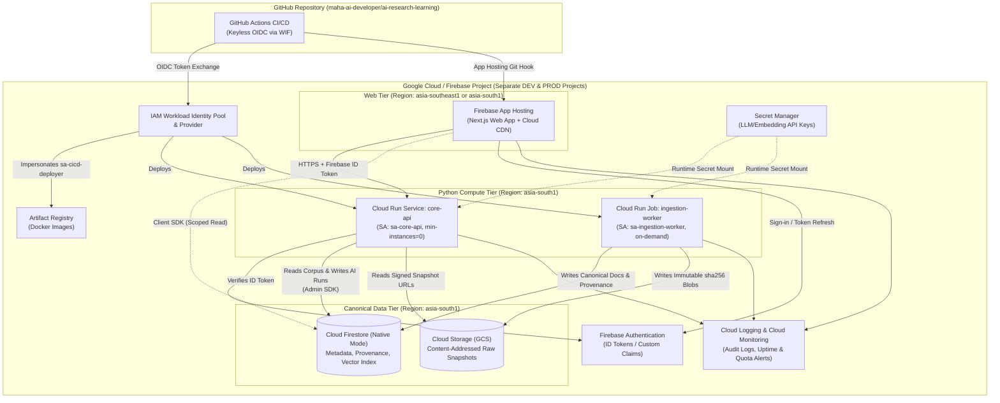

# Cloud Provisioning Plan (`DEV` & `PROD`)

> **Status:** Proposed — Pending Architectural Review & Human Provisioning Approval  
> **Scope:** Planning and operational runbook only. **Zero cloud resources, projects, APIs, credentials, or billing configurations have been created or enabled.**  
> **Date Checked Against Official Documentation:** 2026-10-22  
> **Related Architecture Documents:** [System Overview](../architecture/system-overview.md) · [Data Model](../architecture/data-model.md) · [Source Adapter Contract](../architecture/source-adapter-contract.md) · [Implementation Roadmap](../architecture/implementation-roadmap.md) · [ADR-0001](../architecture/decisions/0001-cloud-architecture.md) · [ADR-0002](../architecture/decisions/0002-knowledge-data-model.md)

---

## 1. Proposed Project Structure

### 1.1 Environment Isolation Model

To enforce strict blast-radius containment, security boundary separation, and independent quota/cost attribution, the system uses **two completely separate Google Cloud projects**, each with Firebase enabled on top of the underlying GCP project (remembering that a Firebase project *is* a Google Cloud project with Firebase-specific metadata and services enabled):

| Environment | Purpose | Candidate Project ID *(Suggestion Only)* | Candidate Display Name | Target Git Branch / Trigger | Data Classification |
| :--- | :--- | :--- | :--- | :--- | :--- |
| **LOCAL (Unbilled)** | Offline unit testing, schema validation, UI prototyping, and adapter development | `demo-ai-research-learning` *(emulator-only dummy project ID)* | Local Emulator Suite | Working tree / Pull Requests | Synthetic fixtures & offline test data |
| **DEV (Staging)** | Integration testing, live adapter verification against rate-limited public sources, pre-release web/API validation | `maha-airl-dev-<suffix>` *(e.g., `maha-airl-dev-01`)* | `AI Research Learning (DEV)` | Push to `main` (automated CI/CD after checks pass) | Non-production test corpus & developer accounts |
| **PROD (Production)** | Canonical source-grounded learning corpus, production learner progress, and live web/mobile backend | `maha-airl-prod-<suffix>` *(e.g., `maha-airl-prod-01`)* | `AI Research Learning (PROD)` | Protected `production` environment release (manual approval gate) | Authoritative corpus & real user learning records |

> **Important Note on Candidate Project IDs:** No Google Cloud or Firebase project IDs are assumed to exist yet. Because Google Cloud project IDs share a **single global namespace** across all Google Cloud customers and are **immutable** once created, the candidate IDs above (`maha-airl-dev-<suffix>`, `maha-airl-prod-<suffix>`) are proposals only.

### 1.2 Naming Rules and Pre-Creation Verification Procedure

Google Cloud project IDs must satisfy the following platform constraints ([Creating and Managing Projects](https://cloud.google.com/resource-manager/docs/creating-managing-projects), checked 2026-10-22):
- **Length:** 6 to 30 characters.
- **Allowed characters:** Lowercase ASCII letters (`a-z`), digits (`0-9`), and hyphens (`-`).
- **Start/End constraints:** Must start with a lowercase letter and cannot end with a hyphen.
- **Reserved substrings:** Cannot contain restricted strings such as `google`, `ssl`, or `undefined`.
- **Immutability & reuse:** Once created, a project ID cannot be changed; if a project is deleted, its ID cannot be reused even after the 30-day recovery window.

Before creating any project, the operator will execute the following verification steps:

1. **Identity & Account Ownership Verification:**
   ```bash
   gcloud auth list
   gcloud config get-value account
   gcloud organizations list
   ```
   Confirm the active Google account is the intended owner account (or belongs to the intended Google Cloud Organization, if applicable) and has permission to create projects (`resourcemanager.projects.create`).
2. **Existing Project Inventory & Access Check:**
   ```bash
   gcloud projects list --filter="projectId:maha-airl-* OR name:ai-research-learning*"
   npx -y firebase-tools@latest projects:list
   ```
   Verify that no conflicting or previously created projects already exist under the account, and verify IAM ownership (`roles/owner`) if reusing an existing empty shell project is ever considered.
3. **Global Namespace Availability Check:**
   Attempt a dry pre-check via the Cloud Resource Manager API or interactive console prompt before committing to a naming pair so that both `DEV` and `PROD` share a consistent naming prefix (e.g., `maha-airl-dev-2026` and `maha-airl-prod-2026`).
4. **Quota & Billing Eligibility Check:**
   ```bash
   gcloud beta billing accounts list
   ```
   Verify the human administrator has `roles/billing.admin` or `roles/billing.user` on an active Cloud Billing account before attempting to link billing for Blaze-tier services.

---

## 2. Region Selection & Co-Location Analysis

### 2.1 Evaluation Criteria

Region selection balances five factors:
1. **Primary User / Operator Latency:** The primary operator and initial learner base are located in **India (`IST`, `UTC+05:30`)**.
2. **Service Availability Matrix:** Every required managed service must actually support the chosen region.
3. **Service Co-Location & Zero Intra-Region Egress:** Co-locating `Cloud Run` (`core-api` and `ingestion-worker`), `Cloud Firestore`, `Cloud Storage`, and `Artifact Registry` in the same Google Cloud region minimizes round-trip latency (~1–3 ms internal network hop) and avoids cross-region data transfer (egress) charges.
4. **Permanent Database & Storage Location Constraints:** Cloud Firestore's database location is **permanent** once provisioned for the `(default)` database.
5. **Free-Tier vs. Regional Pricing Trade-offs:** Some Google Cloud Always-Free quotas (such as Cloud Storage's 5 GB-months free tier) apply only to US regions (`us-central1`, `us-east1`, `us-west1`), whereas Cloud Firestore's free daily operations quota applies across all regions on the `(default)` database.

### 2.2 Service Availability Verification (`asia-south1` vs. Firebase App Hosting)

Checking official Google Cloud and Firebase location documentation as of **2026-10-22** reveals a **critical regional availability constraint**:

| Service | `asia-south1` (Mumbai, India) Supported? | `asia-southeast1` (Singapore) Supported? | `us-central1` (Iowa, USA) Supported? | Official Documentation Source (Checked 2026-10-22) |
| :--- | :---: | :---: | :---: | :--- |
| **Cloud Firestore (Native Mode)** | **Yes** | **Yes** | **Yes** (`nam5` or `us-central1`) | [Firestore Locations](https://firebase.google.com/docs/firestore/locations) |
| **Cloud Storage for Firebase / GCS** | **Yes** | **Yes** | **Yes** (Eligible for 5 GB Always-Free) | [Cloud Storage Locations](https://cloud.google.com/storage/docs/locations) |
| **Cloud Run (Services & Jobs)** | **Yes** | **Yes** | **Yes** | [Cloud Run Locations](https://cloud.google.com/run/docs/locations) |
| **Artifact Registry** | **Yes** | **Yes** | **Yes** | [Artifact Registry Locations](https://cloud.google.com/artifact-registry/docs/repositories/repo-locations) |
| **Secret Manager** | **Yes** (Global / Regional) | **Yes** (Global / Regional) | **Yes** (Global / Regional) | [Secret Manager Locations](https://cloud.google.com/secret-manager/docs/locations) |
| **Firebase Authentication** | **Yes** (Global service) | **Yes** (Global service) | **Yes** (Global service) | [Firebase Auth Overview](https://firebase.google.com/docs/auth) |
| **Firebase App Hosting** | **NO** | **Yes** | **Yes** | [Firebase App Hosting Locations](https://firebase.google.com/docs/app-hosting/locations) |

> **Critical Finding — Firebase App Hosting Regional Support:**  
> As of 2026-10-22, **Firebase App Hosting does NOT support `asia-south1` (Mumbai)**. Firebase App Hosting currently supports creating backends only in six regions:
> - **Asia:** `asia-east1` (Taiwan), `asia-southeast1` (Singapore)
> - **North America:** `us-central1` (Iowa), `us-east4` (N. Virginia), `us-east5` (Columbus)
> - **Europe:** `europe-west4` (Netherlands)

### 2.3 Candidate Regional Topologies for Architectural Decision

Because `asia-south1` supports all data and Python compute services (`Firestore`, `Cloud Storage`, `Cloud Run`, `Artifact Registry`) but **not** `Firebase App Hosting`, the architect and user must approve one of the following three topologies before provisioning begins:

#### Option A (Recommended for India Latency + Managed App Hosting): Split `asia-south1` (Data & Core API) + `asia-southeast1` (Firebase App Hosting)
- **Data & Core Compute (`asia-south1` Mumbai):** Provision **Cloud Firestore**, **Cloud Storage**, **Cloud Run** (`core-api` and `ingestion-worker`), and **Artifact Registry** in **`asia-south1` (Mumbai)**.
  - *Why:* `core-api` and `ingestion-worker` perform high-frequency reads/writes against Firestore and Cloud Storage. Keeping them co-located in `asia-south1` guarantees zero cross-region egress between Python compute and storage/database, Indian data residency, and ~15–35 ms direct API latency for Indian users and mobile clients.
- **Web Frontend (`asia-southeast1` Singapore):** Provision the **Firebase App Hosting** Next.js backend in **`asia-southeast1` (Singapore)**—the closest supported Firebase App Hosting region to India (~55–70 ms network RTT to Mumbai, with static and cached SSR responses served from global Cloud CDN edge POPs inside India).
- *Trade-off:* Server-side rendering (SSR) requests on the Next.js server that are not served from CDN cache and call `core-api` incur a ~60 ms hop between Singapore (`asia-southeast1`) and Mumbai (`asia-south1`). Client-side browser/Flutter calls direct to `core-api` (`asia-south1`) stay strictly within Mumbai.

#### Option B (Strict Single-Region Co-Location in `asia-southeast1` Singapore)
- Provision **all services**—Cloud Firestore, Cloud Storage, Cloud Run (`core-api`, `ingestion-worker`), Artifact Registry, and Firebase App Hosting—in **`asia-southeast1` (Singapore)**.
- *Why:* Zero cross-region hops between Next.js SSR (`Firebase App Hosting`), `core-api` (`Cloud Run`), `Firestore`, and `Cloud Storage`, while maintaining low latency to India (~55–75 ms).
- *Trade-off:* Slightly higher latency from India (~60 ms vs. ~25 ms in Mumbai) and data resides in Singapore rather than India.

#### Option C (Strict `asia-south1` Mumbai Co-Location via Direct Cloud Run Web Hosting)
- Provision **all services** in **`asia-south1` (Mumbai)** and deploy the Next.js web application directly as a **Cloud Run Service in `asia-south1`** (or static export on classic **Firebase Hosting** global CDN) instead of using Firebase App Hosting until Firebase App Hosting adds `asia-south1`.
- *Why:* 100% single-region co-location in `asia-south1` (Mumbai) with zero cross-region hops.

### 2.4 Permanent Location Decisions Required Before Database Creation

The following location choices are **irreversible** once executed on a project and must be explicitly confirmed by the user before running any creation commands:
1. **Cloud Firestore Location ([Firestore Locations](https://firebase.google.com/docs/firestore/locations)):** Once the `(default)` Firestore database is created in a region (e.g., `asia-south1` or `asia-southeast1`), **its location cannot be changed**. Moving regions later requires provisioning a new project or paid non-default named database and migrating all documents.
2. **Default Cloud Storage Bucket Location ([Storage Locations](https://firebase.google.com/docs/storage/locations)):** A bucket's location is permanent once created. It must match the Firestore and Cloud Run compute region (`asia-south1` under Option A/C, or `asia-southeast1` under Option B) so `ingestion-worker` reads/writes raw artifacts with zero cross-region network transfer charges.

---

## 3. Minimum Viable Service Set

### 3.1 Release 1 Service Evaluation Matrix

In accordance with [ADR-0001](../architecture/decisions/0001-cloud-architecture.md) and the [Implementation Roadmap](../architecture/implementation-roadmap.md), the system provisions only the minimum viable serverless footprint required for Release 1, deferring asynchronous message buses, scheduled cron infrastructure, and paid managed vector clusters until needed.

| Service | Classification | Specific Purpose in AI Research & Learning System | Required in `DEV`? | Required in `PROD`? |
| :--- | :--- | :--- | :---: | :---: |
| **Firebase Authentication** | **Required for Release 1** | Authenticates learners and administrators; issues short-lived Firebase ID tokens (JWTs) verified by `core-api` and Firestore Security Rules. | Yes | Yes |
| **Cloud Firestore (Native Mode)** | **Required for Release 1** | Single canonical operational database for metadata (`sources`, `works`, `chunks`, `concepts`, `learning_paths`, `provenance_records`, `user_progress`) and built-in `find_nearest` vector search. | Yes | Yes |
| **Cloud Storage for Firebase (GCS)** | **Required for Release 1** | Stores immutable, content-addressed (`sha256`) raw source snapshots, PDFs, transcripts, and Jupyter `.ipynb` files. | Yes | Yes |
| **Firebase App Hosting** | **Required for Release 1 (Web Phase)** | Builds and serves the responsive Next.js web application backed by Cloud Run + Cloud CDN. *(Not needed until Release 1 Milestone 1.4 Web MVP begins.)* | Yes (at M1.4) | Yes (at M1.4) |
| **Cloud Run Service (`core-api`)** | **Required for Release 1** | Stateless Python FastAPI service (`min-instances=0`) handling source-grounded retrieval, citation verification, and tutor synthesis. | Yes | Yes |
| **Cloud Run Job (`ingestion-worker`)** | **Required for Release 1** | Batch/on-demand Python worker executing polite source adapters, SHA-256 snapshotting, chunking, embedding, and provenance recording; exits with `0` active instances when finished. | Yes | Yes |
| **Artifact Registry** | **Required for Release 1** | Private regional Docker container registry storing immutable, digest-pinned container images for `core-api` and `ingestion-worker`. | Yes | Yes |
| **Secret Manager** | **Required for Release 1** | Stores sensitive server-only credentials (e.g., future LLM/embedding API keys) injected into Cloud Run at runtime; never used for public client configs. | Yes | Yes |
| **Cloud Logging & Cloud Monitoring** | **Required for Release 1** | Captures structured JSON audit logs, request latencies, error rates, quota alerts, and ingestion run metrics. | Yes | Yes |
| **GitHub Actions + Workload Identity Federation (WIF)** | **Required for Release 1** | Keyless OIDC federation allowing GitHub Actions workflows to deploy container images and infrastructure without long-lived JSON service account keys. | Yes | Yes |
| **Cloud Pub/Sub** | **Deferred / Optional (Later Phase)** | Event bus for decoupled high-volume ingestion events. Unnecessary in Release 1 because `ingestion-worker` Cloud Run Jobs can be triggered directly on demand via CLI/API. | No (Deferred) | No (Deferred) |
| **Cloud Tasks** | **Deferred / Optional (Later Phase)** | Rate-limited distributed task queue. Unnecessary in Release 1 because polite per-domain rate-limiting and retry backoff run deterministically inside the single `ingestion-worker` job execution. | No (Deferred) | No (Deferred) |
| **Cloud Scheduler (Scheduled Ingestion)** | **Deferred / Optional (Later Phase)** | Automated cron triggers for periodic corpus harvesting. Deferred until the source adapters and cost/quota guardrails are validated through manual/on-demand `ingestion-worker` runs in Release 1. | No (Deferred) | No (Deferred) |
| **Vertex AI Vector Search / BigQuery / Cloud SQL** | **Explicitly Excluded** | Excluded by [ADR-0001](../architecture/decisions/0001-cloud-architecture.md) and [ADR-0002](../architecture/decisions/0002-knowledge-data-model.md) to avoid idle hourly node charges and multi-database sync complexity. | No | No |

### 3.2 Architecture & Service Interaction Diagram



---

## 4. Security and IAM Architecture

### 4.1 Human Administrator Access

- **Least-Privilege Daily Usage:** Human operators should use standard viewer/developer roles for routine inspection and reserve `roles/owner` or `roles/resourcemanager.projectIamAdmin` for initial project setup and IAM changes.
- **Multi-Factor Authentication (MFA):** All human Google accounts with access to `DEV` or `PROD` projects and the GitHub repository must enforce 2-Step Verification (MFA).
- **No Local Long-Lived Service Account JSON Keys:** Human developers authenticate locally using short-lived user credentials via `gcloud auth login` and `gcloud auth application-default login` (or run strictly against the local **Firebase Emulator Suite** without cloud credentials). Organizational Policy `iam.disableServiceAccountKeyCreation` should be enabled where supported to block JSON key file exports.

### 4.2 Dedicated Runtime Service Accounts

Wait to rely on the default Compute Engine service account (`<project-number>-compute@developer.gserviceaccount.com`), which receives overly broad Editor permissions by default. Instead, provision four dedicated, least-privilege service accounts per project (`DEV` and `PROD`):

| Service Account ID | Used By | Granted IAM Roles (Scoped to Same Project Only) | Explicitly Denied / Excluded Capabilities |
| :--- | :--- | :--- | :--- |
| `sa-core-api` | Cloud Run Service (`core-api`) | - `roles/datastore.user` (Firestore read/write)<br>- `roles/storage.objectViewer` (read raw snapshots/notebooks)<br>- `roles/secretmanager.secretAccessor` *(scoped only to `core-api` secrets)*<br>- `roles/logging.logWriter`<br>- `roles/monitoring.metricWriter` | Cannot overwrite or delete raw GCS objects (`storage.objects.create`/`delete`); cannot trigger Cloud Run Jobs; cannot modify IAM or billing. |
| `sa-ingestion-worker` | Cloud Run Job (`ingestion-worker`) | - `roles/datastore.user` (write canonical `works`, `chunks`, `provenance_records`)<br>- `roles/storage.objectCreator` + `roles/storage.objectViewer` *(scoped to raw snapshot bucket)*<br>- `roles/secretmanager.secretAccessor` *(scoped only to embedding/ingestion secrets)*<br>- `roles/logging.logWriter`<br>- `roles/monitoring.metricWriter` | Cannot delete existing GCS objects unless explicit administrative lifecycle policy runs; cannot access user auth password hashes; cannot modify IAM. |
| `sa-apphosting-web` | Firebase App Hosting Backend | - `roles/firebaseapphosting.computeRunner`<br>- `roles/run.invoker` *(if `core-api` restricts unauthenticated ingress)*<br>- `roles/logging.logWriter` | No direct write access to canonical Firestore collections (`works`, `chunks`, `provenance_records`) or raw GCS buckets. |
| `sa-cicd-deployer` | GitHub Actions via Workload Identity Federation | - `roles/artifactregistry.writer`<br>- `roles/run.developer`<br>- `roles/iam.serviceAccountUser` *(bound strictly to `sa-core-api` and `sa-ingestion-worker`)*<br>- `roles/firebaserules.admin` *(for deploying vetted Firestore/Storage rules)* | Cannot read Secret Manager secret payloads (`secretmanager.versions.access`); cannot modify IAM policies (`resourcemanager.projects.setIamPolicy`); cannot alter billing. |

### 4.3 GitHub Actions Deployment Identity (Workload Identity Federation)

All automated deployments from `maha-ai-developer/ai-research-learning` use **Google Cloud Workload Identity Federation (WIF)** with GitHub Actions OIDC tokens ([Workload Identity Federation with Deployment Pipelines](https://cloud.google.com/iam/docs/workload-identity-federation-with-deployment-pipelines), checked 2026-10-22):
- **Zero Stored JSON Keys:** No `GCP_SA_KEY` JSON secrets are ever generated or stored in GitHub repository secrets.
- **Attribute Conditions:**
  - Every WIF Provider restricts token exchange via CEL attribute conditions to `assertion.repository == 'maha-ai-developer/ai-research-learning'`.
  - In the **`DEV` project**, the WIF principal binding permits deployments only when `assertion.ref == 'refs/heads/main'` (or environment `dev`).
  - In the **`PROD` project**, the WIF principal binding restricts token exchange to workflows running against the protected GitHub Environment `production` (`assertion.environment == 'production'`) and `assertion.ref == 'refs/heads/main'`.

### 4.4 Public Firebase Client Config vs. Private Server Credentials

| Configuration / Credential Type | Security Classification | Where It Lives | Rules & Handling |
| :--- | :--- | :--- | :--- |
| **Firebase Web / Flutter Client Options** (`apiKey`, `appId`, `projectId`, `authDomain`, `storageBucket`, `messagingSenderId`) | **Public Identifiers** ([Understand Firebase Projects — Config Safe to Include](https://firebase.google.com/docs/projects/api-keys), checked 2026-10-22) | Public client bundle / environment variables (`NEXT_PUBLIC_FIREBASE_*`) | These values only identify the Firebase project to Google servers; they **do not** grant data access by themselves. Security depends entirely on **Firestore/Storage Security Rules**, **Firebase Auth**, and **API Key Restrictions** (restricting browser keys by HTTP referrer and API scope in Google Cloud Console). |
| **Server Runtime Credentials** (`sa-core-api`, `sa-ingestion-worker`) | **Private / Privileged Identity** | Google Cloud Metadata Server (automatic ADC inside Cloud Run) | Never exported as JSON files; never bundled into Next.js client code or Flutter binaries; never committed to Git. |
| **Third-Party / AI API Keys** (e.g., Gemini API key, embedding provider key) | **Confidential Secret** | **Google Cloud Secret Manager** | Mounted into `core-api` and `ingestion-worker` at container startup via Secret Manager references (`--set-secrets`). Never exposed to browser/mobile clients. |

### 4.5 Firestore & Cloud Storage Security Rules Strategy

In accordance with [ADR-0002](../architecture/decisions/0002-knowledge-data-model.md):
1. **Default-Deny Baseline:** Both `firestore.rules` and `storage.rules` start with a global default-deny catch-all (`match /{document=**} { allow read, write: if false; }`).
2. **Canonical Corpus Read-Only for Clients:** Authenticated learners (`request.auth != null`) may read published metadata in `sources`, `works`, `concepts`, and `learning_paths` only when `resource.data.Withdrawn != true`. Direct client writes (`create`, `update`, `delete`) to `sources`, `works`, `chunks`, `concepts`, `learning_paths`, `provenance_records`, and `ai_outputs` are unconditionally denied (`allow write: if false;`)—only `sa-ingestion-worker` and `sa-core-api` (via Admin SDK on the server) can write those collections.
3. **Strict Learner Isolation (`user_progress`):** Learners can read and update only their own progress documents (`match /user_progress/{userId}/{docId=**} { allow read, write: if request.auth != null && request.auth.uid == userId; }`) with schema field validation.
4. **Copyright & Redistribution Enforcement on `chunks` and `Storage`:**
   - Full-text `chunks` and raw Cloud Storage objects (`gs://<bucket>/raw/**`) are **never** publicly readable.
   - Client reads on `chunks` require `resource.data.license_clearance == 'redistributable_with_attribution'`. Restricted sources (where `keep_full_text == false` or redistribution is prohibited) are accessible only to server-side `core-api` for ephemeral citation synthesis or via external link-out.

### 4.6 Secret Manager Handling and Rotation Policy

- **Per-Environment Secret Isolation:** Secrets exist independently inside the `DEV` and `PROD` projects. `DEV` secrets must use separate API keys/quotas from `PROD` secrets so a runaway test in `DEV` cannot exhaust `PROD` rate limits or budgets.
- **Version Pinning:** Cloud Run services pin explicit secret version numbers (e.g., `GEMINI_API_KEY=gemini-api-key:2`) rather than `:latest` in `PROD` so secret rotation is atomic, auditable, and rolled out alongside a verified revision.
- **Rotation Schedule:** Secret versions are rotated at least every 90 days (or immediately upon any suspected exposure), with the previous secret version disabled (`gcloud secrets versions disable`) once the new Cloud Run revision passes health checks.

### 4.7 Preventing `DEV` Workloads from Accessing `PROD` Data

Cross-environment contamination is prevented by four overlapping controls:
1. **Separate GCP Projects:** `DEV` and `PROD` live in distinct project IDs with zero shared networks, zero VPC peering, and separate Firestore/GCS instances.
2. **Zero Cross-Project IAM Bindings:** Neither `sa-core-api@<dev-project>` nor `sa-ingestion-worker@<dev-project>` nor `sa-cicd-deployer@<dev-project>` is ever granted any IAM role inside `<prod-project>`.
3. **Separate WIF Pools & Providers:** `<dev-project>` and `<prod-project>` each maintain their own Workload Identity Pool. A GitHub Actions job running in the `dev` environment cannot exchange its OIDC token against the `PROD` WIF provider because the `PROD` provider requires `assertion.environment == 'production'`.
4. **Runtime Startup Assertion:** `core-api` and `ingestion-worker` validate at startup that `APP_ENV` (`dev` vs. `prod`) matches the expected `GOOGLE_CLOUD_PROJECT` prefix; any mismatch causes immediate startup failure (`exit 1`).

---

## 5. Cost and Billing Controls

> **Disclaimer:** We do **not** enable billing in this task, and we explicitly do **not** claim that the cloud deployment will be permanently free. Once the Blaze (pay-as-you-go) plan is enabled for a project, any usage exceeding documented free-tier limits is billed to the linked Cloud Billing account.

### 5.1 Blaze Plan Requirement vs. Spark (No-Cost) Plan

- **Firebase Spark Plan (No-Cost):** Supports Firebase Authentication (up to 50,000 MAUs for email/social), Cloud Firestore (within daily free limits), and classic static Firebase Hosting.
- **Why Blaze (Pay-As-You-Go) Is Required for Full Cloud Deployment:**
  - **Firebase App Hosting**, **Cloud Run Services (`core-api`)**, **Cloud Run Jobs (`ingestion-worker`)**, **Artifact Registry**, and **Secret Manager** all require a linked Cloud Billing account (**Blaze plan**) to be provisioned in Google Cloud ([Firebase Pricing](https://firebase.google.com/pricing), checked 2026-10-22).
- **Phased Billing Activation Recommendation:** Keep all development on the **Local Firebase Emulator Suite** (`$0.00`, no billing account required) until Release 1 cloud deployment is explicitly approved. When approved, link billing to `DEV` first, validate costs and quotas, and only link `PROD` prior to production cutover.

### 5.2 Service-by-Service Pricing Drivers & Free-Tier Limits (Checked 2026-10-22)

| Service | Primary Billing Drivers | Documented Free Tier (Monthly / Daily) | Regional / Plan Nuances | Official Pricing URL (Checked 2026-10-22) |
| :--- | :--- | :--- | :--- | :--- |
| **Firebase Authentication (Identity Platform)** | Monthly Active Users (MAUs) beyond free tier; SMS/phone auth messages | **50,000 MAUs/month free** for standard providers (Email/Password, Google, GitHub OAuth) | Phone/SMS auth and SAML/OIDC enterprise providers have much lower/different free tiers—**disable SMS/Phone Auth** in both `DEV` and `PROD`. | [Firebase Pricing](https://firebase.google.com/pricing) |
| **Cloud Firestore (Native Mode)** | Stored GiB-month, document reads, writes, deletes, and network egress | **1 GiB storage**, **50,000 reads/day**, **20,000 writes/day**, **20,000 deletes/day**, **10 GiB/month egress** | Free tier applies only to the **`(default)` database** per project (up to 1 free database per billing account depending on current tier policy). In **`asia-south1` (Mumbai)**, rates beyond free tier are **$0.165/GiB-month**, **$0.033 per 100k reads**, **$0.099 per 100k writes**, and **$0.011 per 100k deletes**. | [Firestore Pricing](https://cloud.google.com/firestore/pricing) |
| **Cloud Storage (GCS)** | Standard storage GiB-month, Class A (write/list) & Class B (read/get) operations, network egress | **5 GB-months storage**, **5,000 Class A ops**, **50,000 Class B ops/month** *(US regions `us-central1`/`us-east1`/`us-west1` only)* | **Important:** If provisioned in **`asia-south1` (Mumbai)** or **`asia-southeast1` (Singapore)**, GCS Standard Storage is billed from the first GiB at **~$0.023/GiB-month** (`asia-south1`) plus $0.005 per 1,000 Class A ops and $0.0004 per 1,000 Class B ops. | [Cloud Storage Pricing](https://cloud.google.com/storage/pricing) |
| **Cloud Run (`core-api` & `ingestion-worker`)** | vCPU-seconds, GiB-seconds of active request/job execution, request count, egress | **180,000 vCPU-seconds**, **360,000 GiB-seconds**, **2,000,000 requests/month** (pooled per billing account across eligible regions) | Requires `min-instances=0` (scale-to-zero) and CPU allocated only during request processing (`--cpu-throttling`) so idle time costs **$0.00**. Setting `min-instances >= 1` incurs continuous 24/7 charges. | [Cloud Run Pricing](https://cloud.google.com/run/pricing) |
| **Firebase App Hosting** | Cloud Build minutes (on deploy), Cloud Run SSR compute, Artifact Registry storage, and Cloud CDN bandwidth/requests | Shares Google Cloud Always-Free quotas for Cloud Run, Cloud Build (**120 build-minutes/day**), and Artifact Registry (**0.5 GB/month**); Cloud CDN cache egress & origin fill are billed per GiB | Uncached dynamic SSR requests execute on the underlying Cloud Run service; aggressive `Cache-Control` headers minimize SSR compute and CDN origin fill costs. | [App Hosting Costs & Quotas](https://firebase.google.com/docs/app-hosting/costs) |
| **Artifact Registry** | Stored container image GiB-month and cross-region egress | **0.5 GB/month** free per billing account; **$0.10/GB-month** beyond 0.5 GB | Without cleanup policies, old Docker images accumulate on every CI push and exceed 0.5 GB quickly. Configure an **Artifact Registry Cleanup Policy** retaining only the latest 3–5 image digests. | [Artifact Registry Pricing](https://cloud.google.com/artifact-registry/pricing) |
| **Secret Manager** | Active secret versions ($0.06/version-month) and access operations ($0.03 per 10k accesses) | **6 active secret versions** and **10,000 access operations/month** free per billing account | Destroy deprecated secret versions promptly to stay within the 6-version free allowance across `DEV` + `PROD`. | [Secret Manager Pricing](https://cloud.google.com/secret-manager/pricing) |
| **Cloud Logging & Monitoring** | Log ingestion GiB-month beyond free allotment; retention > 30 days | **First 50 GiB/month per project** of log ingestion is free (30-day default retention); standard GCP metrics are free | Keep log retention at the 30-day default and log at `INFO`/`WARNING`/`ERROR` levels (avoid verbose `DEBUG` payload logging in `PROD`). | [Cloud Observability Pricing](https://cloud.google.com/stackdriver/pricing) |

### 5.3 Small-Project Monthly Cost Model (Explicit Assumptions)

To estimate realistic monthly spend across `DEV` + `PROD` during Release 1 (using `asia-south1` for Data/Compute and `asia-southeast1` for App Hosting):

- **Explicit Workload Assumptions:**
  - **Active Learners:** 1–20 learners during Release 1 (~500 page views/day, ~100 API queries/day).
  - **Corpus Size:** ~500 canonical works, ~25,000 metadata/chunk documents (~0.4 GiB in Firestore), and ~3 GiB of raw PDFs/HTML snapshots/notebooks in Cloud Storage (`asia-south1`).
  - **Compute Utilization:** `core-api` (`1 vCPU, 512 MiB`, `min-instances=0`) runs ~6,000 vCPU-seconds/month; `ingestion-worker` (`1 vCPU, 1 GiB`) runs 20 batch executions/month at 3 minutes each (~3,600 vCPU-seconds/month).
  - **Container Images:** Pruned to 4 active images (~0.45 GB total) via Artifact Registry cleanup policies.
  - **Secrets:** 4 active secret versions total across `DEV` + `PROD`.
  - **Logs:** ~2 GiB/month total log volume.

| Cost Component | Estimated Monthly Usage (`DEV` + `PROD`) | Covered by Free Tier? | Estimated Monthly Bill (USD) |
| :--- | :--- | :--- | :--- |
| Firebase Auth (Email/OAuth only) | < 50 MAUs | Yes (50,000 MAUs free) | **$0.00** |
| Cloud Firestore (`asia-south1`) | ~0.4 GiB storage; < 10k reads/day; < 2k writes/day | Mostly covered (`PROD` `(default)` DB free; `DEV` minimal usage) | **$0.00 – $0.25** |
| Cloud Storage (`asia-south1`) | ~3 GiB Standard storage + ~20k ops/month | Billed in `asia-south1` (~$0.023/GiB-month) | **~$0.07 – $0.15** |
| Cloud Run (`core-api` + `ingestion-worker` + App Hosting SSR) | ~15,000 vCPU-sec, ~15,000 GiB-sec | Yes (within 180k vCPU-sec / 360k GiB-sec free tier) | **$0.00** |
| Cloud CDN / Network Egress (App Hosting) | ~2 GiB/month egress | Billed per GiB (~$0.08–$0.12/GiB in Asia) | **~$0.20 – $0.50** |
| Artifact Registry (with cleanup policy) | < 0.5 GB stored | Yes (0.5 GB free) | **$0.00 – $0.20** |
| Secret Manager | 4–6 active secret versions | Yes (6 versions free) | **$0.00** |
| Cloud Logging & Monitoring | ~2 GiB/month logs (30-day retention) | Yes (50 GiB/project/month free) | **$0.00** |
| **Estimated Baseline Infrastructure Total** *(excluding external paid LLM/Embedding tokens)* | | | **~$0.30 – $1.50 / month** |

### 5.4 Local & Cost-Free Development Options

Before and after cloud provisioning, 95%+ of engineering and testing runs at **$0.00 cloud cost**:
1. **Firebase Local Emulator Suite:** Emulates Firebase Auth, Cloud Firestore, and Cloud Storage locally (`firebase emulators:start --project demo-ai-research-learning`).
2. **Offline Fixture Test Suite:** Existing unit tests (`python3 -m unittest discover -s tests -v`) and adapter parsing contract tests run offline in GitHub Actions without touching cloud APIs.
3. **Local Container Execution:** `core-api` and `ingestion-worker` run locally via `uvicorn` or Docker connected to `FIRESTORE_EMULATOR_HOST=localhost:8080` and `FIREBASE_STORAGE_EMULATOR_HOST=localhost:9199`.

### 5.5 Official Google Cloud Pricing Calculator Guidance

Before enabling billing on `DEV` or `PROD`, the operator should enter the exact region and workload numbers into the official **[Google Cloud Pricing Calculator](https://cloud.google.com/products/calculator)** (checked 2026-10-22):
1. Add **Cloud Run** (Region: `asia-south1`, CPU allocated only during request processing, `min-instances = 0`, 1 vCPU, 512 MiB RAM).
2. Add **Cloud Firestore** (Location: `asia-south1`, Storage: 1 GiB, Reads/Writes per day).
3. Add **Cloud Storage** (Location: `asia-south1`, Standard Storage: 5 GiB).
4. Export and archive the calculator estimate link in the deployment approval PR before linking a billing account.

### 5.6 Budget Alerts vs. Technical Spending Caps & Circuit Breakers

> **Critical Billing Warning ([Cloud Billing Budgets Overview](https://cloud.google.com/billing/docs/how-to/budgets), checked 2026-10-22):**  
> **Google Cloud Budget Alerts ONLY send email/Pub/Sub notifications—they do NOT automatically cap spending or stop services when a threshold is reached.**

Because budget alerts alone cannot prevent runaway charges, the provisioning plan enforces both **financial alerts** and **hard technical quotas/circuit breakers**:

1. **Cloud Billing Budget Alerts (Notification Layer):**
   - Configure monthly budgets of **$5.00 USD** for `DEV` and **$15.00 USD** for `PROD` with email alerts at **50%, 80%, 100%, and 120%** of actual and forecasted spend.
2. **Hard Technical Quotas & Concurrency Limits (Enforcement Layer):**
   - **Cloud Run Hard Scaling Cap:** Deploy `core-api` with `--min-instances=0`, `--max-instances=2` (in `DEV`) and `--max-instances=5` (in `PROD`), `--concurrency=40`, and `--timeout=60s` so traffic spikes cannot spin up hundreds of containers.
   - **Cloud Run Job Execution Bounds:** Configure `ingestion-worker` with `--parallelism=1`, `--task-count=1`, `--max-retries=1`, and `--task-timeout=900s` (15 minutes max).
   - **API Consumer Quota Caps:** In `APIs & Services -> Enabled APIs -> Quotas`, lower per-minute request quotas on high-cost APIs (such as Vertex AI / Generative Language API, if ever enabled) to a strict daily/per-minute ceiling.
   - **Application-Level Daily Token/Embedding Circuit Breaker:** Track daily embedding/LLM token calls in a Firestore counter document (`system_quotas/daily_usage_YYYY_MM_DD`); if daily usage crosses the configured budget ceiling, `core-api` and `ingestion-worker` trip a circuit breaker and reject further AI synthesis/embedding calls while continuing to serve cached corpus reads.
   - **Artifact Registry Cleanup Policy:** Automatically delete untagged container images older than 7 days and retain at most 5 tagged versions per repository.

---

## 6. CI/CD and Release Process

### 6.1 End-to-End Release Pipeline (`PR` → `DEV` → Approved `PROD`)

```mermaid
flowchart LR
    subgraph PR["1. Pull Request Checks (Unprivileged)"]
        PR_TEST["Run Offline Unit Tests,\nLint, Compile, Schema & Rules Tests\n(Firebase Emulator Suite)"]
    end

    subgraph DEV_STAGE["2. DEV Deployment (On Push to main)"]
        DEV_WIF["Authenticate to DEV Project\nvia GitHub OIDC (WIF)"]
        DEV_API["Build & Push Image to DEV Artifact Registry\nDeploy Cloud Run (core-api, ingestion-worker)"]
        DEV_WEB["Firebase App Hosting Rollout\n(DEV Backend)"]
        DEV_SMOKE["Automated DEV Smoke Tests\n(/healthz, Firestore read, Provenance check)"]
    end

    subgraph PROD_GATE["3. Human Approval Gate"]
        APPROVAL["GitHub Environment 'production'\nRequired Reviewer Approval\n+ Verified DEV Smoke Results"]
    end

    subgraph PROD_STAGE["4. PROD Deployment (Protected)"]
        PROD_WIF["Authenticate to PROD Project\nvia GitHub OIDC (WIF)"]
        PROD_API["Promote/Build Digest-Pinned Image\nDeploy PROD Cloud Run (core-api, ingestion-worker)"]
        PROD_WEB["Firebase App Hosting Rollout\n(PROD Backend from Release Branch/Tag)"]
        PROD_SMOKE["Automated PROD Smoke Tests\n& Immediate Rollback on Failure"]
    end

    PR_TEST -->|"PR Approved & Squash-Merged to main"| DEV_WIF
    DEV_WIF --> DEV_API --> DEV_SMOKE
    DEV_WIF --> DEV_WEB --> DEV_SMOKE
    DEV_SMOKE --> APPROVAL
    APPROVAL -->|"Approved"| PROD_WIF
    PROD_WIF --> PROD_API --> PROD_SMOKE
    PROD_WIF --> PROD_WEB --> PROD_SMOKE
```



### 6.2 Separation of Web Pipeline (Firebase App Hosting) and API Pipeline (Cloud Run)

The web frontend and the Python backend have **explicitly separate deployment pipelines** so a UI change does not rebuild Python ML/ingestion containers and an API change does not trigger a Next.js rebuild:

| Pipeline Aspect | **Cloud Run API & Worker Pipeline** (`core-api`, `ingestion-worker`) | **Web Frontend Pipeline** (`Firebase App Hosting`) |
| :--- | :--- | :--- |
| **Source Directory** | `services/core-api/`, `services/ingestion-worker/`, `packages/shared/` | `apps/web/` (`apphosting.yaml`, `apphosting.dev.yaml`, `apphosting.prod.yaml`) |
| **Orchestrator** | GitHub Actions workflows (`.github/workflows/deploy-api-dev.yml`, `deploy-api-prod.yml`) | Firebase App Hosting GitHub integration + Cloud Build (or explicit `firebase apphosting:rollouts:create` CLI step in GitHub Actions) |
| **Trigger Filtering** | Path-filtered to backend/shared code changes or manual `workflow_dispatch` | Path-filtered to `apps/web/**` or explicit release rollout |
| **Environment Promotion** | `DEV` builds and deploys automatically on merge to `main`; `PROD` deploys the verified commit SHA only after the `production` GitHub Environment manual approval gate passes | `DEV` App Hosting backend tracks `main` (`rootDir: apps/web`); `PROD` App Hosting backend either tracks a dedicated protected `release/web-prod` branch or is triggered exclusively via `firebase apphosting:rollouts:create` after the `production` GitHub Environment approval gate passes |
| **Runtime Config** | `--set-env-vars` and `--set-secrets` passed in `gcloud run deploy` | Environment-specific `apphosting.dev.yaml` and `apphosting.prod.yaml` referencing environment Secret Manager keys |

### 6.3 Branch Protection & GitHub Environment Approvals

1. **`main` Branch Protection Rules:**
   - Require a Pull Request before merging (no direct pushes to `main`).
   - Require status checks to pass before merging (`offline-tests`, plus future `rules-test`, `api-unit-tests`, `web-typecheck`).
   - Require branches to be up to date before merging.
   - Prefer **Squash and Merge** to maintain a linear, auditable commit history on `main`.
2. **GitHub Environments (`dev` and `production`):**
   - **`dev` Environment:** Restricted to the `main` branch. Contains `DEV_GCP_PROJECT_ID`, `DEV_WIF_PROVIDER`, and `DEV_WIF_SERVICE_ACCOUNT` variables.
   - **`production` Environment:** Restricted to `main` (or signed `v*` release tags) **and configured with Required Reviewers (explicit human approval required before any job referencing `environment: production` can start or receive an OIDC token)**.

### 6.4 Rollback Strategy & Required Verification Checks

- **Cloud Run (`core-api` & `ingestion-worker`) Instant Traffic Rollback:**
  - Every deployment creates an immutable revision tagged with the short Git SHA (`--revision-suffix=sha-${GITHUB_SHA::7}`).
  - If post-deploy smoke checks (`/healthz`, `/readyz`, schema compatibility check) fail, the workflow automatically routes 100% of traffic back to the previous healthy revision in seconds:
    ```bash
    gcloud run services update-traffic core-api \
      --region=<REGION> \
      --to-revisions=<PREVIOUS_REVISION>=100
    ```
- **Firebase App Hosting Rollback:**
  - In the Firebase Console (`App Hosting -> Rollouts`) or via CLI (`firebase apphosting:rollouts:create --git-commit <PREVIOUS_SHA>`), roll back immediately to the prior immutable Cloud Run revision backing the App Hosting backend.
- **Firestore Indexes & Security Rules Rollback:**
  - Rules (`firestore.rules`, `storage.rules`) and composite indexes (`firestore.indexes.json`) are version-controlled in Git and must be backward-compatible (additive-first) so rolling back an application binary never breaks against the active ruleset.

---

## 7. Sequential Provisioning Checklist

> **Execution Policy:** Do **not** execute any of the steps below until the architect and user approve this plan and resolve the open decisions listed in Section 8 / Deliverables. Steps marked **`[HUMAN APPROVAL / CONSOLE REQUIRED]`** require explicit human action or authorization.

### Phase 1: Account Readiness & Pre-Creation Checks
- [ ] **1.1 `[HUMAN APPROVAL / CONSOLE REQUIRED]` Verify Google Account & MFA:** Confirm the administrator Google account has 2-Step Verification (MFA) enabled and is the intended owner for `DEV` and `PROD`.
- [ ] **1.2 Authenticate CLI Locally (Read-Only Check):** Run `gcloud auth login` and `npx -y firebase-tools@latest login`, then run `gcloud projects list` to confirm no conflicting `maha-airl-*` projects already exist.
- [ ] **1.3 `[HUMAN APPROVAL REQUIRED]` Finalize Naming & Region Choice:** Confirm exact `DEV` and `PROD` project IDs (e.g., `maha-airl-dev-01`, `maha-airl-prod-01`) and select **Option A**, **Option B**, or **Option C** from Section 2.3 for the permanent region topology.

### Phase 2: Project Creation (`DEV` First, Then `PROD`)
- [ ] **2.1 `[HUMAN APPROVAL REQUIRED]` Create `DEV` and `PROD` Google Cloud Projects:**
  ```bash
  gcloud projects create <DEV_PROJECT_ID> --name="AI Research Learning (DEV)" --labels=env=dev,system=ai-research-learning
  gcloud projects create <PROD_PROJECT_ID> --name="AI Research Learning (PROD)" --labels=env=prod,system=ai-research-learning
  ```
- [ ] **2.2 Enable Firebase on Both Projects:**
  ```bash
  npx -y firebase-tools@latest projects:addfirebase <DEV_PROJECT_ID>
  npx -y firebase-tools@latest projects:addfirebase <PROD_PROJECT_ID>
  ```

### Phase 3: Billing Authorization, Budgets & Cost Guardrails
- [ ] **3.1 `[HUMAN APPROVAL / CONSOLE REQUIRED]` Review Official Pricing Calculator Estimate:** Verify the estimated monthly cost in the [Google Cloud Pricing Calculator](https://cloud.google.com/products/calculator).
- [ ] **3.2 `[HUMAN APPROVAL / CONSOLE REQUIRED]` Link Cloud Billing Account (Upgrade to Blaze):** Link the authorized Cloud Billing account to `<DEV_PROJECT_ID>` (and `<PROD_PROJECT_ID>` when ready for production provisioning).
- [ ] **3.3 `[HUMAN APPROVAL / CONSOLE REQUIRED]` Configure Cloud Billing Budgets & Alerts:** In Google Cloud Console (`Billing -> Budgets & alerts`), create a **$5/month budget on `DEV`** and a **$15/month budget on `PROD`** with email threshold notifications at 50%, 80%, 100%, and 120%.

### Phase 4: Enable Minimum Required APIs
- [ ] **4.1 Enable Release 1 APIs in `DEV` (and `PROD`):**
  ```bash
  gcloud services enable \
    firestore.googleapis.com \
    firebaserules.googleapis.com \
    firebasestorage.googleapis.com \
    storage.googleapis.com \
    identitytoolkit.googleapis.com \
    run.googleapis.com \
    artifactregistry.googleapis.com \
    secretmanager.googleapis.com \
    cloudbuild.googleapis.com \
     firebaseapphosting.googleapis.com \
    iam.googleapis.com \
    iamcredentials.googleapis.com \
    sts.googleapis.com \
    logging.googleapis.com \
    monitoring.googleapis.com \
    --project=<PROJECT_ID>
  ```
- [ ] **4.2 Verify No Deferred/Paid Enterprise APIs Are Enabled:** Confirm via `gcloud services list --enabled --project=<PROJECT_ID>` that `aiplatform.googleapis.com` (Vertex AI Vector Search), `bigquery.googleapis.com`, `sqladmin.googleapis.com`, `pubsub.googleapis.com`, and `cloudscheduler.googleapis.com` are **not** enabled prematurely.

### Phase 5: Service Accounts & Least-Privilege IAM
- [ ] **5.1 Create Dedicated Runtime & CI/CD Service Accounts (`sa-core-api`, `sa-ingestion-worker`, `sa-apphosting-web`, `sa-cicd-deployer`)** in each project.
- [ ] **5.2 Bind Scoped IAM Roles:** Grant only the specific roles listed in Section 4.2 to each service account within its own project (`DEV` accounts bound only to `DEV`; `PROD` accounts bound only to `PROD`).
- [ ] **5.3 Disable Default Compute Service Account Over-Privilege:** Remove Editor role from the default Compute Engine service account or disable automatic default role grants.

### Phase 6: Permanent Region Selection, Firestore & Cloud Storage Provisioning
- [ ] **6.1 `[HUMAN APPROVAL REQUIRED — PERMANENT DECISION]` Create `(default)` Cloud Firestore Database in Native Mode:**
  ```bash
  gcloud firestore databases create \
    --database="(default)" \
    --location=<DATA_REGION> \
    --type=firestore-native \
    --delete-protection \
    --project=<PROJECT_ID>
  ```
  *(Enable `--point-in-time-recovery` on `PROD`.)*
- [ ] **6.2 Deploy Default-Deny / Scoped Firestore Security Rules & Composite/Vector Indexes:**
  ```bash
  npx -y firebase-tools@latest deploy --only firestore:rules,firestore:indexes --project=<PROJECT_ID>
  ```
- [ ] **6.3 `[HUMAN APPROVAL REQUIRED — PERMANENT DECISION]` Provision Cloud Storage Raw Snapshot Bucket in `<DATA_REGION>`:**
  - Enable **Uniform bucket-level access** (`--uniform-bucket-level-access`) and **Public access prevention** (`--public-access-prevention`).
  - Deploy `storage.rules` denying public reads/writes.

### Phase 7: Firebase Authentication Setup
- [ ] **7.1 `[HUMAN CONSOLE INTERACTION REQUIRED]` Enable Authentication Providers:** In the Firebase Console (`Authentication -> Sign-in method`), enable **Email/Password** (and **Google / GitHub OAuth** if desired).
- [ ] **7.2 Verify SMS / Phone Auth Is Disabled:** Confirm Phone/SMS authentication and multi-tenant paid enterprise tiers are disabled to prevent unexpected SMS/Identity Platform charges.
- [ ] **7.3 Restrict Browser API Keys:** In Google Cloud Console (`APIs & Services -> Credentials`), restrict the auto-generated Browser API key to authorized HTTP referrers (`localhost`, `*.hosted.app`, custom domain) and only the required Firebase client APIs.

### Phase 8: Artifact Registry & Secret Manager Setup
- [ ] **8.1 Create Regional Docker Repository in `<DATA_REGION>` with Cleanup Policy:**
  ```bash
  gcloud artifacts repositories create airl-containers \
    --repository-format=docker \
    --location=<DATA_REGION> \
    --description="AI Research & Learning container images" \
    --project=<PROJECT_ID>
  ```
  Apply a cleanup policy keeping only the 5 most recent tagged digests and deleting untagged images older than 7 days.
- [ ] **8.2 `[HUMAN CONSOLE / CLI INTERACTION REQUIRED]` Create Secret Placeholders in Secret Manager:** Create secret containers (with `--replication-policy="user-managed" --locations=<DATA_REGION>`) and bind `roles/secretmanager.secretAccessor` strictly to the specific runtime service account that requires each secret.

### Phase 9: GitHub Actions Workload Identity Federation (CI/CD)
- [ ] **9.1 Create Workload Identity Pool (`github-actions-pool`) and OIDC Provider (`github-provider`)** in `DEV` and `PROD` with `--attribute-condition="assertion.repository == 'maha-ai-developer/ai-research-learning'"` (plus `&& assertion.environment == 'production'` in `PROD`).
- [ ] **9.2 Bind `roles/iam.workloadIdentityUser` on `sa-cicd-deployer` to the WIF PrincipalSet.**
- [ ] **9.3 `[HUMAN CONSOLE INTERACTION REQUIRED]` Configure GitHub Environments (`dev` and `production`):** In GitHub repository settings (`Settings -> Environments`), configure `dev` and `production`, adding Required Reviewers to `production`.

### Phase 10: Compute Provisioning (`core-api`, `ingestion-worker`, `Firebase App Hosting`)
- [ ] **10.1 Deploy `core-api` Cloud Run Service (`--min-instances=0`, `--max-instances=2` in `DEV` / `5` in `PROD`, `--service-account=sa-core-api@<PROJECT_ID>.iam.gserviceaccount.com`).**
- [ ] **10.2 Create `ingestion-worker` Cloud Run Job (`--parallelism=1`, `--task-count=1`, `--max-retries=1`, `--service-account=sa-ingestion-worker@<PROJECT_ID>.iam.gserviceaccount.com`).**
- [ ] **10.3 `[HUMAN CONSOLE INTERACTION REQUIRED]` Connect Firebase App Hosting Backend (at Release 1 Milestone 1.4):** Link the GitHub repository in Firebase App Hosting in `<WEB_REGION>` (`asia-southeast1` under Option A/B) using service account `sa-apphosting-web`.

### Phase 11: Cloud Logging, Monitoring & Smoke Tests
- [ ] **11.1 Configure Log Retention & Alert Policies:** Verify `_Default` log bucket retention is set to 30 days; create Cloud Monitoring alert policies for Cloud Run 5xx error rates, job failures, and Firestore daily read/write quota thresholds (>70% of free tier).
- [ ] **11.2 Execute Post-Provisioning Smoke Tests:**
  1. Verify `GET /healthz` on `core-api` returns `200 OK` and scales back to `0` active instances after idle timeout.
  2. Verify unauthenticated reads/writes direct to Firestore and Cloud Storage are rejected (`403 PERMISSION_DENIED`) by Security Rules.
  3. Trigger a dry-run execution of `ingestion-worker` on a single fixture item and verify that a `works` document, a content-addressed GCS snapshot (`sha256`), and an immutable `provenance_records` entry are written accurately.
  4. Verify that `DEV` service accounts fail (`403`) if pointed at `PROD` resources.

---

## 8. Architecture Consistency Check

Reviewing the existing merged architecture documents in `docs/architecture/` and `docs/architecture/decisions/` against official Google Cloud and Firebase service constraints (checked 2026-10-22) shows strong alignment on the data model, serverless stack, provenance contract, and embedding governance, with **three targeted clarifications** recommended for follow-up once the architect approves this provisioning plan:

| Document & Section | Current Statement / Assumption | Provisioning Plan Finding | Suggested Non-Breaking Documentation Update (After Approval) |
| :--- | :--- | :--- | :--- |
| **[System Overview](../architecture/system-overview.md) (§4 & §8)** and **[ADR-0001](../architecture/decisions/0001-cloud-architecture.md)** | Specifies **Firebase App Hosting** for the Next.js web application and **Cloud Run + Cloud Firestore + Cloud Storage** for backend and storage, without noting regional availability differences between Firebase App Hosting and the rest of GCP. | **Regional Availability Mismatch (`asia-south1` vs. App Hosting):** Cloud Firestore, Cloud Storage, Cloud Run, and Artifact Registry support `asia-south1` (Mumbai), whereas **Firebase App Hosting does not currently support `asia-south1`** (nearest Asian region is `asia-southeast1` Singapore). | Add a concise "Regional Topology" note to `docs/architecture/system-overview.md` §8 and `docs/architecture/decisions/0001-cloud-architecture.md` recording the approved choice (e.g., Option A: `asia-south1` for Firestore/GCS/Cloud Run + `asia-southeast1` for Firebase App Hosting, or Option B: single-region `asia-southeast1`). |
| **[System Overview](../architecture/system-overview.md) (§8.1 Environment Isolation)** | Lists `Local`, `Dev / Staging`, and `Prod` environments and mentions Workload Identity Federation. | Does not yet enumerate the four distinct runtime/CI service accounts (`sa-core-api`, `sa-ingestion-worker`, `sa-apphosting-web`, `sa-cicd-deployer`) or cross- reference the operational provisioning plan. | Add a cross-reference link in `docs/architecture/system-overview.md` §8.1 pointing to `docs/operations/cloud-provisioning-plan.md` as the authoritative IAM and provisioning runbook. |
| **[Implementation Roadmap](../architecture/implementation-roadmap.md) (Phase 0 -> Release 1 Boundary)** | States that Cloud provisioning is gated on Phase 0 architectural sign-off. | Now that PR #1 is merged and `docs/operations/cloud-provisioning-plan.md` defines the exact Phase 1–11 provisioning checklist, the roadmap can link directly to this operational plan. | Add a link in `docs/architecture/implementation-roadmap.md` §2 ("Phase 0 — Architecture & Design Package") and §3 ("Release 1") to `docs/operations/cloud-provisioning-plan.md`. |

> **Architecture Preservation Confirmation:** No existing architecture documents were silently altered in this task, and no extra databases, message queues, or paid AI services have been introduced.

---

## 9. Official Documentation References Consulted (Checked 2026-10-22)

1. **Google Cloud Resource Manager — Creating and Managing Projects:** https://cloud.google.com/resource-manager/docs/creating-managing-projects
2. **Firebase Projects — Understand Firebase Projects & Relationship to GCP:** https://firebase.google.com/docs/projects/learn-more
3. **Firebase API Keys — Safe Usage of Public Config vs. Security Rules:** https://firebase.google.com/docs/projects/api-keys
4. **Firebase App Hosting — Supported Locations:** https://firebase.google.com/docs/app-hosting/locations
5. **Firebase App Hosting — Costs, Usage, and Quotas:** https://firebase.google.com/docs/app-hosting/costs
6. **Cloud Firestore — Locations (Regional & Multi-Region):** https://firebase.google.com/docs/firestore/locations
7. **Cloud Firestore — Pricing & Free Quota:** https://cloud.google.com/firestore/pricing
8. **Cloud Storage — Bucket Locations:** https://cloud.google.com/storage/docs/locations
9. **Cloud Storage — Pricing & Always-Free Limits:** https://cloud.google.com/storage/pricing
10. **Cloud Run — Locations:** https://cloud.google.com/run/docs/locations
11. **Cloud Run — Pricing & Free Tier:** https://cloud.google.com/run/pricing
12. **Artifact Registry — Repository Locations & Pricing:** https://cloud.google.com/artifact-registry/pricing
13. **Secret Manager — Locations & Pricing:** https://cloud.google.com/secret-manager/pricing
14. **Cloud Observability (Logging & Monitoring) — Pricing:** https://cloud.google.com/stackdriver/pricing
15. **Cloud IAM — Workload Identity Federation with Deployment Pipelines (GitHub Actions):** https://cloud.google.com/iam/docs/workload-identity-federation-with-deployment-pipelines
16. **Cloud Billing — Create, Edit, or Delete Budgets and Budget Alerts:** https://cloud.google.com/billing/docs/how-to/budgets
17. **Firebase Pricing (Spark vs. Blaze Plan):** https://firebase.google.com/pricing
18. **Google Cloud Pricing Calculator:** https://cloud.google.com/products/calculator
