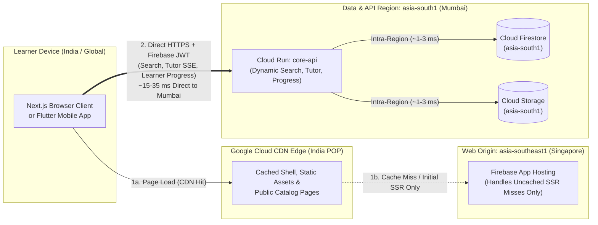
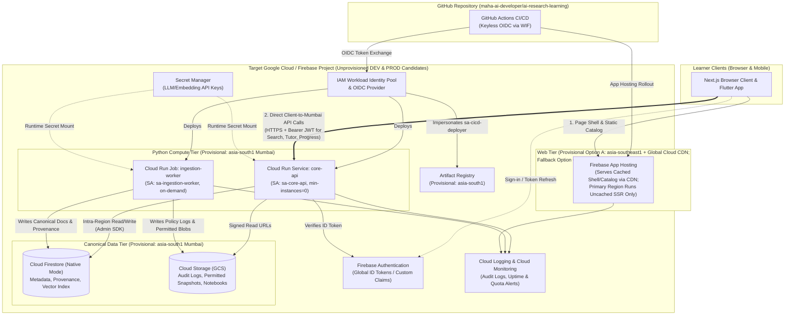

# Cloud Provisioning Plan (`DEV` & `PROD`)

> **Status:** Proposed — Pending Architectural Review & Human Provisioning Approval  
> **Scope:** Planning and operational runbook only. **Zero cloud resources, projects, regions, APIs, credentials, or billing configurations have been created, finalized, or enabled.**  
> **Date Checked Against Official Documentation:** 2026-10-22  
> **Related Architecture Documents:** [System Overview](../architecture/system-overview.md) · [Data Model](../architecture/data-model.md) · [Source Adapter Contract](../architecture/source-adapter-contract.md) · [Implementation Roadmap](../architecture/implementation-roadmap.md) · [ADR-0001](../architecture/decisions/0001-cloud-architecture.md) · [ADR-0002](../architecture/decisions/0002-knowledge-data-model.md)

---

## 1. Proposed Project Structure & Local-First Rollout Strategy

### 1.1 Environment Isolation Model

To enforce strict blast-radius containment, security boundary separation, and independent quota/cost attribution, the system separates local development from two isolated target cloud environments (`DEV` and `PROD`). When cloud provisioning is approved in a future milestone, each cloud environment will use a **separate Google Cloud project** with Firebase enabled on top of the underlying GCP project (a Firebase project *is* a Google Cloud project with Firebase-specific metadata and services enabled):

| Environment | Purpose | Candidate Project ID *(Unprovisioned Candidate Only)* | Parameterized Template Variable | Candidate Display Name | Target Git Branch / Trigger | Data Classification |
| :--- | :--- | :--- | :--- | :--- | :--- | :--- |
| **LOCAL (Unbilled — Active Now)** | Initial adapter/schema development (Stages 1–6), offline unit testing, security rules verification, and local inventory runs | `demo-ai-research-learning` *(emulator-only dummy ID; $0 cloud cost)* | N/A (Local only) | Local Emulator Suite + SQLite (`data/research_inventory.sqlite`) | Working tree / Pull Requests | Synthetic fixtures & local metadata inventory |
| **DEV (Staging — Unprovisioned)** | Integration testing, bounded adapter verification, pre-release web/API validation, and cost/quota telemetry verification | `maha-airl-dev-01` *(candidate only)* | `${GCP_PROJECT_ID_DEV}` | `AI Research Learning (DEV)` | Push to `main` (automated CI/CD after checks pass, once provisioned) | Non-production test corpus & developer accounts |
| **PROD (Production — Unprovisioned)** | Canonical source-grounded learning corpus, production learner progress, and live web/mobile backend | `maha-airl-prod-01` *(candidate only)* | `${GCP_PROJECT_ID_PROD}` | `AI Research Learning (PROD)` | Protected `production` environment release (manual approval gate) | Authoritative corpus & real user learning records |

> [!IMPORTANT]
> **Candidate Project IDs Are Unprovisioned Placeholders Only:**  
> `maha-airl-dev-01` and `maha-airl-prod-01` are recorded strictly as **candidates**, not existing or reserved resources. Because Google Cloud project IDs share a **single global namespace** across all Google Cloud customers and are **immutable** once created, global namespace availability, Google account ownership/access, and Cloud Billing permissions must be verified immediately prior to creation. **Do not execute project creation or enable any APIs in this task.**

### 1.2 Naming Rules and Pre-Creation Verification Procedure

Google Cloud project IDs must satisfy the following platform constraints ([Creating and Managing Projects](https://cloud.google.com/resource-manager/docs/creating-managing-projects), checked 2026-10-22):
- **Length:** 6 to 30 characters.
- **Allowed characters:** Lowercase ASCII letters (`a-z`), digits (`0-9`), and hyphens (`-`).
- **Start/End constraints:** Must start with a lowercase letter and cannot end with a hyphen.
- **Reserved substrings:** Cannot contain restricted strings such as `google`, `ssl`, or `undefined`.
- **Immutability & reuse:** Once created, a project ID cannot be changed; if a project is deleted, its ID cannot be reused even after the 30-day recovery window.

Before creating any project in a future approved provisioning task, the operator must execute the following read-only verification checks:

1. **Identity & Account Access Verification:**
   ```bash
   gcloud auth list
   gcloud config get-value account
   gcloud organizations list
   ```
   Confirm the active Google account is the intended administrator account and holds permission to create projects (`resourcemanager.projects.create`).
2. **Existing Project Inventory & Availability Check:**
   ```bash
   gcloud projects list --filter="projectId:maha-airl-* OR name:ai-research-learning*"
   npx -y firebase-tools@latest projects:list
   ```
   Confirm that no conflicting projects already exist under the account and verify that `maha-airl-dev-01` and `maha-airl-prod-01` (or an alternative consistent suffix pair) are available in the global namespace.
3. **Billing Account Permission Check:**
   ```bash
   gcloud beta billing accounts list
   ```
   Verify that the human administrator holds `roles/billing.admin` or `roles/billing.user` on an active Cloud Billing account before any Blaze-tier service is authorized.

### 1.3 Local-First Development Milestone & `DEV`-First Cloud Rollout

To avoid premature cloud charges and operational overhead while core ingestion, schema validation, and grounding logic are still being built:

1. **Phase A — Local-First Development Milestone (Stages 1–6, `$0` Cloud Spend):**
   - Use **local SQLite** (`data/research_inventory.sqlite` via `collect.py`) and offline test fixtures (`tests/`) alongside the **Firebase Local Emulator Suite** (Auth, Firestore, Storage emulators running against dummy project ID `demo-ai-research-learning`) for all initial source adapter implementation, canonical schema validation, security-rule unit testing, and retrieval/grounding development.
   - **Defer billing authorization and cloud project creation** completely until a separate, explicit approval gate after local verification is complete.
2. **Phase B — `DEV`-First Cloud Rollout (When Cloud Testing Is Justified & Approved):**
   - Once end-to-end integration testing requires live cloud primitives, provision **only the `DEV` project (`maha-airl-dev-01` candidate)** first.
   - Use `DEV` to validate Workload Identity Federation, Firestore security rules, Cloud Run scale-to-zero behavior, rate limiters, and real billing/usage telemetry under strict low instance caps (`max-instances=2`).
3. **Phase C — Gated `PROD` Provisioning (Deferred Until Release Readiness):**
   - **Keep `PROD` (`maha-airl-prod-01` candidate) unprovisioned and unavailable** until release readiness, security rules, provenance verification, and predictable cost behavior have been empirically demonstrated in `DEV` and approved by the user/architect.

---

## 2. Region Selection & Co-Location Analysis

> [!WARNING]
> **No Region Has Been Finalized for Provisioning:**  
> The regional topologies below are evaluated for architectural review. **No region has been finalized or provisioned.** Because Cloud Firestore and Cloud Storage locations are permanent once created, explicit user/architect approval of the regional topology is required before any database or storage bucket is created.

### 2.1 Evaluation Criteria

Region selection balances five factors:
1. **Primary User / Operator Latency:** The primary operator and initial learner base are located in **India (`IST`, `UTC+05:30`)**.
2. **Service Availability Matrix:** Every required managed service must actually support the chosen region.
3. **Service Co-Location & Zero Intra-Region Egress:** Co-locating `Cloud Run` (`core-api` and `ingestion-worker`), `Cloud Firestore`, `Cloud Storage`, and `Artifact Registry` in the same Google Cloud region minimizes round-trip latency (~1–3 ms internal network hop) and avoids cross-region data transfer (egress) charges between compute and storage.
4. **Permanent Database & Storage Location Constraints:** Cloud Firestore's database location and Cloud Storage bucket regions are **permanent** once provisioned.
5. **Free-Tier vs. Regional Pricing Trade-offs:** Some Google Cloud Always-Free quotas (such as Cloud Storage's 5 GB-months free tier) apply only to US regions (`us-central1`, `us-east1`, `us-west1`), whereas Cloud Firestore's free daily operations quota applies across all regions on the `(default)` database.

### 2.2 Service Availability Verification (`asia-south1` vs. Firebase App Hosting)

Checking official Google Cloud and Firebase location documentation as of **2026-10-22** reveals an important regional availability split:

| Service | `asia-south1` (Mumbai, India) Supported? | `asia-southeast1` (Singapore) Supported? | `us-central1` (Iowa, USA) Supported? | Official Documentation Source (Checked 2026-10-22) |
| :--- | :---: | :---: | :---: | :--- |
| **Cloud Firestore (Native Mode)** | **Yes** | **Yes** | **Yes** (`nam5` or `us-central1`) | [Firestore Locations](https://firebase.google.com/docs/firestore/locations) |
| **Cloud Storage for Firebase / GCS** | **Yes** | **Yes** | **Yes** (Eligible for 5 GB Always-Free) | [Cloud Storage Locations](https://cloud.google.com/storage/docs/locations) |
| **Cloud Run (Services & Jobs)** | **Yes** | **Yes** | **Yes** | [Cloud Run Locations](https://cloud.google.com/run/docs/locations) |
| **Artifact Registry** | **Yes** | **Yes** | **Yes** | [Artifact Registry Locations](https://cloud.google.com/artifact-registry/docs/repositories/repo-locations) |
| **Secret Manager** | **Yes** (Global / Regional) | **Yes** (Global / Regional) | **Yes** (Global / Regional) | [Secret Manager Locations](https://cloud.google.com/secret-manager/docs/locations) |
| **Firebase Authentication** | **Yes** (Global service) | **Yes** (Global service) | **Yes** (Global service) | [Firebase Auth Overview](https://firebase.google.com/docs/auth) |
| **Firebase App Hosting** | **NO** | **Yes** | **Yes** | [Firebase App Hosting Locations](https://firebase.google.com/docs/app-hosting/locations) |

> **Critical Finding — Firebase App Hosting Regional Support & Uncached Request Behavior:**  
> 1. As of 2026-10-22, **Firebase App Hosting does NOT support `asia-south1` (Mumbai)**. Firebase App Hosting currently supports creating backends only in six regions: `asia-east1` (Taiwan), `asia-southeast1` (Singapore), `us-central1` (Iowa), `us-east4` (N. Virginia), `us-east5` (Columbus), and `europe-west4` (Netherlands).
> 2. **How App Hosting Handles Uncached Requests ([About App Hosting](https://firebase.google.com/docs/app-hosting/about-app-hosting), [App Hosting Costs](https://firebase.google.com/docs/app-hosting/costs), checked 2026-10-22):** Even though Firebase App Hosting fronts the web app with global Cloud CDN edge POPs (including POPs in India), **every uncached request** (cache misses, dynamic SSR pages, Next.js API routes, or Server Actions) **is routed back to and executed by the primary-region Cloud Run service in the App Hosting backend's region** (e.g., `asia-southeast1` Singapore) and billed at uncached bandwidth rates (`$0.20/GiB` after the 10 GiB/month allowance, plus primary-region Cloud Run CPU/memory).

### 2.3 Candidate Regional Topologies for Architectural Review

#### Option A (Provisional Recommendation): Data & Python Compute in `asia-south1` (Mumbai) + Firebase App Hosting in `asia-southeast1` (Singapore) with Direct Client-to-Mumbai API Calls

- **Data & Python Compute in `asia-south1` (Mumbai):**
  - Provision **Cloud Firestore (Native Mode)**, **Cloud Storage**, **Cloud Run** (`core-api` and `ingestion-worker`), and **Artifact Registry** in **`asia-south1` (Mumbai)**.
  - *Why:* `core-api` and `ingestion-worker` perform multiple sequential reads/writes against Firestore and Cloud Storage per request/job. Co-locating them in `asia-south1` ensures ~1–3 ms internal storage hops, zero cross-region egress between Python compute and data stores, Indian data residency, and ~15–35 ms latency from Indian clients to `core-api`.
- **Firebase App Hosting in `asia-southeast1` (Singapore):**
  - Provision the **Firebase App Hosting** Next.js backend in **`asia-southeast1` (Singapore)** (the nearest supported App Hosting region to India, ~55–70 ms RTT to Mumbai).
  - Configure Next.js public pages and static shells with aggressive `Cache-Control` (`public, s-maxage=3600, stale-while-revalidate=86400`) so repeat page loads are served directly from Indian Cloud CDN edge POPs without hitting the Singapore origin.
- **Mandatory Direct Client-to-Mumbai-API Request Path (No Cross-Region Server Proxies):**
  - To prevent uncached dynamic interactions from hair-pinning across regions (`India User -> Singapore App Hosting SSR -> Mumbai core-api -> Singapore App Hosting SSR -> India User`), **all dynamic web and Flutter operations must call `core-api` in `asia-south1` (Mumbai) directly from the client** (`Browser / Flutter App -> HTTPS + Bearer Firebase ID Token + App Check -> core-api in asia-south1`):
    - Interactive hybrid search (`POST /api/v1/search`)
    - Source-grounded AI tutor queries & SSE streams (`POST /api/v1/tutor/ask`)
    - Learner progress reads/writes & assessments (`/api/v1/me/*`)
  - **Rule:** Do **not** proxy dynamic learner or tutor API calls through Next.js API routes or Server Actions on the `asia-southeast1` App Hosting server. The `asia-southeast1` App Hosting server is strictly for initial HTML/shell delivery and CDN-cacheable public catalog/concept pages.



#### Option C (Primary Fallback for Single-Region Simplicity): 100% Co-Location in `asia-south1` (Mumbai) via Direct Cloud Run Web Hosting

- **When to Choose Option C Over Option A:** If regional simplicity, single-region operational governance, and eliminating the `asia-southeast1` App Hosting origin outweigh Firebase App Hosting's built-in GitHub rollout convenience, **Option C is the preserved fallback**.
- **Topology:** Provision **all services**—Cloud Firestore, Cloud Storage, Artifact Registry, `core-api` (Cloud Run Service), `ingestion-worker` (Cloud Run Job), **and the Next.js web container as a second Cloud Run Service (`web-client`)**—inside **`asia-south1` (Mumbai)** (deployed via the same GitHub Actions WIF pipeline).
- **Benefit:** 100% single-region co-location in `asia-south1` (Mumbai); even uncached SSR requests run in Mumbai alongside `core-api` and Firestore with zero cross-region hops.

#### Option B (Alternative Single-Region Co-Location in `asia-southeast1` Singapore)

- Provision all services—including Firestore, Cloud Storage, Cloud Run (`core-api`, `ingestion-worker`), Artifact Registry, and Firebase App Hosting—in **`asia-southeast1` (Singapore)**.
- *Trade-off:* Eliminates cross-region hops while keeping Firebase App Hosting, at the cost of ~55–75 ms baseline latency from India (vs. ~15–35 ms in Mumbai) and non-Indian data residency.

### 2.4 Permanent Location Decisions Required Before Database Creation

The following location choices are **irreversible** once executed on a project and must be explicitly confirmed by the user before running any creation commands:
1. **Cloud Firestore Location ([Firestore Locations](https://firebase.google.com/docs/firestore/locations)):** Once the `(default)` Firestore database is created in a region (e.g., `asia-south1`), **its location cannot be changed**. Moving regions later requires provisioning a new project (or paid non-default named database) and migrating all documents.
2. **Cloud Storage Bucket Location ([Storage Locations](https://firebase.google.com/docs/storage/locations)):** A bucket's region is permanent once created and must match the Firestore and Cloud Run compute region (`asia-south1` under Option A or Option C) to avoid cross-region data transfer charges during ingestion and retrieval.

---

## 3. Minimum Viable Service Set

### 3.1 Release 1 Service Evaluation Matrix

In accordance with [ADR-0001](../architecture/decisions/0001-cloud-architecture.md) and the [Implementation Roadmap](../architecture/implementation-roadmap.md), the system provisions only the minimum viable serverless footprint required once cloud deployment is approved (Stage 7), deferring asynchronous message buses, scheduled cron infrastructure, and paid managed vector clusters until quantitative triggers are met.

| Service | Classification | Specific Purpose in AI Research & Learning System | Required in Local Milestone (Stages 1–6)? | Required in `DEV` (Stage 7)? | Required in `PROD` (Post-`DEV` Readiness)? |
| :--- | :--- | :--- | :---: | :---: | :---: |
| **Firebase Local Emulator Suite + SQLite** | **Required Now (Local-First)** | Runs offline development, schema validation, adapter tests, and security rule tests at `$0` cloud cost. | **Yes** | Yes (in CI) | Yes (in CI) |
| **Firebase Authentication** | **Required for Cloud Rollout** | Authenticates learners and curators; issues short-lived Firebase ID tokens (JWTs) verified by `core-api` and Firestore Security Rules. | Emulated locally | Yes | Yes |
| **Cloud Firestore (Native Mode)** | **Required for Cloud Rollout** | Single canonical operational database for metadata, provenance, concept graph, learner progress, and native `find_nearest` vector search (up to 2,048 max dimensions). | Emulated locally | Yes | Yes |
| **Cloud Storage for Firebase (GCS)** | **Required for Cloud Rollout** | Stores immutable `robots.txt`/policy audit logs, license-cleared source snapshots, and static `.ipynb` notebook files (`gs://<unprovisioned-env-bucket>-*`). | Emulated locally | Yes | Yes |
| **Cloud Run Service (`core-api`)** | **Required for Cloud Rollout** | Stateless Python FastAPI service (`min-instances=0`) handling source-grounded retrieval, citation verification, and tutor synthesis. | Run via local `uvicorn` | Yes | Yes |
| **Cloud Run Job (`ingestion-worker`)** | **Required for Cloud Rollout** | Batch/on-demand Python worker executing polite source adapters, SHA-256 snapshotting, chunking, embedding, and provenance recording; exits with `0` active instances when finished. | Run via local CLI (`collect.py`) | Yes | Yes |
| **Artifact Registry** | **Required for Cloud Rollout** | Private regional Docker container registry storing immutable, digest-pinned container images for `core-api` and `ingestion-worker`. | No | Yes | Yes |
| **Secret Manager** | **Required for Cloud Rollout** | Stores sensitive server-only credentials (e.g., configurable LLM/embedding API keys) injected into Cloud Run at runtime; never used for public client configs. | `.env.local` (git-ignored) | Yes | Yes |
| **Cloud Logging & Cloud Monitoring** | **Required for Cloud Rollout** | Captures structured JSON audit logs, request latencies, 5xx error rates, quota alerts, and ingestion run metrics. | Local stdout | Yes | Yes |
| **GitHub Actions + Workload Identity Federation (WIF)** | **Required for Cloud Rollout** | Keyless OIDC federation allowing GitHub Actions workflows to deploy container images and rules without long-lived JSON service account keys. | Offline CI only | Yes | Yes |
| **Firebase App Hosting** *(or Option C Cloud Run Web Service)* | **Required at Stage 7 Web Cloud Rollout** | Builds and serves the responsive Next.js web application backed by Cloud Run + Cloud CDN. Requires Blaze plan. | Run via `next dev` locally | Yes (Stage 7) | Yes (Post-`DEV` sign-off) |
| **Cloud Pub/Sub** | **Deferred / Optional (Later Phase)** | Event bus for decoupled high-volume ingestion events. Unnecessary initially because `ingestion-worker` Cloud Run Jobs run on demand. | No | No (Deferred) | No (Deferred) |
| **Cloud Tasks** | **Deferred / Optional (Later Phase)** | Distributed task queue. Unnecessary initially because polite per-domain rate-limiting runs deterministically inside a single `ingestion-worker` task (`parallelism=1`). | No | No (Deferred) | No (Deferred) |
| **Cloud Scheduler (Scheduled Ingestion)** | **Deferred / Optional (Later Phase)** | Automated cron triggers for periodic harvesting. Deferred until adapters and cost/quota guardrails are validated through manual/on-demand `ingestion-worker` runs in `DEV`. | No | No (Deferred) | Optional after `DEV` validation |
| **Vertex AI Vector Search / BigQuery / Cloud SQL** | **Explicitly Excluded** | Excluded by [ADR-0001](../architecture/decisions/0001-cloud-architecture.md) and [ADR-0002](../architecture/decisions/0002-knowledge-data-model.md) to avoid idle hourly node charges and multi-database sync complexity. | No | No | No |

### 3.2 Architecture & Service Interaction Diagram (Provisional Option A Topology)



---

## 4. Security and IAM Architecture

### 4.1 Human Administrator Access

- **Least-Privilege Daily Usage:** Human operators use standard viewer/developer roles for routine inspection and reserve `roles/owner` or `roles/resourcemanager.projectIamAdmin` for initial project setup and IAM changes.
- **Multi-Factor Authentication (MFA):** All human Google accounts with access to `DEV` or `PROD` projects and the GitHub repository must enforce 2-Step Verification (MFA).
- **No Local Long-Lived Service Account JSON Keys:** During Stages 1–6, developers run strictly against the local **Firebase Emulator Suite** and local SQLite without cloud credentials. When cloud testing begins, human operators authenticate via short-lived user sessions (`gcloud auth login` / `gcloud auth application-default login`). Organizational Policy `iam.disableServiceAccountKeyCreation` should be enabled where supported to block JSON key exports.

### 4.2 Dedicated Runtime & CI/CD Service Accounts

Instead of relying on the default Compute Engine service account (`<project-number>-compute@developer.gserviceaccount.com`), which receives overly broad Editor permissions by default, each project (`DEV` and `PROD`) will provision dedicated, least-privilege service accounts:

| Service Account ID | Used By | Granted IAM Roles (Scoped to Same Project Only) | Explicitly Denied / Excluded Capabilities |
| :--- | :--- | :--- | :--- |
| `sa-core-api` | Cloud Run Service (`core-api`) | - `roles/datastore.user` (Firestore read/write)<br>- `roles/storage.objectViewer` (`artifacts/`, `notebooks/`)<br>- `roles/secretmanager.secretAccessor` *(scoped only to `core-api` secrets)*<br>- `roles/logging.logWriter`<br>- `roles/monitoring.metricWriter` | Cannot overwrite or delete raw `audit/` or `artifacts/` GCS objects; cannot trigger Cloud Run Jobs; cannot modify IAM or billing. |
| `sa-ingestion-worker` | Cloud Run Job (`ingestion-worker`) | - `roles/datastore.user` (write canonical `resources`, `resource_versions`, `knowledge_chunks`, `provenance_events`)<br>- `roles/storage.objectCreator` + `roles/storage.objectViewer` *(scoped to `audit/` and `artifacts/` buckets)*<br>- `roles/secretmanager.secretAccessor` *(scoped only to embedding/ingestion secrets)*<br>- `roles/logging.logWriter`<br>- `roles/monitoring.metricWriter` | No public HTTP ingress URL; cannot delete existing GCS objects unless explicit lifecycle policy runs; cannot modify IAM. |
| `sa-apphosting-web` | Firebase App Hosting Backend *(or Option C `web-client` Cloud Run Service)* | - `roles/firebaseapphosting.computeRunner`<br>- `roles/logging.logWriter` | No direct write access to canonical Firestore collections (`sources`, `resources`, `knowledge_chunks`, `provenance_events`) or raw GCS buckets. |
| `sa-cicd-deployer` | GitHub Actions via Workload Identity Federation | - `roles/artifactregistry.writer`<br>- `roles/run.developer`<br>- `roles/firebaseapphosting.admin`<br>- `roles/iam.serviceAccountUser` *(bound strictly to `sa-core-api`, `sa-ingestion-worker`, and `sa-apphosting-web`)*<br>- `roles/firebaserules.admin` *(for deploying vetted Firestore/Storage rules)* | No static JSON keys; cannot read Secret Manager secret payloads (`secretmanager.versions.access`); cannot modify project IAM policies; cannot alter billing. |
| `sa-lab-sandbox` *(Deferred Stage 9)* | Isolated Ephemeral Notebook Runner | **None (`0` GCP IAM roles; metadata server blocked)** | Zero access to Firestore, GCS, Secret Manager, Vertex AI, or internal networks ([ADR-0004](../architecture/decisions/0004-notebook-isolation.md)). |

### 4.3 GitHub Actions Deployment Identity (Workload Identity Federation)

All automated deployments from `maha-ai-developer/ai-research-learning` will use **Google Cloud Workload Identity Federation (WIF)** with GitHub Actions OIDC tokens ([Workload Identity Federation with Deployment Pipelines](https://cloud.google.com/iam/docs/workload-identity-federation-with-deployment-pipelines), checked 2026-10-22):
- **Zero Stored JSON Keys:** No `GCP_SA_KEY` JSON secrets are ever generated or stored in GitHub repository secrets.
- **Attribute Conditions:**
  - Every WIF Provider restricts token exchange via CEL attribute conditions to `assertion.repository == 'maha-ai-developer/ai-research-learning'`.
  - In the **`DEV` project**, the WIF principal binding permits deployments only when `assertion.ref == 'refs/heads/main'` (or environment `dev`).
  - In the **`PROD` project**, the WIF principal binding restricts token exchange to workflows running against the protected GitHub Environment `production` (`assertion.environment == 'production'`) and `assertion.ref == 'refs/heads/main'`.

### 4.4 Public Firebase Client Config vs. Private Server Credentials

| Configuration / Credential Type | Security Classification | Where It Lives | Rules & Handling |
| :--- | :--- | :--- | :--- |
| **Firebase Web / Flutter Client Options** (`apiKey`, `appId`, `projectId`, `authDomain`, `storageBucket`, `messagingSenderId`) | **Public Identifiers** ([Understand Firebase Projects — Config Safe to Include](https://firebase.google.com/docs/projects/api-keys), checked 2026-10-22) | Public client bundle / environment variables (`NEXT_PUBLIC_FIREBASE_*`) | These values only identify the Firebase project to Google servers; they **do not** grant data access by themselves. Security depends entirely on **Firestore/Storage Security Rules**, **Firebase Auth**, **Firebase App Check**, and **API Key Restrictions** (restricting browser keys by HTTP referrer and API scope in Google Cloud Console). |
| **Server Runtime Credentials** (`sa-core-api`, `sa-ingestion-worker`) | **Private / Privileged Identity** | Google Cloud Metadata Server (automatic ADC inside Cloud Run) | Never exported as JSON files; never bundled into Next.js client code or Flutter binaries; never committed to Git. |
| **Third-Party / AI API Keys** (e.g., Gemini API key, embedding provider key) | **Confidential Secret** | **Google Cloud Secret Manager** | Mounted into `core-api` and `ingestion-worker` at container startup via Secret Manager references (`--set-secrets`). Never exposed to browser/mobile clients. |

### 4.5 Firestore & Cloud Storage Security Rules Strategy

In accordance with [ADR-0002](../architecture/decisions/0002-knowledge-data-model.md) and [`data-model.md`](../architecture/data-model.md):
1. **Default-Deny Baseline:** Both `firestore.rules` and `storage.rules` start with a global default-deny catch-all (`match /{document=**} { allow read, write: if false; }`).
2. **Canonical Corpus Read-Only for Clients:** Direct client writes (`create`, `update`, `delete`) to canonical collections (`sources`, `resources`, `resource_versions`, `knowledge_chunks`, `concepts`, `concept_relations`, `claims`, `citations`, `provenance_events`, `agent_runs`) are unconditionally denied (`allow write: if false;`)—only `sa-ingestion-worker` and `sa-core-api` (via Admin SDK on the server) can write those collections.
3. **Strict Learner Isolation (`users/{uid}/progress`):** Learners can read and update only their own progress documents (`request.auth != null && request.auth.uid == uid`) with schema field validation.
4. **Copyright & Redistribution Enforcement:**
   - Raw Cloud Storage audit logs (`gs://<unprovisioned-env-bucket>-audit/`) and restricted snapshots are **never** publicly readable.
   - Verbatim excerpts and redistributable artifacts remain gated by `redistribution_allowed == true` and `permits_verbatim_excerpts == true` ([`source-adapter-contract.md`](../architecture/source-adapter-contract.md)).

### 4.6 Secret Manager Handling and Rotation Policy

- **Per-Environment Secret Isolation:** Secrets exist independently inside the `DEV` and `PROD` projects. `DEV` secrets must use separate API keys/quotas from `PROD` secrets so a test in `DEV` cannot exhaust `PROD` rate limits or budgets.
- **Version Pinning:** Cloud Run services pin explicit secret version numbers (e.g., `MODEL_API_KEY=model-api-key:2`) rather than `:latest` in `PROD` so secret rotation is atomic, auditable, and rolled out alongside a verified revision.
- **Rotation Schedule:** Secret versions are rotated at least every 90 days (or immediately upon any suspected exposure), with deprecated versions disabled and destroyed promptly to stay within Secret Manager's 6-version free tier.

### 4.7 Preventing `DEV` Workloads from Accessing `PROD` Data

Cross-environment contamination is prevented by four overlapping controls:
1. **Separate GCP Projects:** `DEV` (`maha-airl-dev-01` candidate) and `PROD` (`maha-airl-prod-01` candidate) live in distinct project IDs with zero shared VPC networks and separate Firestore/GCS instances.
2. **Zero Cross-Project IAM Bindings:** Neither `sa-core-api`, `sa-ingestion-worker`, `sa-apphosting-web`, nor `sa-cicd-deployer` in `DEV` is ever granted any IAM role inside `PROD`.
3. **Separate WIF Pools & Providers:** `DEV` and `PROD` each maintain their own Workload Identity Pool. A GitHub Actions job running in the `dev` environment cannot exchange its OIDC token against the `PROD` WIF provider because the `PROD` provider requires `assertion.environment == 'production'`.
4. **Runtime Startup Assertion:** `core-api` and `ingestion-worker` validate at startup that `APP_ENV` (`dev` vs. `prod`) matches the expected `GOOGLE_CLOUD_PROJECT`; any mismatch causes immediate startup failure (`exit 1`).

---

## 5. Cost and Billing Safeguards

> [!WARNING]
> **Critical Billing & Cost-Control Disclaimer:**  
> 1. **We do NOT enable billing or provision cloud resources in this task**, and we do **not** claim that cloud deployment will be free.  
> 2. **No single control in Google Cloud or Firebase guarantees a strict total-bill ceiling** once a project is upgraded to the Blaze (pay-as-you-go) plan.  
> 3. **Cloud Billing budgets ($5 `DEV` / $15 `PROD`) are notification thresholds only—NOT maximum spending caps.** Preventing unexpected charges requires combining a **local-first emulator workflow**, a **`DEV`-first cloud rollout**, **hard Cloud Run instance/task bounds**, **API rate/quota limits**, and **application-level token circuit breakers**.

### 5.1 Blaze Plan Requirement & Multi-Service Cost Drivers of Firebase App Hosting

- **Firebase Spark Plan (No-Cost):** Supports Firebase Authentication (up to 50,000 MAUs for Email/Password and social OAuth), Cloud Firestore (within strict daily free limits), and classic static Firebase Hosting.
- **Why Blaze (Pay-As-You-Go) Is Required for Cloud Deployment:**
  - **Firebase App Hosting**, **Cloud Run Services (`core-api`)**, **Cloud Run Jobs (`ingestion-worker`)**, **Artifact Registry**, and **Secret Manager** all require a linked Cloud Billing account (**Blaze plan**) ([Firebase Pricing](https://firebase.google.com/pricing), checked 2026-10-22).
- **Composite Cost Profile of Firebase App Hosting ([App Hosting Costs & Quotas](https://firebase.google.com/docs/app-hosting/costs), checked 2026-10-22):**
  - Enabling **Firebase App Hosting** does not bill as a single flat item; it orchestrates and **may incur costs across five underlying Google Cloud services simultaneously**:
    1. **Firebase App Hosting / Cloud CDN Outgoing Bandwidth:** Includes a 10 GiB/month no-cost allowance; beyond 10 GiB/month, **cached CDN responses** cost **$0.15/GiB** while **uncached responses** served from the primary region cost **$0.20/GiB**.
    2. **Cloud Run (Primary-Region SSR Compute):** Every uncached page request, SSR render, or Next.js server route executes on the underlying Cloud Run service in the App Hosting backend's primary region (`asia-southeast1` under Option A), consuming vCPU-seconds, memory GiB-seconds, and request quotas (or continuous charges if `minInstances >= 1` is ever set).
    3. **Cloud Build:** Every rollout compiles the Next.js application on Cloud Build, consuming build-minutes (120 build-minutes/day free tier; billed per build-minute thereafter).
    4. **Artifact Registry:** Stores the built Next.js container image for each rollout (0.5 GB/month free per billing account; **$0.10/GB-month** thereafter, which accumulates across deployments unless an Artifact Registry cleanup policy deletes old images).
    5. **Secret Manager:** Stores and accesses runtime secrets referenced in `apphosting.yaml` (6 active secret versions and 10,000 access operations/month free per billing account; **$0.06/version-month** and **$0.03 per 10,000 operations** thereafter).

### 5.2 Service-by-Service Pricing Drivers & Free-Tier Limits (Checked 2026-10-22)

| Service | Primary Billing Drivers | Documented Free Tier (Monthly / Daily) | Regional / Plan Nuances | Official Pricing URL (Checked 2026-10-22) |
| :--- | :--- | :--- | :--- | :--- |
| **Firebase Authentication (Identity Platform)** | Monthly Active Users (MAUs) beyond free tier; SMS/phone auth messages | **50,000 MAUs/month free** for standard providers (Email/Password, Google, GitHub OAuth) | Phone/SMS auth and SAML/OIDC enterprise providers have much lower/different free tiers—**disable SMS/Phone Auth** in both `DEV` and `PROD`. | [Firebase Pricing](https://firebase.google.com/pricing) |
| **Cloud Firestore (Native Mode)** | Stored GiB-month, document reads, writes, deletes, and network egress | **1 GiB storage**, **50,000 reads/day**, **20,000 writes/day**, **20,000 deletes/day**, **10 GiB/month egress** | Free tier applies only to **one `(default)` database per billing account** (resets daily at midnight Pacific Time). In **`asia-south1` (Mumbai)**, rates beyond free tier are **$0.165/GiB-month**, **$0.033 per 100k reads**, **$0.099 per 100k writes**, and **$0.011 per 100k deletes**. **Exclusions:** PITR storage, backup storage/restores, and TTL deletes are excluded from the free tier. | [Firestore Pricing](https://cloud.google.com/firestore/pricing) |
| **Cloud Storage (GCS)** | Standard storage GiB-month, Class A (write/list) & Class B (read/get) operations, network egress | **5 GB-months storage**, **5,000 Class A ops**, **50,000 Class B ops/month** *(US regions `us-central1`/`us-east1`/`us-west1` only)* | **Important:** In **`asia-south1` (Mumbai)** or **`asia-southeast1` (Singapore)**, GCS Standard Storage is **not** covered by the US-only 5 GB free tier and is billed from the first GiB at **~$0.023/GiB-month** (`asia-south1`) plus $0.005 per 1,000 Class A ops and $0.0004 per 1,000 Class B ops. | [Cloud Storage Pricing](https://cloud.google.com/storage/pricing) |
| **Cloud Run (`core-api` & `ingestion-worker`)** | vCPU-seconds, GiB-seconds of active request/job execution, request count, egress | **180,000 vCPU-seconds**, **360,000 GiB-seconds**, **2,000,000 requests/month** (pooled per billing account across eligible regions) | Requires `min-instances=0` (scale-to-zero) and CPU allocated only during request processing (`--cpu-throttling`) so idle time costs **$0.00**. Setting `min-instances >= 1` incurs continuous 24/7 charges. | [Cloud Run Pricing](https://cloud.google.com/run/pricing) |
| **Firebase App Hosting** | Outgoing bandwidth ($0.15/GiB cached, $0.20/GiB uncached), Cloud Build minutes, Cloud Run SSR compute, Artifact Registry storage, Secret Manager | **10 GiB/month** outgoing bandwidth free; shares pooled Always-Free quotas for Cloud Run, Cloud Build (**120 build-minutes/day**), Artifact Registry (**0.5 GB/month**), and Secret Manager | Uncached dynamic SSR requests execute on the primary-region Cloud Run service (`asia-southeast1`); direct client-to-`asia-south1` API calls and aggressive `Cache-Control` headers minimize uncached SSR compute and bandwidth. | [App Hosting Costs & Quotas](https://firebase.google.com/docs/app-hosting/costs) |
| **Artifact Registry** | Stored container image GiB-month and cross-region egress | **0.5 GB/month** free per billing account; **$0.10/GB-month** beyond 0.5 GB | Without cleanup policies, old Docker images accumulate on every CI push and exceed 0.5 GB quickly. Configure an **Artifact Registry Cleanup Policy** retaining only the latest 3–5 image digests. | [Artifact Registry Pricing](https://cloud.google.com/artifact-registry/pricing) |
| **Secret Manager** | Active secret versions ($0.06/version-month) and access operations ($0.03 per 10k accesses) | **6 active secret versions** and **10,000 access operations/month** free per billing account | Destroy deprecated secret versions promptly to stay within the 6-version free allowance across `DEV` + `PROD`. | [Secret Manager Pricing](https://cloud.google.com/secret-manager/pricing) |
| **Cloud Logging & Monitoring** | Log ingestion GiB-month beyond free allotment; retention > 30 days | **First 50 GiB/month per project** of log ingestion is free (30-day default retention); standard GCP metrics are free | Keep log retention at the 30-day default and log at `INFO`/`WARNING`/`ERROR` levels (avoid verbose `DEBUG` payload logging in `PROD`). | [Cloud Observability Pricing](https://cloud.google.com/stackdriver/pricing) |

### 5.3 Small-Project Monthly Cost Model (Explicit Assumptions)

To estimate realistic monthly spend once `DEV` (and later `PROD`) are active (provisional Option A: `asia-south1` for Data/Compute and `asia-southeast1` for App Hosting):

- **Explicit Workload Assumptions:**
  - **Active Learners:** 1–20 learners during initial rollout (~500 page views/day, ~100 API queries/day).
  - **Corpus Size:** ~500 canonical resources, ~25,000 metadata/chunk documents (~0.4 GiB in Firestore), and ~3 GiB of audit logs, permitted snapshots, and `.ipynb` files in Cloud Storage (`asia-south1`).
  - **Compute Utilization:** `core-api` (`1 vCPU, 512 MiB`, `min-instances=0`) runs ~6,000 vCPU-seconds/month; `ingestion-worker` (`1 vCPU, 1 GiB`) runs 20 batch executions/month at 3 minutes each (~3,600 vCPU-seconds/month).
  - **Container Images:** Pruned to <= 4 active images (~0.45 GB total) via Artifact Registry cleanup policies.
  - **Secrets:** <= 6 active secret versions total across the billing account.
  - **Logs:** ~2 GiB/month total log volume.

| Cost Component | Estimated Monthly Usage (`DEV` + `PROD`) | Covered by Free Tier? | Estimated Monthly Bill (USD) |
| :--- | :--- | :--- | :--- |
| Firebase Auth (Email/OAuth only) | < 50 MAUs | Yes (50,000 MAUs free) | **$0.00** |
| Cloud Firestore (`asia-south1`) | ~0.4 GiB storage; < 10k reads/day; < 2k writes/day | 1 `(default)` DB free per billing account; second project DB billed at low volume | **$0.00 – $0.35** |
| Cloud Storage (`asia-south1`) | ~3 GiB Standard storage + ~20k ops/month | Billed in `asia-south1` (~$0.023/GiB-month) | **~$0.07 – $0.15** |
| Cloud Run (`core-api` + `ingestion-worker` + App Hosting SSR) | ~15,000 vCPU-sec, ~15,000 GiB-sec | Yes (within 180k vCPU-sec / 360k GiB-sec pooled free tier) | **$0.00** |
| App Hosting / Cloud CDN Outgoing Bandwidth | ~2 GiB/month egress | Within 10 GiB/month App Hosting bandwidth allowance (or ~$0.15–$0.20/GiB after) | **$0.00 – $0.40** |
| Artifact Registry (with cleanup policy) | < 0.5 GB stored | Yes (0.5 GB free per billing account) | **$0.00 – $0.20** |
| Secret Manager | 4–6 active secret versions | Yes (6 versions free per billing account) | **$0.00** |
| Cloud Logging & Monitoring | ~2 GiB/month logs (30-day retention) | Yes (50 GiB/project/month free) | **$0.00** |
| **Estimated Baseline Infrastructure Total** *(excluding external paid LLM/Embedding API tokens)* | | | **~$0.10 – $1.50 / month** |

### 5.4 Local-First & Cost-Free Development Workflow (`$0.00` Cloud Spend)

During Stages 1–6 (and for all ongoing day-to-day feature development and PR testing after cloud provisioning), engineering runs at **`$0.00` cloud cost**:
1. **Local SQLite & Offline Fixture Suite:** `collect.py` with `data/research_inventory.sqlite` and `python3 -m unittest discover -s tests -v` validate discovery, `robots.txt` policies, URL canonicalization, and schema invariants completely offline.
2. **Firebase Local Emulator Suite:** Emulates Firebase Auth, Cloud Firestore, and Cloud Storage locally (`firebase emulators:start --project demo-ai-research-learning`) with zero Google Cloud project or billing account required.
3. **Local Service Execution:** `core-api` (`uvicorn`) and `ingestion-worker` connect to `FIRESTORE_EMULATOR_HOST=localhost:8080` and `FIREBASE_STORAGE_EMULATOR_HOST=localhost:9199`.

### 5.5 Official Google Cloud Pricing Calculator Guidance

Before enabling billing on `DEV` (or later `PROD`), the operator must enter the candidate region and workload numbers into the official **[Google Cloud Pricing Calculator](https://cloud.google.com/products/calculator)** (checked 2026-10-22):
1. Add **Cloud Run** (Region: `asia-south1`, CPU allocated only during request processing, `min-instances = 0`, 1 vCPU, 512 MiB RAM).
2. Add **Cloud Firestore** (Location: `asia-south1`, Storage: 1 GiB, Reads/Writes per day, plus PITR if enabled on `PROD`).
3. Add **Cloud Storage** (Location: `asia-south1`, Standard Storage: 5 GiB).
4. Export and archive the calculator estimate link in the provisioning approval record before linking a billing account.

### 5.6 Notification Thresholds vs. Service-Specific Spend Caps (Eligibility, Delays & Exclusions)

A rigorous cost-control design must recognize the exact capabilities and limitations of Google Cloud's billing and quota mechanisms ([Cloud Billing Budgets](https://cloud.google.com/billing/docs/how-to/budgets), [Firestore Pricing & Quotas](https://firebase.google.com/docs/firestore/pricing), [Service Usage Quota Overrides](https://cloud.google.com/service-usage/docs/manage-quota), checked 2026-10-22):

| Mechanism | What It Actually Does | Eligibility Constraints | Reporting / Propagation Delays | Exclusions (What It Does NOT Cap) |
| :--- | :--- | :--- | :--- | :--- |
| **Cloud Billing Budgets (`$5.00/mo DEV`, `$15.00/mo PROD`)** | **Notification Threshold Only:** Sends email and optional Pub/Sub notifications at `50%`, `80%`, `100%`, and `120%` of actual/forecasted monthly spend. | Any project linked to a Cloud Billing account. | **Multi-hour billing reporting delay:** Usage records can take several hours to appear in Cloud Billing, so a rapid traffic spike can exceed `$5` or `$15` before the alert fires. | **Does NOT cap spending or stop services.** Even if wired to a custom Pub/Sub Cloud Function that unlinks billing, the multi-hour billing lag means it is not an instantaneous hard ceiling. |
| **Firebase Spark (No-Cost) Plan Quotas** | Enforces a **hard daily stop** on Firestore operations (`50k` reads, `20k` writes, `20k` deletes/day; resets midnight PT) and `1 GiB` storage. | **Eligible ONLY while the project stays on the Spark plan.** Cannot be used once upgraded to Blaze for Cloud Run or Firebase App Hosting. | Near-real-time quota enforcement, with minor local cache buffering. | Incompatible with Cloud Run, Cloud Build, Artifact Registry, Secret Manager, and Firebase App Hosting (all require Blaze). |
| **Cloud Firestore / Legacy App Engine Daily Spending Limit** | Historically allowed setting a daily dollar limit on App Engine / Firestore database operations. | **Deprecated / unavailable for new Firestore projects on Blaze.** On the Blaze plan, Cloud Firestore has **no native hard daily or monthly dollar spending cap**. | Legacy quota enforcement buffered usage across distributed nodes. | Even where legacy limits existed, they **excluded storage costs (`GiB-month`), network egress, PITR storage, backup storage/restores, and TTL deletes**. |
| **GCP API Consumer Quota Overrides (`Service Usage` API Quotas)** | Enforces a hard ceiling on **API request rates** (e.g., requests per minute or requests per day per project/user on `aiplatform.googleapis.com`, `run.googleapis.com`, or `firestore.googleapis.com`). | Supported on GCP APIs that expose adjustable consumer rate/daily quotas in `IAM & Admin -> Quotas`. | **15–30 minute (up to several hours) propagation delay** when quota overrides are lowered or modified. | Caps **request counts only**; **excludes** passive storage accumulation (Firestore/GCS/Artifact Registry `GiB-month`), PITR/backups, container build minutes, and network/CDN bandwidth charges. |

### 5.7 Defense-in-Depth Technical Cost Safeguards

Because **no single billing alert or service quota guarantees a strict total-bill ceiling**, the system layers six technical controls together:

1. **Notification Thresholds (`$5 DEV` / `$15 PROD` Cloud Billing Budgets):** Configured with email alerts at `50%`, `80%`, `100%`, and `120%` of actual and forecasted monthly spend to provide early visibility.
2. **Cloud Run Hard Instance & Concurrency Caps:**
   - `core-api`: `--min-instances=0` (scale-to-zero when idle), `--max-instances=2` in `DEV` (and `--max-instances=5` to `10` in `PROD`), `--concurrency=40`, `--cpu-throttling`, and `--timeout=60s`.
   - Firebase App Hosting (`apphosting.yaml`): `runConfig.minInstances: 0`, `runConfig.maxInstances: 2` (`DEV`) / `5` (`PROD`).
3. **Cloud Run Job Task & Runtime Bounds:**
   - `ingestion-worker`: `--parallelism=1`, `--task-count=1`, `--max-retries=1`, and `--task-timeout=900s` (15 minutes max), with per-run document fetch caps (`--limit 25` in `DEV`).
4. **API Consumer Quota Caps:** Lower per-minute and daily request quotas in `IAM & Admin -> Quotas` on any model/embedding API before enabling traffic.
5. **Application-Level Request & Daily Token Circuit Breakers:**
   - Per-UID and per-IP token-bucket rate limiting on `core-api` (`30 req/min` search, `5 req/min` tutor in `DEV`).
   - Atomic daily token/request counter in Firestore (`system_quotas/daily_usage_YYYY_MM_DD`) enforcing a hard project ceiling (`100,000` tokens/day in `DEV`, `2,000,000` tokens/day in `PROD`). When reached, `core-api` and `ingestion-worker` immediately trip an application circuit breaker (`HTTP 503 ERR_UPSTREAM_MODEL_UNAVAILABLE`) and fall back to deterministic metadata/keyword search without invoking paid model APIs.
6. **Storage Lifecycle & Artifact Registry Cleanup Policies:**
   - Artifact Registry cleanup policy deletes untagged images after 7 days and keeps at most 5 tagged digests per repository (staying near/within the 0.5 GB free tier).
   - Cloud Storage lifecycle policy deletes temporary `DEV` staging objects after 7 days; **Point-in-Time Recovery (PITR) is disabled in `DEV`** (enabled only in `PROD`) because PITR incurs billed storage outside the free tier.

---

## 6. CI/CD and Release Process

### 6.1 End-to-End Release Pipeline (`Local/PR` → `DEV`-First → Approval-Gated `PROD`)

```mermaid
flowchart LR
    subgraph PR["1. Pull Request Checks (Unprivileged, $0 Cloud Spend)"]
        PR_TEST["Run Offline Unit Tests,\nBytecode Compile, Schema & Rules Tests\n(Local SQLite + Firebase Emulator Suite)"]
    end

    subgraph DEV_STAGE["2. DEV Deployment (On Push to main — After DEV Provisioning Approval)"]
        DEV_WIF["Authenticate to DEV Project\nvia GitHub OIDC (WIF)"]
        DEV_API["Build & Push Image to DEV Artifact Registry\nDeploy Cloud Run (core-api, ingestion-worker)"]
        DEV_WEB["Firebase App Hosting Rollout\n(DEV Backend — or Option C Cloud Run Web)"]
        DEV_SMOKE["Automated DEV Smoke Tests\n(/healthz, Rules check, Provenance check)"]
    end

    subgraph PROD_GATE["3. Release Readiness & Human Approval Gate"]
        APPROVAL["GitHub Environment 'production'\nRequired Reviewer Approval\n+ Verified DEV Telemetry & Readiness"]
    end

    subgraph PROD_STAGE["4. PROD Deployment (Protected — After PROD Provisioning Approval)"]
        PROD_WIF["Authenticate to PROD Project\nvia GitHub OIDC (WIF)"]
        PROD_API["Promote Digest-Pinned Image\nDeploy PROD Cloud Run (core-api, ingestion-worker)"]
        PROD_WEB["Firebase App Hosting Rollout\n(PROD Backend from Release Branch/Tag)"]
        PROD_SMOKE["Automated PROD Smoke Tests\n& Immediate Rollback on Failure"]
    end

    PR_TEST -->|"PR Approved & Squash-Merged to main"| DEV_WIF
    DEV_WIF --> DEV_API --> DEV_SMOKE
    DEV_WIF --> DEV_WEB --> DEV_SMOKE
    DEV_SMOKE --> APPROVAL
    APPROVAL -->|"Approved"| PROD_WIF
    PROD_WIF --> PROD_API --> PROD_SMOKE
    PROD_WIF --> PROD_WEB --> PROD_SMOKE
```



### 6.2 Separation of Web Pipeline (Firebase App Hosting) and API Pipeline (Cloud Run)

The web frontend and the Python backend have **explicitly separate deployment pipelines** so a UI change does not rebuild Python containers and an API change does not trigger unnecessary Cloud Build Next.js builds:

| Pipeline Aspect | **Cloud Run API & Worker Pipeline** (`core-api`, `ingestion-worker`) | **Web Frontend Pipeline** (`Firebase App Hosting` — or Option C `web-client`) |
| :--- | :--- | :--- |
| **Source Directory** | `services/core-api/`, `services/ingestion-worker/`, `packages/shared/` | `apps/web/` (`apphosting.yaml`, `apphosting.dev.yaml`, `apphosting.prod.yaml`) |
| **Orchestrator** | GitHub Actions workflows (`.github/workflows/deploy-api-dev.yml`, `deploy-api-prod.yml`) | Firebase App Hosting GitHub integration + Cloud Build (or explicit `firebase apphosting:rollouts:create` CLI step in GitHub Actions) |
| **Trigger Filtering** | Path-filtered to backend/shared code changes or manual `workflow_dispatch` | Path-filtered to `apps/web/**` or explicit release rollout |
| **Environment Promotion** | `DEV` builds and deploys on merge to `main` (once `DEV` exists); `PROD` deploys the verified image digest only after the `production` GitHub Environment manual approval gate passes | `DEV` App Hosting backend tracks `main` (`rootDir: apps/web`); `PROD` App Hosting backend tracks a protected release branch or is triggered exclusively via `firebase apphosting:rollouts:create` after the `production` GitHub Environment approval gate passes |
| **Runtime Config** | `--set-env-vars` and `--set-secrets` passed in `gcloud run deploy` | Environment-specific `apphosting.dev.yaml` and `apphosting.prod.yaml` setting `NEXT_PUBLIC_API_BASE_URL` directly to the `asia-south1` `core-api` URL |

### 6.3 Branch Protection & GitHub Environment Approvals

1. **`main` Branch Protection Rules:**
   - Require a Pull Request before merging (no direct pushes to `main`).
   - Require status checks to pass before merging (`offline-tests`, plus future emulator rules and contract checks).
   - Require branches to be up to date before merging; prefer **Squash and Merge** for a linear history.
2. **GitHub Environments (`dev` and `production`):**
   - **`dev` Environment:** Restricted to the `main` branch. Stores unsecret deployment targets (`DEV_GCP_PROJECT_ID`, `DEV_WIF_PROVIDER`, `DEV_WIF_SERVICE_ACCOUNT`).
   - **`production` Environment:** Restricted to `main` (or signed `v*` release tags) **and configured with Required Reviewers (explicit human approval required before any job referencing `environment: production` can start or request an OIDC token)**.

### 6.4 Rollback Strategy & Required Verification Checks

- **Cloud Run (`core-api` & `ingestion-worker`) Instant Traffic Rollback:**
  - Every deployment creates an immutable revision tagged with the short Git SHA (`--revision-suffix=sha-${GITHUB_SHA::7}`).
  - If post-deploy smoke checks (`/healthz`, `/readyz`, schema compatibility check) fail, traffic is routed 100% back to the previous healthy revision:
    ```bash
    gcloud run services update-traffic core-api \
      --region=<DATA_REGION> \
      --to-revisions=<PREVIOUS_REVISION>=100
    ```
- **Firebase App Hosting Rollback:**
  - In the Firebase Console (`App Hosting -> Rollouts`) or via CLI (`firebase apphosting:rollouts:create --git-commit <PREVIOUS_SHA>`), roll back immediately to the prior immutable revision.
- **Firestore Indexes & Security Rules Rollback:**
  - Rules (`firestore.rules`, `storage.rules`) and composite indexes (`firestore.indexes.json`) are version-controlled in Git and must be backward-compatible (additive-first).

---

## 7. Sequential Provisioning Checklist (Phased: Local-First → `DEV`-First → `PROD`)

> **Execution Policy:** Do **not** execute any cloud provisioning steps below until the architect and user approve this plan and resolve all open decisions in Section 8.2. Steps marked **`[HUMAN APPROVAL / CONSOLE REQUIRED]`** require explicit human action or authorization.

### Phase 0: Local-First Milestone (Stages 1–6 — Active Now, `$0` Cloud Spend)
- [ ] **0.1 Develop & Verify Adapters and Schemas Locally:** Use `collect.py` + local SQLite (`data/research_inventory.sqlite`) and offline unit tests (`python3 -m unittest discover -s tests -v`).
- [ ] **0.2 Run Local Firebase Emulator Suite:** Test `firestore.rules`, `storage.rules`, and `core-api` locally against `demo-ai-research-learning` with zero cloud projects or billing accounts enabled.
- [ ] **0.3 `[HUMAN APPROVAL GATE]` Authorize `DEV` Cloud Rollout:** Confirm that Stages 1–6 acceptance criteria are met and explicitly authorize creating the `DEV` cloud environment first (`PROD` remains unprovisioned until `DEV` demonstrates release readiness).

### Phase 1: Account Readiness & Pre-Creation Checks (`DEV` First)
- [ ] **1.1 `[HUMAN APPROVAL / CONSOLE REQUIRED]` Verify Google Account & MFA:** Confirm the administrator Google account has 2-Step Verification (MFA) enabled and is the intended owner.
- [ ] **1.2 Authenticate CLI Locally (Read-Only Check):** Run `gcloud auth login` and `npx -y firebase-tools@latest login`, then run `gcloud projects list` and `gcloud beta billing accounts list` to verify account access, billing permissions, and global availability of candidate ID `maha-airl-dev-01` (and reserve/check `maha-airl-prod-01` for later).
- [ ] **1.3 `[HUMAN APPROVAL REQUIRED]` Finalize Candidate Project IDs & Regional Topology:** Confirm `maha-airl-dev-01` / `maha-airl-prod-01` (or approved alternatives) and approve **Option A** (provisional recommendation: `asia-south1` Data/Compute + `asia-southeast1` App Hosting with direct client-to-Mumbai API calls) or **Option C** (fallback: 100% `asia-south1` with direct Cloud Run web hosting).

### Phase 2: Project Creation (`DEV` First; `PROD` Deferred Until Release Readiness)
- [ ] **2.1 `[HUMAN APPROVAL REQUIRED]` Create `DEV` Google Cloud Project First:**
  ```bash
  gcloud projects create <DEV_PROJECT_ID> --name="AI Research Learning (DEV)" --labels=env=dev,system=ai-research-learning
  npx -y firebase-tools@latest projects:addfirebase <DEV_PROJECT_ID>
  ```
  *(Repeat for `<PROD_PROJECT_ID>` **only** after `DEV` release readiness is demonstrated and approved.)*

### Phase 3: Billing Authorization, Notification Thresholds & Cost Guardrails
- [ ] **3.1 `[HUMAN APPROVAL / CONSOLE REQUIRED]` Review Official Pricing Calculator Estimate:** Verify the estimated monthly cost in the [Google Cloud Pricing Calculator](https://cloud.google.com/products/calculator).
- [ ] **3.2 `[HUMAN APPROVAL / CONSOLE REQUIRED]` Link Cloud Billing Account (Upgrade `DEV` to Blaze):** Link the authorized Cloud Billing account to `<DEV_PROJECT_ID>`.
- [ ] **3.3 `[HUMAN APPROVAL / CONSOLE REQUIRED]` Configure Cloud Billing Notification Budgets:** In Google Cloud Console (`Billing -> Budgets & alerts`), configure the **$5.00/month notification threshold on `DEV`** (and **$15.00/month on `PROD`** when created) with email alerts at 50%, 80%, 100%, and 120% (recognizing these are notifications, not hard caps).

### Phase 4: Enable Minimum Required APIs & Consumer Quota Caps
- [ ] **4.1 Enable Minimum Required APIs in `<DEV_PROJECT_ID>`:**
  ```bash
  gcloud services enable \
    firestore.googleapis.com \
    firebaserules.googleapis.com \
    firebasestorage.googleapis.com \
    storage.googleapis.com \
    identitytoolkit.googleapis.com \
    run.googleapis.com \
    artifactregistry.googleapis.com \
    secretmanager.googleapis.com \
    cloudbuild.googleapis.com \
    firebaseapphosting.googleapis.com \
    iam.googleapis.com \
    iamcredentials.googleapis.com \
    sts.googleapis.com \
    logging.googleapis.com \
    monitoring.googleapis.com \
    --project=<DEV_PROJECT_ID>
  ```
- [ ] **4.2 Verify Deferred/Excluded APIs Remain Disabled:** Confirm via `gcloud services list --enabled` that `bigquery.googleapis.com`, `sqladmin.googleapis.com`, `pubsub.googleapis.com`, and `cloudscheduler.googleapis.com` are not enabled prematurely.
- [ ] **4.3 `[HUMAN CONSOLE INTERACTION REQUIRED]` Set API Consumer Quota Overrides:** In `IAM & Admin -> Quotas`, lower per-minute/daily request quotas on any model/embedding APIs, noting the 15–30 minute propagation delay.

### Phase 5: Service Accounts & Least-Privilege IAM
- [ ] **5.1 Create Dedicated Service Accounts (`sa-core-api`, `sa-ingestion-worker`, `sa-apphosting-web`, `sa-cicd-deployer`)** and bind only the project-scoped roles in Section 4.2.
- [ ] **5.2 Remove Default Compute Service Account Over-Privilege.**

### Phase 6: Permanent Region Selection, Firestore & Cloud Storage Provisioning
- [ ] **6.1 `[HUMAN APPROVAL REQUIRED — PERMANENT DECISION]` Create `(default)` Cloud Firestore Database in Native Mode (`<DATA_REGION>`, e.g., `asia-south1`):**
  ```bash
  gcloud firestore databases create \
    --database="(default)" \
    --location=<DATA_REGION> \
    --type=firestore-native \
    --delete-protection \
    --project=<DEV_PROJECT_ID>
  ```
  *(Keep PITR disabled in `DEV` to avoid billed PITR storage; enable `--point-in-time-recovery` only on `PROD`.)*
- [ ] **6.2 Deploy Default-Deny / Scoped Firestore Security Rules & Indexes:**
  ```bash
  npx -y firebase-tools@latest deploy --only firestore:rules,firestore:indexes --project=<DEV_PROJECT_ID>
  ```
- [ ] **6.3 `[HUMAN APPROVAL REQUIRED — PERMANENT DECISION]` Provision Cloud Storage Buckets in `<DATA_REGION>`:** Enable `--uniform-bucket-level-access`, `--public-access-prevention`, 7-day `DEV` staging lifecycle rules, and deploy `storage.rules`.

### Phase 7: Firebase Authentication Setup
- [ ] **7.1 `[HUMAN CONSOLE INTERACTION REQUIRED]` Enable Email/Password & Approved OAuth Providers.**
- [ ] **7.2 Verify SMS / Phone Auth Is Disabled** to prevent SMS charges.
- [ ] **7.3 Restrict Browser API Keys** by HTTP referrer (`localhost`, `*.hosted.app`, approved domain) and API scope.

### Phase 8: Artifact Registry & Secret Manager Setup
- [ ] **8.1 Create Regional Docker Repository in `<DATA_REGION>` with Cleanup Policy (keep <= 5 tagged digests, purge untagged > 7 days).**
- [ ] **8.2 `[HUMAN CONSOLE / CLI INTERACTION REQUIRED]` Create Secret Placeholders in Secret Manager** with `--replication-policy="user-managed" --locations=<DATA_REGION>` and scoped `secretAccessor` bindings.

### Phase 9: GitHub Actions Workload Identity Federation (CI/CD)
- [ ] **9.1 Create WIF Pool & OIDC Provider** restricted to `assertion.repository == 'maha-ai-developer/ai-research-learning'`.
- [ ] **9.2 `[HUMAN CONSOLE INTERACTION REQUIRED]` Configure GitHub Environments (`dev` and `production` with Required Reviewers).**

### Phase 10: Compute Provisioning (`core-api`, `ingestion-worker`, Web Frontend)
- [ ] **10.1 Deploy `core-api` Cloud Run Service in `<DATA_REGION>` (`--min-instances=0`, `--max-instances=2` in `DEV`, `--service-account=sa-core-api@...`).**
- [ ] **10.2 Create `ingestion-worker` Cloud Run Job in `<DATA_REGION>` (`--parallelism=1`, `--task-count=1`, `--max-retries=1`, `--task-timeout=900s`).**
- [ ] **10.3 `[HUMAN CONSOLE INTERACTION REQUIRED]` Provision Web Tier:** Under Option A, link Firebase App Hosting in `asia-southeast1` with `NEXT_PUBLIC_API_BASE_URL` pointing directly to the `asia-south1` `core-api` URL (or under Option C, deploy the Next.js container directly to Cloud Run in `asia-south1`).

### Phase 11: Cloud Logging, Monitoring, Smoke Tests & `PROD` Readiness Gate
- [ ] **11.1 Configure 30-Day Log Retention & Cloud Monitoring Alerts** (5xx error rates, job failures, Firestore daily read/write usage > 70% of free tier, and daily token circuit-breaker triggers).
- [ ] **11.2 Execute `DEV` Post-Provisioning Smoke Tests:**
  1. Verify `GET /healthz` on `core-api` returns `200 OK` and scales back to `0` active instances after idle timeout.
  2. Verify browser dynamic requests call `core-api` (`asia-south1`) directly without proxying through `asia-southeast1`.
  3. Verify unauthenticated/unauthorized client reads and writes to Firestore and Cloud Storage are rejected (`403 PERMISSION_DENIED`).
  4. Trigger a bounded dry-run execution of `ingestion-worker` (`--limit 10`) and verify provenance records and cost telemetry.
- [ ] **11.3 `[HUMAN APPROVAL GATE]` Authorize `PROD` Provisioning Only After `DEV` Sign-Off:** Repeat Phases 2–11 for `<PROD_PROJECT_ID>` (`maha-airl-prod-01` candidate) only after `DEV` passes all readiness checks.

---

## 8. Architecture Consistency & Remaining Decisions Requiring User Approval

### 8.1 Cross-Reference Alignment Across Architecture Documents

To ensure complete consistency across the repository without prematurely treating unprovisioned resources as active, the companion architecture documents have been aligned with this plan:

| Document | Cross-Reference & Consistency Alignment Applied |
| :--- | :--- |
| **[`docs/architecture/system-overview.md`](../architecture/system-overview.md)** | - Links directly to [`docs/operations/cloud-provisioning-plan.md`](./cloud-provisioning-plan.md).<br>- Documents **Option A** (`asia-south1` Mumbai for Firestore, GCS, Cloud Run, and Artifact Registry + `asia-southeast1` Singapore for Firebase App Hosting, with direct client-to-Mumbai API calls for dynamic operations) as the provisional recommendation and **Option C** (direct Cloud Run web hosting in `asia-south1`) as the co-location fallback, while explicitly stating no region is finalized.<br>- Preserves candidate project IDs (`maha-airl-dev-01`, `maha-airl-prod-01` / `${GCP_PROJECT_ID_DEV}`, `${GCP_PROJECT_ID_PROD}`) and bucket URIs (`gs://<unprovisioned-env-bucket>-*`) as unprovisioned placeholders.<br>- Aligns `DEV`/`PROD` service account names, local-first (`Firebase Emulator Suite` + local `SQLite`), `DEV`-first rollout, and notification-only budget disclaimers. |
| **[`docs/architecture/decisions/0001-cloud-architecture.md`](../architecture/decisions/0001-cloud-architecture.md)** | - Links to [`docs/operations/cloud-provisioning-plan.md`](./cloud-provisioning-plan.md).<br>- Records the regional availability split (`asia-south1` vs. Firebase App Hosting in `asia-southeast1`), how App Hosting's primary region processes uncached requests, the direct client-to-`asia-south1` `core-api` request path, Option C fallback, and multi-service Blaze cost drivers. |
| **[`docs/architecture/implementation-roadmap.md`](../architecture/implementation-roadmap.md)** | - Links to [`docs/operations/cloud-provisioning-plan.md`](./cloud-provisioning-plan.md).<br>- Reinforces the **Local-First Milestone (Stages 1–6)** using local SQLite and the Firebase Emulator Suite (`$0` cloud spend), followed by a **`DEV`-first rollout** at Stage 7 with `PROD` gated on demonstrated `DEV` release readiness.<br>- Aligns service account identifiers (`sa-core-api`, `sa-ingestion-worker`, `sa-apphosting-web`, `sa-cicd-deployer`, `sa-lab-sandbox`) and labels `$5 DEV` / `$15 PROD` budgets as notification thresholds paired with technical caps. |

### 8.2 Unresolved Choices Requiring Explicit User Approval Before Provisioning

No cloud resources may be provisioned until the user/architect reviews this plan and approves the following choices in a future provisioning milestone:

1. **Final Regional Topology Decision (Permanent for Firestore & Cloud Storage):**
   - Approve **Option A (Provisional Recommendation):** `asia-south1` (Mumbai) for Firestore, Cloud Storage, Cloud Run (`core-api`, `ingestion-worker`), and Artifact Registry + `asia-southeast1` (Singapore) for Firebase App Hosting, with direct client-to-Mumbai `core-api` calls for dynamic operations; **OR**
   - Approve **Option C (Single-Region Co-Location Fallback):** `asia-south1` (Mumbai) for all services by deploying the Next.js web app directly on Cloud Run in `asia-south1` instead of Firebase App Hosting; **OR**
   - Approve **Option B:** `asia-southeast1` (Singapore) for all services.
2. **Candidate Project IDs Confirmation:**
   - Confirm `maha-airl-dev-01` and `maha-airl-prod-01` (or specify alternative candidate IDs) prior to running pre-creation namespace availability and ownership checks.
3. **Timing of `DEV` Billing Authorization & Provisioning Gate:**
   - Confirm that the project will remain in the **Local-First Milestone** (Firebase Emulator Suite + local SQLite, `$0` cloud spend) during initial adapter and schema development, and require a separate explicit go-ahead before linking a Cloud Billing account or creating the `DEV` project.
4. **Timing of `PROD` Provisioning Gate:**
   - Confirm that `PROD` will remain unprovisioned until `DEV` integration testing, security rules, and cost controls have been demonstrated and signed off.

---

## 9. Official Documentation References Consulted (Checked 2026-10-22)

1. **Google Cloud Resource Manager — Creating and Managing Projects:** https://cloud.google.com/resource-manager/docs/creating-managing-projects
2. **Firebase Projects — Understand Firebase Projects & Relationship to GCP:** https://firebase.google.com/docs/projects/learn-more
3. **Firebase API Keys — Safe Usage of Public Config vs. Security Rules:** https://firebase.google.com/docs/projects/api-keys
4. **Firebase App Hosting — About App Hosting & Request Architecture:** https://firebase.google.com/docs/app-hosting/about-app-hosting
5. **Firebase App Hosting — Supported Locations:** https://firebase.google.com/docs/app-hosting/locations
6. **Firebase App Hosting — Costs, Usage, and Quotas:** https://firebase.google.com/docs/app-hosting/costs
7. **Cloud Firestore — Locations (Regional & Multi-Region):** https://firebase.google.com/docs/firestore/locations
8. **Cloud Firestore — Pricing, Free Quota & Spending Management:** https://cloud.google.com/firestore/pricing and https://firebase.google.com/docs/firestore/pricing
9. **Cloud Storage — Bucket Locations:** https://cloud.google.com/storage/docs/locations
10. **Cloud Storage — Pricing & Always-Free Limits:** https://cloud.google.com/storage/pricing
11. **Cloud Run — Locations:** https://cloud.google.com/run/docs/locations
12. **Cloud Run — Pricing, Free Tier & Max Instances:** https://cloud.google.com/run/pricing and https://cloud.google.com/run/docs/configuring/max-instances
13. **Artifact Registry — Repository Locations, Pricing & Cleanup Policies:** https://cloud.google.com/artifact-registry/pricing
14. **Secret Manager — Locations & Pricing:** https://cloud.google.com/secret-manager/pricing
15. **Cloud Observability (Logging & Monitoring) — Pricing:** https://cloud.google.com/stackdriver/pricing
16. **Cloud IAM — Workload Identity Federation with Deployment Pipelines (GitHub Actions):** https://cloud.google.com/iam/docs/workload-identity-federation-with-deployment-pipelines
17. **Cloud Billing — Create, Edit, or Delete Budgets and Budget Alerts:** https://cloud.google.com/billing/docs/how-to/budgets
18. **Service Usage — Managing and Capping API Consumer Quotas:** https://cloud.google.com/service-usage/docs/manage-quota
19. **Firebase Local Emulator Suite:** https://firebase.google.com/docs/emulator-suite
20. **Firebase Pricing (Spark vs. Blaze Plan):** https://firebase.google.com/pricing
21. **Google Cloud Pricing Calculator:** https://cloud.google.com/products/calculator
